# Module 5

## Lecture

<iframe src="https://docs.google.com/presentation/d/1ckYUDRURp57VL5lj4P-XAhuno5kfcVxV/preview" width="640" height="480" allow="autoplay"></iframe>

## Lab

Download the latest version of the R Markdown file to run on your instance:
```{bash, eval=FALSE}
cd /home/ubuntu/CourseData/Module5/codes && \
wget -O 050-module-5_runVersion.Rmd \
https://raw.githubusercontent.com/JeffBCC96/CBW_Rong/main/050-module-5_runVersion.Rmd
```

```{r setup, include=FALSE, eval=FALSE}
# The data are not on GitHub, so the R code of this module is NOT run when the book is knit
# (eval=FALSE). Run the chunks by hand on the course instance: each plotting chunk saves
# its figure in img_dir, and the book only shows these saved PNGs.
# All relative paths below are relative to the project root
knitr::opts_knit$set(root.dir = "~/CourseData/Module5/")
knitr::opts_chunk$set(message = FALSE, warning = FALSE)

# Folder for the figures, relative to the project root: Module5/img next to this Rmd
# img_dir <- "Module5/img"
# dir.create(img_dir, showWarnings = FALSE, recursive = TRUE)
# save_fig <- function(p, name, width = 7, height = 5, dpi = 150) {
#   ggplot2::ggsave(file.path(img_dir, paste0(name, ".png")), p,
#                   width = width, height = height, dpi = dpi)
# }
```

### Dataset

We use the **SEQC-II tumor purity titration** (Xiao *et al.*, *Nat Biotechnol* 2021, PMID 34504346). DNA from the breast cancer cell line **HCC1395** (tumor) was mixed with DNA from its matched B-lymphoblastoid line **HCC1395BL** (normal) at known ratios, then sequenced by WGS (\~100x).

| Sample (BAM prefix) | Role   | Tumor : Normal DNA | True Tumor DNA fraction |
|---------------------|--------|--------------------|-------------------------|
| SPP_GT_0-1_1        | Normal | 0 : 1              | 0.00                    |
| SPP_GT_1-19_1       | Tumor  | 1 : 19             | 0.05                    |
| SPP_GT_1-9_1        | Tumor  | 1 : 9              | 0.10                    |
| SPP_GT_1-4_1        | Tumor  | 1 : 4              | 0.20                    |
| SPP_GT_1-1_1        | Tumor  | 1 : 1              | 0.50                    |
| SPP_GT_3-1_1        | Tumor  | 3 : 1              | 0.75                    |
| SPP_GT_1-0_1        | Tumor  | 1 : 0              | 1.00                    |

Because the true purity is known, this dataset is ideal for checking how well a copy-number tool estimates purity and ploidy as the tumor fraction drops.

- BAMs: `data/NCBI_SEQCII_SPP/<sample>.bwa.dedup.bam` (already aligned with BWA-MEM and duplicate-marked)
- Reference: GDC **GRCh38.d1.vd1** (GRCh38 + decoy, HLA and viral contigs; 2,779 contigs, `chr` prefix)

------------------------------------------------------------------------

### Run cobalt , amber , purple

PURPLE (Hartwig Medical Foundation, part of [hmftools](https://github.com/hartwigmedical/hmftools)) estimates **tumor purity, ploidy and allele-specific copy number** from two independent signals:

| Tool | Signal | Why it matters |
|-------------------|-------------------|----------------------------------|
| **AMBER** | **B-allele frequency (BAF)** at germline heterozygous SNPs | A het SNP has BAF = 0.5 in the normal. In tumor regions with allelic imbalance (LOH, gains of one allele) the BAF moves away from 0.5, and how far it moves depends on purity. |
| **COBALT** | **Read-depth ratio** tumor / normal in 1 kb windows, GC-corrected | Depth is proportional to total copy number, diluted by the normal cells. |
| **PURPLE** | Combines BAF + depth ratio | Searches the purity/ploidy combinations that best explain both signals together, then gives a copy number and minor/major allele copy number for every segment. |

```{r, echo=FALSE, out.width='100%', fig.align='center'}
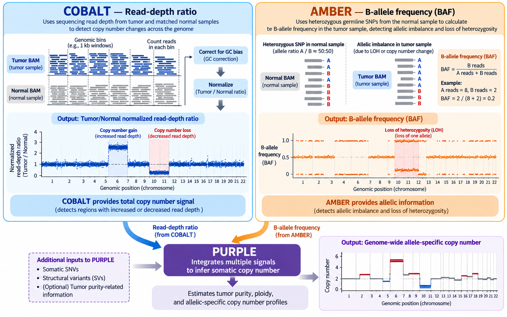
```

We ran the jobs on the Alliance cluster **Rorqual**. AMBER and COBALT require WGS BAM files and are computationally resource-intensive, so they cannot be run on our current cloud instance. However, we can review the code to understand how these tools work, including their inputs and outputs. We can then run PURPLE on the current instance using the results generated by AMBER and COBALT.

#### 1. COBALT: read-depth ratios

```{bash, eval=FALSE}
# parameter
HMF=/cvmfs/ref.mugqic/genomes/hmftools/hmf_pipeline_resources.38_v5.31
COBALT_JAR='#path to cobalt tool'
JAVA_MEM=48G
THREADS=8
GC=$HMF/copy_number/GC_profile.1000bp.38.cnp             # COBALT + PURPLE
NORMAL_ID=SPP_GT_0-1_1
TUMOR_ID=SPP_GT_1-0_1

# Run
java -Xmx${JAVA_MEM} -jar $COBALT_JAR \
  -reference     $NORMAL_ID \
  -reference_bam data/NCBI_SEQCII_SPP/${NORMAL_ID}.bwa.dedup.bam \
  -tumor         $TUMOR_ID \
  -tumor_bam     data/NCBI_SEQCII_SPP/${TUMOR_ID}.bwa.dedup.bam \
  -gc_profile    $GC \
  -threads       $THREADS \
  -output_dir    results/cobalt/$TUMOR_ID
```

| Parameter | Meaning |
|-------------------------|-----------------------------------------------|
| `-reference`, `-reference_bam` | Normal sample ID and BAM. The normal is used for its own depth profile, to detect germline copy-number changes and the sex of the individual. |
| `-tumor`, `-tumor_bam` | Tumor sample ID and BAM |
| `-gc_profile` | 1 kb GC/mappability profile. COBALT counts reads in each 1 kb window and divides by the median depth of windows with the same GC content, so GC bias is removed. |
| `-threads`, `-output_dir` | As for AMBER |

Optional: `-pcf_gamma` (segmentation penalty; higher gives fewer, longer segments), `-tumor_only_diploid_bed` (tumor-only mode: regions assumed diploid instead of a normal).

**Outputs** (`Mathieu_purple/cobalt/<tumor>/`):

| File | Content |
|-------------------------|-----------------------------------------------|
| `<tumor>.cobalt.ratio.tsv.gz` | One row per 1 kb window: read depths, `tumorGCRatio`, `referenceGCRatio`, `referenceGCDiploidRatio`. **-1** = window not usable (low mappability, extreme GC). |
| `<tumor>.cobalt.ratio.pcf` | Segments of the tumor ratio; the `mean` column is **log2** |
| `<normal>.cobalt.ratio.pcf` | Segments of the normal ratio |
| `<normal>.cobalt.ratio.median.tsv` | Median normal ratio per chromosome. \~1.0 = two copies; \~0.5 = one copy. |
| `<sample>.cobalt.gc.median.tsv` | Median depth per GC bucket (the GC correction curve) |

#### 2. AMBER: B-allele frequencies

```{bash, eval=FALSE}
# Parameters
HMF=/cvmfs/ref.mugqic/genomes/hmftools/hmf_pipeline_resources.38_v5.31
AMBER_JAR='#path to amber tool'
HET_LOCI=$HMF/copy_number/GermlineHetPon.38.vcf.gz       # AMBER
GENOME_VERSION=38
THREADS=8
JAVA_MEM=48G

NORMAL_ID=SPP_GT_0-1_1
TUMOR_ID=SPP_GT_1-0_1

# Run
java -Xmx${JAVA_MEM} -jar $AMBER_JAR \
  -reference          $NORMAL_ID \
  -reference_bam      data/NCBI_SEQCII_SPP/${NORMAL_ID}.bwa.dedup.bam \
  -tumor              $TUMOR_ID \
  -tumor_bam          data/NCBI_SEQCII_SPP/${TUMOR_ID}.bwa.dedup.bam \
  -loci               $HET_LOCI \
  -ref_genome_version $GENOME_VERSION \
  -threads            $THREADS \
  -output_dir         results/amber/$TUMOR_ID
```

| Parameter | Meaning |
|-------------------------|-----------------------------------------------|
| `-reference` | Sample ID of the **normal**. hmftools call the matched normal the "reference". |
| `-reference_bam` | BAM of the normal; used to find the SNPs that are heterozygous in this individual |
| `-tumor` | Sample ID of the tumor; used to name the output files |
| `-tumor_bam` | BAM of the tumor; BAF is measured at the normal's het sites |
| `-loci` | Candidate SNP sites to check (`GermlineHetPon`) |
| `-ref_genome_version` | `37` or `38`; selects chromosome naming and built-in resources |
| `-threads` | Number of threads |
| `-output_dir` | Output folder (one per tumor) |

Useful optional parameters, kept at their defaults here: `-min_mapping_quality`, `-min_base_quality` and `-tumor_min_depth` (read filters); `-tumor_only` (no normal available).

**Outputs** (`Mathieu_purple/amber/<tumor>/`):

| File | Content |
|-------------------------|-----------------------------------------------|
| `<tumor>.amber.baf.tsv.gz` | One row per het site: `tumorBAF`, `tumorModifiedBAF`, `tumorDepth`, `normalBAF`, `normalDepth` |
| `<tumor>.amber.baf.pcf` | Segments of the tumor BAF (piecewise-constant fit) |
| `<tumor>.amber.qc` | QC: contamination, consanguinity, uniparental disomy |
| `<tumor>.amber.contamination.tsv` | Evidence for contamination (alt reads at sites homozygous in the normal) |
| `<normal>.amber.homozygousregion.tsv` | Long runs of homozygosity in the normal |

#### 3. PURPLE: purity, ploidy and copy number

```{bash, eval=FALSE}
# parameters
PURPLE_JAR=~/CourseData/Module5/tools/purple_v4.0.1.jar
GENOME_VERSION=38
THREADS=3
JAVA_MEM=10G

cd ~/CourseData/Module5
GC=reference/GC_profile.1000bp.38.cnp
ENSEMBL=reference/ensembl_data
REF_GENOME=reference/Homo_sapiens.GRCh38.fa

# Tumors samples:
# SPP_GT_1-19_1; SPP_GT_1-9_1;SPP_GT_1-4_1; SPP_GT_1-1_1;SPP_GT_3-1_1; SPP_GT_1-0_1
NORMAL_ID=SPP_GT_0-1_1
TUMOR_ID=SPP_GT_1-0_1


# run
java -Xmx${JAVA_MEM} -jar $PURPLE_JAR \
  -tumor              $TUMOR_ID \
   -gc_profile        $GC \
  -amber              Mathieu_purple/amber/$TUMOR_ID \
  -cobalt             Mathieu_purple/cobalt/$TUMOR_ID \
  -ensembl_data_dir   $ENSEMBL \
  -ref_genome         $REF_GENOME \
  -ref_genome_version $GENOME_VERSION \
  -threads            $THREADS \
  -output_dir         Mathieu_purple/purple_test/$TUMOR_ID
```

| Parameter | Meaning |
|-------------------------|-----------------------------------------------|
| `-tumor` | Tumor sample ID; must match the AMBER/COBALT file names |
| `-amber` | Folder with the AMBER output for this tumor |
| `-cobalt` | Folder with the COBALT output for this tumor |
| `-gc_profile` | Same GC profile as COBALT |
| `-ensembl_data_dir` | Gene annotation, for the gene-level copy-number table |
| `-ref_genome`, `-ref_genome_version` | Reference FASTA and its version (38) |
| `-min_purity` / `-max_purity` | Range of purities PURPLE searches. The default minimum (0.08) would exclude our 5% sample, so it is lowered to 0.03. |
| `-threads`, `-output_dir` | As above |

Other important parameters, not used in this run:

| Parameter | Meaning |
|-------------------------|-----------------------------------------------|
| `-reference <normal ID>` | Name of the matched normal. **Without it PURPLE runs in tumor-only mode** (`runMode = TUMOR` in `purity.tsv`; the log shows `reference(NONE)`). For a paired analysis add `-reference $NORMAL_ID`. |
| `-somatic_vcf` | Somatic SNVs/indels, e.g. the Strelka2 or ensemble VCF from GenPipes. Their allele frequencies give a third, independent purity estimate, which helps most at low purity. |
| `-structural_vcf` | Structural variants (e.g. Manta/GRIDSS); breakpoints sharpen segment boundaries. |
| `-driver_gene_panel`, `-somatic_hotspots`, `-germline_hotspots` | Turn on the driver catalog. All three must be given together; PURPLE stops with *"somatic_hotspots is a mandatory argument when running drivers"* otherwise. |
| `-min_ploidy` / `-max_ploidy` | Range of ploidies to search (defaults 1 - 8) |

**Outputs** (`Mathieu_purple/purple/`):

| File | Content |
|-------------------------|-----------------------------------------------|
| `<tumor>.purple.purity.tsv` | Best fit: `purity`, `ploidy`, `gender`, `wholeGenomeDuplication`, `status`, plus the min/max of each estimate |
| `<tumor>.purple.purity.range.tsv` | Score of every purity/ploidy combination tested (shows how confident the fit is) |
| `<tumor>.purple.cnv.somatic.tsv` | Final copy-number segments: `copyNumber`, `minorAlleleCopyNumber`, `majorAlleleCopyNumber`, `bafCount`, `depthWindowCount` |
| `<tumor>.purple.cnv.gene.tsv` | Min/max copy number per gene, and the region with the lowest CN (`minRegionStart/End`) |
| `<tumor>.purple.segment.tsv` | Segments before smoothing, with the observed BAF / ratio and the fitted values |
| `<tumor>.purple.qc` | QC summary: status, contamination, gender from AMBER and COBALT, number of deleted genes |
| `plot/` | Genome-wide plots: `copynumber.png`, `segment.png`, `purity.range.png`, ... |

#### First look at the results: estimated vs. "true" purity

```{r, eval=FALSE}
library(tidyverse)

# function to convert tumor DNA fraction to purity
tdf_to_purity <- function(tdf, ploidy = 2) {
  2 * tdf / (ploidy * (1 - tdf) + 2 * tdf)
}

true_fraction <- tibble(
  sample      = c("SPP_GT_1-19_1", "SPP_GT_1-9_1", "SPP_GT_1-4_1",
                  "SPP_GT_1-1_1",  "SPP_GT_3-1_1", "SPP_GT_1-0_1"),
  true_fraction = c(0.05, 0.10, 0.20, 0.50, 0.75, 1.00))

purple_fit <- list.files("Mathieu_purple/purple", pattern = "purple.purity.tsv$",
                         full.names = TRUE) %>%
  set_names(~ basename(.x) %>% str_remove(".purple.purity.tsv")) %>%
  map_dfr(read_tsv, .id = "sample", show_col_types = FALSE) %>%
  select(sample, purity, minPurity, maxPurity, ploidy, gender, runMode) %>% 
  left_join(., true_fraction, by = 'sample') %>% 
  mutate(., estimated_purity_from_fraction = tdf_to_purity(true_fraction, ploidy = ploidy) )


p <- ggplot(purple_fit, aes(estimated_purity_from_fraction, purity)) +
  geom_abline(linetype = "dashed", colour = "grey50") +
  # geom_errorbar(aes(ymin = minPurity, ymax = maxPurity), width = 0.02) +
  geom_point(size = 3, colour = "red3") +
  coord_equal(xlim = c(0, 1), ylim = c(0, 1)) +
  labs(x = "Estimated purity based on tumor DNA Fraction", y = "PURPLE purity",
       title = "PURPLE purity estimates on the SEQC-II dilution series") +
  theme_bw(base_size = 13)
```

```{r, echo=FALSE, out.width='70%', fig.align='center'}
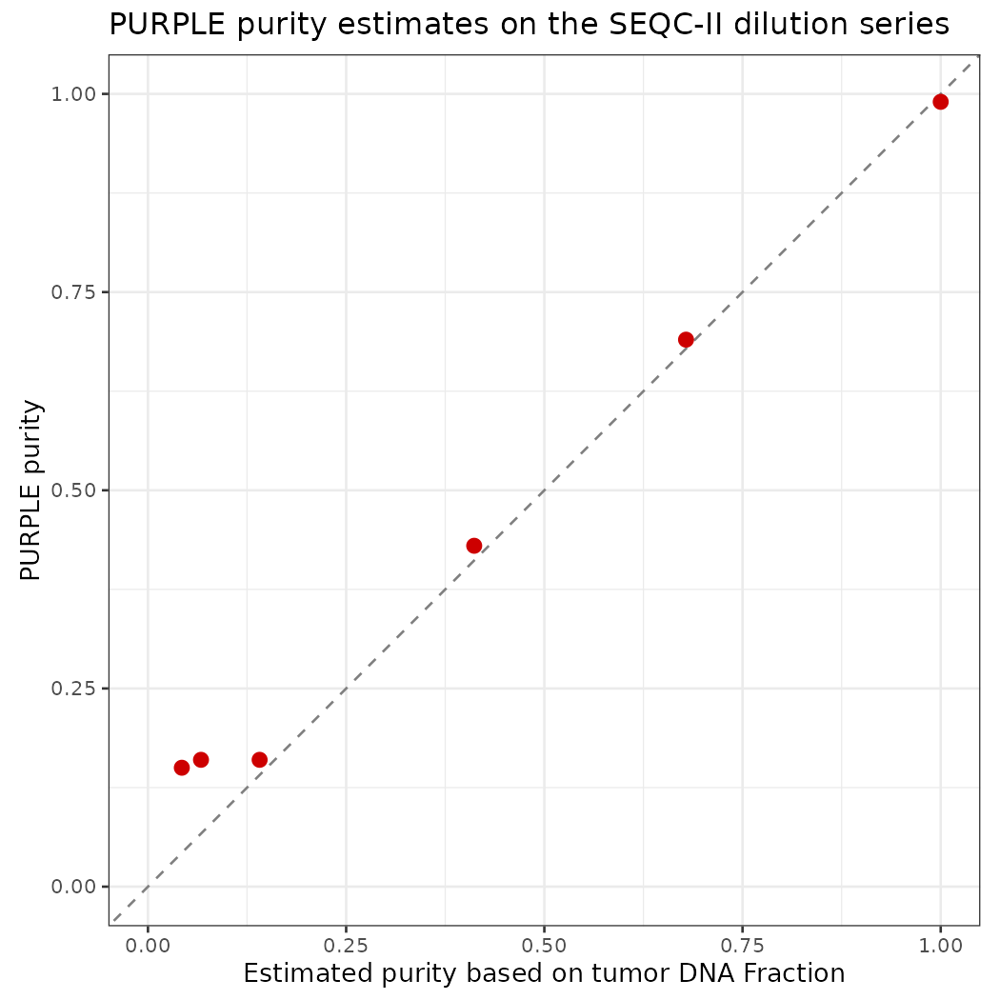
```

***Summary***

| Sample (BAM prefix) | Role | Tumor : Normal DNA | True Tumor DNA fraction | "True" Purity (estimated based on tDNA fraction) | Purity (estimated by PURPLE) |
|------------|------------|------------|------------|------------|------------|
| SPP_GT_0-1_1 | Normal | 0 : 1 | 0.00 | 0.00 | 0.00 |
| SPP_GT_1-19_1 | Tumor | 1 : 19 | 0.05 | 0.04 | 0.15 |
| SPP_GT_1-9_1 | Tumor | 1 : 9 | 0.10 | 0.07 | 0.16 |
| SPP_GT_1-4_1 | Tumor | 1 : 4 | 0.20 | 0.14 | 0.16 |
| SPP_GT_1-1_1 | Tumor | 1 : 1 | 0.50 | 0.41 | 0.43 |
| SPP_GT_3-1_1 | Tumor | 3 : 1 | 0.75 | 0.68 | 0.69 |
| SPP_GT_1-0_1 | Tumor | 1 : 0 | 1.00 | 1.00 | 0.99 |

Questions for discussion:

1.  Down to which true purity does PURPLE estimate purity correctly? What happens below that, and why do the BAF and depth signals become hard to separate from noise?

2.  The 100% tumor has `QCStatus FAIL_CONTAMINATION` (AMBER contamination 0.85). Is this real contamination, or a consequence of this tumor/normal pair?

### Run Genpipe

[GenPipes](https://genpipes.readthedocs.io) is the C3G workflow manager. It turns a readset file plus configuration (`.ini`) files into a bash script that submits one Slurm job per task, with the correct dependencies between jobs.

In GenPipes 6 the old `tumor_pair` pipeline is part of **`dnaseq`**, selected with `-t somatic_ensemble`. The *ensemble* protocol calls somatic SNVs/indels with several callers (MuTect2, Strelka2, VarDict, VarScan2) and keeps a consensus. It also runs Manta (SVs), Sequenza, PURPLE and CNVkit (copy number), and annotates with PCGR/CPSR.

#### 1. Load the environment

```{bash, eval=FALSE}
# GenPipes and all its tools are distributed on CVMFS by C3G
export MUGQIC_INSTALL_HOME=/cvmfs/soft.mugqic/root   # root of the C3G software/genome stack
module use $MUGQIC_INSTALL_HOME/modulefiles         # make the mugqic/* modules visible
module load mugqic/genpipes/6.2.0

export RAP_ID='#put the slurm account' # Slurm account; the rorqual.ini passes it as "-A $RAP_ID"
export JOB_MAIL="you@example.com" # e-mail for job END/FAIL notifications
```

> `module load` only works in a **login shell**. In scripts use `#!/bin/bash -l`.

#### 2. Input files

##### Readset file (`readsets.tsv`, tab-separated)

One line per sequencing readset. GenPipes groups readsets by `Sample`.

| Column | Meaning |
|-------------------------|-----------------------------------------------|
| `Sample` | Sample name; it must match the names used in the pairs file |
| `Readset` | Unique readset ID (sample + library/lane) |
| `Library` | Library ID; only used for read-group tags during alignment |
| `RunType` | `PAIRED_END` or `SINGLE_END` |
| `Run`, `Lane` | Sequencing run and lane; only used for read groups |
| `Adapter1/2` | Adapter sequences for trimming (empty: not trimming) |
| `QualityOffset` | Base-quality encoding; 33 for all modern Illumina data |
| `BED` | Capture regions for exome/panel data; empty for WGS |
| `FASTQ1/2` | Raw reads; empty here because we start from BAMs |
| `BAM` | Input BAM; GenPipes would convert it back to FASTQ in step 1 |

```{bash, eval=FALSE}
cat codes/genpipes_somatic_ensemble/readsets.tsv | column -t -s $'\t'
# Sample         Readset             Library        RunType     Run  Lane  ...  QualityOffset  ...  BAM
# SPP_GT_0-1_1   SPP_GT_0-1_1.L001   SPP_GT_0-1_1   PAIRED_END  1    1    ...  33             ...  .../SPP_GT_0-1_1.bwa.dedup.bam
# ...
```

##### Pairs file (`pairs.csv`, comma-separated, no header)

`<pair name>,<normal sample>,<tumor sample>`. Every tumor is paired with the same normal.

```{bash, eval=FALSE}
cat codes/genpipes_somatic_ensemble/pairs.csv
# pair_1-19_1,SPP_GT_0-1_1,SPP_GT_1-19_1
# pair_1-9_1,SPP_GT_0-1_1,SPP_GT_1-9_1
# pair_1-4_1,SPP_GT_0-1_1,SPP_GT_1-4_1
# pair_1-1_1,SPP_GT_0-1_1,SPP_GT_1-1_1
# pair_3-1_1,SPP_GT_0-1_1,SPP_GT_3-1_1
# pair_1-0_1,SPP_GT_0-1_1,SPP_GT_1-0_1
```

#### 3. Re-using existing BAMs: make them match the GenPipes reference

Steps 1-4 of the protocol (BAM → FASTQ, trimming, BWA-MEM2 alignment, duplicate marking) are already done for our BAMs, so we start at step 5. GenPipes then expects each sample's BAM at `alignment/<sample>/<sample>.sorted.dup.bam`.

There is one catch. Our BAMs were aligned to GRCh38.d1.vd1 (2,779 contigs), but GenPipes uses `Homo_sapiens.GRCh38` (195 contigs). The first 195 contigs are identical in name, length and order; the remaining 2,584 are HLA, decoy and viral sequences. Strelka2 and Manta stop with *"Reference genome mismatch: Reference fasta file is missing a chromosome found in the BAM"*. **GATK ReorderSam** rewrites each BAM against the GenPipes sequence dictionary:

```{bash, eval=FALSE}
gatk --java-options "-Xmx20G" ReorderSam \
  -I  data/NCBI_SEQCII_SPP/SPP_GT_0-1_1.bwa.dedup.bam \
  -O  results/genpipes_somatic_ensemble/alignment/SPP_GT_0-1_1/SPP_GT_0-1_1.sorted.dup.bam \
  -SD /cvmfs/ref.mugqic/genomes/species/Homo_sapiens.GRCh38/genome/Homo_sapiens.GRCh38.dict \
  --ALLOW_INCOMPLETE_DICT_CONCORDANCE true \
  --CREATE_INDEX true \
  --VALIDATION_STRINGENCY SILENT \
  --TMP_DIR /lustre10/scratch/rongma/CBW/tmp
```

| Parameter | Meaning |
|-------------------------|-----------------------------------------------|
| `-I` / `-O` | Input BAM / output BAM, written where GenPipes expects the duplicate-marked BAM |
| `-SD` | Sequence dictionary (`.dict`) of the target reference; defines the new header |
| `--ALLOW_INCOMPLETE_DICT_CONCORDANCE true` | Accept a BAM with *more* contigs than the reference. Reads on the extra contigs become unmapped (about 1% of reads). |
| `--CREATE_INDEX true` | Write the `.bai` index next to the BAM |
| `--VALIDATION_STRINGENCY SILENT` | Do not stop on minor SAM-format warnings |
| `--TMP_DIR` | Directory for temporary sort files; use a large file system, because node-local `$SLURM_TMPDIR` can fill up with \~180 GB BAMs |

The full Slurm array script (7 samples, \~3-5 h each) is `codes/genpipes_somatic_ensemble/01_reorder_bams.sbatch`.

#### 4. Configuration files

GenPipes reads a stack of `.ini` files; a parameter in a later file overrides the same parameter in an earlier file.

```{bash, eval=FALSE}
INIS="$GENPIPES_INIS/dnaseq/dnaseq.base.ini \
      $GENPIPES_INIS/dnaseq/dnaseq.cancer.ini \
      $GENPIPES_INIS/common_ini/rorqual.ini \
      codes/genpipes_somatic_ensemble/custom.ini"
```

| File | Role |
|-------------------------|-----------------------------------------------|
| `dnaseq.base.ini` | Default tools, module versions and genome (GRCh38) for the DNA-seq pipeline |
| `dnaseq.cancer.ini` | Settings for the somatic protocols: caller parameters, HMF resources for PURPLE, PCGR, etc. |
| `rorqual.ini` | Cluster-specific settings: Slurm flags, CPUs/memory per node, account (`-A $RAP_ID`) |
| `custom.ini` | Our overrides: account and longer walltimes for AMBER/COBALT/PURPLE/Picard on deep WGS |

Example override in `custom.ini`:

``` ini
[amber]
cluster_walltime=12:00:0
```

#### 5. Generate the job script

```{bash, eval=FALSE}
genpipes dnaseq \
  -t somatic_ensemble \
  -c $INIS \
  -r codes/genpipes_somatic_ensemble/readsets.tsv \
  -p codes/genpipes_somatic_ensemble/pairs.csv \
  -o results/genpipes_somatic_ensemble \
  -s 5-33,35-37,39 \
  -j slurm \
  -g results/genpipes_somatic_ensemble/genpipes_somatic_ensemble_cmd.sh
```

| Parameter | Meaning |
|-------------------------|-----------------------------------------------|
| `dnaseq` | Pipeline to run |
| `-t somatic_ensemble` | Protocol: tumor/normal pairs, ensemble of somatic callers |
| `-c` | List of `.ini` files (order matters, later overrides earlier) |
| `-r` | Readset file |
| `-p` | Tumor/normal pairs file (required for the somatic protocols) |
| `-o` | Output directory; all results and job logs go here |
| `-s 5-33,35-37,39` | Steps to run. **1-4** skipped: BAMs are already aligned and duplicate-marked. **34** (`sym_link_fastq_pair`) skipped: needs raw FASTQs. **38** (`cram_output`) skipped: it only makes a CRAM copy of the BAMs. |
| `-j slurm` | Job scheduler (`slurm`, `pbs`, or `batch` to run locally) |
| `-g` | File in which to write the generated bash script; nothing is submitted yet |
| `--sanity-check` | (optional) Only check that every input file exists, then exit. Run this first! |

List all steps of the protocol with `genpipes dnaseq --help`. Key steps of `somatic_ensemble`:

| Step | Name | What it does |
|-------------------|-------------------|----------------------------------|
| 5 | `set_interval_list` | Splits the genome at N-gaps to parallelise calling |
| 6 | `conpair_concordance_contamination` | Checks the tumor and normal come from the same person and estimates contamination |
| 7-8 | `metrics_dna_*` | Picard and mosdepth alignment / coverage metrics |
| 9 | `sequenza` | Purity, ploidy and allele-specific copy number (Sequenza) |
| 10 | `manta_sv_calls` | Structural variants |
| 11-13 | `strelka2_paired_*` | Somatic and germline small variants (Strelka2) |
| 14 | `purple` | AMBER + COBALT + PURPLE (section above) |
| 15-17 | `rawmpileup`, `paired_varscan2` | Somatic calls with VarScan2 |
| 18-19 | `paired_mutect2`, `merge_mutect2` | Somatic calls with GATK MuTect2 |
| 20-21 | `vardict_paired` | Somatic calls with VarDict |
| 22 | `ensemble_somatic` | Consensus of the somatic callers (bcbio ensemble) |
| 28 | `cnvkit_batch` | Copy number with CNVkit |
| 30, 32 | `report_cpsr`, `report_pcgr` | Germline (CPSR) and somatic (PCGR) clinical reports |
| 33 | `run_multiqc` | One QC report for all samples |

#### 6. Submit

Running `bash genpipes_somatic_ensemble_cmd.sh` would submit all **1,231 jobs** at once. Rorqual allows at most **1,000 queued jobs per user**, so plain submission fails part-way. GenPipes includes a tool that cuts the script into chunks and keeps the queue below a limit:

```{bash, eval=FALSE}
genpipes tools chunk_and_submit_genpipes \
  results/genpipes_somatic_ensemble/genpipes_somatic_ensemble_cmd.sh \
  results/genpipes_somatic_ensemble/chunks \
  -n 20 -q 900 -s 300 -S slurm
```

| Parameter | Meaning |
|-------------------------|-----------------------------------------------|
| 1st argument | The script generated in step 5 |
| 2nd argument | Folder where the chunks and their submission status are stored |
| `-n 20` | Jobs per chunk |
| `-q 900` | Maximum number of our jobs in the queue (stay below the 1,000 limit) |
| `-s 300` | Seconds to wait before checking the queue again when it is full |
| `-S slurm` | Scheduler |

The tool must keep running until every chunk is submitted, so start it with `nohup` (or in `tmux`). If it is interrupted, run `genpipes tools submit_genpipes <chunk folder>` to resume; chunks already submitted (`chunk_N.done`) are skipped.

#### 7. Monitor and find the results

```{bash, eval=FALSE}
squeue -u $USER | wc -l                                    # jobs still queued or running
ls results/genpipes_somatic_ensemble/job_output/           # one log per job, grouped by step
ls results/genpipes_somatic_ensemble/pairedVariants/       # per-pair variant calls
ls results/genpipes_somatic_ensemble/pairedVariants/ensemble/   # consensus somatic / germline VCFs
```

GenPipes writes a `.done` file for each finished job. If you run the same command again, it only regenerates the jobs whose outputs are missing or out of date, so a failed run can be restarted.

------------------------------------------------------------------------

### Analyze the purple results

- Check the quality of each PURPLE run and compare the estimated purity with the truth.

- Understand how PURPLE chooses purity and ploidy.

- Read the raw signals (read depth and B-allele frequency) and the fitted copy number.

- Find genes that are gained, lost, deleted or show loss of heterozygosity (LOH).

- Plot any gene or chromosome with all the evidence in one figure.

#### Key concepts (read this first)

| Term | Meaning |
|-------------------------|-----------------------------------------------|
| **Copy number (CN)** | How many copies of a DNA segment a cell has. Normal human cells have 2 (one from each parent). |
| **Purity** | Fraction of cells in the sample that are tumor cells. The rest are normal cells with CN = 2. |
| **Ploidy** | Average copy number across the tumor genome. HCC1395 is about 2.8, i.e. near-triploid. |
| **Major / minor allele CN** | The two parental copies are counted separately. A segment with CN 3 can be 2+1 (major 2, minor 1) or 3+0 (major 3, minor 0). |
| **BAF (B-allele frequency)** | At a heterozygous SNP (A/B), the fraction of reads that carry the B allele. It is 0.5 in a normal cell. |
| **LOH (loss of heterozygosity)** | One parental allele is lost (minor CN = 0). The BAF then moves to 0 or 1. If the remaining allele is duplicated, CN stays 2: **copy-neutral LOH (cnLOH)**. |
| **Depth ratio** | Tumor read depth divided by normal read depth in a window. It goes up with gains and down with losses. |

PURPLE combines two independent signals:

- **COBALT** measures the **depth ratio** in 1 kb windows → tells us the *total* copy number.
- **AMBER** measures the **BAF** at germline heterozygous SNPs → tells us how the copies are split between the two alleles.

Both signals are **diluted by normal cells**. With purity *p*, a segment with tumor copy number *CN* and minor-allele copy number *m* is expected to show:

$$\text{depth ratio} =\frac{p \cdot CN + (1-p)\cdot 2}{p \cdot \text{ploidy} + (1-p)\cdot 2}\qquad\text{BAF} =\frac{p \cdot m + (1-p)\cdot 1}{p \cdot CN + (1-p)\cdot 2}$$

PURPLE searches for the purity and ploidy that make these predictions match the observed data best, across the whole genome.

Let's see what these formulas mean in practice. The table shows the expected signal of four common events at different purities (tumor ploidy fixed at 2.8):

```{r, eval=FALSE}
library(tidyverse)

expected_signal <- function(purity, cn, minor, ploidy = 2.8) {
  tibble(
    depth_ratio = (purity * cn + (1 - purity) * 2) / (purity * ploidy + (1 - purity) * 2),
    BAF         = (purity * minor + (1 - purity) * 1) / (purity * cn + (1 - purity) * 2)
  )
}

events <- tribble(
  ~event,                  ~cn, ~minor,
  "Normal (1+1)",           2,   1,
  "Deep deletion (0+0)",    0,   0,
  "Copy-neutral LOH (2+0)", 2,   0,
  "Gain (3+1)",             4,   1
)

crossing(events, purity = c(1, 0.5, 0.2, 0.05)) %>%
  mutate(expected_signal(purity, cn, minor)) %>%
  mutate(across(c(depth_ratio, BAF), ~ round(.x, 2))) %>%
  arrange(event, desc(purity))
```

**What to notice**

- At purity 1, a deep deletion has depth ratio 0, and cnLOH has BAF 0 (or 1): very clear signals.
- At purity 0.05, every event gives a depth ratio close to the genome average and a BAF close to 0.5. The tumor signal is tiny compared with the noise, so low-purity samples are hard to fit.
- The BAF of a deleted region is undefined at purity 1 (no reads at all). In a mixed sample the remaining reads come only from normal cells, so the BAF goes back to 0.5.

#### Setup

```{r, eval=FALSE}
# Packages used in this lab
library(tidyverse)   # data manipulation (dplyr, tidyr, readr) and plotting (ggplot2)
library(patchwork)   # stack several ggplots into one figure (p1 / p2)
library(stringr)     # string helpers
library(data.table)
# Helper functions written for this lab (see codes/purple_lab_functions.R):
#   purity_info          named vector: sample -> true purity
#   sort_by_purity()     order file names by the true purity of the sample
#   load_purple_sample() read all AMBER / COBALT / PURPLE files of one sample
#   plot_gene()          multi-track figure of one gene
#   plot_chromosome()    multi-track figure of one chromosome
#   plot_cn_region()     multi-track figure of any chr:start-end
#   classify_gene_cn()   label genes as gain / loss / deep deletion / LOH ...
#   save_cn_plot()       save a figure as PDF + PNG
source("codes/purple_lab_functions.R")

if (!requireNamespace("R.utils", quietly = TRUE)) {
  install.packages("R.utils")
}

library(R.utils)

purple_dir <- "./Mathieu_purple/purple/" # purity_info
```

#### A tour of the output files (one sample)

Before analysing the results, let's look at **every file** that AMBER, COBALT and PURPLE wrote for one sample, what each file is for, and what is inside. We use the 100% tumor `SPP_GT_1-0_1`; every other sample has the same files.

##### How the files fit together

```         
 tumor BAM + normal BAM
        │
        ├── AMBER  ──► amber.baf.tsv.gz   (BAF at every het SNP)
        │                 └─► amber.baf.pcf      (BAF segments)
        │
        ├── COBALT ──► cobalt.ratio.tsv.gz (depth ratio in 1 kb windows)
        │                 └─► cobalt.ratio.pcf   (depth segments)
        │
        └────────────► PURPLE
                          ├─► purple.purity.range.tsv  (score of every purity/ploidy tried)
                          │      └─► purple.purity.tsv (the best fit)
                          ├─► purple.segment.tsv       (all segments, observed + fitted values)
                          │      └─► purple.cnv.somatic.tsv (final copy-number segments)
                          │             └─► purple.cnv.gene.tsv (copy number per gene)
                          └─► purple.qc, plot/*.png
```

AMBER and COBALT turn the BAMs into two signals; PURPLE combines them, fits purity and ploidy, and turns the signals into copy numbers for segments and genes.

```{r, eval=FALSE}
tour_sample <- "SPP_GT_1-0_1"
tour_dirs <- c(AMBER  = file.path("./Mathieu_purple/amber",  tour_sample),
               COBALT = file.path("./Mathieu_purple/cobalt", tour_sample),
               PURPLE = "./Mathieu_purple/purple")

# List every file with its size. The purple/ folder holds all samples, so keep this sample only.
tour_files <- lapply(names(tour_dirs), function(tool) {
  f <- list.files(tour_dirs[[tool]], full.names = TRUE, recursive = TRUE)
  if (tool == "PURPLE") f <- f[grepl(tour_sample, basename(f)) | basename(f) == "purple.version"]
  tibble(tool, file = str_remove(f, paste0(tour_dirs[[tool]], "/")), size_MB = round(file.size(f) / 1e6, 2))
}) %>% bind_rows()

print(tour_files, n = Inf)
```

Two small helpers to look inside the files:

```{r, eval=FALSE}
# peek(): print the first lines of a file exactly as they are on disk (works for .gz too)
peek <- function(path, n = 4, width = 150) {
  con <- if (grepl("\\.gz$", path)) gzfile(path) else file(path)
  on.exit(close(con))
  lines <- readLines(con, n = n)
  cat(str_trunc(lines, width), sep = "\n")
}

# columns(): list the columns of a table with their type and first values
columns <- function(path, n = 3) {
  read_tsv(path, n_max = n, show_col_types = FALSE) %>% glimpse()
}

amber_dir  <- tour_dirs[["AMBER"]]
cobalt_dir <- tour_dirs[["COBALT"]]
purple_f   <- function(suffix) file.path(purple_dir, paste0(tour_sample, suffix))
```

#### AMBER: B-allele frequency

| File | What it is | When to use it |
|------------------|--------------------------------|----------------------|
| `<tumor>.amber.baf.tsv.gz` | **Main output.** One row per SNP that is heterozygous in the normal (\~1.7 million rows) | Plot BAF along the genome; check allelic imbalance / LOH in a region |
| `<tumor>.amber.baf.pcf` | Segments of the tumor BAF (piecewise-constant fit) | Input for PURPLE; quick view of where the BAF changes |
| `<tumor>.amber.qc` | QC summary: contamination, consanguinity, uniparental disomy | First thing to check |
| `<tumor>.amber.contamination.tsv` (+ `.vcf.gz`) | SNPs that are **homozygous** in the normal; any other allele in the tumor suggests DNA from another person | Investigate a contamination warning |
| `<normal>.amber.homozygousregion.tsv` | Long runs of homozygosity in the **normal** | Detect consanguinity or uniparental disomy in the patient |
| `amber.version` | AMBER version and build date | Reproducibility |

```{r, eval=FALSE}
# **`amber.baf.tsv.gz`**
cat('amber.baf.tsv.gz\n')
peek(file.path(amber_dir, paste0(tour_sample, ".amber.baf.tsv.gz")))
cat('\n\n')

# **`amber.baf.pcf`**: the `mean` column is the average **tumorModifiedBAF** of the segment; `n.probes` is the number of SNPs in it.
cat('amber.baf.pcf\n')
peek(file.path(amber_dir, paste0(tour_sample, ".amber.baf.pcf")))
# cat('\n\n')


# # **`amber.qc`**: key-value pairs.
# cat('amber.qc\n')
# peek(file.path(amber_dir, paste0(tour_sample, ".amber.qc")), n = 15)
# cat('\n\n')

# # **`amber.contamination.tsv`**: sites homozygous in the normal (`normalAltSupport` = 0). If many sites have alt reads in the tumor (`tumorAltSupport` \> 0), the tumor may contain DNA from someone else.
# cat('amber.contamination.tsv\n')
# peek(file.path(amber_dir, paste0(tour_sample, ".amber.contamination.tsv")))
# cat('\n\n')
# 
# 
# # **`<normal>.amber.homozygousregion.tsv`**: regions where the normal has (almost) only homozygous SNPs (`homCount` vs `hetCount`). Long regions on many chromosomes suggest consanguinity. Note that this file writes chromosomes without the `chr` prefix.
# cat('amber.homozygousregion.tsv\n')
# peek(file.path(amber_dir, "SPP_GT_0-1_1.amber.homozygousregion.tsv"))
# cat('\n\n')
```

| Column | Meaning |
|-------------------------|-----------------------------------------------|
| `chromosome`, `position` | SNP location (1-based) |
| `tumorBAF` | Fraction of tumor reads with the B allele: 0.5 balanced, 0 or 1 = LOH |
| `tumorModifiedBAF` | BAF folded to the upper half: 0.5 + \|BAF − 0.5\|. Easier to segment because the two bands become one. |
| `tumorDepth` | Tumor reads covering the SNP |
| `normalBAF`, `normalModifiedBAF`, `normalDepth` | Same for the normal; normalBAF should be close to 0.5 |

#### COBALT: read-depth ratio

| File | What it is | When to use it |
|------------------|-------------------------------|-----------------------|
| `<tumor>.cobalt.ratio.tsv.gz` | **Main output.** One row per 1 kb window (\~3 million rows), tumor and normal depth and GC-corrected ratios | Plot depth along the genome; look for gains / losses |
| `<tumor>.cobalt.ratio.pcf` | Segments of the tumor ratio | Input for PURPLE; quick view of copy-number steps |
| `<normal>.cobalt.ratio.pcf` | Segments of the normal ratio | Spot germline copy-number changes |
| `<normal>.cobalt.ratio.median.tsv` | Median normal ratio per chromosome | Sex of the patient (chrX \~0.5 = one X) and whole-chromosome germline changes |
| `<sample>.cobalt.gc.median.tsv` | Mean/median depth, and median depth per GC bucket | See how strongly depth depends on GC (the GC-correction curve) |
| `cobalt.version` | COBALT version | Reproducibility |

**`cobalt.ratio.tsv.gz`**

```{r, eval=FALSE}
# The first windows of chr1 are telomere sequence (N), so their values are -1
# peek(file.path(cobalt_dir, paste0(tour_sample, ".cobalt.ratio.tsv.gz")))
read_tsv(file.path(cobalt_dir, paste0(tour_sample, ".cobalt.ratio.tsv.gz")),
         n_max = 5000, show_col_types = FALSE) %>% head(5)

# A few usable windows further along chr1
read_tsv(file.path(cobalt_dir, paste0(tour_sample, ".cobalt.ratio.tsv.gz")),
         n_max = 5000, show_col_types = FALSE) %>%
  filter(tumorGCRatio >= 0) %>%
  head(5)
```

| Column | Meaning |
|-------------------------|-----------------------------------------------|
| `chromosome`, `position` | Start of the 1 kb window (1, 1001, 2001, ...) |
| `referenceReadDepth`, `tumorReadDepth` | Raw read depth in the window |
| `referenceGCRatio`, `tumorGCRatio` | Depth divided by the median depth of windows with the same GC content: GC-corrected, genome average about 1. **This is the tumor depth ratio we plot.** |
| `referenceGCDiploidRatio` | Normal ratio, further normalised so a normal diploid region is 1 (accounts for the sex chromosomes) |
| `referenceGCContent`, `tumorGCContent` | GC content of the reads in the window |
| value **-1** | Window not used (N bases, low mappability, extreme GC) |

```{r, eval=FALSE}

# **`cobalt.ratio.pcf`**: same layout as the AMBER pcf. Here `mean` is a **log2** ratio: use `2^mean` to get back to the ratio scale.
peek(file.path(cobalt_dir, paste0(tour_sample, ".cobalt.ratio.pcf")))


# **`<normal>.cobalt.ratio.median.tsv`**: one line per chromosome. Look at chrX (\~0.5: only one X) and chr16 (\~0.57: part of chr16 is lost in the normal itself).
read_tsv(file.path(cobalt_dir, "SPP_GT_0-1_1.cobalt.ratio.median.tsv"), show_col_types = FALSE) %>%
  filter(chromosome %in% c("chr1", "chr6", "chr16", "chr19", "chrX", "chrY"))

```

**`cobalt.gc.median.tsv`**: two blocks. The first gives the sample's mean and median depth; the second the median depth for each GC percentage.\
**It is important to account for GC bias, as sequencing read counts can vary substantially across regions with different GC content.** Depth is not constant across GC content: in the normal it drops from about 116 (25% GC) to about 90 (60% GC), and both samples lose depth below \~25% GC. If this bias were not removed, GC-rich and GC-poor regions would look like losses or gains. COBALT divides each window's depth by the median of its GC bucket (this curve), so the `tumorGCRatio` / `referenceGCRatio` values are free of GC bias.

```{r, eval=FALSE}
# The file has 3 header lines (#sampleMean/sampleMedian, their values, #gcBucket/median);
# skip all 3 and force numeric columns, otherwise the "#gcBucket" line is read as data
# and both columns become text (ggplot then draws no line).
read_gc_median <- function(path) {
  read_tsv(path, skip = 3, col_names = c("gcBucket", "median"), col_types = "dd")
}
p <- bind_rows(
  tumor  = read_gc_median(file.path(cobalt_dir, paste0(tour_sample, ".cobalt.gc.median.tsv"))),
  normal = read_gc_median(file.path(cobalt_dir, "SPP_GT_0-1_1.cobalt.gc.median.tsv")),
  .id = "sample") %>%
  ggplot(aes(gcBucket, median, colour = sample)) + geom_line(linewidth = 1) +
  labs(x = "GC content of the 1 kb window (%)", y = "Median read depth") + theme_bw()
```

```{r, echo=FALSE, out.width='70%', fig.align='center'}
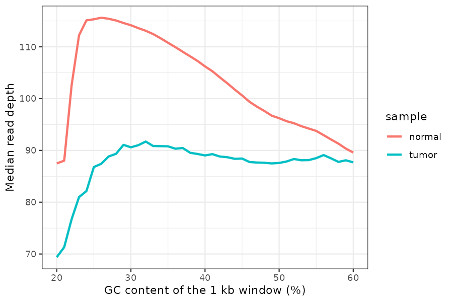
```

#### PURPLE: purity, ploidy and copy number

| File | What it is | When to use it |
|------------------|--------------------------------|----------------------|
| `<tumor>.purple.purity.tsv` | **The best fit**: purity, ploidy, sex, status, plus the uncertainty range | Report purity/ploidy |
| `<tumor>.purple.purity.range.tsv` | Score of every purity/ploidy combination tested (\~16,000 rows) | Check whether other solutions are almost as good |
| `<tumor>.purple.cnv.somatic.tsv` | **Final copy-number segments** (\~300 rows) | Copy number of any region; genome plots; input for downstream tools |
| `<tumor>.purple.cnv.gene.tsv` | **Copy number per gene** (\~37,000 genes) | Is my gene deleted / gained / LOH? |
| `<tumor>.purple.segment.tsv` | All segments before merging (\~9,500 rows), with observed and fitted values and the **germline status** | Debug a call: compare observed vs fitted ratio and BAF |
| `<tumor>.purple.qc` | QC summary | First thing to check |
| `<tumor>.purple.somatic.clonality.tsv` | Clonality peaks of somatic SNVs | **Empty here**: no somatic VCF (`-somatic_vcf`) was given |
| `plot/*.png` | PURPLE's own figures (purity.range, segment, copynumber, map) | Quick visual QC |
| `plot/<tumor>.somatic_data.tsv` | Data behind the somatic-variant plots | **Empty here**, same reason |
| `purple.version` | PURPLE version | Reproducibility |

Files that PURPLE can also write but that are **missing** in this run: `purple.driver.catalog.somatic.tsv` (needs `-driver_gene_panel`), the germline files (`purple.germline.*`, need a matched normal via `-reference`), and `purple.somatic.vcf.gz` (needs `-somatic_vcf`).

**`purple.purity.tsv`**: one line, the chosen fit (columns explained in the QC section).

```{r, eval=FALSE}
columns(purple_f(".purple.purity.tsv"), n = 1)
```

**`purple.purity.range.tsv`**: every fit that was tried, best first.

| Column | Meaning |
|-------------------------|-----------------------------------------------|
| `purity`, `ploidy` | The combination tested |
| `score` | How badly it explains the data; **lower is better** |
| `normFactor` | Scaling between observed ratio and copy number for this fit |
| `diploidProportion` | Fraction of the genome that would be diploid |
| `somaticPenalty` | Penalty from somatic variants (0 without a somatic VCF) |

```{r, eval=FALSE}
read_tsv(purple_f(".purple.purity.range.tsv"), show_col_types = FALSE) %>% head(8)
```

**`purple.cnv.somatic.tsv`**: the final segments (columns explained in the *PURPLE segments* section below). The `method` column says how the copy number was obtained:

| `method` | Meaning |
|---------------------------|---------------------------------------------|
| `BAF_WEIGHTED` | From depth and BAF of the segment itself (most reliable) |
| `LONG_ARM` | Too little data; copied from the rest of the chromosome arm |
| `STRUCTURAL_VARIANT`, `GERMLINE_*` | Other inference methods (not used in this run) |
| `UNKNOWN` | Could not be inferred |

```{r, eval=FALSE}
cnv_tour <- read_tsv(purple_f(".purple.cnv.somatic.tsv"), show_col_types = FALSE)
head(cnv_tour)
count(cnv_tour, method)
```

**`purple.cnv.gene.tsv`**: one row per gene (columns explained in the *Gain, Loss, Deletion and LOH* section below).

```{r, eval=FALSE}
read_tsv(purple_f(".purple.cnv.gene.tsv"), show_col_types = FALSE) %>%
  filter(gene %in% c("CDKN2A", "MYC", "TP53")) %>%
  dplyr::select(chromosome, start, end, gene, minCopyNumber, maxCopyNumber,
                minMinorAlleleCopyNumber, somaticRegions, chromosomeBand)
```

**`purple.segment.tsv`**: the most detailed table, useful to understand *why* PURPLE made a call. Important columns:

| Column | Meaning |
|-------------------------|-----------------------------------------------|
| `germlineStatus` | State of the **normal** in this segment: `DIPLOID` (normal), `HET_DELETION`, `HOM_DELETION`, `AMPLIFICATION`, `NOISE`, `CENTROMETIC` (sic), `EXCLUDED`, `UNKNOWN` |
| `observedTumorRatio`, `observedNormalRatio` | Measured depth ratios of the segment |
| `observedBAF`, `bafCount` | Measured (folded) BAF and the number of SNPs |
| `tumorCopyNumber`, `minorAlleleCopyNumber`, `majorAlleleCopyNumber` | Copy numbers implied by the chosen purity/ploidy |
| `fittedTumorCopyNumber`, `fittedBAF` | Nearest whole-number solution and its expected BAF |
| `minorAlleleCopyNumberDeviation`, `majorAlleleCopyNumberDeviation` | Distance from a whole number: large values = poor fit or subclonal |
| `support` | What defines the segment start: `NONE` (depth/BAF change), `CENTROMERE`, `TELOMERE`, or an SV type if SVs were given |

```{r, eval=FALSE}
segment_tour <- read_tsv(purple_f(".purple.segment.tsv"), show_col_types = FALSE)
count(segment_tour, germlineStatus, sort = TRUE)
```

Most segments are `DIPLOID` in the normal. The `HET_DELETION` segments are places where the **normal** has only one copy: mostly large parts of chr6 (\~58 Mb) and chr16 (\~53 Mb) in this cell line. PURPLE treats these as germline events, so they are not reported as tumor losses.

**`purple.qc`**

```{r, eval=FALSE}
peek(purple_f(".purple.qc"), n = 20)
```

#### Which file answers which question?

| Question | File | Column(s) |
|--------------------|-----------------------------|------------------------|
| What is the purity and ploidy of my tumor? | `purple.purity.tsv` | `purity`, `ploidy` |
| How sure is PURPLE about it? | `purple.purity.range.tsv`, `plot/*purity.range.png` | `score` |
| Did the run pass QC? | `purple.qc`, `amber.qc` | `QCStatus` |
| What is the copy number of gene X? | `purple.cnv.gene.tsv` | `minCopyNumber`, `maxCopyNumber`, `minMinorAlleleCopyNumber` |
| What is the copy number of region chr:start-end? | `purple.cnv.somatic.tsv` | `copyNumber`, `major/minorAlleleCopyNumber` |
| Is a region LOH? | `purple.cnv.somatic.tsv` (minor CN = 0), confirmed in `amber.baf.tsv.gz` | `minorAlleleCopyNumber`, `tumorBAF` |
| Is a change germline or somatic? | `purple.segment.tsv`, normal ratio in `cobalt.ratio.tsv.gz` | `germlineStatus`, `referenceGCDiploidRatio` |
| What does the raw evidence look like? | `cobalt.ratio.tsv.gz`, `amber.baf.tsv.gz` | `tumorGCRatio`, `tumorBAF` (or use `plot_gene()` below) |

##### Load the files

```{r, eval=FALSE}
# purity range
purple.purity_ranges <- list.files("./Mathieu_purple/purple/plot/",
                                   pattern = "purity.range.png", full.names = TRUE)
purple.purity_ranges <- normalizePath(sort_by_purity(purple.purity_ranges))


# segment
segfiles <- list.files("./Mathieu_purple/purple/plot/",
                       pattern = "segment.png", full.names = TRUE)
segfiles <- normalizePath(sort_by_purity(segfiles))

# CN files
copyNumberFiles <- list.files("./Mathieu_purple/purple/plot/",
                              pattern = "copynumber.png", full.names = TRUE)
copyNumberFiles <- normalizePath(sort_by_purity(copyNumberFiles))

# MAC
MAP <- list.files("./Mathieu_purple/purple/plot/",
                  pattern = "map.png", full.names = TRUE)
MAP <- normalizePath(sort_by_purity(MAP))


# arrange plots
library(png)    # readPNG(): read a PNG file into a matrix of pixels
library(grid)   # rasterGrob(): turn the pixels into a drawable object
# combine_pngs(): put several PNG files into one figure, each panel titled
# with its sample ID and true purity. Panels are filled row by row.
#   labels: panel titles; default = sample ID + true purity, "" = no title
combine_pngs <- function(files, ncol = 3, labels = NULL, purity = purity_info) {
  if (is.null(labels)) {
    ids    <- str_extract(basename(files), "SPP_GT_[0-9]+-[0-9]+_[0-9]+")
    labels <- sprintf("%s  (true tDNA fraction %g%%)", ids, 100 * purity[ids])
  }
  panels <- lapply(seq_along(files), function(i) {
    p <- wrap_elements(full = rasterGrob(readPNG(files[i]), interpolate = TRUE))   # image as a patchwork panel
    if (nzchar(labels[i])) {
      p <- p + labs(title = labels[i]) +
        theme(plot.title = element_text(face = "bold", size = 14, hjust = 0.5))
    }
    p
  })
  wrap_plots(panels, ncol = ncol)
}
```

##### All four plots for one sample

Change `idx` to look at another sample (1 = 5% tDNA fraction ... 6 = 100% tDNA fraction).

```{r, eval=FALSE}
idx <- 6
one_sample <- c(purple.purity_ranges[idx], segfiles[idx], copyNumberFiles[idx], MAP[idx])
sid <- str_extract(basename(one_sample[1]), "SPP_GT_[0-9]+-[0-9]+_[0-9]+")

# 2 x 2 figure; each PNG already has its own title, so only the sample is labelled (on top)
p <- combine_pngs(one_sample, ncol = 2, labels = rep("", 4)) +
  plot_annotation(title = sprintf("%s  (true tDNA fraction %g%%)", sid, 100 * purity_info[[sid]])) &
  theme(plot.title = element_text(face = "bold", size = 18, hjust = 0.5))
```

```{r, echo=FALSE, out.width='100%', fig.align='center'}
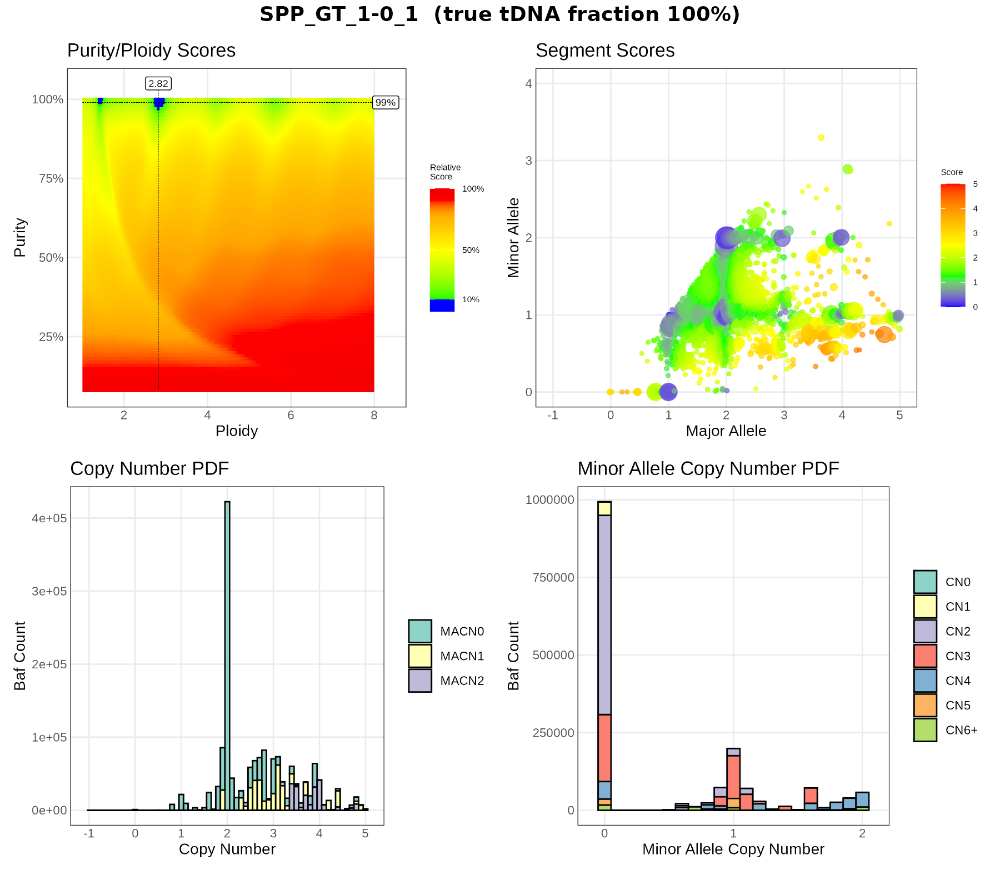
```

#### Selection of purity

PURPLE tries a grid of purity (y axis) × ploidy (x axis) combinations and gives each one a score: how badly the predicted depth ratio and BAF fit the data (**lower is better**). In the `purity.range.png` plots:

- colours show the score relative to the best fit; **blue** = within 10% of the best, red = poor;
- the dashed lines and labels mark the chosen purity and ploidy;
- several separate blue spots mean several solutions explain the data almost as well (e.g. ploidy 1.4 vs 2.8 at the same purity). This is a common source of errors, because doubling all copy numbers often fits the data equally well.

```{r, eval=FALSE}
p <- combine_pngs(purple.purity_ranges)
```

```{r, echo=FALSE, out.width='100%', fig.align='center'}
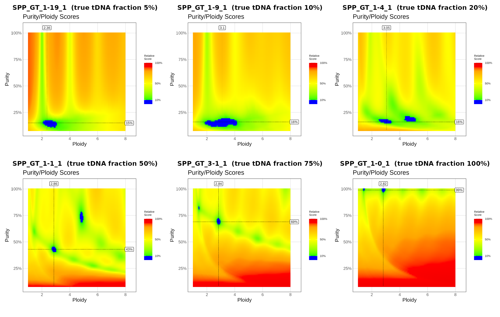
```

**What to notice.**

- **100%**: one sharp blue spot at purity 99%, ploidy 2.82 (plus a small one at ploidy \~1.4, the "half" solution).
- **75%**: still one clear solution, at the right purity.
- **50%**: two blue spots: the chosen fit (43%, ploidy 2.86) and an alternative at about 73% purity with ploidy \~4.8. PURPLE picked the right one, but the data alone almost allow the other.
- **20% and below**: the blue region is a horizontal band at \~15% purity that stretches over many ploidies: PURPLE cannot tell the ploidy, and it reports about the same purity for all three samples.

#### BAF vs copy number: does the fit explain the data?

This plot checks a purity/ploidy fit directly against the data.

**Observed (coloured density).** Each PURPLE segment (from `purple.segment.tsv`) has:

- an **observed BAF** (`observedBAF`, folded to 0.5-1), and
- an **observed depth ratio** (`observedTumorRatio`), which we turn into a tumor copy number with

$$CN = \frac{\text{ratio}\cdot\big(p\cdot\text{ploidy} + (1-p)\cdot 2\big) - (1-p)\cdot 2}{p}$$

Segments with many het SNPs count more (the density is weighted by `bafCount`). Only autosomal segments that are diploid in the normal are used.

**Expected (black dots).** For the same purity *p*, every allele state "major+minor" (e.g. `2+1`) predicts where its segments should fall:

$$\text{BAF} = \frac{p\cdot\text{major} + (1-p)}{p\cdot(\text{major}+\text{minor}) + 2(1-p)}, \qquad CN = \text{major}+\text{minor}$$

**A good fit puts the dense clouds on the black dots.** The functions behind the plot (in `codes/purple_lab_functions.R`):

``` r
expected_CN(ratio, p, CN_R = ploidy)     # depth ratio -> tumor copy number
calc_baf(purity, nA = minor, nB = major) # expected BAF of an allele state
plot_baf_cn(sample_id, purity = NULL, ploidy = NULL, min_baf_count = 10, max_cn = 8)
```

By default `plot_baf_cn()` uses PURPLE's fitted purity and ploidy. With these values, `expected_CN()` gives back PURPLE's own `tumorCopyNumber`.

```{r, eval=FALSE}
p <- plot_baf_cn("SPP_GT_1-0_1")
```

```{r, echo=FALSE, out.width='80%', fig.align='center'}
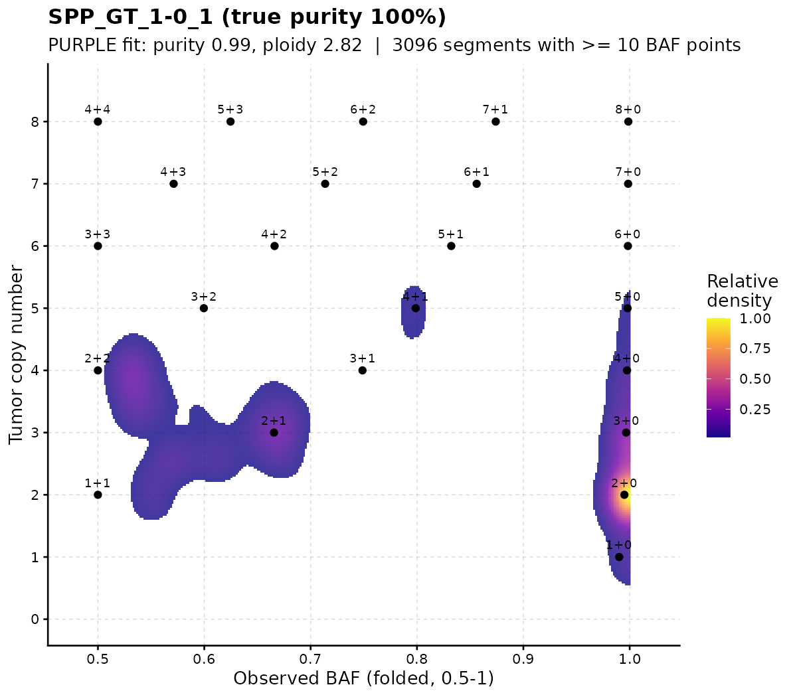
```

**100% purity.** The clouds sit on whole-number states: a big cloud on `2+0` (copy-neutral LOH), and others on `1+0`, `3+0`, `4+0`, `2+1`, `4+1`, `2+2`. Balanced states (`1+1`, `2+2`) appear slightly right of 0.5: folding a noisy BAF to 0.5-1 always pushes it up a little.

```{r, eval=FALSE}
p <- plot_baf_cn("SPP_GT_1-1_1")

# Test another solution
# The purity-range plot of SPP_GT_1-1_1 had a second blue spot at about 73% purity and ploidy 4.8. Give these values to plot_baf_cn()
# plot_baf_cn("SPP_GT_1-1_1", purity = 0.73, ploidy =4.8 ) # 4.8  2
```

```{r, echo=FALSE, out.width='80%', fig.align='center'}
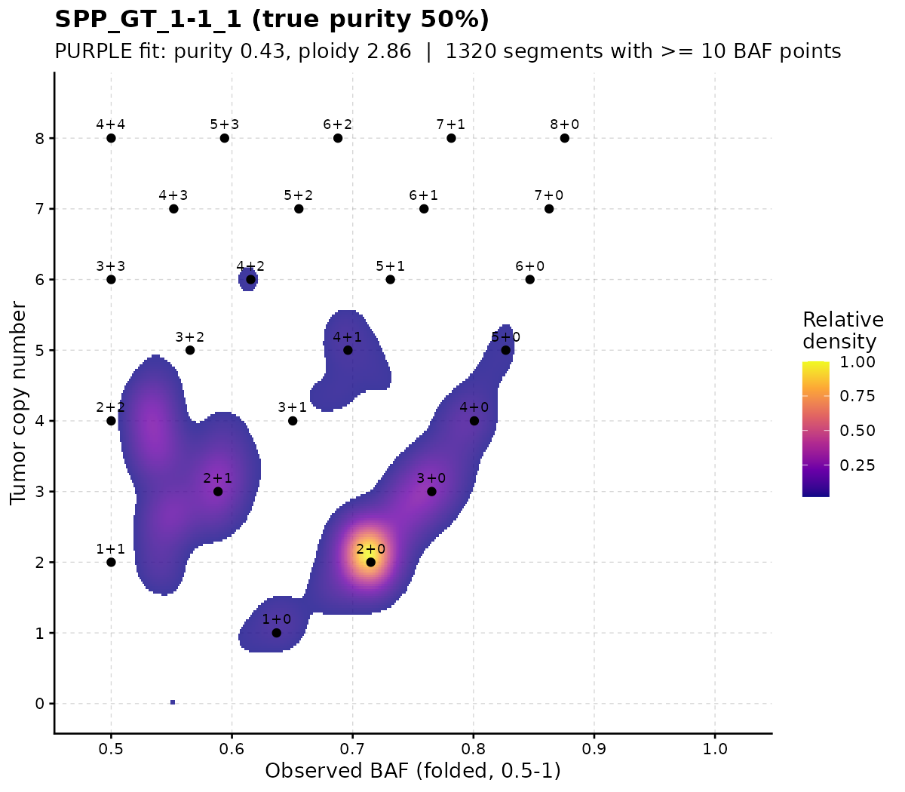
```

**50% purity.** All states move towards BAF 0.5 because of the normal cells (`2+0` is now at BAF \~0.71 instead of 1), but the clouds still sit on the predicted dots. The fit is good.

**Another solution:** The clouds still sit on predicted dots, only every state has one more copy: `2+0` becomes `3+1`, `2+1` becomes `3+2`, `1+0` becomes `2+1`. Both solutions explain the same BAF and depth data, which is why PURPLE found two blue spots. PURPLE prefers the solution with fewer copy-number changes and lower ploidy (here the correct one).

##### Low purity

```{r, eval=FALSE}
p <- plot_baf_cn("SPP_GT_1-9_1")
```

```{r, echo=FALSE, out.width='80%', fig.align='center'}
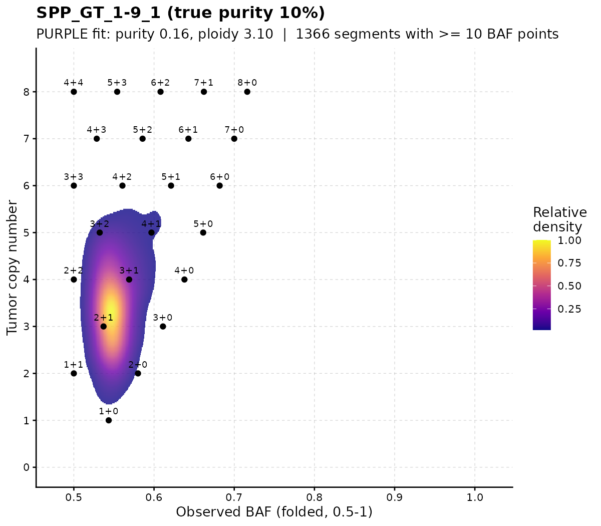
```

At 10% purity all expected states are squeezed close to BAF 0.5, and the observed segments form one blurred cloud: many purity/ploidy combinations fit equally badly or well, so the fit cannot be trusted.

**Try it:** run `plot_baf_cn()` on `SPP_GT_3-1_1` with PURPLE's fit, then with `purity = 0.5`. How do the dots move relative to the clouds?

##### check specific chromosome

```{r, eval=FALSE}
p <- plot_chromosome("SPP_GT_1-0_1", "chr1")
```

```{r, echo=FALSE, out.width='100%', fig.align='center'}
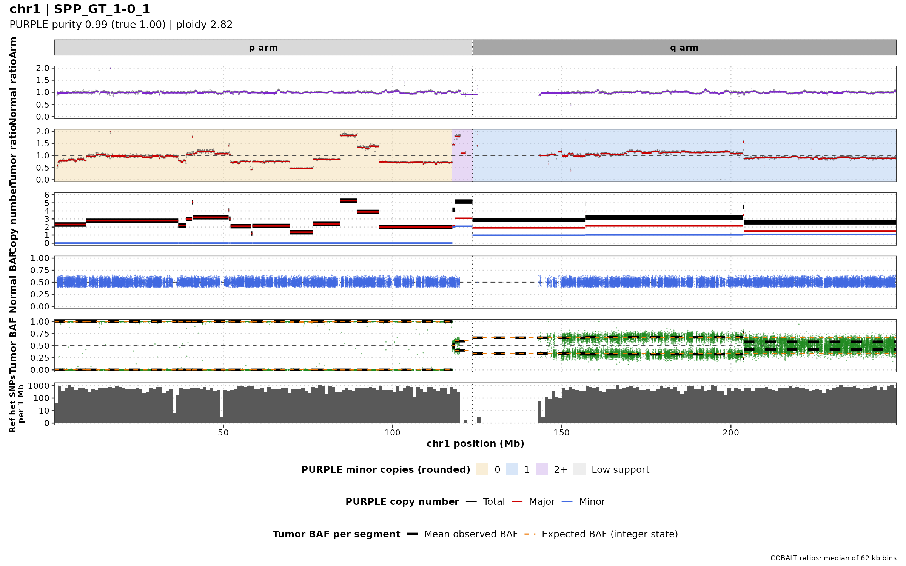
```

#### Segment

Each point in `segment.png` is one copy-number segment, placed at its **major** (x) and **minor** (y) allele copy number.

- Point size = number of BAF points supporting the segment (bigger = more evidence).
- Colour = how far the segment is from a whole number of copies (blue = close, red = far).

In a good fit, most large points sit on integer values (1+1, 2+0, 2+1, ...). Points spread between integers suggest the purity/ploidy is wrong or the sample is subclonal.

```{r, eval=FALSE}
p <- combine_pngs(segfiles)   # one figure, panels titled with sample ID and true purity
```

```{r, echo=FALSE, out.width='100%', fig.align='center'}
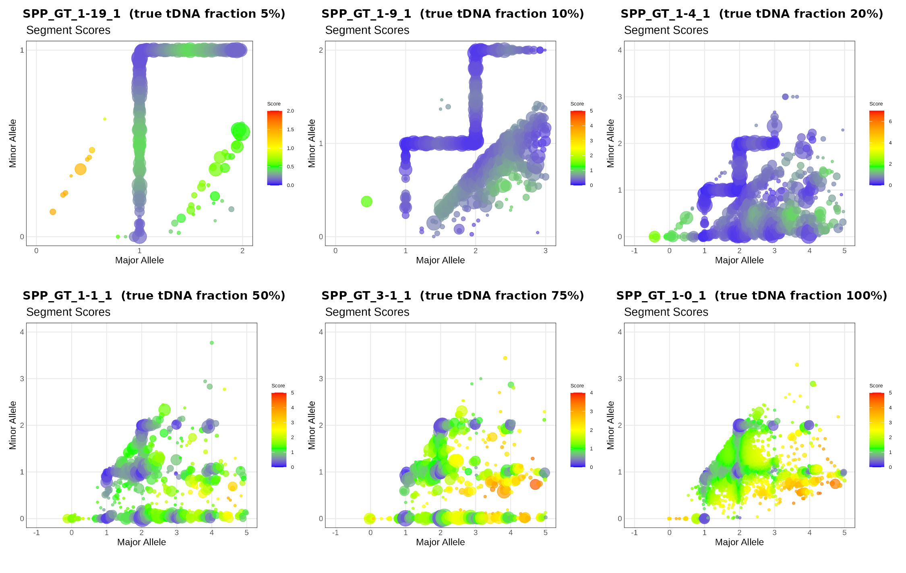
```

**What to notice.** At 50-100% purity the large points cluster on whole-number states (1+1, 2+0, 2+1, 2+2, ...). At 5-10% purity the points line up along straight lines instead of clusters: with so little tumor signal, PURPLE can place a segment almost anywhere along these lines, so the major/minor split is not determined.

#### Copy number distribution

`copynumber.png` is a histogram of the fitted copy number, weighted by the number of BAF points. Colours split each bar by minor-allele copy number (MACN0 = LOH, MACN1, MACN2). For a good fit the peaks sit on whole numbers. For HCC1395 the largest peak is CN 2 with MACN0, i.e. copy-neutral LOH covers a big part of the genome.

```{r, eval=FALSE}
p <- combine_pngs(copyNumberFiles)   # one figure, panels titled with sample ID and true
```

```{r, echo=FALSE, out.width='100%', fig.align='center'}
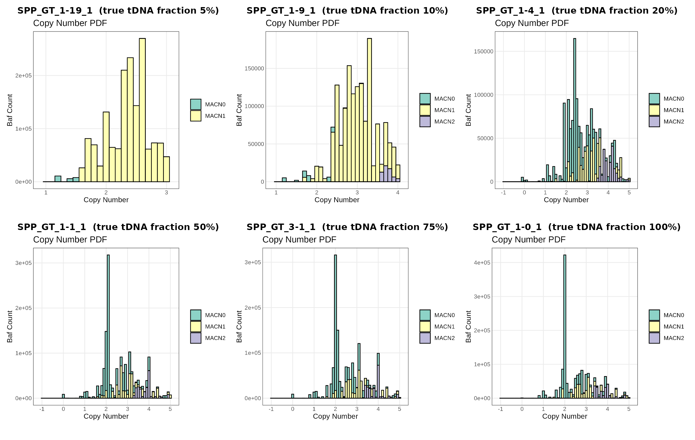
```

**What to notice.** From 50% to 100% purity the histograms look alike: a sharp peak at CN 2 that is almost all MACN0 (copy-neutral LOH), plus peaks at 3 and 4. At 5% and 10% there is almost no MACN0 at all and the copy numbers form a broad, continuous hump between 1.5 and 3.5: the LOH and the integer copy-number states are no longer resolved.

#### MinorAlleleCopy

`map.png` (minor-allele ploidy) is the same idea for the **minor** allele: a histogram of minor-allele copy number, coloured by total copy number. The bar at 0 is the amount of LOH in the genome.

```{r, eval=FALSE}
p <- combine_pngs(MAP)   # one figure, panels titled with sample ID and true purity
```

```{r, echo=FALSE, out.width='100%', fig.align='center'}
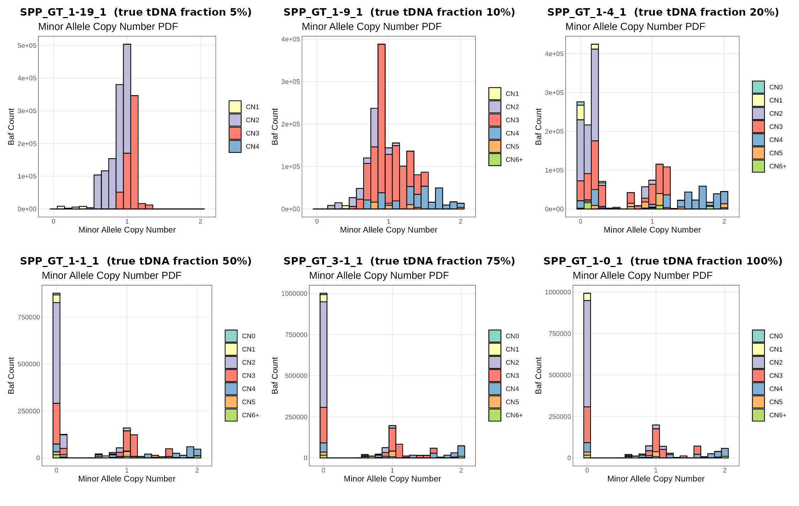
```

**What to notice.** At 50-100% purity the tallest bar is at minor CN 0: a large part of the genome is LOH. At 20% the LOH is still partly found (bars near 0-0.2). At 5% and 10% the distribution is centred on 1: PURPLE no longer sees the LOH, because the BAF shift it causes is too small (see the expected-signal table in the introduction).

### Some examples of Gain, Loss, Deletion and LOH

`<sample>.purple.cnv.gene.tsv` summarises the copy number of every gene. A gene can overlap several segments, so PURPLE reports the minimum and maximum.

| Column | Meaning |
|-------------------------|-----------------------------------------------|
| `minCopyNumber`, `maxCopyNumber` | Lowest / highest copy number over the gene |
| `minMinorAlleleCopyNumber` | Lowest minor-allele copy number (0 = LOH somewhere in the gene) |
| `minRegionStart`, `minRegionEnd` | Region of the gene with the lowest copy number |
| `somaticRegions` | Number of segments overlapping the gene |

```{r, eval=FALSE}
sample_id <- "SPP_GT_1-0_1"   # sample analysed in this section
somatic_cnv_gene <- read_tsv(paste0(purple_dir, sample_id, ".purple.cnv.gene.tsv"), show_col_types = FALSE)
sample_ploidy    <- read_tsv(paste0(purple_dir, sample_id, ".purple.purity.tsv"), show_col_types = FALSE)$ploidy

somatic_cnv_gene <- classify_gene_cn(somatic_cnv_gene, ploidy = sample_ploidy)
sample_ploidy
```

`classify_gene_cn()` gives each gene one label, **relative to the ploidy of the sample** (a gene with 3 copies is a gain in a diploid tumor but normal in a triploid one). Rules, checked in this order:

| Event         | Rule                                       |
|---------------|--------------------------------------------|
| Deep deletion | min CN \< 0.5: no copy left in the tumor   |
| Amplification | max CN \> 3 × ploidy                       |
| Gain          | min CN ≥ ploidy + 1                        |
| Loss          | max CN ≤ ploidy − 1                        |
| cnLOH         | minor CN \< 0.5 and CN between 1.5 and 2.5 |
| LOH           | minor CN \< 0.5, any other CN              |
| Neutral       | anything else                              |

```{r, eval=FALSE}
somatic_cnv_gene %>%
  filter(!chromosome %in% c("chrX", "chrY")) %>%
  count(event, sort = TRUE)
```

A scatter of all genes: x = highest copy number, y = lowest minor-allele copy number.

```{r, eval=FALSE}
p <- somatic_cnv_gene %>%
  filter(!chromosome %in% c("chrX", "chrY")) %>%
  ggplot(aes(x = maxCopyNumber, y = minMinorAlleleCopyNumber, colour = event)) +
  geom_jitter(size = 0.6, width = 0.05, height = 0.05, alpha = 0.5) +
  geom_vline(xintercept = sample_ploidy, linetype = 2) +
  labs(x = "Max copy number", y = "Min minor-allele copy number",
       title = paste(sample_id, "- one dot per gene; dashed line = ploidy")) +
  # bigger, opaque dots in the legend only (the plot keeps small transparent dots)
  guides(colour = guide_legend(override.aes = list(size = 4, alpha = 1))) +
  theme_bw()
```

```{r, echo=FALSE, out.width='80%', fig.align='center'}
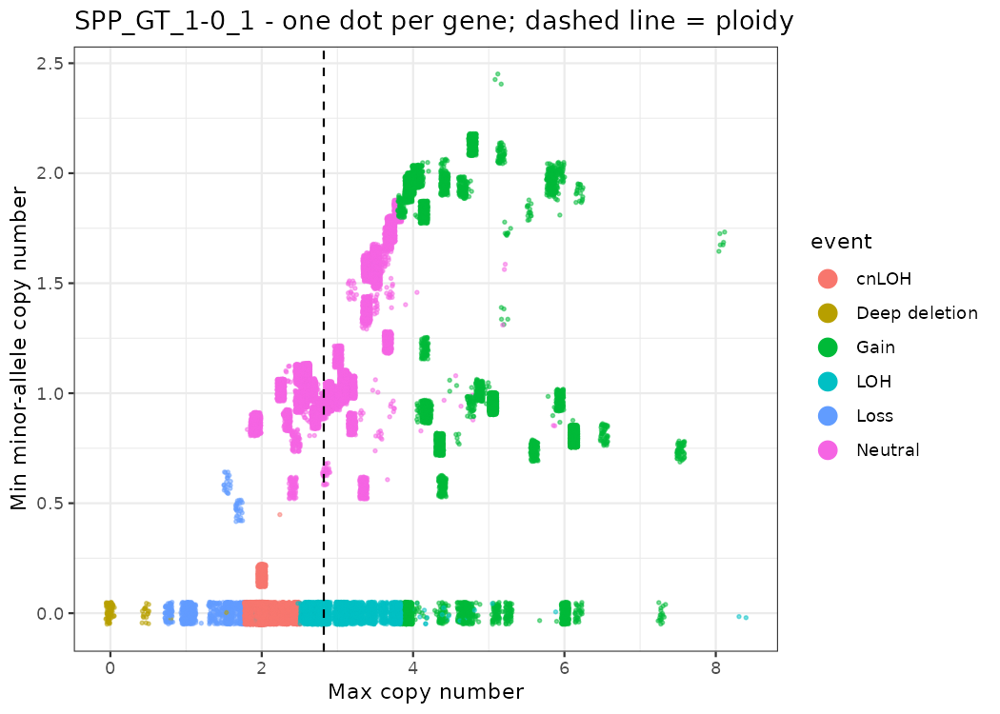
```

Some well-known cancer genes in this sample:

```{r, eval=FALSE}
genes_of_interest <- c("CDKN2A", "FBXL17", "MYC", "CCND1", "BRCA2", "TP53", "PTEN", "BRCA1", "PIK3CA", "PTPRC")

somatic_cnv_gene %>%
  filter(gene %in% genes_of_interest) %>%
  dplyr::select(chromosome, gene, minCopyNumber, maxCopyNumber, minMinorAlleleCopyNumber, event) %>%
  mutate(across(where(is.numeric), ~ round(.x, 2))) %>%
  arrange(event)
```

| Gene | What we see | Meaning |
|-------------------|-------------------|----------------------------------|
| **CDKN2A**, **FBXL17** | CN ≈ 0 | **Deep (homozygous) deletion**: both copies lost. CDKN2A is a classic tumor suppressor. |
| **MYC** | CN ≈ 6, minor 0 | **Gain** of one allele only (6+0) |
| **CCND1**, **BRCA2** | CN ≈ 4-5 | **Gain** |
| **PTEN**, **BRCA1** | CN ≈ 2, minor 0 | **Copy-neutral LOH**: one allele lost, the other duplicated |
| **TP53** | CN ≈ 2.8, minor 0 | **LOH** without a change in total copy number relative to ploidy |

Example: **CDKN2A** (chr9:21,967,751-21,994,490). Each dot is one gene on chr9; the copy number drops to 0 around CDKN2A.

```{r, eval=FALSE}
cdkn2a <- c(21967751, 21994490)

p_all <- somatic_cnv_gene %>% filter(chromosome == "chr9") %>%
  ggplot(aes(x = start / 1e6, y = maxCopyNumber)) + geom_point(size = 0.5) +
  geom_vline(xintercept = cdkn2a / 1e6, linetype = 2, colour = "red3") +
  labs(x = "chr9 (Mb)", y = "Max CN") + theme_bw()

p_zoom <- somatic_cnv_gene %>% filter(chromosome == "chr9", between(start, 21.5e6, 22.5e6)) %>%
  ggplot(aes(x = start / 1e6, y = maxCopyNumber)) + geom_point() +
  geom_vline(xintercept = cdkn2a / 1e6, linetype = 2, colour = "red3") +
  labs(x = "chr9 (Mb), zoom 21.5-22.5", y = "Max CN") + theme_bw()

p <- p_all | p_zoom
```

```{r, echo=FALSE, out.width='90%', fig.align='center'}
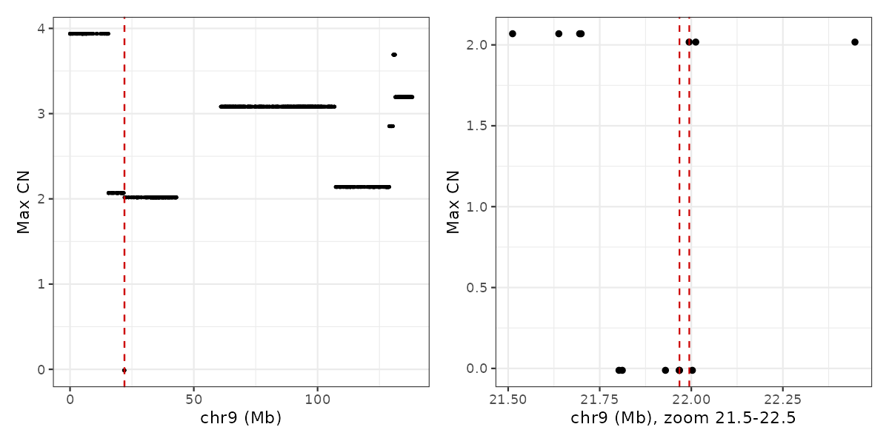
```

### Visualize a gene or a chromosome

The figures above each show one signal. To judge a copy-number call, we want **all the evidence in one figure**. The functions from `codes/purple_lab_functions.R` draw these tracks (top to bottom):

| Track | Data | What to look for |
|-------------------|----------------------------------|-------------------|
| Normal ratio | COBALT depth of the normal, purple line = segments | Should be flat at 1. A change here is **germline**, not tumor. |
| Tumor ratio | COBALT depth of the tumor, red line = segments. Background colour = PURPLE minor-allele CN (beige 0 = LOH, blue 1, lilac 2+, grey = too few SNPs) | Steps = changes in total copy number |
| Copy number | PURPLE fitted total (black), major (red), minor (blue) CN | PURPLE's interpretation of the two signals |
| Normal BAF | AMBER BAF of the normal | Always around 0.5 (these SNPs were chosen as heterozygous in the normal) |
| Tumor BAF | AMBER BAF of the tumor | 0.5 = balanced; two bands = imbalance; 0 and 1 = LOH |
| Genes | Selected genes (red) and other genes (grey) | Which genes are hit |
| Ref het SNPs per 1 Mb | Number of AMBER SNPs per 1 Mb | Few SNPs = weak BAF evidence (e.g. centromeres) |

Red dashed lines mark PURPLE's lowest-copy-number region within the gene.

#### One gene: `plot_gene()`

``` r
plot_gene(sample_id, gene_name, flank = 250e3, show_cn = FALSE)
```

- `sample_id`: e.g. `"SPP_GT_1-0_1"`
- `gene_name`: gene symbol as in `purple.cnv.gene.tsv`
- `flank`: bases shown on each side of the gene (default 250 kb)
- `show_cn`: add the PURPLE copy-number track (default `FALSE`, same layout as `Mathieu_purple/plots_gene_region/SPP_GT_1-0_1_chr5_FBXL17.pdf`)

**Deep deletion: FBXL17.** The tumor ratio drops to 0 between the red lines (no tumor reads at all) while the normal stays at 1, and there are no BAF points inside: both copies are gone.

```{r, eval=FALSE}
p <- plot_gene("SPP_GT_1-0_1", "FBXL17")
```

```{r, echo=FALSE, out.width='80%', fig.align='center'}
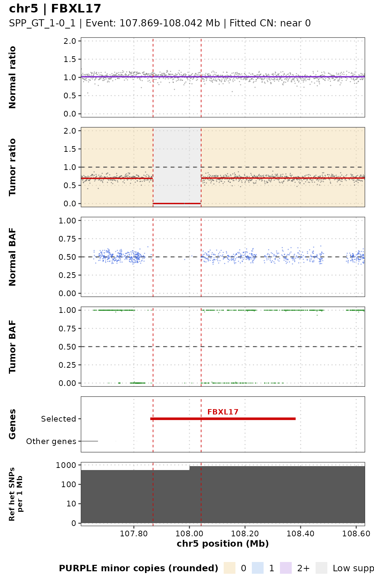
```

**Deep deletion: CDKN2A**, now with the copy-number track (`show_cn = TRUE`):

```{r, eval=FALSE}
p <- plot_gene("SPP_GT_1-0_1", "CDKN2A", show_cn = TRUE)
```

```{r, echo=FALSE, out.width='80%', fig.align='center'}
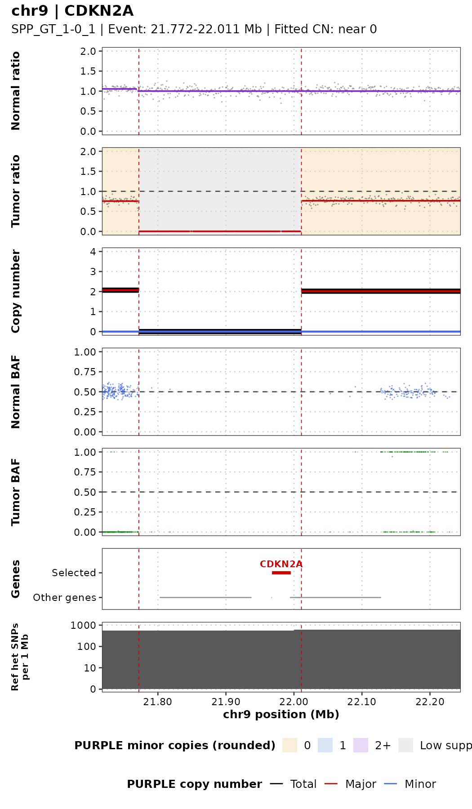
```

**Copy-neutral LOH: GATA3.** The tumor ratio is flat and the copy number is 2, exactly like a normal region, but the tumor BAF is at 0 and 1: one allele was lost and the other duplicated. Depth alone would miss this event; only the BAF reveals it.

```{r, eval=FALSE}
p <- plot_gene("SPP_GT_1-0_1", "GATA3", flank = 2e6, show_cn = TRUE)
```

```{r, echo=FALSE, out.width='80%', fig.align='center'}
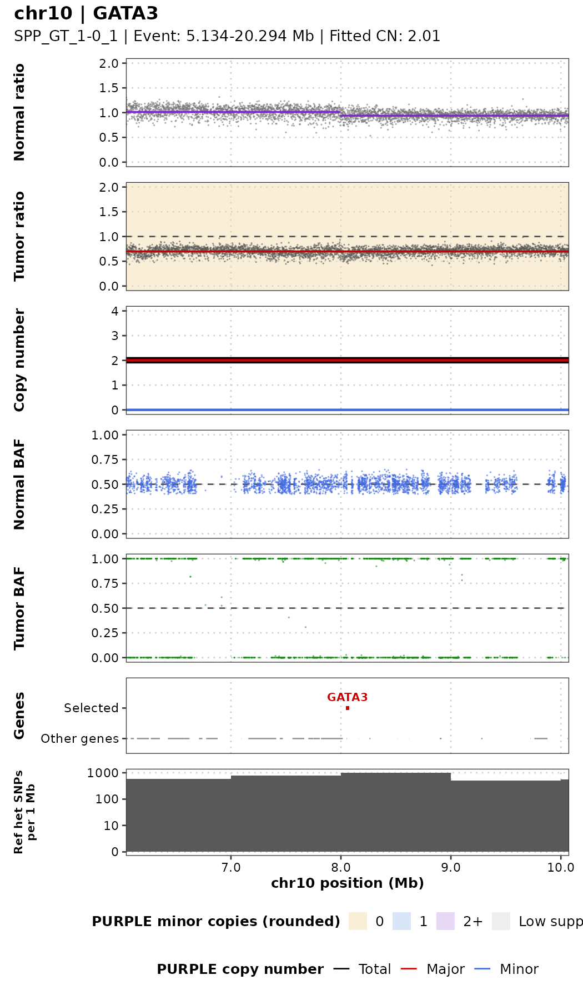
```

#### One chromosome: `plot_chromosome()`

``` r
plot_chromosome(sample_id, chr, genes = NULL, show_cn = TRUE, show_arms = TRUE, baf_lines = TRUE)
```

- `chr`: chromosome name with the `chr` prefix, e.g. `"chr9"`
- `genes`: optional gene names to mark on the gene track
- `show_arms`: top track with the **p arm** and **q arm**; the dotted vertical line in every track is the centromere (taken from the PURPLE segment that starts at the centromere)
- `baf_lines`: in the tumor BAF track, two dashed lines per PURPLE segment, drawn at *b* and 1−*b* so they sit on both BAF bands:
  - **black (thick)** = mean observed BAF of the segment (`observedBAF`)
  - **orange (thin)** = BAF expected for the nearest whole-number state (rounded major+minor) at PURPLE's purity, as in `plot_baf_cn()`
  - orange on top of black = the segment fits a whole-number state; separated lines = it does not (noise, subclonal change, or wrong fit). For balanced states (2+2) the black line sits a little away from 0.5: folding a noisy BAF always pushes it outwards.
- On long regions the 1 kb depth windows are summarised as medians of larger bins, and at most 50,000 BAF points are drawn (the caption says so).

```{r, eval=FALSE}
p <- plot_chromosome("SPP_GT_1-0_1", "chr9", genes = "CDKN2A")
```

```{r, echo=FALSE, out.width='80%', fig.align='center'}
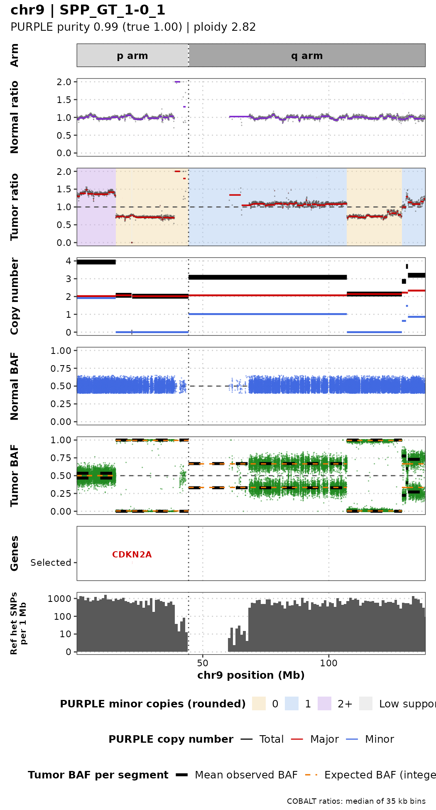
```

**Reading chr9 from left to right:** the start of 9p is gained with both alleles (4 copies, 2+2, BAF at 0.5); then comes a long copy-neutral LOH region (2+0, BAF at 0 and 1) that contains the CDKN2A deep deletion; most of 9q has 3 copies (2+1, two BAF bands around 0.33 and 0.67), followed by a second LOH region near the end of the chromosome.

#### Effect of purity on the signal

The same deletion (FBXL17) in samples with decreasing purity. Watch the depth ratio inside the deletion and the tumor BAF bands move towards the normal values.

```{r, eval=FALSE}
for (s in c("SPP_GT_1-0_1", "SPP_GT_1-1_1", "SPP_GT_1-9_1")) {
  p <- plot_gene(s, "FBXL17")
}
```

```{r, echo=FALSE, out.width='80%', fig.align='center'}
knitr::include_graphics(c("Module5/img/gene_SPP_GT_1-0_1_FBXL17.png",
                          "Module5/img/gene_SPP_GT_1-1_1_FBXL17.png",
                          "Module5/img/gene_SPP_GT_1-9_1_FBXL17.png"))
```

With the formulas from the introduction (ploidy 2.8; the region around FBXL17 is cnLOH, 2+0):

| Purity | Depth ratio inside the deletion | Depth ratio of the neighbours | Tumor BAF of the neighbours | Tumor BAF inside the deletion |
|---------------|---------------|---------------|---------------|---------------|
| 1.0 | 0 | 0.71 | 0 / 1 | no SNP reads |
| 0.5 | 0.41 | 0.83 | 0.25 / 0.75 | 0.5 (only normal reads left) |
| 0.1 | 0.86 | 0.96 | 0.45 / 0.55 | 0.5 |

At 50% purity the deletion is still clear: the observed ratio is about 0.52 inside versus 0.87 outside, and the neighbours' BAF bands sit near 0.28 / 0.72 (close to the table; PURPLE estimated 43% rather than 50% purity for this sample). Inside the deletion the BAF goes **back to 0.5** because all remaining reads come from normal cells. At 10% purity the differences are smaller than the noise.

#### Any region: `plot_cn_region()`

For a region that is not a single gene, give the coordinates directly:

```{r, eval=FALSE}
p <- plot_cn_region("SPP_GT_1-0_1", chr = "chr5", start = 100e6, end = 115e6,
                    genes = c("FBXL17", "APC"), title = "chr5:100-115 Mb")
```

```{r, echo=FALSE, out.width='80%', fig.align='center'}
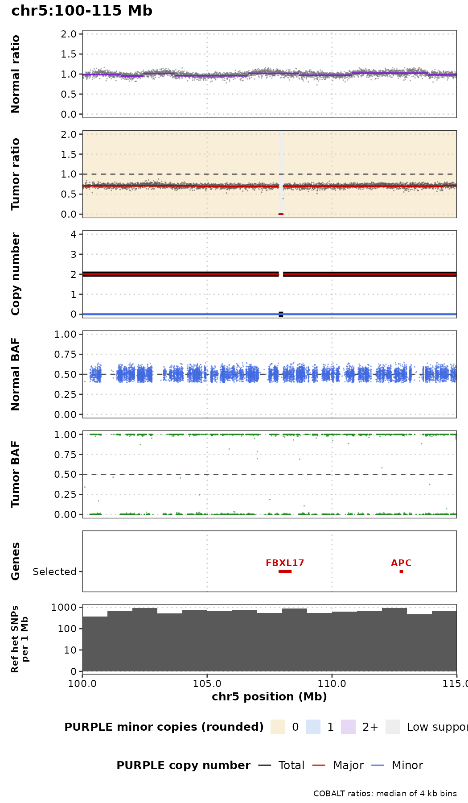
```

#### Saving figures

`save_cn_plot()` writes a PDF and a PNG; the height is chosen from the number of tracks.

```{r, eval=FALSE}
# p <- plot_gene("SPP_GT_1-0_1", "FBXL17")
# save_cn_plot(p, "Mathieu_purple/plots_gene_region/SPP_GT_1-0_1_chr5_FBXL17")
# 
# p <- plot_chromosome("SPP_GT_1-0_1", "chr9", genes = "CDKN2A")
# save_cn_plot(p, "Mathieu_purple/plots_chromosome/SPP_GT_1-0_1_chr9")
```

### Exercises

1.  Plot `TP53` in `SPP_GT_1-0_1` with `show_cn = TRUE`. Is it LOH, a gain or a loss? How does the tumor BAF support your answer?
2.  Pick one gene labelled `Gain` and one labelled `Loss` in the table from `classify_gene_cn()` and plot them. Do the depth ratio and BAF agree with the label?
3.  Plot chr17 for `SPP_GT_1-0_1` and for `SPP_GT_3-1_1` (75%). Which events are still easy to see at 75% purity?
4.  Run `classify_gene_cn()` on `SPP_GT_1-1_1` (50%). Is CDKN2A still called a deep deletion? Why might PURPLE's call change at lower purity?
5.  Look at the normal-ratio track of chr16. What do you see, and why does it matter for interpreting the tumor?
6.  Plot `PTEN` with `flank = 2e6, show_cn = TRUE`. The tumor ratio shows two small focal events right next to the gene (a short gain and a short drop to 0), but the PURPLE copy-number track is flat. Why might PURPLE not call them? (Hint: count the depth windows and BAF points they contain.)
