# Module 9 Lab Primer: Cytoscape Primer {#cytoscape_mod9}

**This work is licensed under a [Creative Commons Attribution-ShareAlike 3.0 Unported License](http://creativecommons.org/licenses/by-sa/3.0/deed.en_US). This means that you are able to copy, share and modify the work, as long as the result is distributed under the same license.**

By Gary Bader, Ruth Isserlin, Veronique Voisin

## Goal of the exercise

**Create a network and customize it.**

The goal of this exercise is to learn how to create a network in Cytoscape and customize id. In this example, the proteins are the entities represented as nodes in the network and known physical interactions are the connections between the proteins that are represented as edges. We will overlay 2 additional pieces of information about these proteins, mutation information per protein as node color and mutation expression as node size.

## Data

  * The data used in this exercise is a set of protein - protein interactions and associated attributes.  

## Start the exercise

To start the lab practical section, first create a cytoscape_primer_files directoty on your computer and download the files below.

```{block, type="rmd-datadownload"}
Right click on link below and select "Save Link As...".

Place it in the corresponding module directory of your CBW work directory.
```
<br>
<br>
Two files are needed for this exercise:

  * [networktable.txt](./Module9/cytoscape_primer/data/network_table.txt)
  * [nodeattribute.txt](./Module9/cytoscape_primer/data/node_attribute.txt)
  
## Exercise 1a - Create Network from table

  1. Launch Cytoscape
  1. Locate the top menu bar and select **File**,--> **Import**, --> **Network from File…**.
  
  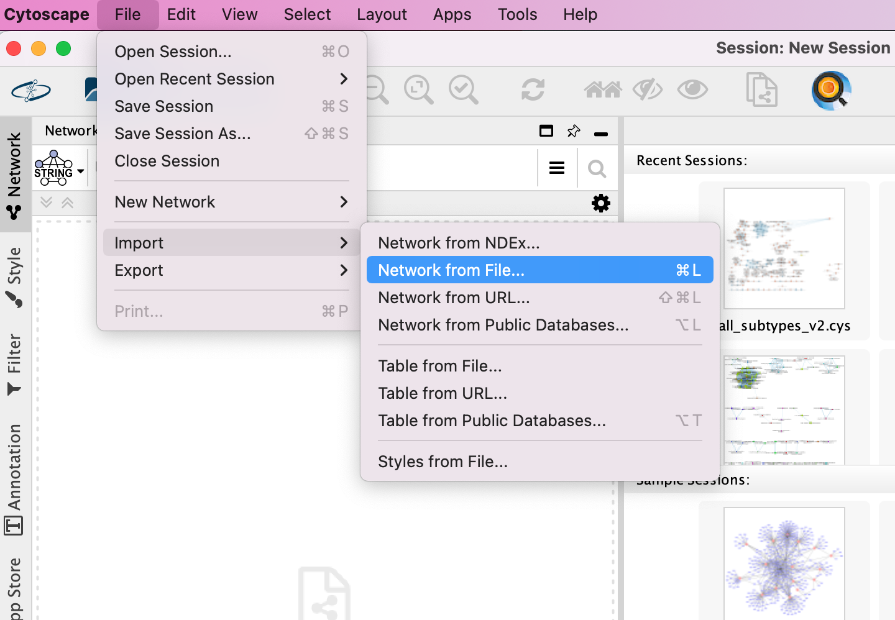
  
  <ol start=3 type="1">
<li>  Browse your computer and select the file [networktable.txt](./Module9/cytoscape_primer/data/network_table.txt)
</ol>
  <ol start=4 type="1">
<li> An **Import Network from Table** dialog box opens. The 3 columns of the table should be set as "source", "interaction" and "target" respectively. </ol>
  
  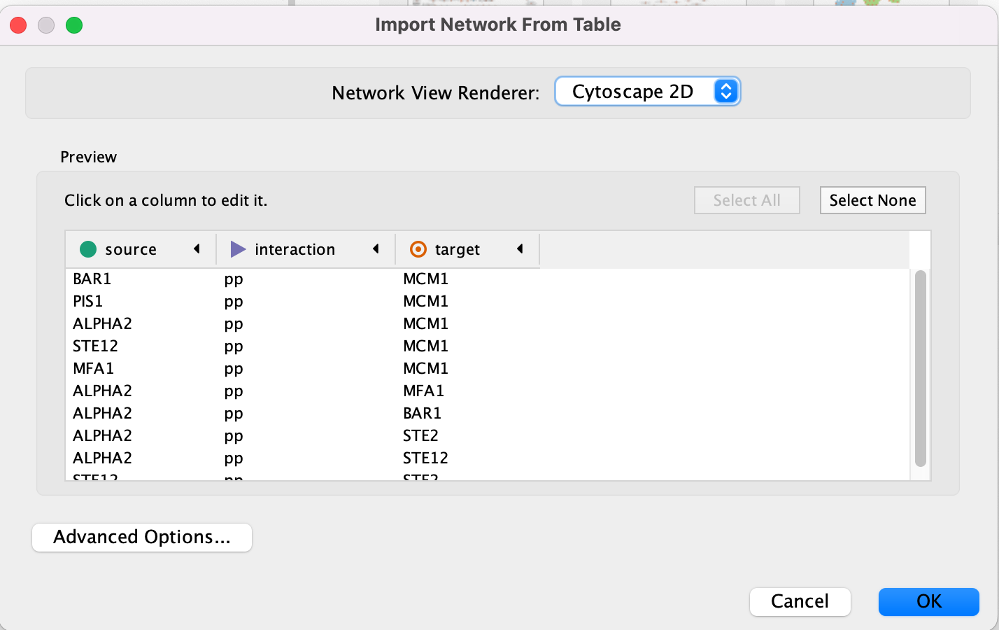
    

```{block, type="rmd-tip"}  
  
  Cytoscape will assume, by default,  will look for the column names that start with "source", "interaction" and "target".  It will assume that any other column is an interaction attribute (edge attribute)  
  
  * This is just an example file.  You can import files with any number of additional columns and choose to ignore all columns except for the ones that you want to import or import all of them.  Although Cytoscape tries to guess the data type of each column and the type (ie. is it an attribute associated with source node, target nodes or the interaction) you are able to fine tune everything.  
  
  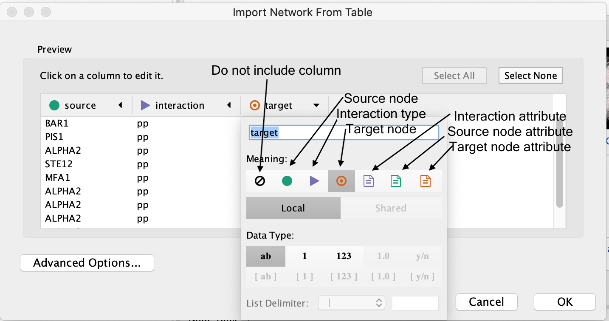
  
```
<br>
<br>
 <ol start=5 type="1">
<li>  Click "Ok".
</ol>  

  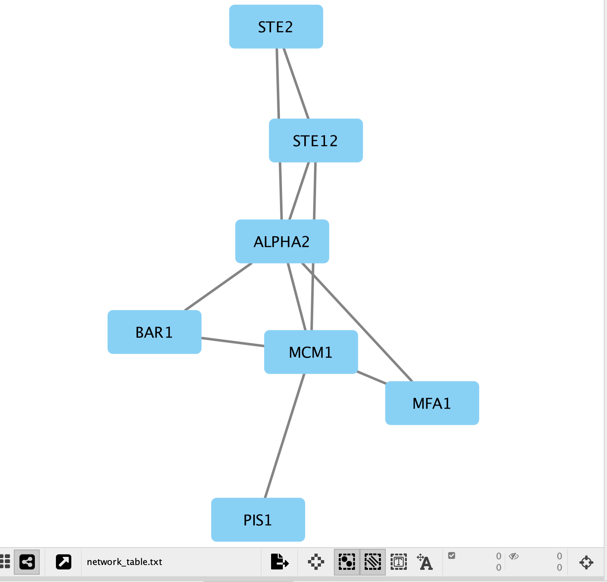
  
  * A network containing the proteins as blue square nodes and interaction as edges should be displayed in the main Cytoscape window.

```{block, type="rmd-rcybox"}
**Equivalent RCy3 code — Create network from a table file**
```

### Setting up cytoscape variables -

  The values of the below variables depends on where you are running your R Code and where you are running your Cytoscape.  There are a lot of different combinations but it is improtant to understand your set up.  
  Almost always you will be running cytoscape on your computer or laptop.  Something that you can interact with directly. But often we might run our code on:
  
  1. A Dcoker on your computer
  1. A docker on a remote machine
  1. AWS cloud
  1. another cloud service. 
  
  When we send commands to cytoscape we need to specify where cytoscape is.  We have defined a varialbe that we will use for every command we send to cytoscape telling it where the cytoscape host is:
  1. From RStudio on your computer to cytoscape on your computer - current_cytoscape_baseurl = "http://localhost:1234/v1"
  1. From docker implementation of Rstudio on your computer to cytoscape on your computer - current_cytoscape_baseurl = "http://host.docker.internal:1234/v1"  
  1. From AWS Rstudio to cytoscape on your computer - 
    a. Set up ssh tunnel from your computer to AWS as follows - 
```{r tunnel-rcybox, eval=FALSE}
ssh -i <studentname>.pem -R 1234:localhost:1234 ubuntu@can.uhn-hpc.ca
```
    a. current_cytoscape_baseurl = "http://localhost:1234/v1"
    
  When cytoscape loads or saves files, it can not save to the docker or the cloud.  It only has access to the files on the computer that it is running.  So the path to files saved or accessed by cytoscape need to be on the machine that is running cytoscape.  Initialize the variable to a directory on your computer that you want to save all your results
  
  path_to_save_cytoscape = "/Users/risserlin/CBW_Workshop_results/Module9"

```{r setup_cyto-rcybox, eval=FALSE}
library(RCy3)

is_remote = TRUE
current_cytoscape_baseurl = "http://localhost:1234/v1"

#make sure this directory is created ahead of time.  We can't create this directory from this instance of RStudio.  
path_to_save_cytoscape = "/Users/risserlin/CBW_Workshop_results/Module9"

# Confirm Cytoscape is running and reachable
cytoscapePing(base.url = current_cytoscape_baseurl)
```


```{r exercise1a-rcybox, eval=FALSE}

# Read the network table into R
network_df <- read.table(
  "./Module9/cytoscape_primer/data/network_table.txt",
  header = TRUE, sep = "\t", stringsAsFactors = FALSE
)

# The table has columns: source, interaction, target
# createNetworkFromDataFrames() takes a separate edges data frame and
# an optional nodes data frame.  Here we build edges directly from the table.
edges_df <- data.frame(
  source      = network_df$source,
  target      = network_df$target,
  interaction = network_df$interaction,
  stringsAsFactors = FALSE
)

# Create the network in Cytoscape
network_suid <- createNetworkFromDataFrames(
  edges      = edges_df,
  title      = "Cytoscape Primer Network",
  collection = "Module 9",
  base.url = current_cytoscape_baseurl
)

# Confirm the network was created
message("Network SUID: ", network_suid)
```

  
## Exercise 1b - Load node attributes

  1. Locate the Cytoscape top menu bar and select **File**,--> **Import**,--> **Table from File…**. 
  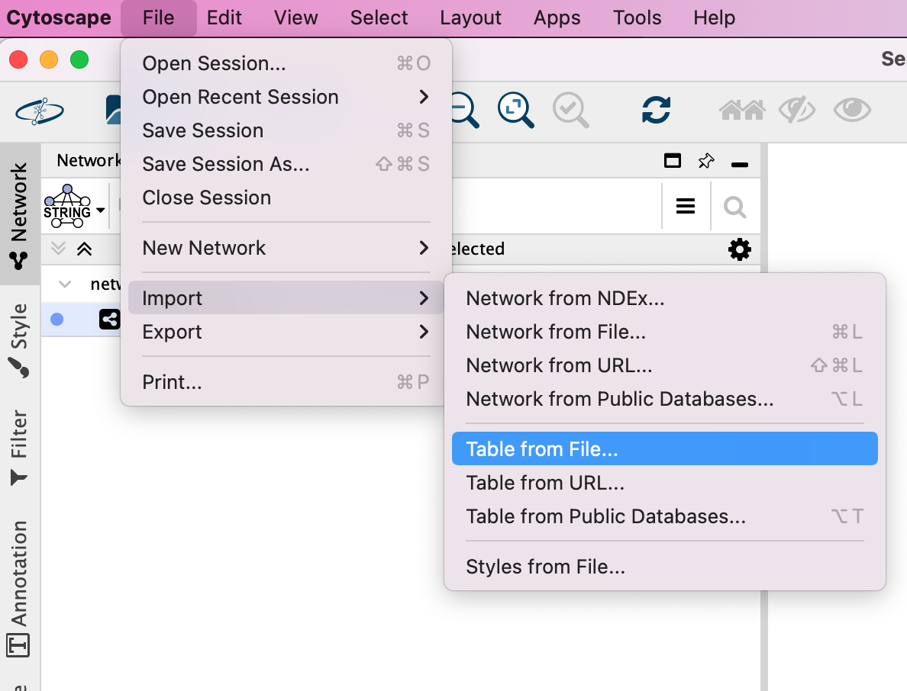

  1. Browse your computer and select the file [nodeattribute.txt](./Module9/cytoscape_primer/data/node_attribute.txt)
  
  1. click "Open".

  1. An "Import Table from Columns" dialog appears. 
  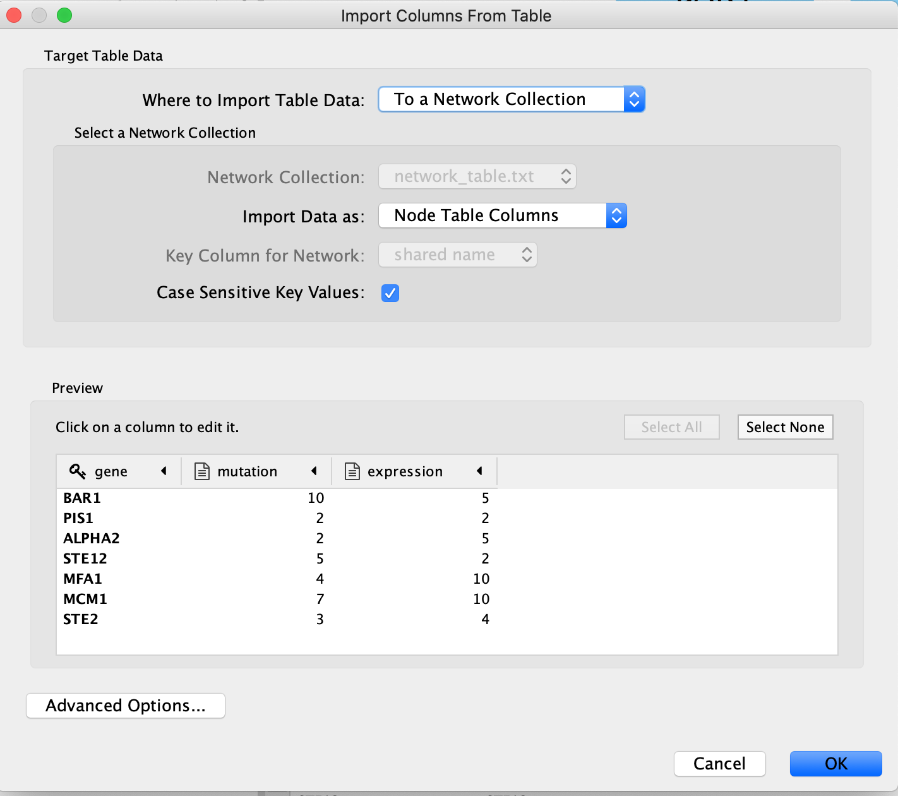

  
  1. Click on "OK".
  
  1. You should be able to see the imported attributes in the node table. 
  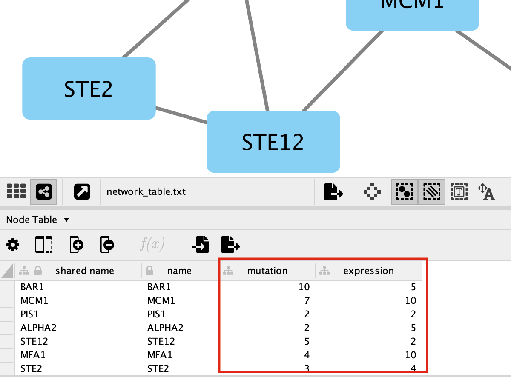

<br>
<br>
```{block, type="rmd-note"}
  i. The key column is assumed to be the first column in your table.  
  i. The key is the column in the loaded attribute file used to match your attributes to your network. 
  i. **key colum for Network** is the column in the Network that the key is matched to.  (In this network there isn't the ability to set this value because that is the only attribute associated with the nodes in our network but normally this drop box will be selectable)
  i. The key and matching column need to match perfectly (unless you have specifid that case does not matter). 
  
  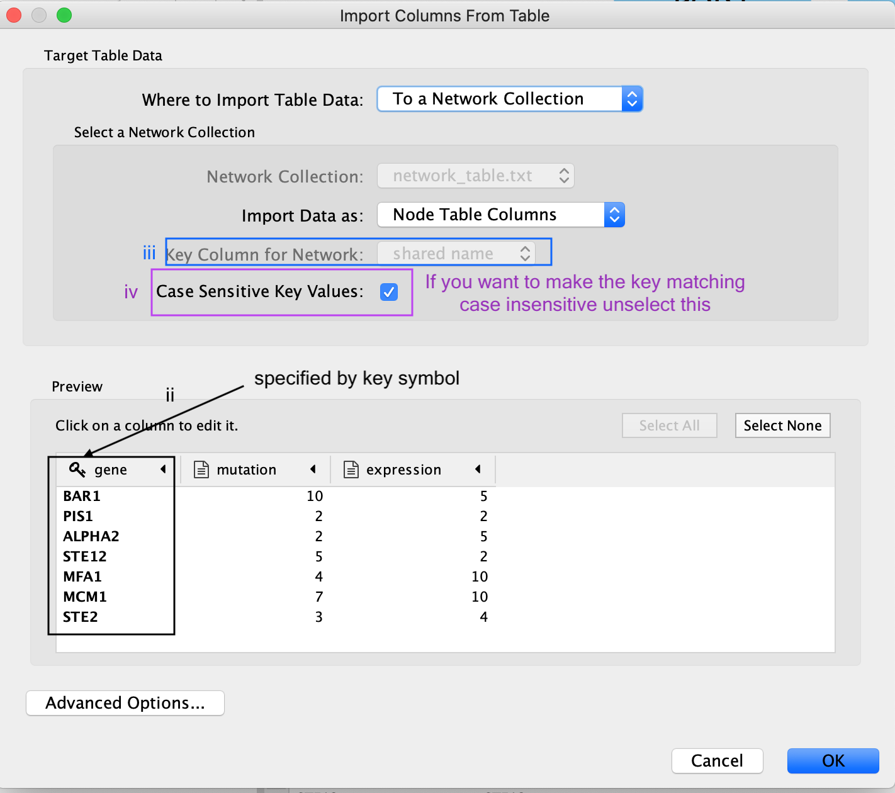

```
<br>
<br>


```{block, type="rmd-tip"}  
  Similiar to the **Import Network from Table**, everything about the import is customizable.  Cytoscape does its best to guess the datatypes of each column but you are able to fine tune it.  
  
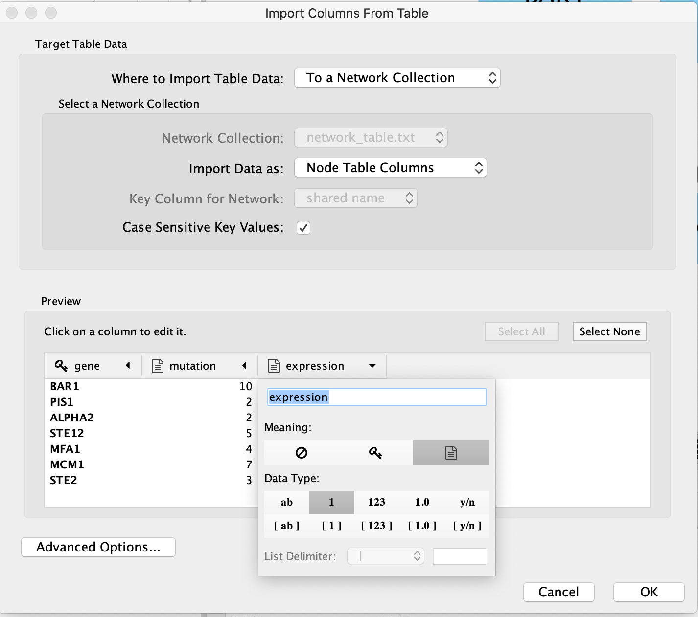

  
  There are also advanced options if you want to:
  
  * change the file delimiter
  * skip lines
  * specify the header column
    
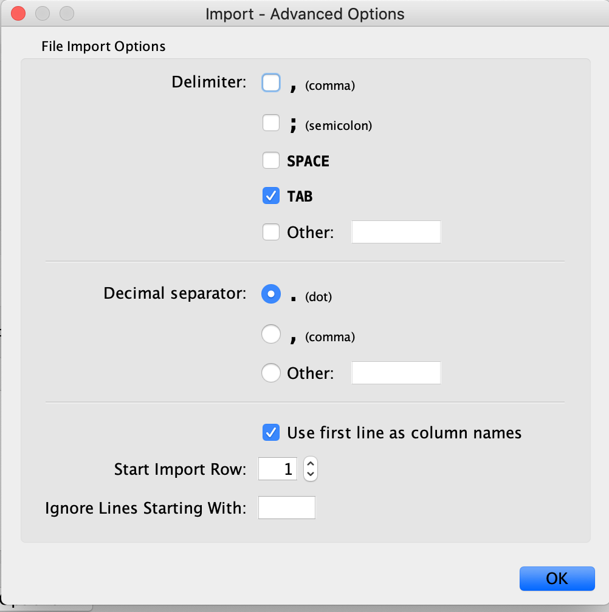
    
```

```{block, type="rmd-rcybox"}
**Equivalent RCy3 code — Load node attributes from a file**
```

```{r exercise1b-rcybox, eval=FALSE}
# Read the node attribute table into R
node_attributes <- read.table(
  "./Module9/cytoscape_primer/data/node_attribute.txt",
  header = TRUE, sep = "\t", stringsAsFactors = FALSE
)

# loadTableData() merges the data frame into the Cytoscape node table.
# The 'data.key.column' is the column in node_attributes that matches
# the node name column in Cytoscape (default: "name").
loadTableData(
  data            = node_attributes,
  data.key.column = colnames(node_attributes)[1],  # first column is the key
  table           = "node",
  table.key.column = "name",
  network         = network_suid,
  base.url = current_cytoscape_baseurl
)

message("Node attributes loaded successfully.")
```

## Exercise 1c - Map node attributes to Visual Style


  1. Go to "Control Panel" on the left side and select the "Style" tab. Make sure that you are in the "Node" tab.<br>
  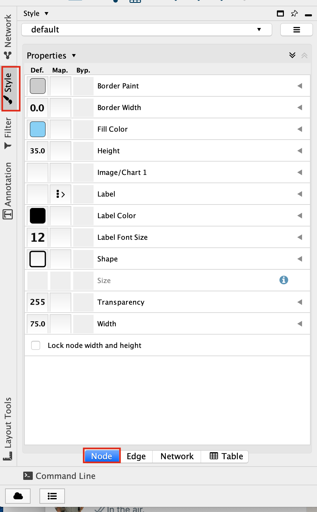

  1. Select the "Fill Color" field 
  1. expand it by clicking on the right arrow. 
  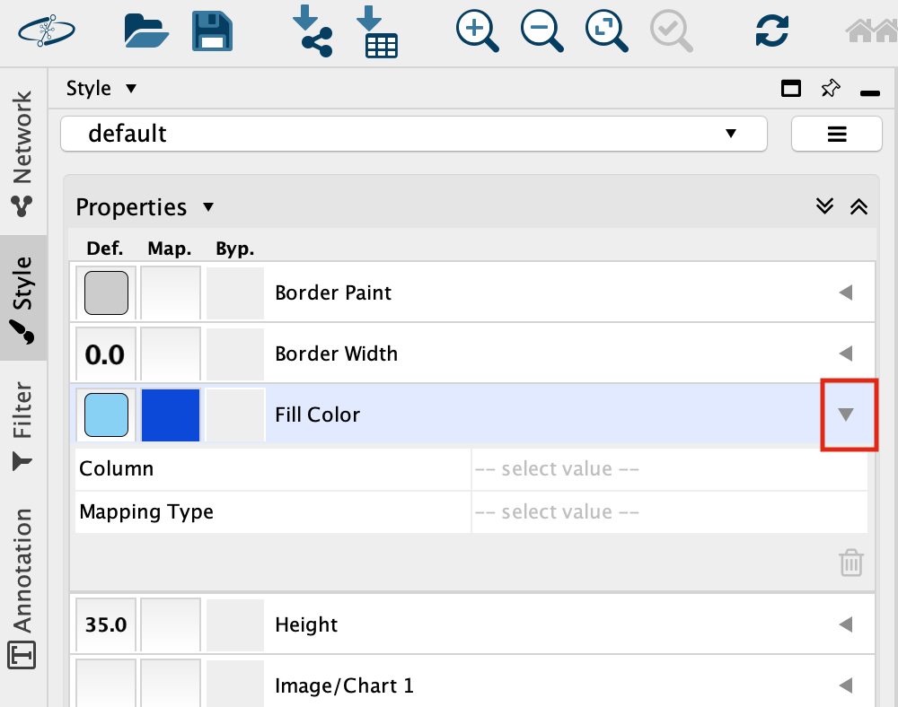
  
  1. Set "Column" to "expression" and "Mapping Type" to "Continuous Mapping".
  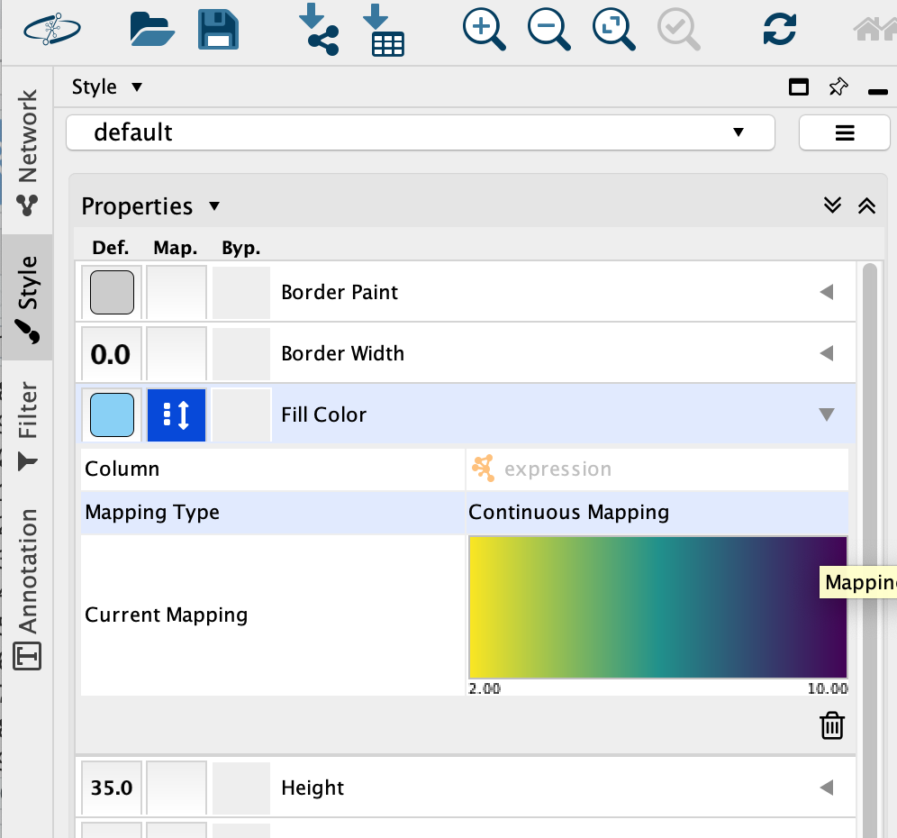
  
  1. This will change the colours of the nodes to the default colour coding.
  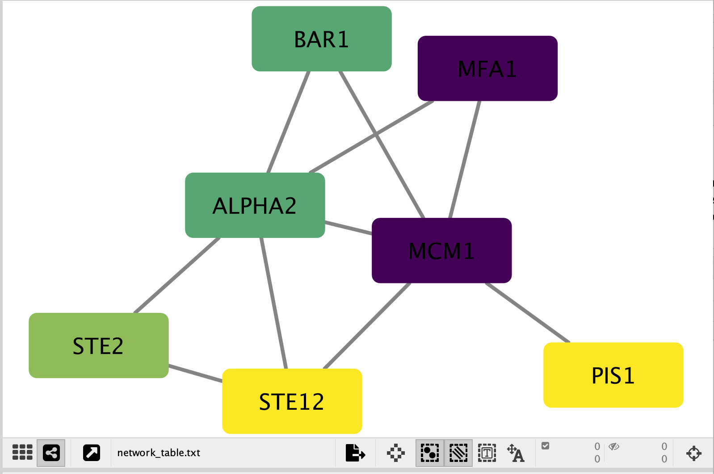
  
  1. Double click on the continuos mapping colour box to manually adjust the colour and other settings.  
 
  1. At the bottom of the "Style" tab, check the box "Lock node width and height".
  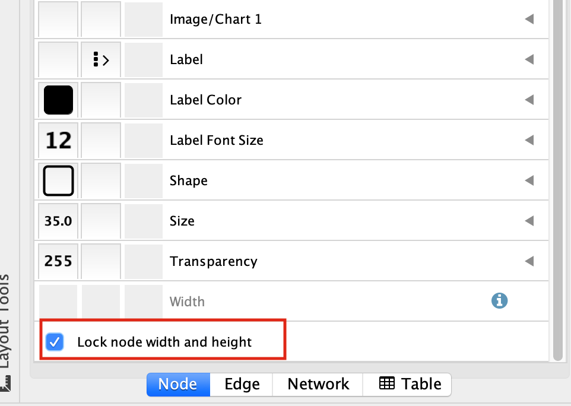

  1. Select the "Size" field and 
  1. expand it by clicking on the right arrow. 
  1. Set "Column" to "mutation" and "Mapping Type" to "Continuous Mapping".
  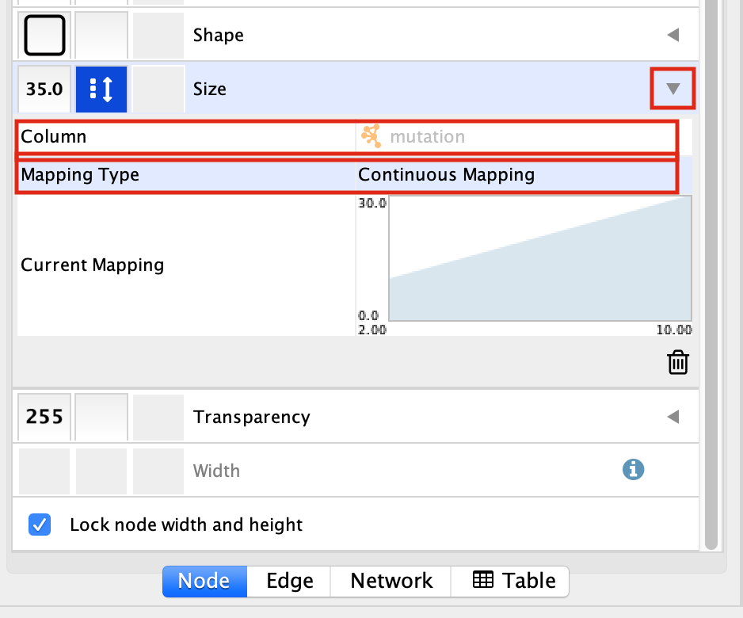
  
  1. Your resulting network maps expression to the colour of the node and the size of the node to the number of mutations.
  <br>
<br>
```{block, type="rmd-bonus"}

  1. Adjust the setting on the colour mapping.  Change the colour scheme.  Change the maximum and minimum values.
  1. Adjust the setting on the size mapping.  Make the nodes bigger with higher values.
  1.  Eventhough the network is small, play around with the layouts.

```

```{block, type="rmd-rcybox"}
**Equivalent RCy3 code — Map node attributes to visual properties**
```

```{r exercise1c-rcybox, eval=FALSE}
# ── Colour: map 'expression' column to node fill colour ─────────────────────

# Set a continuous colour mapping: low expression = blue, mid = white, high = red
# First get the range of the expression values from the node table
node_table_current <- getTableColumns(table = "node", network = network_suid,base.url = current_cytoscape_baseurl)
expr_min <- min(node_table_current$expression, na.rm = TRUE)
expr_max <- max(node_table_current$expression, na.rm = TRUE)
expr_mid <- (expr_min + expr_max) / 2

setNodeColorMapping(
  table.column  = "expression",
  table.column.values = c(expr_min, expr_mid, expr_max),
  colors        = c("#0000FF", "#FFFFFF", "#FF0000"),  # blue -> white -> red
  mapping.type  = "continuous",
  network       = network_suid,
  base.url = current_cytoscape_baseurl
)

# ── Size: map 'mutation' column to node size ──────────────────────────────────

mut_min <- min(node_table_current$mutation, na.rm = TRUE)
mut_max <- max(node_table_current$mutation, na.rm = TRUE)

setNodeSizeMapping(
  table.column        = "mutation",
  table.column.values = c(mut_min, mut_max),
  sizes               = c(30, 100),   # smallest to largest node size in pixels
  mapping.type        = "continuous",
  network             = network_suid,
  base.url = current_cytoscape_baseurl
)

# Lock node width and height so size mapping applies uniformly
lockNodeDimensions(TRUE, 
                   base.url = current_cytoscape_baseurl)

message("Visual style mappings applied.")
```

## Exercise 2 - Work with larger networks

Cytoscape supplies a few demo networks that you can play around with.  When you open cytoscape you are presented with a Start Panel where you can choose to reload a previous session or load in one of the sample networks.  

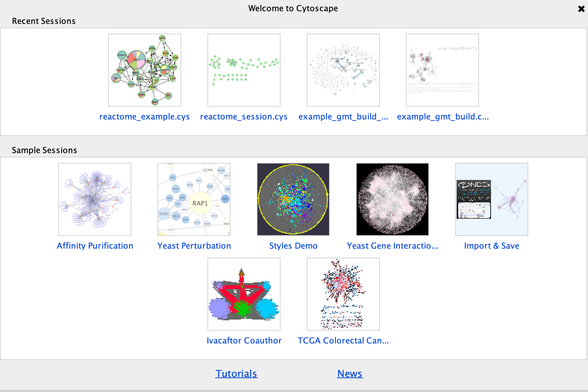

  1.  You do not need to re-open cytoscape to open the starter panel.  Locate the Cytoscape top menu bar and select **View**,--> **Show Starter panel**. 
  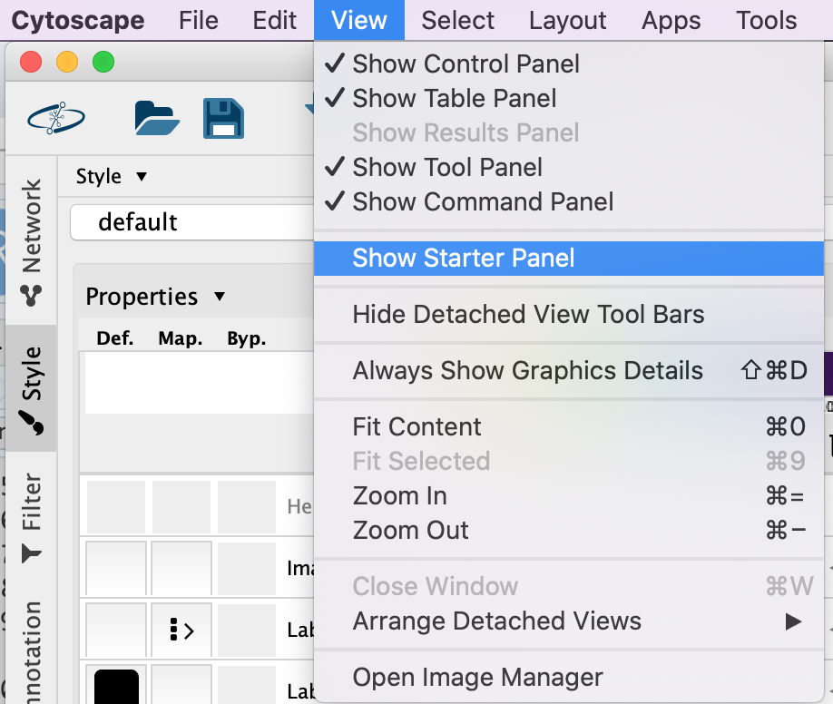

  1.  Double click on the **Affinity Purification Network** to open it.

  1.  If you already have a session open then you will recieve a warning that the current session will be lost.  Before proceeding make sure your current session is saved.  (Click on cancel.  Then, **File** --> **Save as**)<br>
  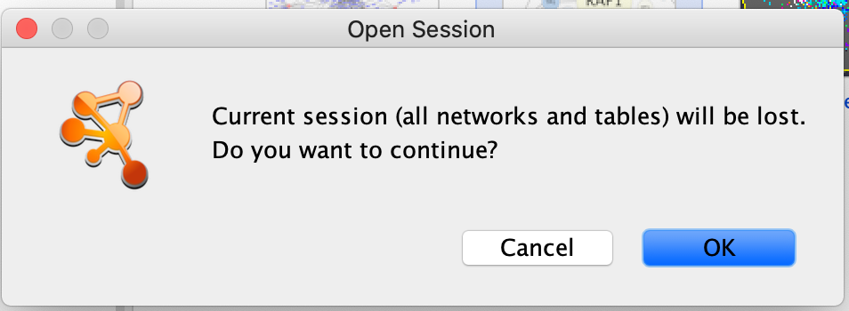

  
  1. Once the network has loaded you will see a network of protein interactions derived from an affinity purification experiment.  Bait proteins are reprsented as pink hexagons and their corresponing prey proteins blue boxes. 
    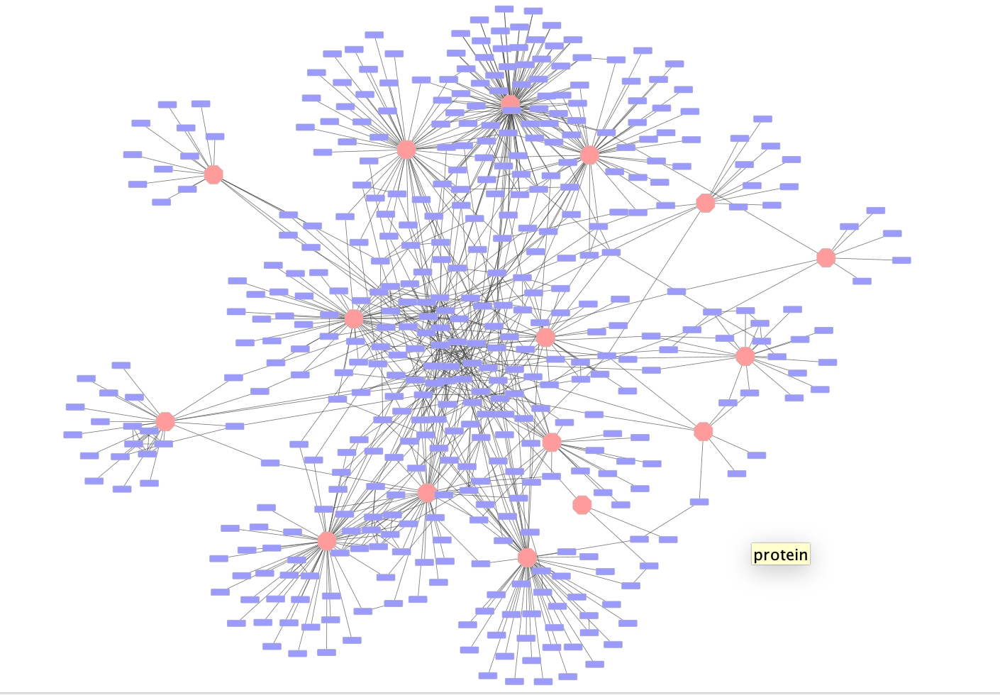

  1. Using this larger network play around with the different layouts
  <br>
<br>
```{block, type="rmd-bonus"}  
  1. Search for the node "VPR"
  1. select all of the prey proteins associated with "VPR"
```

```{block, type="rmd-rcybox"}
**Equivalent RCy3 code — Save current session, open a sample network, apply layouts, search for a node and select its neighbours**
```

Save current session before moving onto the next example - This is a little bit difficult because cytoscape is running on your computer but you are running this code from your instance which is in the cloud.  the path to the file from within the instance is not the same as the one that cytoscape will see on your computer.  


```{r exercise2-rcybox, eval=FALSE}
# ── Save the current session before switching networks ───────────────────────
saveSession(filename = file.path(path_to_save_cytoscape, 
                                 "my_session.cys"),
            base.url = current_cytoscape_baseurl)

# ── Open the Affinity Purification sample network ────────────────────────────
# Cytoscape ships sample sessions in its installation directory.
# The easiest way via RCy3 is to open the session file directly if you know
# its path, or to use the openSession command:
openSession(
  file.location = file.path(
    Sys.getenv("CYTOSCAPE_HOME", "/Applications/Cytoscape_v3.10.5"),
    "sampleData", "sessions", "Affinity Purification.cys"
  ), base.url = current_cytoscape_baseurl
)

# Get the SUID of the newly loaded network
ap_suid <- getNetworkSuid(base.url = current_cytoscape_baseurl)

# ── Try different layouts ─────────────────────────────────────────────────────
# List available layout algorithms
getLayoutNames(base.url = current_cytoscape_baseurl)

# Apply a force-directed layout
layoutNetwork("force-directed", network = ap_suid,
              base.url = current_cytoscape_baseurl)

# Apply a hierarchical layout
layoutNetwork("hierarchical", network = ap_suid,
              base.url = current_cytoscape_baseurl)

# ── Search for the node "VPR" and select its first neighbours ────────────────
# Select VPR by name
selectNodes(nodes = "VPR", by.col = "name", network = ap_suid,
            base.url = current_cytoscape_baseurl)

# Expand selection to include all directly connected (first-neighbour) nodes
selectFirstNeighbors(network = ap_suid,
                     base.url = current_cytoscape_baseurl)

# Retrieve the names of all currently selected nodes
selected <- getSelectedNodes(network = ap_suid,
                             base.url = current_cytoscape_baseurl)
message("Selected nodes: ", paste(selected, collapse = ", "))
```

## Exercise 3 - Perform basic enrichment analysis using EnrichmentTable

In Module 2 we performed detailed enrichment analysis with g:profiler and GSEA.  We supplied gene lists and ranked expression sets in order to perform the analysis.  What if you want to run a quick enrichment analysis with a given network or a given subset of the network?  The easiest way to do this is to use the cytoscape app EnrichmentTable.  EnrichmentTable will query g:profiler directly with the given network or subnetwork.  Not all of the parameters that are available in the web version can be tweaked from the enrichmentmap table app but it can be an easy way to quickly see enrichment results.

We will select the bait protein VPR and all its associated prey proteins to use for an enrichment analysis. 
<br>
<br>
```{block, type="rmd-note"}
**Bait Protein** - Is the labelled protein in an affinity purification experiment that is pulled down.<br>  
**Prey Protein** - are the proteins that are associated with the bait protein when it is pulled down and are assumed to interact with the bait protein.<br>
**First neighbor** - are all the nodes that are directly connected to the given node
```
<br>
<br>
  1. In the search bar enter "VPR".  Press enter.
  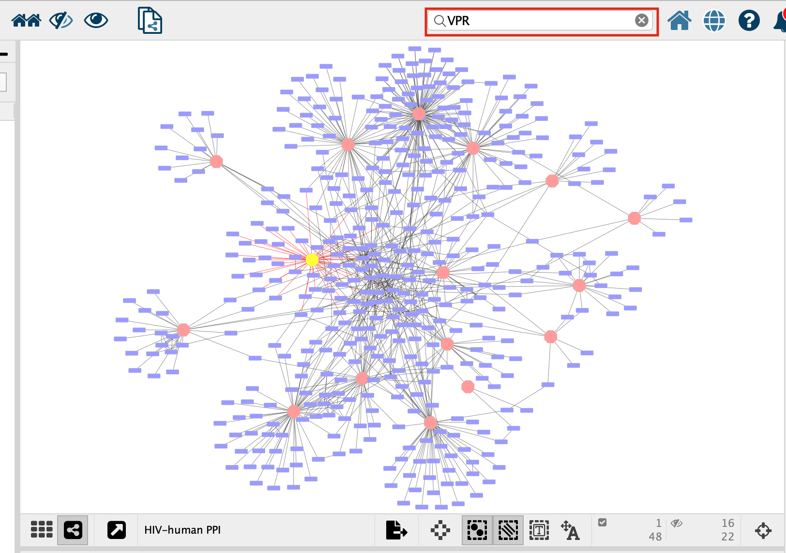
  
  1. VPR is now the only highlighted node in the network.  In order to select all its associated preys we need to select all the nodes that are connected to VPR, all of VPR's first neighbours.  There are two ways to select the first neighbours:
  i. In the top menu bar click on **Select** --> **Nodes** --> **First neighbors of selected nodes** --> **undirected**
  i. Click on the **first neighbor** button, 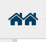, in the quick links button set.

<ol start=3 type="1">
<li>Click on the "Enrichment Table" in the Table Panel.</li>
</ol>

```{block, type="rmd-tip"}
If the Enrichment Table tab is not in the Table Panel, Open Enrichment Table.  Go to:<br>
Tools --> Enrichment Table --> Perform Gene Enrichment <br>
to launch Enrichment Table Tab.<br><br>
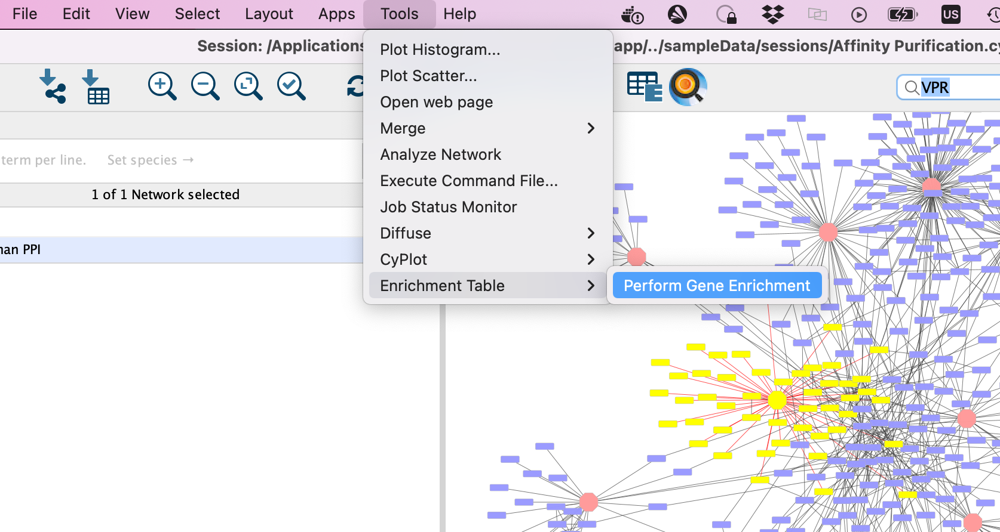

```

<ol start=4 type="1">
<li>Click on the cog icon in the top right hand corner of the Enrichment Table panel
  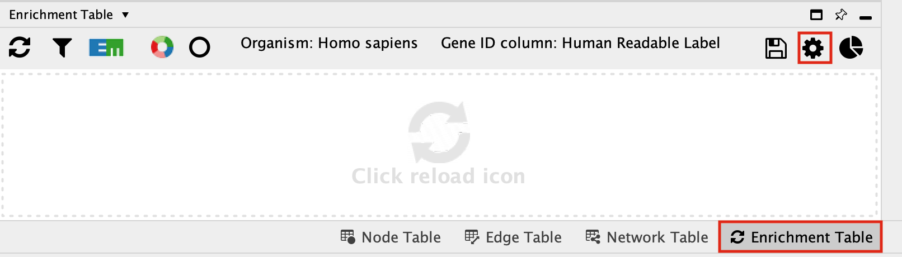
</li>
</ol>

<ol start=5 type="1">
<li>This will bring up a panel with the adjustable settings.  There are only 5 adjustable parameters- </li>
</ol>
  i. **Organism** - This shows a list of organisms that are available on the g:Profiler site.  
  i. **Gene ID column** - the column in the current network that you want to use to search g:Profiler with.  Ideally this should be a column specifying the Gene Name or other identifier.
  i. **Multiple testing correction** - change to fdr.
  i. **Adjusted p-value threshold (min 0 max 1)** - leave as 0.05.  If you are getting too many results you can make this value smaller.
  i. **Include inferred GO annotations (IEA)** - by default the search will exclude inferred from electonic annotation GO terms.  If you want to include them, select this option. <br>
    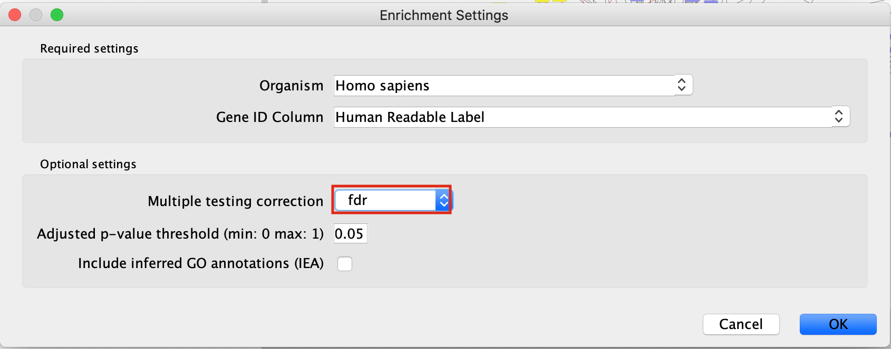

  <br>
<br>
```{block, type="rmd-tip"}  
  By default, EnrichmentTable automatically uses all the databases available on the g:Profiler site.  There is no way to filter prior to running the analysis.  You need to filter the results after the analysis has been run.  This **will** change the results because you end up filtering the results after the multiple correction and the multiple correction is dependent on the number of genesets you are testing with.  
```
 <br>
<br>

<ol start=6 type="1">
<li>Filter the EnrichmentTable results to show only GO&#58;BP, Reactome and Wikipathway, similiar to what we used in Module 2. </li>
</ol>  
  i. Click on the filter icon in the top left hand corner of the enrichment table results. <br> 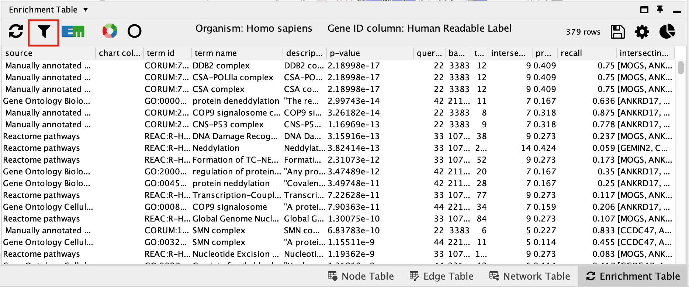
  i. Next to **Select Categories** select *Gene Ontology Biological Process*, *Reactome*, *Wikipathways*.  To select multiple options click and hold *command* key on Mac or *Shift* on Windows. <br> 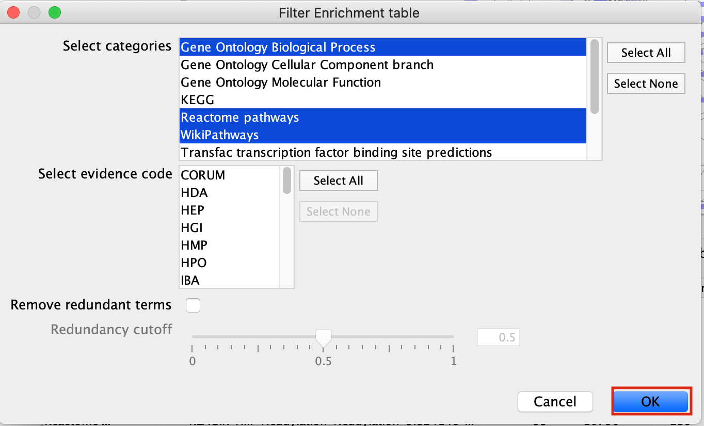
  i. click on **OK**
  i. The EnrichmentTable will update to only include the sets from  *Gene Ontology Biological Process*, *Reactome*, *Wikipathways*.<br> 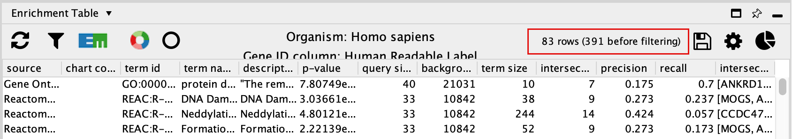

```{block, type="rmd-rcybox"}
**Equivalent RCy3 code — Select VPR and its first neighbours, then run g:Profiler enrichment directly from R**
```

```{r exercise3-rcybox, eval=FALSE}
library(gprofiler2)

# ── Select VPR and its first neighbours ──────────────────────────────────────
selectNodes(nodes = "VPR", by.col = "name", network = ap_suid,
            base.url = current_cytoscape_baseurl)
selectFirstNeighbors(network = ap_suid,
                     base.url = current_cytoscape_baseurl)

# Get the names of all selected nodes (VPR + prey proteins)
vpr_neighbourhood <- getSelectedNodes(network = ap_suid,
                                      base.url = current_cytoscape_baseurl)
message("Nodes in VPR neighbourhood: ", length(vpr_neighbourhood))

# ── Run g:Profiler enrichment directly from R ─────────────────────────────────
# This replicates what EnrichmentTable does internally, with full control over
# all parameters including source filtering before multiple testing correction.
gp_results <- gost(
  query             = vpr_neighbourhood,
  organism          = "hsapiens",
  correction_method = "fdr",
  user_threshold    = 0.05,
  evcodes           = TRUE,           # include evidence codes (like IEA filter)
  sources           = c("GO:BP", "REAC", "WP")  # GO:BP, Reactome, WikiPathways
)

# View the top results
if (!is.null(gp_results)) {
  results_df <- gp_results$result
  results_df <- results_df[order(results_df$p_value), ]
  print(head(results_df[, c("term_name", "source", "p_value", "term_size",
                             "intersection_size")], 20))
} else {
  message("No significant enrichment results found.")
}
```

## Exercise 3B - create Enrichment Map and Enhanced graphics nodes from EnrichmentTable {#enrichmenttabl-features}

<ol start=1 type="1">
<li> To create an Enrichment Map from the EnrichmentTable results, Click on the EM logo in the top left hand bar in the ErichmentTable Panel.<br>  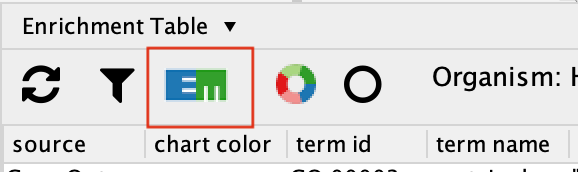 </li>
</ol>
  i. This will bring up an EM options panel with very limited parameter adjustments.  You can only change the name of the network and the connectivity threshold.  You have already specified the p-value threshold when you originally performed the analysis.  If you want to create your network with a more permissive q-value you need to go back to the EnrichmentTable search panel. Click on **OK**<br>  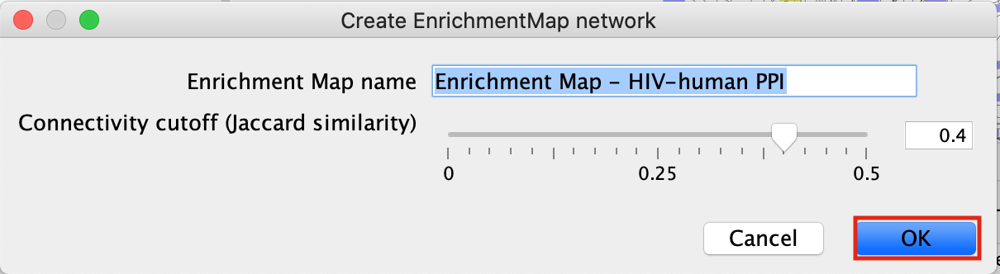
  i. This will create an Enrichment Map in a new network and represents all the *Gene Ontology Biological Process*, *Reactome*, *Wikipathways* terms enriched for the VPR and its prey protein set. <br> 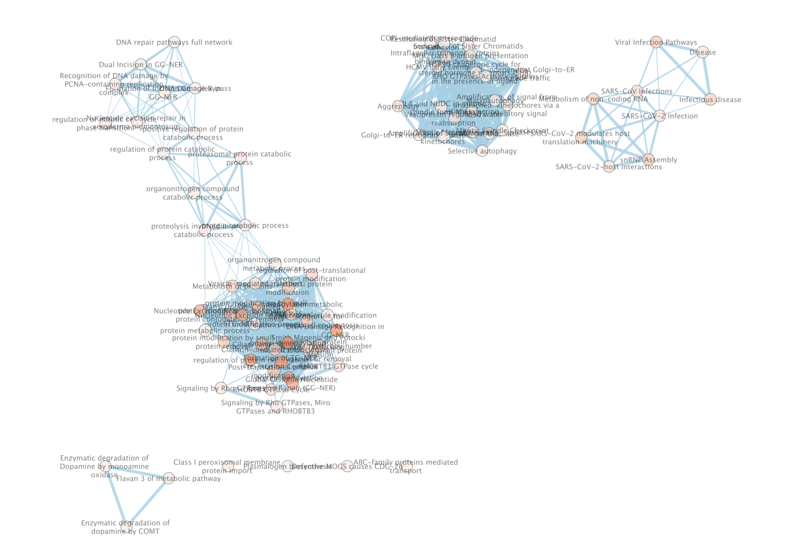

```{block, type="rmd-rcybox"}
**Equivalent RCy3 code — Build an Enrichment Map from g:Profiler results using the EnrichmentMap Cytoscape app**
```

Cytoscape has no access to the files that we create on the instance or remote server.  We need to upload the file to Cytoscape so it can see it.  

```{r upload_files_to_cytoscape, eval=FALSE}
#if using docker we need to replace all the the paths to the host path
if(is_remote) {
  upload_em_file <- function(localPath) {
      # EnrichmentMap's upload endpoint is on the root port, 
      #not under /v1
     base_no_v1 <- sub("/v1$", "", current_cytoscape_baseurl)
  
    bname <- basename(localPath)
    r <- httr::POST(
      url = paste(base_no_v1,
      '/enrichmentmap/textfileupload?fileName=', 
                  bname, sep=""),
      config = list(),
      body = list(file = httr::upload_file(localPath)),
      encode = "multipart",
      handle = NULL
    )
    httr::content(r,"parsed")$path
  }
  
}
```


```{r exercise3b-rcybox, eval=FALSE}
library(RCy3)

# ── Write g:Profiler results to a file that EnrichmentMap can read ────────────
# EnrichmentMap accepts g:Profiler results via its file-based input.
# gprofiler2::gost() can write a GMT-compatible file directly.

em_dir <- "./Module9/cytoscape_primer/em_output"
dir.create(em_dir, showWarnings = FALSE, recursive = TRUE)

gp_gem_file <- file.path(em_dir, "vpr_gprofiler.gem.txt")

# Write the g:Profiler results in the Generic Enrichment Map (GEM) format
if (!is.null(gp_results)) {
  gem_df <- data.frame(
    Name        = gp_results$result$term_name,
    Description = gp_results$result$term_id,
    pvalue      = gp_results$result$p_value,
    qvalue      = gp_results$result$p_value,  # gost returns fdr-corrected p_value
    phenotype = 1,
    genes       = sapply(gp_results$result$intersection, paste, collapse = ","),
    stringsAsFactors = FALSE
  )
  write.table(gem_df, file = gp_gem_file, sep = "\t",
              quote = FALSE, row.names = FALSE, col.names = TRUE)
}

#if cytoscape is remote then upload the file we just created
if(is_remote) {
    gp_gem_file <- upload_em_file(gp_gem_file)
  }

# ── Build the Enrichment Map via the RCy3 / EM command interface ──────────────
# Use commandsRun() to call the EnrichmentMap build command directly
em_command <- paste(
  "enrichmentmap build",
  paste0("analysisType=", "generic"),
  paste0("enrichmentsDataset1=", gp_gem_file),
  paste0("pvalue=",   "1.0"),    # already filtered by gost; keep all
  paste0("qvalue=",   "0.05"),
  paste0("coefficients=", "COMBINED"),
  paste0("similaritycutoff=", "0.375"),
  sep = " "
)

commandsRun(em_command,base.url = current_cytoscape_baseurl)

message("Enrichment Map created from VPR neighbourhood g:Profiler results.")
```

## Exercise 4 - Load network from NDex

[NDex](https://www.ndexbio.org/) is an open-source repository where scientists can store, share, manipulate and publish biological network data.  Networks are viewable on the web through their webapp but can also be downloaded directly into cytoscape so you can search, manipulate, integrate and analyze the given network for yourselves.

For the purpose of this exercise we are going to load in a network from the publication [A protein landscape of Breast Cancer](https://www.science.org/doi/10.1126/science.abf3066?url_ver=Z39.88-2003&rfr_id=ori:rid:crossref.org&rfr_dat=cr_pub%20%200pubmed).  This publication is associated with multiple networks the the authors of this paper created and shared in NDex - https://www.ndexbio.org/index.html#/networkset/4423340d-e8e3-11eb-b666-0ac135e8bacf

  1. Start a new session.  **File** --> **Close**
  1. In the Network Search bar (located at the top of the control panel) make sure that the search provider is set to NDex.  <br> 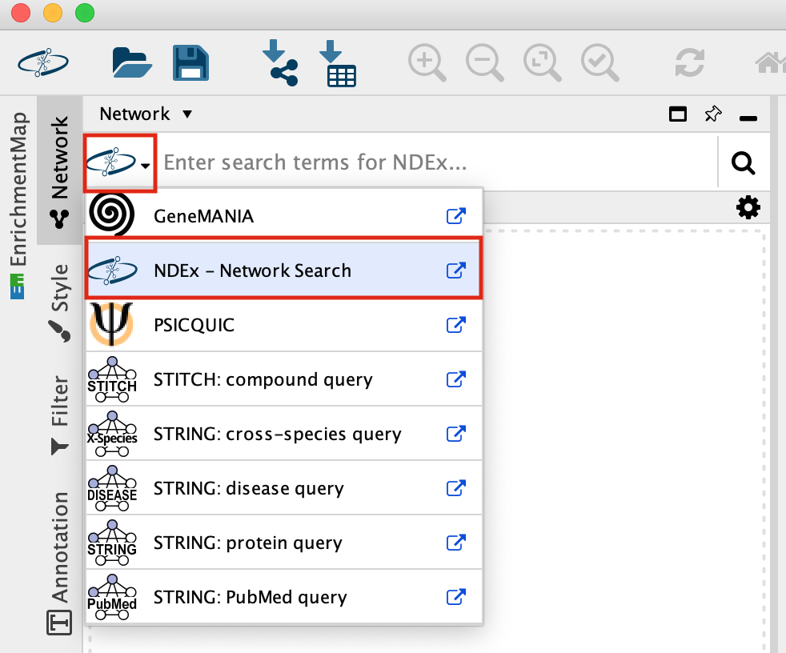
  
<br>
<br>
```{block, type="rmd-tip"}    
It should be set to NDex by default but click on down arrow to see the different data sources you can search for.  Later in the workshop we will be using this bar to query GeneMania.
```
<br>
<br>
<ol start=3 type="1">
<li> Enter *MCF7_All_PPI>=0.9* into the search box, Click on the search icon. <br> 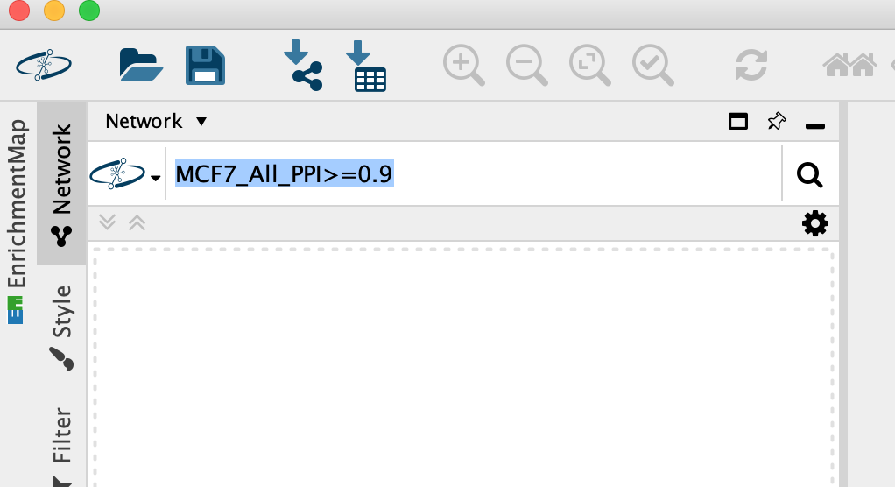</li></ol>

<ol start=4 type="1">
<li> A search results box will appear. The *MCF7_All_PPI>=0.9* network is just one of the networks associated with this publication.  Eventhough you are searching for this specific network, other networks associated with the original paper will also show up in the search results as well as others.<br> 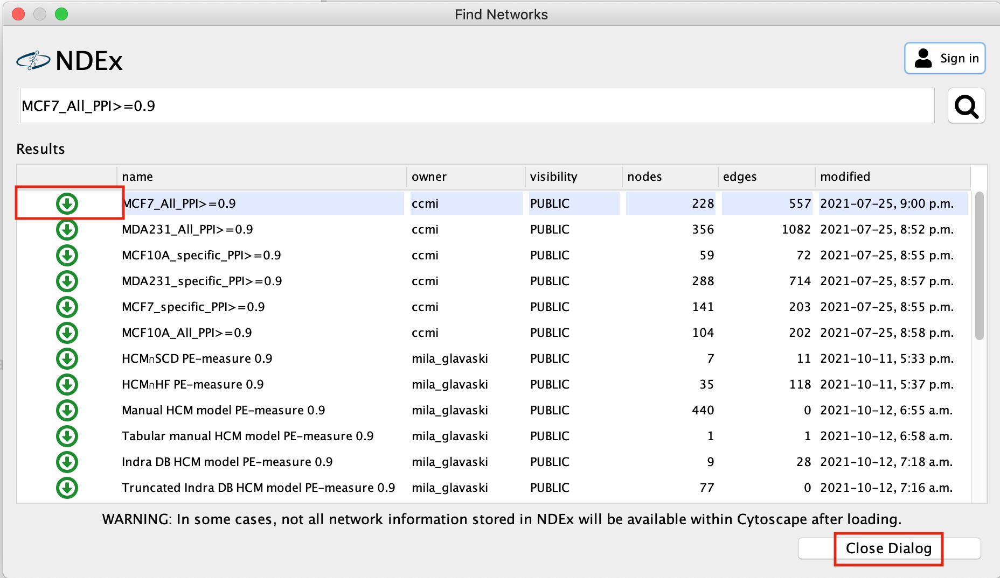</li>
</ol>

<ol start=5 type="1">
<li> Click on the green down arrow next to *MCF7_All_PPI>=0.9*, the network will start to import.</li></ol>

<ol start=6 type="1">
<li> Once the network has been loaded, click on **Close Dialog** </li></ol>

<ol start=7 type="1">
<li> Resulting network loaded into cytoccape.<br> 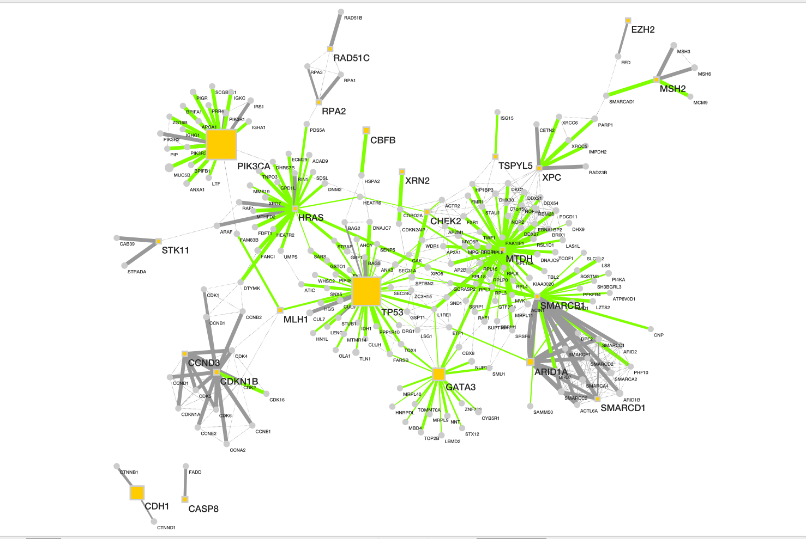 </li></ol>
<br>
<br>
```{block, type="rmd-note"} 
**Description taken from [NDex record](https://www.ndexbio.org/viewer/networks/84e36f91-ecb7-11eb-b666-0ac135e8bacf)**<br>

  * Baits are shown as yellow box, and 
  * preys as grey circle. 
  * Size of each node represents number of patients with alterations in each protein. 
  * Dotted line represents the physical protein-protein association (validated in other studies) with high Integrated Association Stringency score.
```

<br>
<br>
```{block, type="rmd-bonus"}  
  1. Change the edge width to reflect the number of patients the associations is found in instead of the PPI score.
  1. Change the default node colour to blue.
```

```{block, type="rmd-rcybox"}
**Equivalent RCy3 code — Close current session, import a network from NDEx, and apply bonus visual style changes**
```

```{r exercise4-rcybox, eval=FALSE}
library(RCy3)
library(ndexr)  # install with: BiocManager::install("ndexr")

# ── Close current session ─────────────────────────────────────────────────────
closeSession(save.before.closing = FALSE,
             base.url = current_cytoscape_baseurl)

# ── Import the MCF7_All_PPI>=0.9 network from NDEx ───────────────────────────
# The NDEx UUID for this network (from the publication's NDEx record)
mcf7_ndex_uuid <- "84e36f91-ecb7-11eb-b666-0ac135e8bacf"

# Import directly into Cytoscape via the CyNDEx2 app command
# (requires the CyNDEx2 Cytoscape app to be installed)
importNetworkFromNDEx(ndex.id = mcf7_ndex_uuid,
                      base.url = current_cytoscape_baseurl)

# Get the SUID of the imported network
mcf7_suid <- getNetworkSuid(base.url = current_cytoscape_baseurl)
message("MCF7 network SUID: ", mcf7_suid)

# Apply a layout to make the network readable
layoutNetwork("force-directed", network = mcf7_suid,
              base.url = current_cytoscape_baseurl)

# ── BONUS: Change edge width to reflect number of patients ────────────────────
# First inspect the edge table to find the relevant column name
edge_table <- getTableColumns(table = "edge", network = mcf7_suid,
                              base.url = current_cytoscape_baseurl)
print(colnames(edge_table))  # identify the patients column name

# Assuming the column is called "num_patients" - adjust to match actual column
patient_col <- "PPI.Score"   # <-- update this to the actual column name

patient_min <- min(edge_table[[patient_col]], na.rm = TRUE)
patient_max <- max(edge_table[[patient_col]], na.rm = TRUE)

setEdgeLineWidthMapping(
  table.column        = patient_col,
  table.column.values = c(patient_min, patient_max),
  widths              = c(1, 10),
  mapping.type        = "continuous",
  network             = mcf7_suid,
  base.url = current_cytoscape_baseurl
)

# ── BONUS: Change default node colour to blue ─────────────────────────────────
setNodeColorDefault(new.color = "#4A90D9", 
                    base.url = current_cytoscape_baseurl)

message("Visual style updates applied to MCF7 network.")
```
