# Module 9.2 Lab: g:profiler Visualization {#gprofiler_mod9}

**This work is licensed under a [Creative Commons Attribution-ShareAlike 3.0 Unported License](http://creativecommons.org/licenses/by-sa/3.0/deed.en_US). This means that you are able to copy, share and modify the work, as long as the result is distributed under the same license.**

By Gary Bader, Ruth Isserlin, Veronique Voisin

## Goal of the exercise

**Create an enrichment map and navigate through the network**

During this exercise, you will learn how to create an enrichment map from gene-set enrichment results. The enrichment results chosen for this exercise are generated using

  * [g:Profiler](https://biit.cs.ut.ee/gprofiler/gost) but an enrichment map can be created directly from output from:
  
  * [GSEA](http://software.broadinstitute.org/gsea/index.jsp), 
  * [g:Profiler](https://biit.cs.ut.ee/gprofiler/gost),
  * [GREAT](http://great.stanford.edu/public/html/),
  * [BinGo](http://apps.cytoscape.org/apps/bingo),
  * [Enrichr](https://amp.pharm.mssm.edu/Enrichr/) or 
  * alternately from any gene-set tool using the generic enrichment results (GEM) format.


## Data

The data used in this exercise is a differentially expressed gene set from palbociclib-resistant samples compared with parental samples from the breast cancer cell line MCF7 [previous exercise](#gprofiler-lab). 


## EnrichmentMap

*	A circle (node) is a gene-set (pathway) enriched in genes that we used as input in g:Profiler (frequently mutated genes).

*	edges (lines) represent genes in common between 2 pathways (nodes).

*	A cluster of nodes represent overlapping and related pathways and may represent a common biological process.

*	Clicking on a node will display the genes included in each pathway.

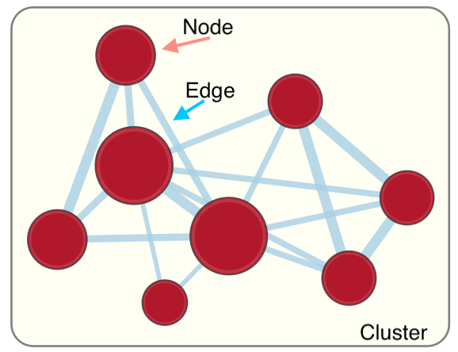


## Description of this exercise

We will create EnrichmentMaps from:

  1. **Two g:Profiler results** run on UP- and DOWN-regulated genes separately .
  2. **fgsea results** using the Baderlab gene set file .

An enrichment map represents the result of enrichment analysis as a network where significantly enriched gene-sets that share a lot of genes in common will form identifiable clusters. The visualization of the results as these biological themes will ease the interpretation of the results. 

The goal of this exercise is to learn how to:

  1. Upload g:Profiler results into Cytoscape EnrichmentMap to create a map.
  1. Upload UP and DOWN regulated g:Profiler results at the same time to create one combined map.
  1. Create an EnrichmentMap from fgsea results using the Baderlab gene set file.


## Start the exercise

To start the lab practical section, first create a gprofiler_files directory on your computer and download the files below.

```{block, type="rmd-datadownload"}
Right click on link below and select "Save Link As...".

Place it in the corresponding module directory of your CBW work directory.
```

Two input files are needed to generate all the enrichment results:

  1. Differential expression results: [edgeR_resistant_vs_parental_all_genes.csv](./Module9/gprofiler/data/edgeR_resistant_vs_parental_all_genes.csv)
    * Full edgeR output with columns: logFC, logCPM, F, PValue, FDR, gene, score
  2. Custom Baderlab gene set file: [Human_GOBP_AllPathways_filtered_500orLessV2.gmt](./Module9/gprofiler/data/Human_GOBP_AllPathways_filtered_500orLessV2.gmt)
    * Pre-filtered to gene sets with 500 or fewer genes
  3. [enrichment_results_gprofiler_UPgenes.gem.txt](./Module9/gprofiler/data/enrichment_results_gprofiler_UPgenes.gem.txt) — g:profiler UP genes results, GEM format for EnrichmentMap
  4. [enrichment_results_gprofiler_DNgenes.gem.txt](./Module9/gprofiler/data/enrichment_results_gprofiler_DNgenes.gem.txt) — g:profiler DOWN genes results, GEM format for EnrichmentMap
  5. [gprofiler_full_hsapiens.name.gmt](./Module9/gprofiler/data/gprofiler_full_hsapiens.name.gmt) — downloaded from g:Profiler


```{r prepare-enrichment-files, eval=FALSE,include=FALSE}
# The code block below generates all remaining files automatically:
# 
#   * `enrichment_results_gprofiler_UPgenes.csv` — g:Profiler results for UP-regulated genes
#   * `enrichment_results_gprofiler_DNgenes.csv` — g:Profiler results for DOWN-regulated genes
#  
#   * `fgsea_resistant_vs_parental.csv` — fgsea results (from previous exercise)
# 
# ---
# 
# ## Prepare enrichment result files from edgeR output
# 
# Run this code block **once** before starting the exercises. It reads the edgeR differential expression results, selects UP- and DOWN-regulated genes, runs g:Profiler on each set using both the g:Profiler built-in GMT (downloaded automatically) and the custom Baderlab GMT, and writes all output GEM files to the data directory.

library(gprofiler2)

data_dir  <- "./Module9/gprofiler/data"
dir.create(data_dir, showWarnings = FALSE, recursive = TRUE)

# ── File paths ────────────────────────────────────────────────────────────────
edger_file    <- file.path(data_dir, "edgeR_resistant_vs_parental_all_genes.csv")
baderlab_gmt  <- file.path(data_dir, "Human_GOBP_AllPathways_filtered_500orLessV2.gmt")
up_csv        <- file.path(data_dir, "enrichment_results_gprofiler_UPgenes.csv")
dn_csv        <- file.path(data_dir, "enrichment_results_gprofiler_DNgenes.csv")
up_gem        <- file.path(data_dir, "enrichment_results_gprofiler_UPgenes.gem.txt")
dn_gem        <- file.path(data_dir, "enrichment_results_gprofiler_DNgenes.gem.txt")
gprofiler_gmt <- file.path(data_dir, "gprofiler_full_hsapiens.name.gmt")

# ── 1. Read edgeR results ─────────────────────────────────────────────────────
degs <- read.csv(edger_file, stringsAsFactors = FALSE)

# Filter to significant genes (FDR < 0.05)
sig <- degs[!is.na(degs$FDR) & degs$FDR < 0.05, ]

# Split into UP and DOWN by logFC direction
up_genes <- sig$gene[sig$logFC >  0]
dn_genes <- sig$gene[sig$logFC <  0]

message("UP genes:   ", length(up_genes))
message("DOWN genes: ", length(dn_genes))

# ── 2. Download g:Profiler GMT file ──────────────────────────────────────────
# gprofiler2 can download the GMT for a given organism directly
if (!file.exists(gprofiler_gmt)) {
  message("Downloading g:Profiler GMT for hsapiens ...")
  # download_GO downloads individual source GMTs; we concatenate GO:BP, REAC, WP
  gobp_gmt <- download_GO(organism = "hsapiens", format = "name",
                           filename = file.path(data_dir, "hsapiens.GO_BP.name.gmt"))
  reac_gmt  <- download_GO(organism = "hsapiens", format = "name",
                            filename = file.path(data_dir, "hsapiens.REAC.name.gmt"),
                            sources   = "REAC")
  wp_gmt    <- download_GO(organism = "hsapiens", format = "name",
                            filename = file.path(data_dir, "hsapiens.WP.name.gmt"),
                            sources   = "WP")
  # Concatenate into one file
  gmt_lines <- c(
    readLines(file.path(data_dir, "hsapiens.GO_BP.name.gmt")),
    readLines(file.path(data_dir, "hsapiens.REAC.name.gmt")),
    readLines(file.path(data_dir, "hsapiens.WP.name.gmt"))
  )
  writeLines(gmt_lines, gprofiler_gmt)
  message("g:Profiler GMT written to: ", gprofiler_gmt)
} else {
  message("g:Profiler GMT already exists: ", gprofiler_gmt)
}

# ── 3. Helper: run g:Profiler and save CSV + GEM ─────────────────────────────
run_gprofiler_and_save <- function(genes, csv_path, gem_path,
                                   custom_gmt = NULL, phenotype = 1) {

  if (!is.null(custom_gmt)) {
    # Upload custom GMT to g:Profiler and get the token
    gmt_token <- upload_GMT_file(gmtfile = custom_gmt)
    organism  <- gmt_token
    sources   <- NULL   # all sources in the custom GMT
  } else {
    organism <- "hsapiens"
    sources  <- c("GO:BP", "REAC", "WP")
  }

  gp <- gost(
    query             = genes,
    organism          = organism,
    sources           = sources,
    correction_method = "fdr",
    user_threshold    = 0.05,
    evcodes           = TRUE    # adds 'intersection' column with gene IDs
  )

  if (is.null(gp) || nrow(gp$result) == 0) {
    message("No significant results for: ", csv_path)
    return(invisible(NULL))
  }

  result <- gp$result

  # ── Save raw CSV
result_to_save <- result
# Convert any list columns to semicolon-separated strings
list_cols <- sapply(result_to_save, is.list)
result_to_save[list_cols] <- lapply(result_to_save[list_cols], function(col)
  sapply(col, function(x) paste(x, collapse = ";"))
)
write.csv(result_to_save, file = csv_path, row.names = FALSE)
message("CSV saved: ", csv_path)

  # ── Convert to GEM format for EnrichmentMap
  gem <- data.frame(
    Name        = result$term_id,
    Description = result$term_name,
    pvalue      = result$p_value,
    qvalue      = result$p_value,   # gost returns FDR-corrected p_value
    phenotype   = phenotype,
    genes       = sapply(result$intersection, function(x)
                    paste(trimws(unlist(strsplit(as.character(x), ","))),
                          collapse = ",")),
    stringsAsFactors = FALSE
  )

  write.table(gem, file = gem_path, sep = "\t",
              quote = FALSE, row.names = FALSE, col.names = TRUE)
  message("GEM saved: ", gem_path)

  invisible(result)
}

# ── 4. Run g:Profiler on UP genes using custom Baderlab GMT ──────────────────
message("\n--- Running g:Profiler on UP-regulated genes (Baderlab GMT) ---")
run_gprofiler_and_save(
  genes      = up_genes,
  csv_path   = up_csv,
  gem_path   = up_gem,
  custom_gmt = baderlab_gmt,
  phenotype  = 1
)

# ── 5. Run g:Profiler on DOWN genes using custom Baderlab GMT ─────────────────
message("\n--- Running g:Profiler on DOWN-regulated genes (Baderlab GMT) ---")
run_gprofiler_and_save(
  genes      = dn_genes,
  csv_path   = dn_csv,
  gem_path   = dn_gem,
  custom_gmt = baderlab_gmt,
  phenotype  = -1
)

message("\nAll enrichment files written to: ", data_dir)
message("You can now proceed with the exercises below.")

library(fgsea)

data_dir   <- "./Module9/gprofiler/data"
edger_file <- file.path(data_dir, "edgeR_resistant_vs_parental_all_genes.csv")
gmt_file   <- file.path(data_dir, "Human_GOBP_AllPathways_filtered_500orLessV2.gmt")

# ── 1. Build ranked list from edgeR score column ──────────────────────────────
degs  <- read.csv(edger_file, stringsAsFactors = FALSE)
ranks <- setNames(degs$score, degs$gene)
ranks <- sort(ranks, decreasing = TRUE)   # fgsea expects descending order
ranks <- ranks[!is.na(ranks)]

# ── 2. Load GMT file ──────────────────────────────────────────────────────────
pathways <- gmtPathways(gmt_file)
message("Gene sets loaded: ", length(pathways))

# ── 3. Run fgsea ─────────────────────────────────────────────────────────────
set.seed(42)
fgsea_results <- fgsea(
  pathways   = pathways,
  stats      = ranks,
  minSize    = 15,
  maxSize    = 500,
  nPermSimple = 10000
)

# ── 4. Write GSEA-style output files ─────────────────────────────────────────
# GSEA produces two report files: one for positively enriched (NES > 0)
# and one for negatively enriched (NES < 0) gene sets.
# EnrichmentMap reads both and the column names must match exactly.

gsea_cols <- c("NAME", "GS<br> DETAILS", "SIZE", "ES", "NES",
               "NOM p-val", "FDR q-val", "FWER p-val",
               "RANK AT MAX", "LEADING EDGE")

make_gsea_report <- function(results, ranks, pathways) {
  results <- results[order(results$NES, decreasing = TRUE), ]
  n_genes <- length(ranks)

  rows <- lapply(seq_len(nrow(results)), function(i) {
    pw_name    <- results$pathway[i]
    le_genes   <- unlist(results$leadingEdge[[i]])
    gs_genes   <- pathways[[pw_name]]
    gs_size    <- results$size[i]

    le_idx      <- which(names(ranks) %in% le_genes)
    rank_at_max <- if (length(le_idx) > 0) max(le_idx) else NA_integer_

    tags_pct   <- round(length(le_genes) / gs_size * 100)
    list_pct   <- round(rank_at_max / n_genes * 100)
    signal_pct <- round(tags_pct/100 * (1 - list_pct/100) *
                          (n_genes / (n_genes - gs_size)) * 100)

    data.frame(
      "NAME"          = pw_name,
      "GS<br> follow link to MSigDB" = "",          # empty — no MSigDB link for custom GMT
  "GS DETAILS"                 = paste0("Details for ", pw_name),
      "SIZE"          = gs_size,
      "ES"            = round(results$ES[i],  7),
      "NES"           = round(results$NES[i], 7),
      "NOM p-val"     = results$pval[i],
      "FDR q-val"     = results$padj[i],
      "FWER p-val"    = results$pval[i],
      "RANK AT MAX"   = rank_at_max,
      "LEADING EDGE"  = sprintf("tags=%d%%, list=%d%%, signal=%d%%",
                                tags_pct, list_pct, signal_pct),
      check.names     = FALSE,
      stringsAsFactors = FALSE
    )
  })

  do.call(rbind, rows)
}

# Split into positive and negative NES
pos_results <- fgsea_results[fgsea_results$NES >  0 & !is.na(fgsea_results$NES), ]
neg_results <- fgsea_results[fgsea_results$NES <= 0 & !is.na(fgsea_results$NES), ]

pos_report <- make_gsea_report(pos_results, ranks, pathways)
neg_report <- make_gsea_report(neg_results, ranks, pathways)

all_reports <- rbind(pos_report,neg_report)

all_results_file <- file.path(data_dir, "fgsea_report_for_list.tsv")

write.table(all_reports, file = all_results_file, sep = "\t",
            quote = FALSE, row.names = FALSE, col.names = TRUE)

message("enrichment report: ", nrow(all_reports), " gene sets -> ", all_results_file)

rnk_file <- file.path(data_dir, "resistant_vs_parental.rnk")
rnk_df   <- data.frame(gene = degs$gene, score = degs$score,
                        stringsAsFactors = FALSE)
rnk_df   <- rnk_df[order(rnk_df$score, decreasing = TRUE), ]
rnk_df   <- rnk_df[!is.na(rnk_df$score), ]
write.table(rnk_df, file = rnk_file, sep = "\t",
            quote = FALSE, row.names = FALSE, col.names = FALSE)
message("RNK file written: ", rnk_file)
```

```{block, type="rmd-note"}
The g:Profiler GMT file (`gprofiler_full_hsapiens.name.gmt`) is downloaded automatically by the code above using `gprofiler2::download_GO()`. 

The Baderlab custom GMT (`Human_GOBP_AllPathways_filtered_500orLessV2.gmt`) is pre-filtered to gene sets with 500 or fewer genes, which means the FDR correction is applied only to those gene sets — giving more statistical power than filtering after the fact. 

`evcodes = TRUE` in the `gost()` call is required to get the `intersection` column, which contains the actual gene IDs from your query that overlap with each term. Despite the name, this is not GO evidence codes — it is the intersecting gene identifiers.
```

---

```{block, type="rmd-rcybox"}
**RCy3 Setup — run once before all exercises**
```

```{r setup-rcy3, eval=FALSE}
library(RCy3)
library(httr)
library(jsonlite)

path_to_save_cytoscape = "/Users/risserlin/CBW_Workshop_results/Module9"

# Set base URL — adjust if not running from Docker
current_cytoscape_baseurl <- "http://host.docker.internal:1234/v1"

cytoscapePing(base.url = current_cytoscape_baseurl)
cytoscapeVersionInfo(base.url = current_cytoscape_baseurl)

# Helper: upload a local file to Cytoscape so EM can read it.
# EnrichmentMap's upload endpoint sits outside /v1.
upload_em_file <- function(localPath) {
  bname      <- basename(localPath)
  base_no_v1 <- sub("/v1$", "", current_cytoscape_baseurl)
  r <- httr::POST(
    url    = paste0(base_no_v1,
                    "/enrichmentmap/textfileupload?fileName=", bname),
    config = list(),
    body   = list(file = httr::upload_file(localPath)),
    encode = "multipart",
    handle = NULL
  )
  jsonlite::fromJSON(rawToChar(r$content))$path
}

# Helper: convert fgsea CSV result to GEM format and write to disk.
# g:Profiler GEM files are already written by the prepare-enrichment-files chunk.
fgsea_csv_to_gem <- function(csv_path, gem_path) {
  fs <- read.csv(csv_path, stringsAsFactors = FALSE)
  gem <- data.frame(
    Name        = fs$pathway,
    Description = fs$pathway,
    pvalue      = fs$pval,
    qvalue      = fs$padj,
    phenotype   = ifelse(fs$NES >= 0, 1, -1),
    genes       = fs$leadingEdge,
    stringsAsFactors = FALSE
  )
  write.table(gem, file = gem_path, sep = "\t",
              quote = FALSE, row.names = FALSE, col.names = TRUE)
  invisible(gem_path)
}

# ── File paths (g:Profiler GEMs written by prepare-enrichment-files chunk) ───
data_dir      <- "./Module9/gprofiler/data"
up_gem        <- file.path(data_dir, "enrichment_results_gprofiler_UPgenes.gem.txt")
dn_gem        <- file.path(data_dir, "enrichment_results_gprofiler_DNgenes.gem.txt")
fgsea_csv     <- file.path(data_dir, "fgsea_resistant_vs_parental.csv")
fgsea_gem     <- file.path(data_dir, "fgsea_report_for_list.tsv")
gmt_gprofiler <- file.path(data_dir, "gprofiler_full_hsapiens.name.gmt")
gmt_baderlab  <- file.path(data_dir, "Human_GOBP_AllPathways_filtered_500orLessV2.gmt")

message("Setup complete. All GEM files ready in: ", data_dir)
```

## Exercise 1a - compare UP and DOWN regulated g:Profiler results

### Step 1

Launch Cytoscape and open the EnrichmentMap App

1a. Double click on Cytoscape icon

1b. Open EnrichmentMap App

*	In the Cytoscape top menu bar:

  *	Click on Apps -> EnrichmentMap

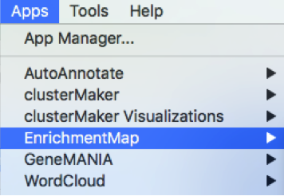

 * A 'Create Enrichment Map' window is now opened.

### Step 2

Create an enrichment map from the UP and DOWN g:Profiler result files.

2a. In the '**Create Enrichment Map**' window, drag and drop the 2 enrichment files *enrichment_results_gprofiler_UPgenes.gem.txt* and 
*enrichment_results_gprofiler_DNgenes.gem.txt*.

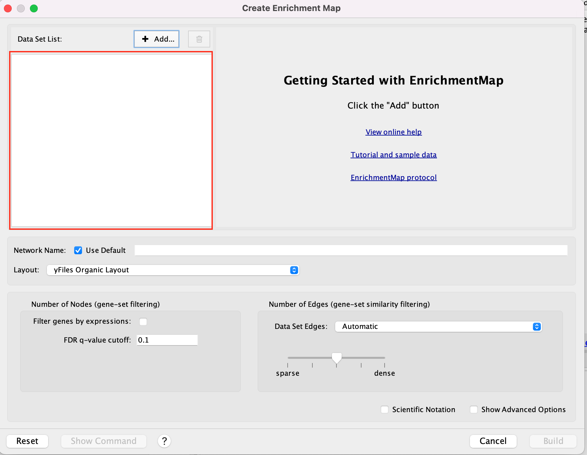

2b. In the white box, click on "*enrichment_results_gprofiler_UPgenes (Generic/gProfiler)*" 

2c. On the right side, go to the **GMT** field, click on the 3 radio button (...) and locate the file *gprofiler_full_hsapiens.name.gmt* that you have saved on your computer to upload it.

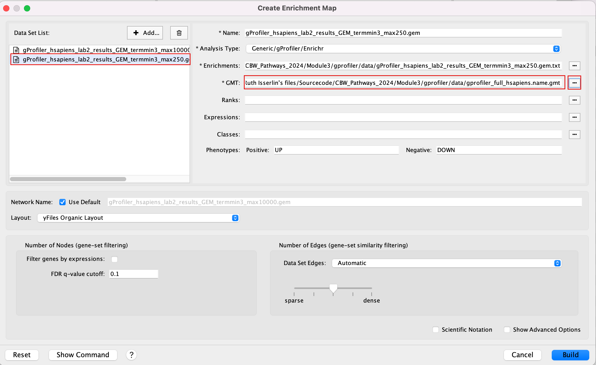

2d. In the white box, click on "*enrichment_results_gprofiler_DNgenes (Generic/gProfiler)*" 

2e. On the right side, go to the **GMT** field, click on the 3 radio button (...) and locate the file *gprofiler_full_hsapiens.name.gmt* that you have saved on your computer to upload it.

2f. Locate the **FDR q-value cutoff** field and set the value to 0.01

2g. Select the **Connectivity** slide bar to **sparse**. 

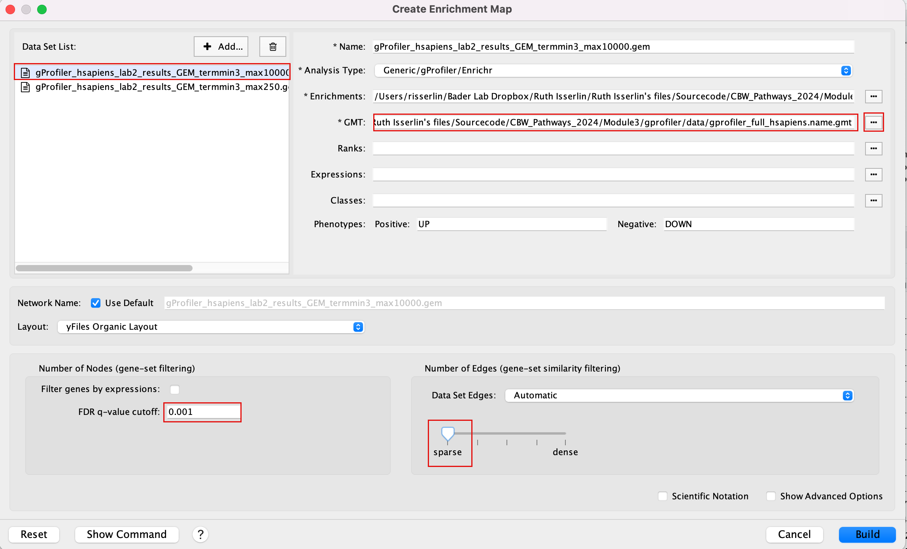

```{block, type="rmd-tip"}
Instead of specifying the gmt file for each dataset separately, if all the datasets in your analysis use the same gmt file, you can specify a common gmt file to be used by all datasets.  

  * Click *+Add...* and select *Add Common Files* 
  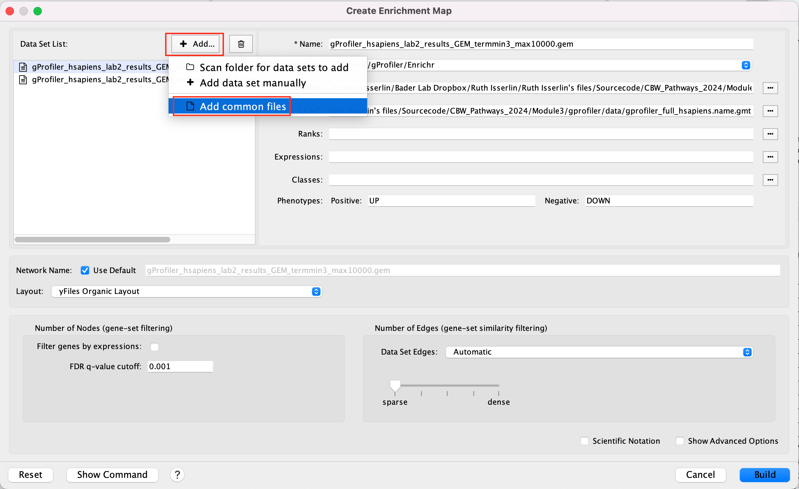
  * On the right side, go to the *GMT file* field, click on the 3 radio button (...) and locate the file *gprofiler_full_hsapiens.name.gmt* that you have saved on your computer to upload it.

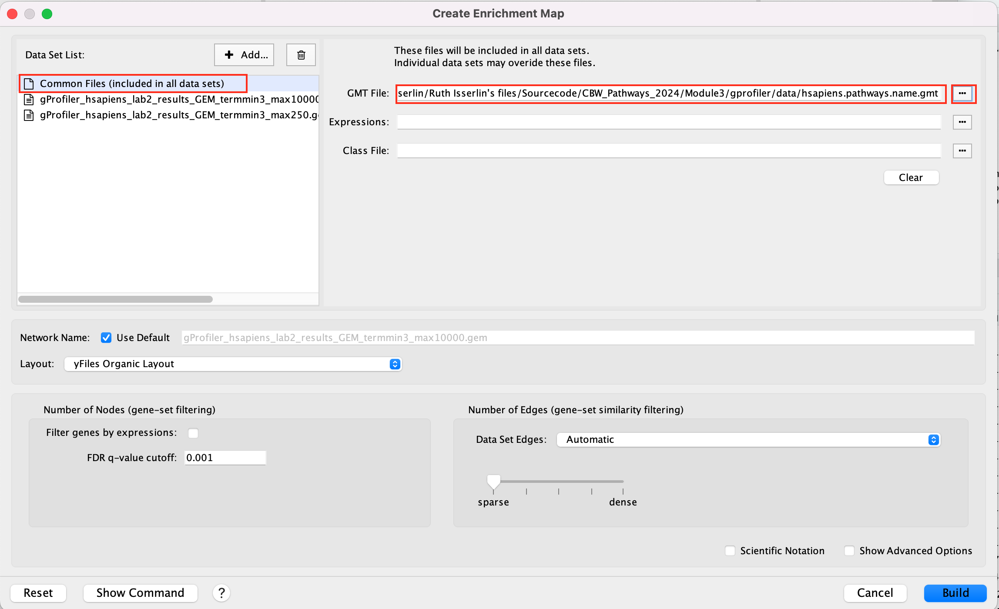

  This can also be done for a shared expression file.

```


2h. Click on *Build*.

```{block, type="rmd-tip"}
If you have specified common files this info box will appear

  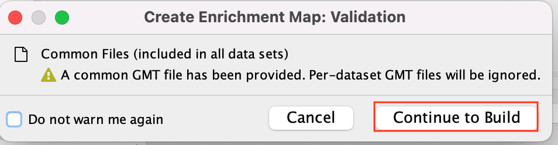
  * Click on *Continue to build*

```

* A status bar should pop up showing progress of the Enrichment map build.

<p align="center">
  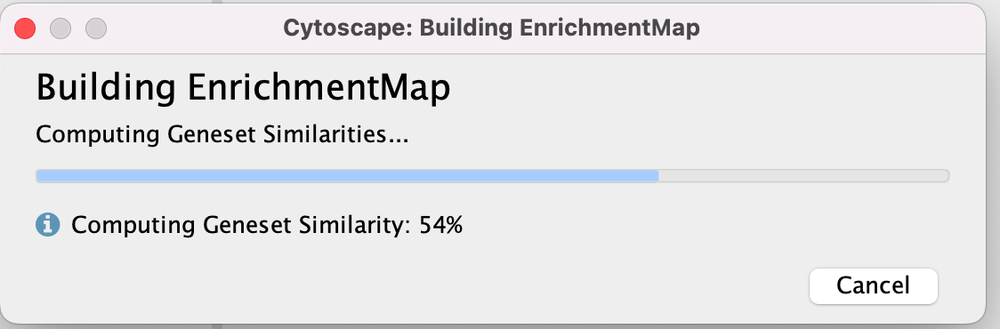
</p>

```{block, type="rmd-tip"}
There might be multiple messages that appear when you first create an enrichment map.  You can choose to silence them if you want (Although the yfiles message will continue to appear every two weeks).

  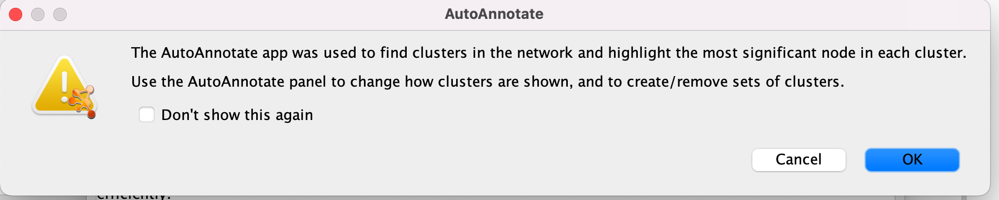
  * Click on *OK*

  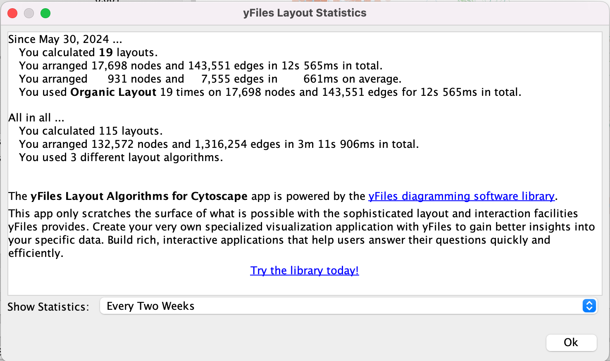
  * Click on *OK*

```

### Step 3: Explore the results:

In the EnrichmentMap control panel located at the left:

  * Select the 2 Data Sets (checked by default)
  * Set Chart Data to *Color by Data Set*
  * Select *Publication Ready* to remove gene-set label to have a global view of the map. 
  
```{block, type="rmd-tip"}
un-select *Publication Ready* when you explore the map in more detail to see the gene-set names. 
```

<p align="center">
   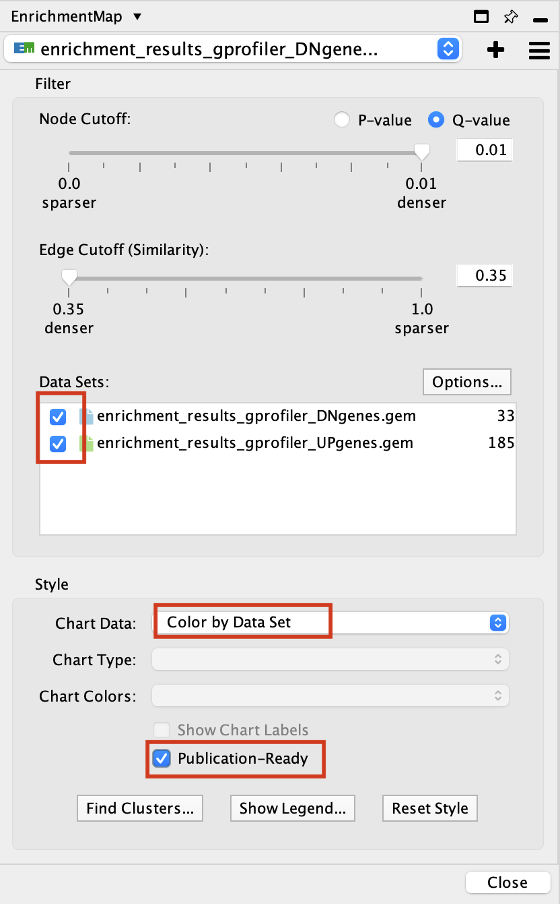
</p>

On the map, a node that is coloured both green and blue is a gene-set that is found in both the UP and DOWN g:Profiler result sets. 

* A node that is blue is a gene-set that is found only in the DOWN-regulated results (*enrichment_results_gprofiler_DNgenes*). 
* A node that is green is a gene-set that is found only in the UP-regulated results (*enrichment_results_gprofiler_UPgenes*).
* A blue edge represents genes that overlap between gene-sets found in the DOWN-regulated results.
* A green edge represents genes that overlap between gene-sets found in the UP-regulated results. 

 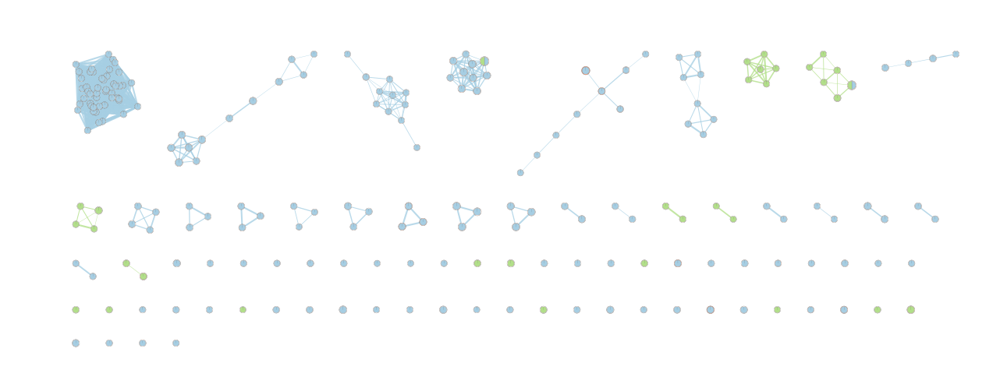

```{block, type="rmd-question"}
Are there pathways enriched in both the UP and DOWN gene lists? What might this mean biologically?
```

### Explore Detailed results 

  * In the Cytoscape menu bar, select 'View" and 'Show Graphic Details' to display node labels. 
  
```{block, type="rmd-caution"}
Make sure you have unselected "Publication Ready" in the EnrichmentMap control panel.
```

  * Zoom in to be able to read the labels and navigate the network using the bird eye view (blue rectangle).

  * Select a node and visualize the *Table Panel*
    * Click on a node
   
    * For this example the node *"MET_activates"* has been selected. 
    
```{block, type="rmd-tip"}
you can type it in the search bar, quotes are important.   
```

   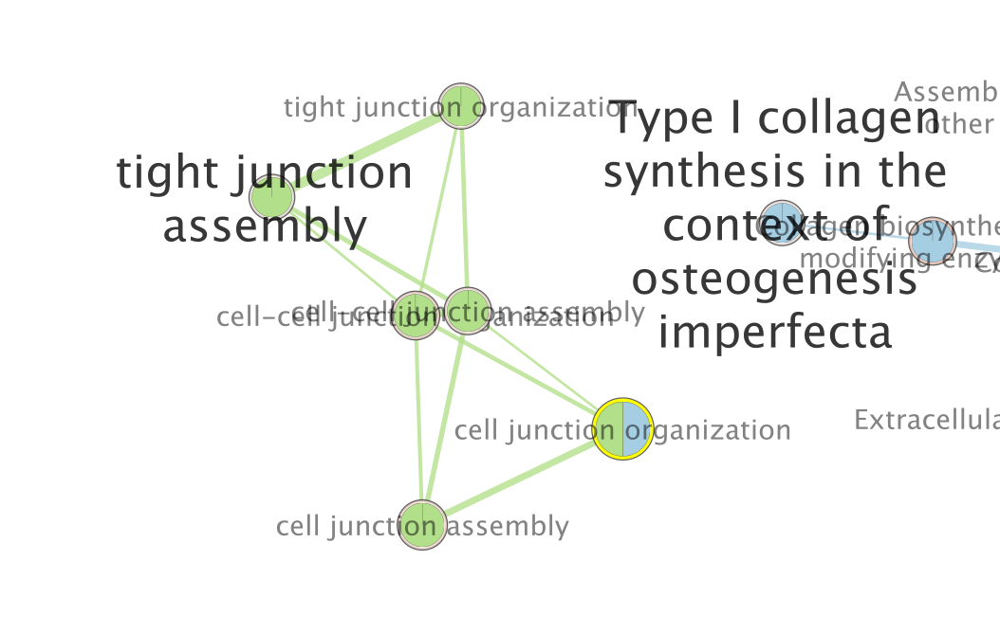

When the node is selected, it is highlighted in <font color="yellow">yellow</font>.

In table panel, we can see the genes included in the gene-set. 

A green colored box indicates that the gene is in the gene-set(pathway) and in our gene list. 

A gray colored box indicated that the gene is in the gene-set but not in our gene list.

  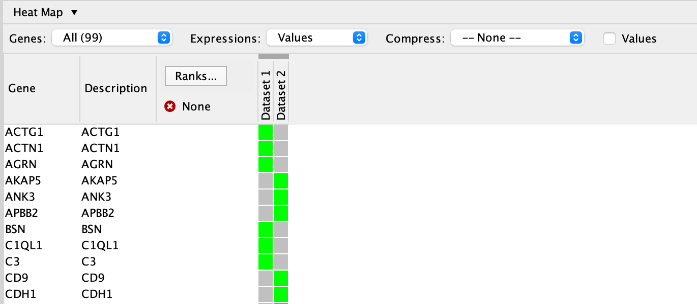

```{block, type="rmd-rcybox"}
**Equivalent RCy3 code — Exercise 1a: Build EM from UP and DOWN g:Profiler results**
```

```{r exercise1a-rcy3, eval=FALSE}
# Upload GEM files to Cytoscape
up_gem_cyto    <- upload_em_file(up_gem)
dn_gem_cyto    <- upload_em_file(dn_gem)
gmt_cyto       <- upload_em_file(gmt_baderlab)

# Build the EnrichmentMap with both datasets
em1a_command <- paste(
  "enrichmentmap build",
  "analysisType=generic",
  paste0("enrichmentsDataset1=", up_gem_cyto),
  paste0("gmtFile=",            gmt_cyto),
  paste0("enrichmentsDataset2=", dn_gem_cyto),
  "qvalue=0.01",
  "pvalue=1.0",
  "coefficients=JACCARD",
  "similaritycutoff=0.35",
  sep = " "
)

commandsRun(em1a_command, base.url = current_cytoscape_baseurl)

# Get the newly created network
em1a_suid <- getNetworkSuid(base.url = current_cytoscape_baseurl)
message("Exercise 1a EM SUID: ", em1a_suid)

renameNetwork("EM_UP_vs_DN_gprofiler",
              network = getNetworkSuid(base.url = current_cytoscape_baseurl),
              base.url = current_cytoscape_baseurl)

# Apply a layout
layoutNetwork("force-directed defaultSpringCoefficient=0.00004 defaultSpringLength=5",
              network = em1a_suid, base.url = current_cytoscape_baseurl)

# Search for a specific node (e.g. "MET activates") and select it
selectNodes(nodes = "MET ACTIVATES PTK2 SIGNALING%REACTOME DATABASE ID RELEASE 97%8874081", by.col = "name",
            network = em1a_suid, base.url = current_cytoscape_baseurl)

# View the node table for the selected node
selected_node_table <- getTableColumns(
  table   = "node",
  network = em1a_suid,
  base.url = current_cytoscape_baseurl
)
# Filter to the selected node
selected_nodes <- getSelectedNodes(network = em1a_suid,
                                   base.url = current_cytoscape_baseurl)
print(selected_node_table[selected_node_table$name %in% selected_nodes, ])
```

## Exercise 1b - create EM from fgsea results using Baderlab genesets
 
Create an enrichment map from fgsea results run using the custom Baderlab gene-set file. <br>
Using a pre-filtered pathway database (max 250 genes per set) means the FDR is calculated only on these gene-sets, giving a more focused and interpretable result compared to filtering after the fact.

For this exercise, we will use:
 
  * fgsea result file: [fgsea_report_for_list.tsv](./Module9/gprofiler/data/fgsea_report_for_list.tsv)
  
  * Filtered gmt file: [Human_GOBP_AllPathways_filtered_500orLessV2.gmt](./Module9/gprofiler/data/Human_GOBP_AllPathways_filtered_500orLessV2.gmt). 
  
  * To create an enrichment map of these results:
   * Go to Control Panel and select the EnrichmentMap tab. 
 * Click on the "+" sign to re-open the *Create Enrichment Map* window.
 <p align="center">
   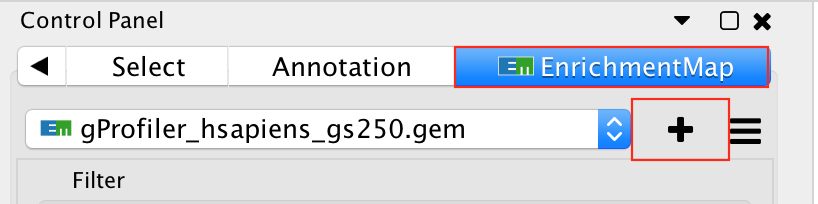
  </p> 
 * Click on *Reset* to reset the Enrichment map panel
 * Drag the fgsea GEM file *fgsea_report_for_list.tsv* and the filtered gmt file *Human_GOBP_AllPathways_filtered_500orLessV2.gmt* into the Datasets box on Enrichment map panel.
 * In the white box, select the "*fgsea_resistant_vs_parental (Generic/gProfiler)*" file 
 * Locate the GMT field and upload the file "*Human_GOBP_AllPathways_filtered_500orLessV2.gmt*".
 * Set the **FDR q-value cutoff** to 0.01 and set the **Connectivity** slide bar to second level. 
  
  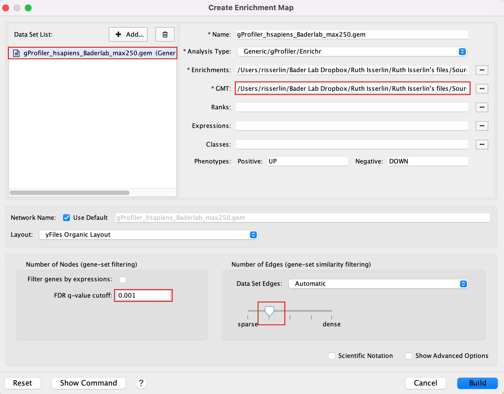
  
 Explore the results:
 
  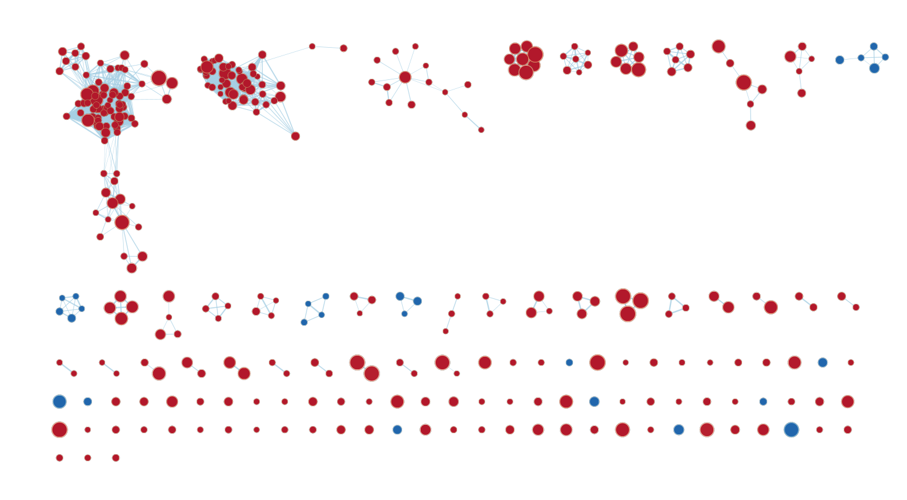
 

```{block, type="rmd-caution"}
SAVE YOUR CYTOSCAPE SESSION (.cys) FILE ! 
```

```{block, type="rmd-rcybox"}
**Equivalent RCy3 code — Exercise 1b: Build EM from fgsea results with Baderlab GMT**
```

```{r exercise1b-rcy3, eval=FALSE}
# Upload the fgsea GEM and Baderlab GMT to Cytoscape
fgsea_gem_cyto  <- upload_em_file(fgsea_gem)
rnk_cyto <- upload_em_file(rnk_file)
gmt_bader_cyto  <- upload_em_file(gmt_baderlab)

# Build the EnrichmentMap from fgsea results
em1b_command <- paste(
  "enrichmentmap build",
  "analysisType=GSEA",
  paste0("enrichmentsDataset1=", fgsea_gem_cyto),
  paste0("gmtFile=",            gmt_bader_cyto),
  paste0("ranksDataset1=", rnk_cyto),
  "qvalue=0.05",
  "pvalue=1.0",
  "coefficients=COMBINED",
  "similaritycutoff=0.5",   # second-level connectivity
  sep = " "
)

commandsRun(em1b_command, base.url = current_cytoscape_baseurl)

renameNetwork("EM_fgsea_Baderlab",
              network = getNetworkSuid(base.url = current_cytoscape_baseurl),
              base.url = current_cytoscape_baseurl)

em1b_suid <- getNetworkSuid(base.url = current_cytoscape_baseurl)
message("Exercise 1b fgsea EM SUID: ", em1b_suid)

layoutNetwork("force-directed defaultSpringCoefficient=0.00004 defaultSpringLength=5",
              network = em1b_suid, base.url = current_cytoscape_baseurl)

# Save the Cytoscape session
saveSession(filename = file.path(path_to_save_cytoscape,"module9_gprofiler_session.cys"),
            base.url = current_cytoscape_baseurl)
message("Session saved.")
```

## Exercise 1c (optional) - investigate individual pathways in GeneMANIA or String

** This requires that you install additional Cytoscape Apps - GeneMania and String ** 

Each node in the Enrichment map represents a biological process or pathway.  It consists of a collection of genes.  Often we want to know how the genes in that group interact.  There are many different ways you can investigate the underlying interactions for the given group.  Some involve searching online databases and others are directly integrated into cytoscape.

* [GeneMANIA](https://genemania.org/) - an integrative database of gene connections including co-expression, protein interactions, genetic interactions, pathways and more. **Cytoscape App**
* [String](https://string-db.org/) - an integrative database of gene connections including co-expression, protein interactions, genetic interactions, pathways and more. **Cytoscape App**
* [Pathway Commons](https://www.pathwaycommons.org/) - a intergrative database of pathways.  (There is a beta feature in EM to show your pathway in the painter app, a pathway common web page that overlays your expression data on the given pathway.  Still in beta testing and requires expression data to work correctly so won't work for this example)

### GeneMANIA

* Navigate to the enrichment map that you created using the fgsea Baderlab results (Exercise 1b)
    * Click on Network Tab and navigate to the third network (it should be the third network if you followed the above examples - name: fgsea_resistant_vs_parental_gem)
    * or in the Enrichment map panel in the top drop down select the network named fgsea_resistant_vs_parental_gem
* In the cytoscape search bar enter *"MET activates"* 

```{block, type="rmd-tip"}
If you can't see the selected nodes, click on "Fit Selected" to focus on the selected node.<br>
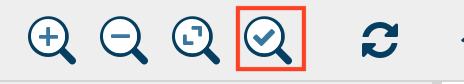
```


* Right click on the node *"MET activates"* and Select *Apps* --> *Enrichmemt Map - Show in GeneMANIA*

  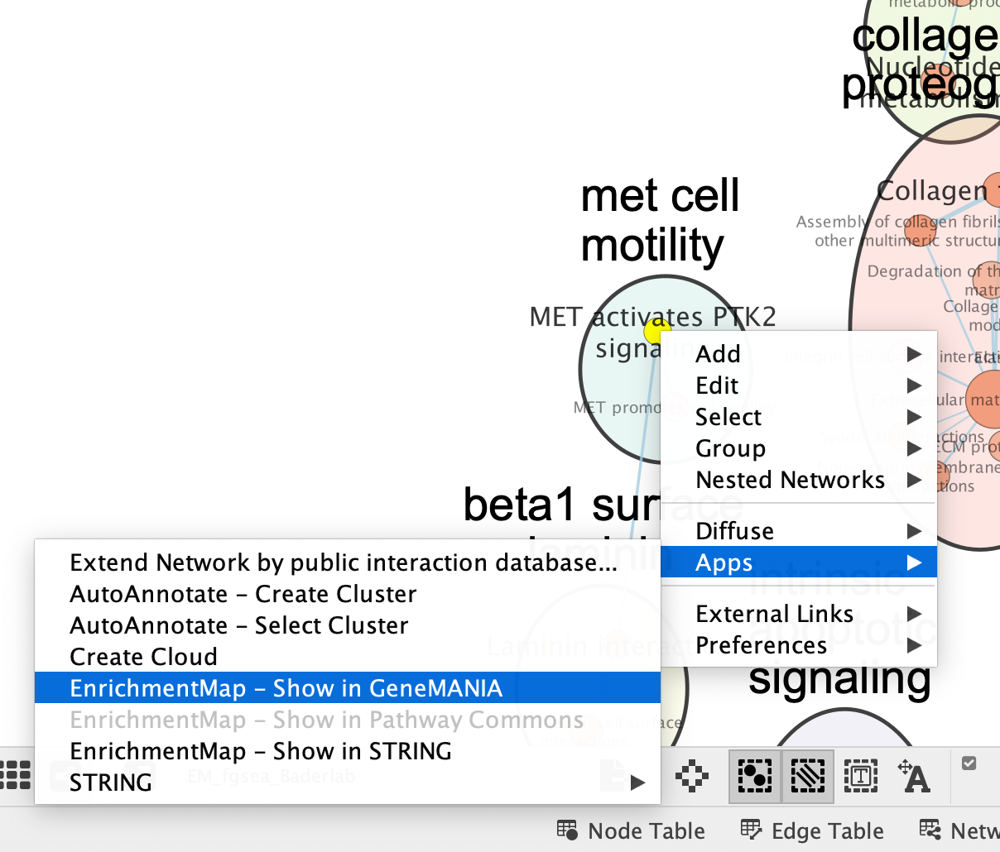

* A GeneMANIA Query Panel will pop up.
* Select *Select leading edge* to reduce the query set to just the genes found to influence the expression of this pathway.
* Click on *OK*

  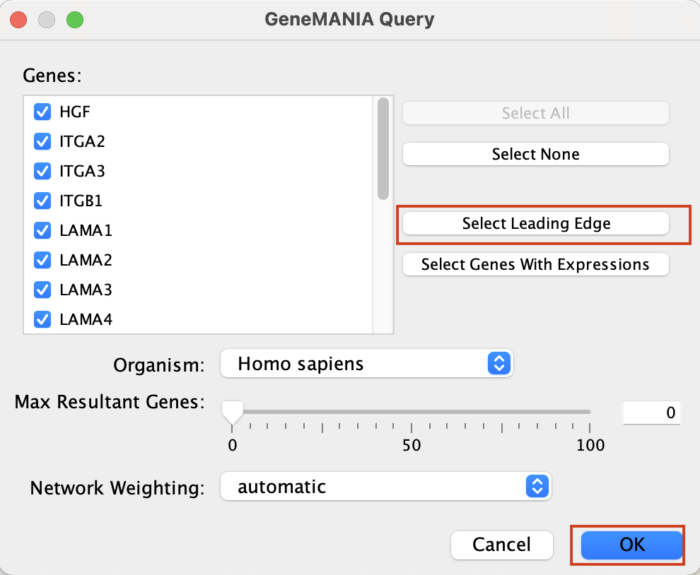

* A GeneMANIA network will show up with the connections between the genes found in your query set and the pathway "MET activates"

  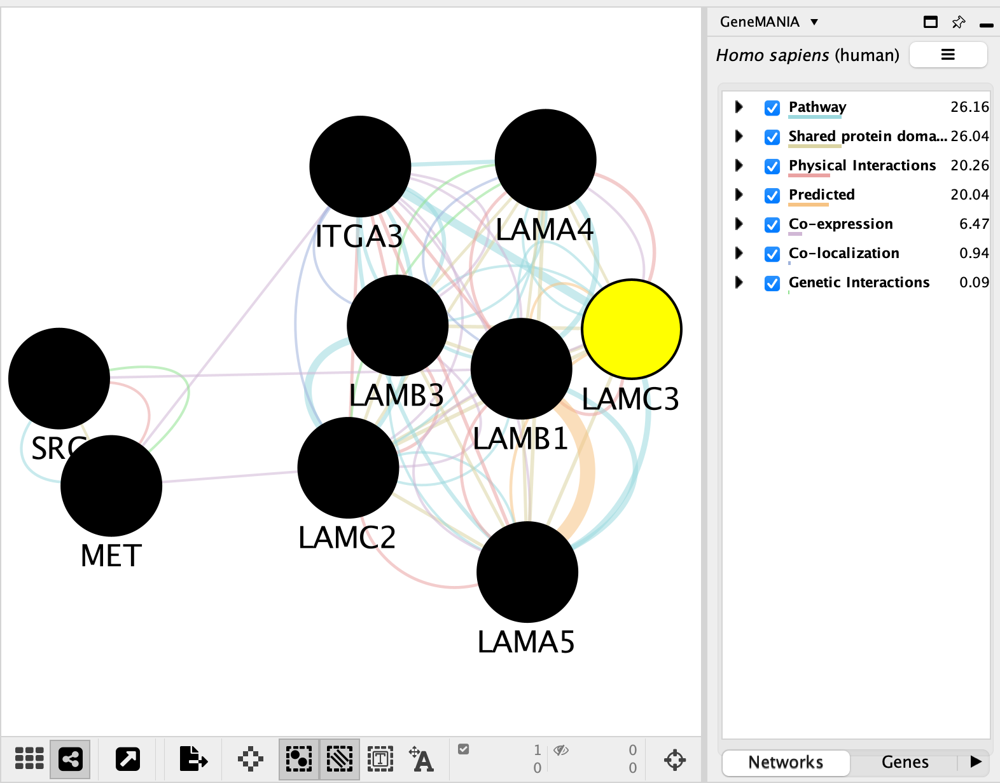

* We will go more in depth into [GeneMANIA in module 5](#genemania_cytoscape)

```{block, type="rmd-rcybox"}
**Equivalent RCy3 code — Exercise 1c: Select a node and query GeneMANIA via the command interface**

 Caveat - there is no way to selected just the leading edge through RCy3 because it is a functionality that is only present in the interface.  The network you get from code will be larger.  
```

```{r exercise1c-genemania-rcy3, eval=FALSE}
# Navigate to the fgsea EM network
setCurrentNetwork(network = em1b_suid, base.url = current_cytoscape_baseurl)

# Select the "MET activates" node
selectNodes(nodes = "MET ACTIVATES PTK2 SIGNALING%REACTOME DATABASE ID RELEASE 97%8874081", by.col = "name",
            network = em1b_suid, base.url = current_cytoscape_baseurl)

# Fit the view to the selected node
fitContent(selected.only = TRUE, base.url = current_cytoscape_baseurl)

# Get the genes in this pathway from the node table
node_tbl <- getTableColumns(table = "node", network = em1b_suid,
                             base.url = current_cytoscape_baseurl)
met_row  <- node_tbl[grepl("MET activates", node_tbl$name,
                              ignore.case = TRUE), ]

# The EnrichmentMap::Genes column holds the genes in the leading edge /
# gene-set intersection — extract them to use as the GeneMANIA query
met_genes <- unlist(met_row[["EnrichmentMap::Genes"]][1])
met_genes  <- met_genes[met_genes != ""]
message("Genes in 'met activates': ", paste(met_genes, collapse = ", "))

# Query GeneMANIA via its Cytoscape app command
# (requires GeneMANIA Cytoscape app to be installed)
genemania_command <- paste0(
  "genemania search genes=\"",
  paste(met_genes, collapse = "|"),
  "\" organism=Homo sapiens"
)
commandsRun(genemania_command, base.url = current_cytoscape_baseurl)
```

### String
* Navigate to the enrichment map that you created using the fgsea Baderlab results (Exercise 1b)
    * Click on Network Tab and navigate to the third network (it should be the third network if you followed the above examples - name: fgsea_resistant_vs_parental_gem)
    * or in the Enrichment map panel in the top drop down select the network named fgsea_resistant_vs_parental_gem
* In the cytoscape search bar enter *"MET activates"* 

```{block, type="rmd-tip"}
If you can't see the selected nodes, click on "Fit Selected" to focus on the selected node.<br>

```

* Right click on the node *"MET activates"* and Select *Apps* --> *Enrichmemt Map - Show in String*

  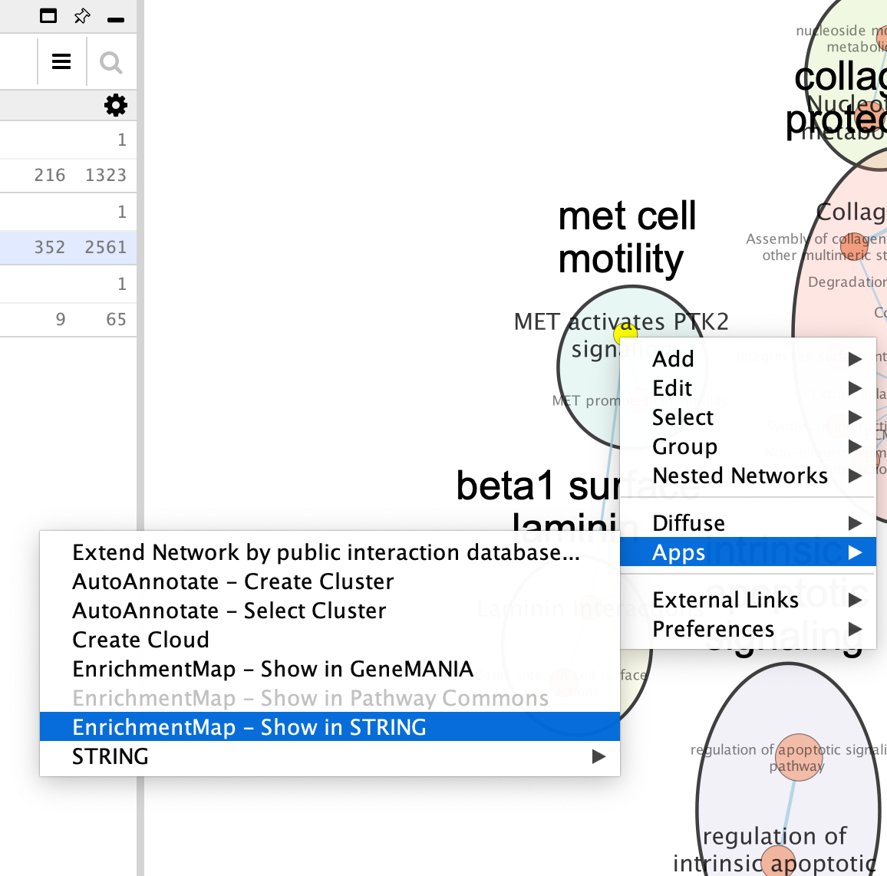

* A String Query Panel will pop up.
* Select *Select genes with expression* to reduce the query set to just the genes in the given that pathway that was in your original dataset (for example we search for a set of 127 genes in g:profiler but the given pathway has 233 genes associated with it of which only 10 genes are found in our original query set )
* Click on *OK*

  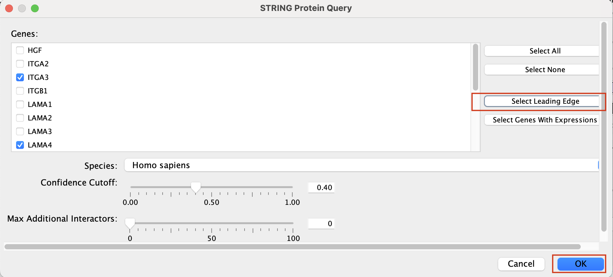

* A String network will show up with the connections between the genes found in your query set and the pathway "MET activates"

  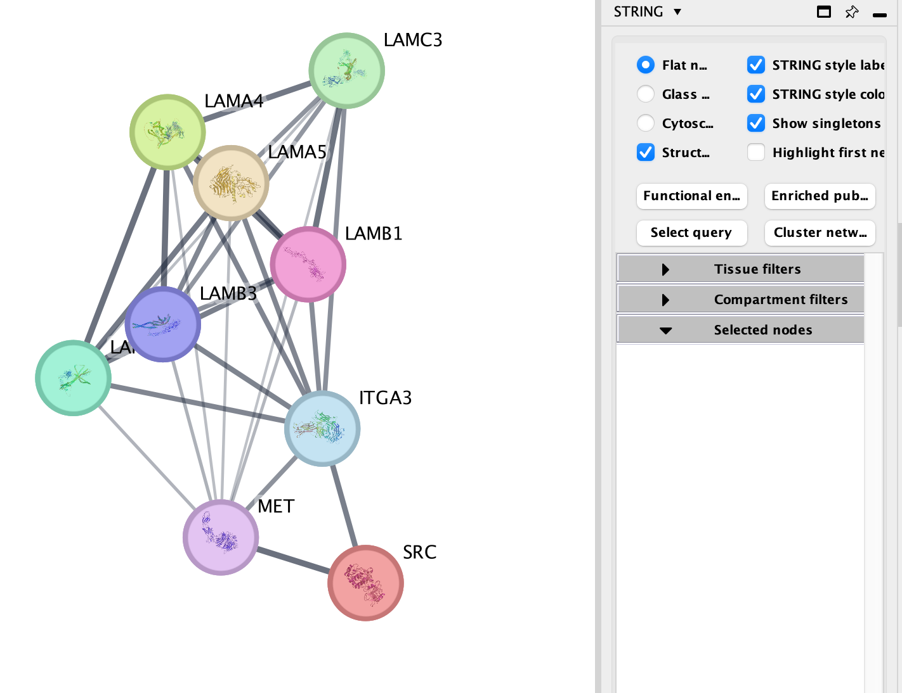
  
```{block, type="rmd-rcybox"}
**Equivalent RCy3 code — Exercise 1c: Query String for genes in a selected pathway**

Caveat - there is no way to selected just the leading edge through RCy3 because it is a functionality that is only present in the interface.  The network you get from code will be larger.  
```

```{r exercise1c-string-rcy3, eval=FALSE}
# Using the met_genes vector extracted above, query String via its app command
# (requires STRINGapp Cytoscape app to be installed)
string_command <- paste0(
  "string protein query",
  " query=\"", paste(met_genes, collapse = ","), "\"",
  " species=\"Homo sapiens\"",
  " limit=0",        # only return queried proteins, no additional interactors
  " cutoff=0.4"
)
commandsRun(string_command, base.url = current_cytoscape_baseurl)
```

```{block, type="rmd-question"}
Explore the features and data of each Cytoscape app.<br>What sort of information does each tell you? <br> What is the main difference between the two resulting networks?
```
