--- 
title: "Cancer Analysis 2026"
author: "Faculty: Trevor Pugh, Linda Xiang, Yoshiaki Tanaka, Robert Eveleigh, Mathieu Lajoie, Vida Talebian, Aqsa Alam, Veronique Voisin, Ruth Isserlin, Nicholas Geoffrion"
date: "October 19-23, 2026"
site: bookdown::bookdown_site
documentclass: book
bibliography: [book.bib, packages.bib]
url: https://bioinformaticsdotca.github.io/CAN_TorMon-2610/ 
cover-image: img/bioinformatics_logo.png
description: |
  Workshop website for the 2026 Cancer Analysis Canadian Bioinformatics Workshop
link-citations: yes
github-repo: bioinformaticsdotca/CAN_TorMon-2610
favicon: img/favicon.ico
---

# (PART) Introduction {-}

# Workshop Info

Welcome to the 2026 Cancer Analysis Canadian Bioinformatics Workshop webpage!  

## Pre-work

<!--[You can find your pre-work here.](LINK TO PREWORK)-->

## Class Photo

Coming soon! 

## Schedule

```{r schedule-loader, echo=FALSE, message=FALSE, warning=FALSE}
# --- Self-Contained R-Markdown Schedule Component ---

# 1. Load necessary libraries
library(readr)
library(jsonlite)
library(htmltools)

# 2. Define the path to your schedule data
csv_path <- "schedule.csv"

# 3. Check if the CSV file exists
if (!file.exists(csv_path)) {
  stop("Error: 'schedule.csv' not found. Please create it in your project directory.")
}

# 4. Read the schedule data, ensuring all columns are character type
schedule_df <- readr::read_csv(
  csv_path,
  col_types = cols(.default = "c"),
  show_col_types = FALSE
)

# 5. Convert the data frame to a JSON object
schedule_json <- jsonlite::toJSON(schedule_df, auto_unbox = FALSE, na = "string")

# 6. Define the HTML structure, CSS, and JavaScript using htmltools
schedule_component <- tagList(
  # A. CSS for the design
  tags$style(HTML("
    :root {
      --schedule-primary-color: #4A6BFF;
      --schedule-border-color: #EAECEF;
      --schedule-text-color: #555;
    }
    .schedule-card {
      font-family: -apple-system, BlinkMacSystemFont, 'Segoe UI', Roboto, Oxygen, Ubuntu, Cantarell, 'Open Sans', 'Helvetica Neue', sans-serif;
      border: 1px solid var(--schedule-border-color);
      border-radius: 12px;
      margin: 2em 0;
      box-shadow: 0 4px 12px rgba(0,0,0,0.05);
      overflow: hidden;
    }
    .schedule-tabs {
      display: flex;
      justify-content: space-between;
      align-items: center;
      border-bottom: 1px solid var(--schedule-border-color);
      background-color: #fff;
    }
    .schedule-tabs-wrapper {
      position: relative;
      flex-grow: 1;
      overflow: hidden;
    }
    .schedule-tabs-wrapper::before,
    .schedule-tabs-wrapper::after {
      content: '';
      position: absolute;
      top: 0;
      bottom: 0;
      width: 50px;
      pointer-events: none;
      transition: opacity 0.2s;
      opacity: 0;
    }
    .schedule-tabs-wrapper::before {
      left: 0;
      background: linear-gradient(to left, rgba(255,255,255,0), #fff 70%);
    }
    .schedule-tabs-wrapper::after {
      right: 0;
      background: linear-gradient(to right, rgba(255,255,255,0), #fff 70%);
    }
    .schedule-tabs-wrapper.scrolled-left::before { opacity: 1; }
    .schedule-tabs-wrapper.scrolled-right::after { opacity: 1; }
    
    .schedule-tab-buttons {
      display: flex;
      overflow-x: auto;
      white-space: nowrap;
      -ms-overflow-style: none;
      scrollbar-width: none;
      scroll-behavior: smooth;
    }
    .schedule-tab-buttons::-webkit-scrollbar { display: none; }
    
    .timezone-selector-container {
      display: flex;
      align-items: center;
      gap: 0.75em;
      padding: 0 20px;
    }
    .timezone-selector-container label {
      font-size: 0.9em;
      color: var(--schedule-text-color);
      font-weight: 500;
    }
    .schedule-tabs select {
      padding: 6px 10px;
      border-radius: 6px;
      border: 1px solid #ccc;
      background-color: #fff;
    }
    .schedule-tab {
      padding: 14px 20px;
      cursor: pointer;
      border-bottom: 3px solid transparent;
      margin-bottom: -1px;
      color: var(--schedule-text-color);
      font-weight: 500;
    }
    .schedule-tab.active {
      color: var(--schedule-primary-color);
      border-bottom-color: var(--schedule-primary-color);
    }
    .schedule-panel { display: none; }
    .schedule-panel.active { display: block; }
    .schedule-table { width: 100%; border-collapse: collapse; }
    .schedule-table th, .schedule-table td {
      text-align: left;
      padding: 14px 20px;
      border-bottom: 1px solid var(--schedule-border-color);
    }
    .schedule-table th {
      color: #888;
      font-size: 0.8em;
      font-weight: 600;
      text-transform: uppercase;
      background-color: #F8F9FA;
    }
    .schedule-table tr:last-child td { border-bottom: none; }
    
    /* --- RULE FOR BREAKS AND PAUSES --- */
    .schedule-table tr.is-break td {
      font-style: italic;
      font-size: 0.95em;
      color: #777;
    }
    
    /* --- NEW: RULE FOR 'OTHER' TYPE (More Visible) --- */
    .schedule-table tr.is-other td {
      background-color: #f0f4ff; /* A light blue background */
      font-weight: 500; /* Slightly bolder text */
    }
    .schedule-table tr.is-other td:first-child {
      border-left: 4px solid var(--schedule-primary-color);
    }
  ")),

  # B. HTML placeholders
  div(class = "schedule-card",
      div(class = "schedule-tabs", id = "schedule-tabs-container"),
      div(class = "schedule-content", id = "schedule-panels-container")
  ),

  # C. JavaScript to build the interface
  tags$script(HTML(paste0('
    document.addEventListener("DOMContentLoaded", function() {
      const scheduleData = ', jsonlite::toJSON(schedule_df, auto_unbox = TRUE, na = "string"), ';
      const tabsContainer = document.getElementById("schedule-tabs-container");
      const panelsContainer = document.getElementById("schedule-panels-container");

      if (scheduleData.length === 0) return;

      const timezones = [];
      const firstRow = scheduleData[0];
      for (const key in firstRow) {
        if (key.match(/timezone_\\d+_label/)) {
          const index = key.match(/\\d+/)[0];
          timezones.push({ index: index, label: firstRow[key] });
        }
      }
      const days = [...new Set(scheduleData.map(row => row.day_label))];
      
      const tabsWrapper = document.createElement("div");
      tabsWrapper.className = "schedule-tabs-wrapper";
      const tabButtonsContainer = document.createElement("div");
      tabButtonsContainer.className = "schedule-tab-buttons";
      tabsWrapper.appendChild(tabButtonsContainer);
      tabsContainer.appendChild(tabsWrapper);

      days.forEach((day, dayIndex) => {
        const tab = document.createElement("div");
        tab.className = "schedule-tab";
        tab.dataset.target = `panel-${dayIndex}`;
        tab.textContent = day;
        tabButtonsContainer.appendChild(tab);
      });

      if (timezones.length > 1) {
        const selectorContainer = document.createElement("div");
        selectorContainer.className = "timezone-selector-container";
        let selectorHtml = `<label for="tz-selector">Timezone</label>
                            <select id="tz-selector">`;
        timezones.forEach(tz => {
          selectorHtml += `<option value="${tz.index}">${tz.label}</option>`;
        });
        selectorHtml += `</select>`;
        selectorContainer.innerHTML = selectorHtml;
        tabsContainer.appendChild(selectorContainer);
      }
      
      const tzSelector = document.getElementById("tz-selector");

      days.forEach((day, dayIndex) => {
        panelsContainer.innerHTML += `<div class="schedule-panel" id="panel-${dayIndex}"></div>`;
      });
      
      const tabs = document.querySelectorAll(".schedule-tab");
      const panels = document.querySelectorAll(".schedule-panel");

      function renderTables() {
        const selectedTzIndex = tzSelector ? tzSelector.value : timezones[0].index;
        const timeCol = `time_${selectedTzIndex}`;
        let selectedTzLabel = tzSelector ? tzSelector.options[tzSelector.selectedIndex].text : timezones[0].label;
        
        panels.forEach((panel, dayIndex) => {
          const day = days[dayIndex];
          const dayEvents = scheduleData.filter(row => row.day_label === day);
          let tableHtml = `<table class="schedule-table"><thead><tr>
                               <th style="width:25%;">${selectedTzLabel}</th>
                               <th>Activity</th>
                               </tr></thead><tbody>`;
          dayEvents.forEach(row => {
            const type = row.type ? row.type.toLowerCase() : "";
            let rowClass = "";

            if (type === "break" || type === "pause") {
              rowClass = "class=\'is-break\'";
            } else if (type === "other") {
              rowClass = "class=\'is-other\'";
            }
            
            tableHtml += `<tr ${rowClass}><td>${row[timeCol] || ""}</td><td>${row.activity || ""}</td></tr>`;
          });
          tableHtml += `</tbody></table>`;
          panel.innerHTML = tableHtml;
        });
      }

      function switchTab(targetId) {
        tabs.forEach(tab => tab.classList.remove("active"));
        panels.forEach(panel => panel.classList.remove("active"));
        
        const activeTab = document.querySelector(`[data-target=\'${targetId}\']`);
        const activePanel = document.getElementById(targetId);
        
        if (activeTab) {
          activeTab.classList.add("active");
          activeTab.scrollIntoView({ behavior: "smooth", block: "nearest", inline: "center" });
        }
        if (activePanel) {
          activePanel.classList.add("active");
        }
      }
      
      function updateScrollIndicators() {
        const el = tabButtonsContainer;
        const scrollLeft = Math.round(el.scrollLeft);
        const scrollWidth = Math.round(el.scrollWidth);
        const clientWidth = Math.round(el.clientWidth);
        
        const hasOverflow = scrollWidth > clientWidth;
        tabsWrapper.classList.toggle("scrolled-left", hasOverflow && scrollLeft > 0);
        const isAtEnd = scrollLeft >= scrollWidth - clientWidth;
        tabsWrapper.classList.toggle("scrolled-right", hasOverflow && !isAtEnd);
      }

      tabButtonsContainer.addEventListener("click", e => {
        if (e.target.classList.contains("schedule-tab")) {
          switchTab(e.target.dataset.target);
        }
      });

      if (tzSelector) {
        tzSelector.addEventListener("change", renderTables);
      }
      
      tabButtonsContainer.addEventListener("scroll", updateScrollIndicators, { passive: true });
      window.addEventListener("resize", updateScrollIndicators);

      renderTables();

      // --- LOGIC TO ACTIVATE CURRENT DAY ---
      let initialTabIndex = 0;

      const today = new Date();
      const monthNames = ["January", "February", "March", "April", "May", "June", "July", "August", "September", "October", "November", "December"];
      const monthName = monthNames[today.getMonth()];
      const day = today.getDate();
      const year = today.getFullYear();
      const todayString = `${monthName} ${day}, ${year}`;

      const todayEvent = scheduleData.find(row => row.date === todayString);

      if (todayEvent) {
        const dayIndex = days.findIndex(day => day === todayEvent.day_label);
        if (dayIndex !== -1) {
          initialTabIndex = dayIndex;
        }
      }

      if (tabs.length > initialTabIndex) {
        const initialTabId = `panel-${initialTabIndex}`;
        switchTab(initialTabId);
      }
      // --- END OF CURRENT DAY LOGIC ---

      setTimeout(updateScrollIndicators, 100);
    });
  ')))
)

# 7. Output the final component
schedule_component
```

<!--chapter:end:index.Rmd-->

# Meet Your Faculty

#### Trevor Pugh (He/Him)


>Senior Scientist, Princess Margaret Cancer Centre <br>
Director, Genomics, Ontario Institute for Cancer Research <br>
Toronto, ON, Canada <br>
trevor.pugh@utoronto.ca 

Dr. Trevor Pugh, PhD, FACMG is a cancer genomics researcher and board-certified molecular geneticist at the forefront of precision medicine. As holder of the Canada Research Chair in Translational Genomics, he uses genome sequencing to understand causes of cancer, guide treatment of patients, and detect early disease using blood tests. He directs the OICR Genomics Program and the Princess Margaret Genomics Centre; genomics cores that specialize in single cell, cell-free DNA and clinically-accredited whole genome sequencing. He has contributed to multiple large-scale genomics and data-sharing programs including The Cancer Genome Atlas, NCI TARGET, AACR GENIE, and the Terry Fox Marathon of Hope Cancer Centres Network. He leads the CHARM Consortium, an initiative to use cell-free DNA monitoring for all people with an inherited predisposition to cancer. Originally from Vancouver, Dr. Pugh received a PhD in Medical Genetics from the University of British Columbia and was an early student of the Canadian Bioinformatics Workshop.

#### Linda Xiang (She/Her)


>Data Scientist II <br>
Ontario Institute of Cancer Research  <br>
Toronto, ON, Canada <br>
lxiang@oicr.on.ca 

Linda is a Senior Data Scientist with over a decade of experience designing and delivering production-grade data platforms for large-scale international genomics initiatives, including ICGC/ICGC-ARGO, PCAWG, GDC, and VirusSeq. Her work focuses on bridging complex scientific requirements with robust engineering solutions, spanning bioinformatics workflow architecture, data services, and platform integration. She has led the development of containerized, reproducible pipelines for genomic data processing and submission across cloud and on-premises environments, and has driven the adoption of standards-based frameworks to improve scalability and maintainability. In parallel, she has led the design of interoperable clinical and genomic data models to support secure data sharing and federated analysis, while contributing to global standards development through GA4GH.

#### Yoshiaki Tanaka (He/Him)


>Associate Professor <br>
Centre de Recherche de l’Hôpital Maisonneuve-Rosemont, Université de Montréal <br>
Montreal, QC, Canada <br>
yoshiaki.tanaka@umontreal.ca  

Dr. Yoshiaki Tanaka obtained his undergraduate degree (2006) in pharmaceutical science at Tokyo University of Science, Japan. During his Ph.D. training (2006-2011), he pursued purely bioinformatics approaches using large-scale datasets, such as RNA-seq and ChIP-seq, to model the relationship between transcriptional and epigenetic regulation in eukaryotic cells under the supervision of Dr. Kenta Nakai at University of Tokyo, Japan. He also applied machine learning algorithms to high-throughput sequencing data to investigate chromatin conformation regulations. For his post-doctoral studies, Tanaka joined Dr. In-Hyun Park laboratory at Yale University USA (2011-2020) to seek out complementary training in cell and molecular biology with the goal of understanding stem cell pluripotency and tissue development. Recently, he developed in vitro 3D models of human brain and elucidated mechanistic insight of brain development and neuronal diseases. Dr. Tanaka’s research vision at Maisonneuve-Rosemont Hospital Research Center (CRHMR), University of Montreal is to explore complex problems related to brain tumor and other neuronal diseases using both in vitro and in silico modeling.

#### Robert Eveleigh


> Senior Bioinformatics Specialist <br>
 Canacian Centre for Computational Genomics (C3G), McGill University <br>
 Montral, QC, Canada >

Robert Eveleigh, MSc, is a Senior Bioinformatics Specialist at the Canadian Centre for Computational Genomics (C3G) at McGill University. For about 15 years he has developed variant detection pipelines in GenPipes, with a focus on DNA alterations, and he has benchmarked each new sequencing instrument brought into the centre. He develops SOPs for benchmarking to determine the optimal steps for germline and somatic alteration detection. He led development of the GenPipes tumor-pair pipeline, which has processed over 5000 patients, including hundreds from PROFYLE (Precision Oncology for Young People). He is first author of a 2026 Genome Biology paper benchmarking sequencing technologies for variant detection.


#### Mathieu Lajoie 


>Research Associate - Bioinformatician <br>
Rosalind and Morris Goodman Cancer Institute, McGill University <br>
Montreal, QC, Canada 
  
Mathieu Lajoie is a Research Associate and Bioinformatician in Dr. Ian Watson’s laboratory at the Rosalind and Morris Goodman Cancer Institute, McGill University. He holds a PhD in Bioinformatics from Université de Montréal and has more than 10 years of experience in cancer research. He has worked on a wide range of computational biology topics, from algorithm development to regulatory genomics and tumour evolution. His current research focuses on melanoma, integrating genomic and spatial transcriptomic data to investigate disease progression and therapeutic response.

#### Vida Talebian 


>Bioinformatician <br>
Ontario Institute for Cancer Research <br>
Toronto,ON,Canada 

Vida is a bioinformatician at the Diagnostic Development program at OICR. She holds a master’s degree in bioinformatics from the University of Waterloo with a computer engineering background. She is involved in projects with a focus on analyzing and integrating multi-omics data to identify prognostic signatures in clinical studies.

#### Aqsa Alam (She/Her)


>Bioinformatician III <br>
Ontario Institute for Cancer Research <br>
Toronto,ON,Canada <br>
aalam@oicr.on.ca

Aqsa Alam is a bioinformatician in the Clinical Genome Interpretation team at the Ontario Institute of Cancer Research. Aqsa did her Honours BSc with high distinction in Biology and Physics at the University of Toronto Mississauga and her MSc in Cell and Systems Biology at the University of Toronto. Aqsa is passionate about communication and scientific outreach. Her current work focuses on genomic interpretation in cancer and supporting accredited clinical trials.

#### Veronique Voisin


> Computational Biologist <br>
Princess Margaret Center <br>
Toronto,ON,Canada <br>
veronique.voisin@gmail.com

Véronique Voisin, PhD, is a computational biologist affiliated with the Princess Margaret Cancer Centre (UHN), where she works with Dr. Aaron Schimmer, SickKids, where she works with Dr. Grace Egan, and the University of Toronto, where she continues to collaborate with Dr. Gary Bader. She uses bioinformatics tools to analyze omics and clinical data and untangle biological questions relevant to leukemia and cancer treatment. Her work includes pathway and network analysis of gene expression data using tools such as GSEA and Cytoscape. She has also contributed to bioinformatics training through the Canadian Bioinformatics Workshop (CBW) over several years.


#### Ruth Isserlin


>Research Data Analyst <br>
The Donnelly Centre, University of Toronto <br>
Toronto,ON,Canada <br>
ruth.isseerlin@utoronto.ca

Bioinformatician and data analyst in the Bader lab applying pathway and data analysis to varied data types. Developed Enrichment Map App for Cytoscape, an app to visually translate functional enrichment results from popular enrichment tools like GSEA to networks. Further developed the Enrichment Map Pipeline including development of additional Apps to help summarize and analyze resulting Enrichment Maps, including PostAnalysis, WordCloud, and AutoAnnotate App. 

#### Nicholas Geoffrion


>Senior Bioinformatician, Infrastructre Manager <br>
Meta Platform for Integrated Genomics, Azrieli Reasearch Center, CHU Sainte-Justine
 <br>
Montréal, QC, Canada <br>
nicholas.geoffrion.hsj@ssss.gouv.qc.ca

Nicholas Geoffrion is a bioinformatician and Genomics Platform Infrastructure Manager at the Azrieli Research Centre in Montréal, specializing in long-read sequencing, computational genomics, and translational cancer research. His work focuses on integrating emerging sequencing technologies, particularly Oxford Nanopore, with scalable bioinformatics pipelines and high-performance computing infrastructure to support genomic research and clinical applications, with a particular emphasis on pediatric oncology. His interests span software engineering, infrastructure automation, open-source technologies, and the development of computational tools that make genomic analysis faster, more accessible, and clinically actionable.


## TA's

#### Oliver De Sa


>Bioinformatician III <br>
Ontario Institute for Cancer Research <br>
Toronto,ON,Canada <br>
odesa@oicr.on.ca

Oliver De Sa is a bioinformatician in the Window-of-Opportunity (WOO) network at the Ontario Institute for Cancer Research. Oliver completed a BSc in Biochemistry, followed by an MSc in Immunology both at the University of Toronto. His current work focuses on multi-omic analyses for WOO clinical trials, integrating various data types to describe the molecular mechanisms through which the tumour microenvironment responds to treatment.

#### Edmund Su


Bio coming soon

#### Jordan Babadoudou


>M.Sc. Student in Bioinformatics <br>
Montreal University  <br>
Montréal, Quebec, Canada <br>
jordan.babadoudou@umontreal.ca


#### Alain Pacis


>Bioinformatics Specialist <br>
Canadian Centre for Computational Genomics (C3G), McGill University<br>
Montréal, Quebec, Canada <br>


Alain received his undergraduate degree in Cell and Molecular Biology at Concordia University. In 2018, he obtained his PhD in Bioinformatics from University of Montreal. His research focused on the genetic and the epigenetic regulation of innate immune responses to infection. As a bioinformatician at C3G since August 2018, Alain’s work primarily involves bulk/single-cell/spatial RNA-seq, epigenomics and cancer genomics.

#### Rong Ma


>PhD Candidate in Human Genetics <br>
McGill University & Kyoto University <br>
Montréal, Quebec, Canada <br>
rong.ma2@mail.mcgill.ca

Rong Ma began his PhD in Human Genetics at McGill University in Fall 2019, joining the laboratories of Drs. Ian Watson and Guillaume Bourque. He holds a Bachelor's degree in Biochemistry and a Master's degree in Biomedical Informatics from Columbia University. His current research focuses on leveraging bioinformatics and computational approaches to advance our understanding of melanoma biology from a multi-omics perspective. In particular, he aims to investigate the molecular mechanisms underlying resistance to immune checkpoint inhibitor (ICI) therapy in melanoma patients by integrating cutting-edge genomic and transcriptomic profiling technologies.

#### Zahra Tavakol

>PhD Student in Computational Biology<br>
Concordia University <br>
Montréal, Quebec, Canada <br>
zahra.tavakolhamedani@concordia.ca


She began her PhD in Quantitative Life Sciences at McGill University in Winter 2025 and joined the Kuzmin Lab at Concordia University and the Najafabadi Lab at McGill University in Winter 2026. She holds both Bachelor's and Master's degrees in Molecular Biotechnology. Her current research focuses on using bioinformatics and computational tools to analyze single-cell transcriptomic data, infer copy number aberrations, and perform pathway enrichment analysis. Her PhD research aims to develop computational approaches to predict transcriptional states at the single-cell level.

<!--chapter:end:001-faculty.Rmd-->

<!--
IF YOUR WORKSHOP DOES NOT INCLUDE COMPUTE:
- REMOVE "AND COMPUTE SETUP" FROM THE TOP-LEVEL HEADER
- DELETE THE LAST SECTION (COMPUTE SETUP)

IF YOUR WORKSHOP INCLUDES COMPUTE:
- AFTER THE WORKSHOP, ADD DATA DOWNLOAD LINKS, AWS MACHINE IMAGE INSTRUCTIONS, ETC.
- IF IT IS MORE APPROPRIATE, YOU CAN INCLUDE THE DATA DOWNLOAD LINKS IN EACH OF THE MODULES.
-->

# Data and Compute Setup

#### Course data downloads
Coming soon!

#### Compute setup
Coming soon!


<!--chapter:end:002-computing.Rmd-->

# (PART) Modules {-}

# Module 1 Intro to Cancer Genomics

## Lecture

<!--<iframe width="640" height="360" src="YOUTUBE EMBED LINK" title="YouTube video player" frameborder="0" allow="accelerometer; autoplay; clipboard-write; encrypted-media; gyroscope; picture-in-picture; web-share" referrerpolicy="strict-origin-when-cross-origin" allowfullscreen></iframe>
-->

<iframe src="https://docs.google.com/presentation/d/18sEuZvOvIQDaK0MG-TYCOzCRIPapRK8b/preview" width="640" height="480" allow="autoplay"></iframe>  
-->


<!--chapter:end:010-module-1.Rmd-->

# Module 2 Understanding and Visualizing Data

## Lecture

<!--<iframe width="640" height="360" src="YOUTUBE EMBED LINK" title="YouTube video player" frameborder="0" allow="accelerometer; autoplay; clipboard-write; encrypted-media; gyroscope; picture-in-picture; web-share" referrerpolicy="strict-origin-when-cross-origin" allowfullscreen></iframe>
-->

<iframe src="https://docs.google.com/presentation/d/1J3otDAd_AILYLFDwxbxpMMJS07cYCxtw/preview" width="640" height="480" allow="autoplay"></iframe>  


## Lab

In this lab, we'll demo a popular tool and resources related to exploring our data and potentially finding datasets of interest.

The only requirements for the tutorial are as follows:

1) An internet connection
2) A modern browser
3) An account with COSMIC : https://cancer.sanger.ac.uk/cosmic/register

#### Learning Objectives
- How to use IGV browser to explore data types : BAMs, VCFs, BEDs
- How to browse and make use of the visualization functions in cBioPortal
- How to browse and make use of the visualization functions in COSMIC

### Part 1 - IGV

#### Learning Objectives
- How to use IGV browser to explore data types : BAMs, VCFs, BEDs 
- How to traverse the genome
- Loading Tracks and annotations
- How to find additional info for each genomic feature

__To get started, Please navigate over to [https://igv.org/app/](https://igv.org/app/)__

:::: {.callout type="blue" collapsible="true" title="Question : Aside from avoiding installation issues, a browser version is much more convenient and accessible. Why should one consider using a local installation of IGV vs the online version?"}
  1) Data size - Imagine streaming multiple 500 GB files
  2) Data protection - if you're working with sensitive data that is under DACO restriction or patient data, you're limited by where you store and send the data
::::

#### BAM

##### Step 1 – Open IGV-Web and choose the genome

Make sure our build is on `Hg38`, to do so click "Genome" and navigate the dropdown to find GRCh38/hg38

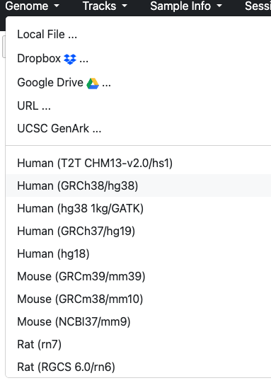

Let's load our data, __select Tracks, then URL from the dropdown__, 

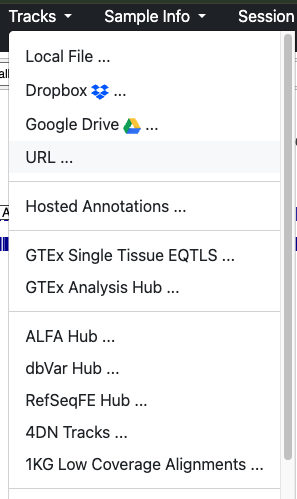

##### Step 2 – Loading the BAM and Index

Paste the following info, ensure the __BAM file goes into the Track__ and __index file into index__:

```shell
https://42basepairs.com/download/s3/gatk-test-data/wgs_bam/NA12878_20k_hg38/NA12878.bam
https://42basepairs.com/download/s3/gatk-test-data/wgs_bam/NA12878_20k_hg38/NA12878.bai
```
NA12878 is the GIAB/1000 Genomes reference individual. This BAM is a very small subset of a whole-genome run: about 61,000 mapped reads across the whole genome, compared with hundreds of millions in a real 30× genome. It is meant for teaching.

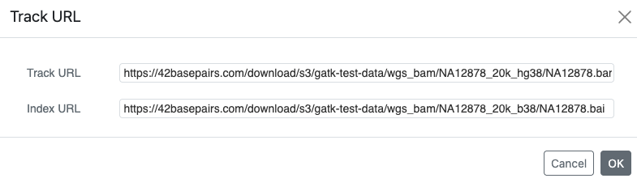

##### Step 3 – Post loading sanity check

What do we see after loading?

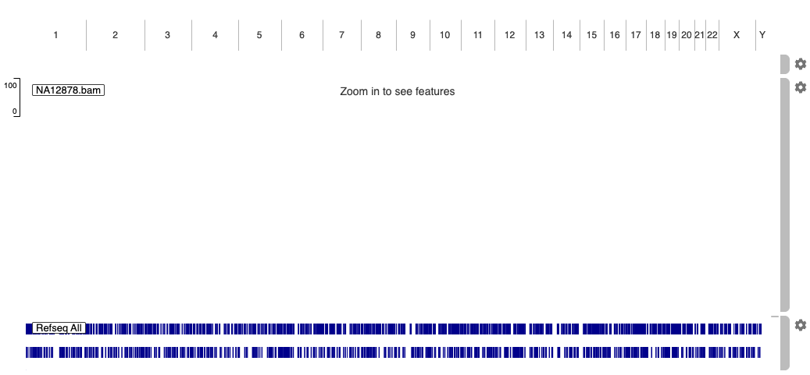

:::: {.callout type="blue" collapsible="true" title="Question : We don't see much. How come?"}
  - One possibility is wrong genome build. Not the case here but a possibility.
  - The toy BAM being examined is also very small in comparison. So the reads representation will be sparse.
  - In both the browser and local version of IGV, the number of reads visualized is limited, especially at whole genome view that's an overwhelming amount of data to visualize. For the browser, imagine everyone trying to load a 1TB BAM. Local version can adjust settings according to hardware limitations.
::::

##### Step 4 – Zoomed in look

Let's zoom in to a more manageable view. __Paste the following coordinates into the search bar__
```shell
chr1:143,220,111-143,221,807
```


Once the result loads, what do we see?  
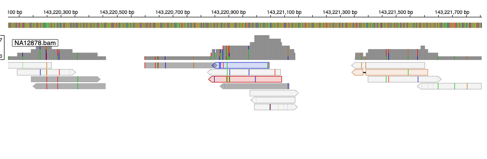

:::: {.callout type="blue" collapsible="true" title="Question : What are the grey lines? What do the ends (sharp vs blunt) represent?"}
  Each grey bar is a read. The pointed end shows the direction it was sequenced: pointing right = forward (+) strand, pointing left = reverse (−).
::::
:::: {.callout type="blue" collapsible="true" title="Question : What are the colour dashes in each block?"}
  Mismatches
::::
:::: {.callout type="blue" collapsible="true" title="Question : What is the graph bar above?"}
  Coverage, the height represents the amount of reads per BP. If coloured, shows the ratio of mismatches per nucleotide
::::

##### Step 5 – Read features


Clicking on a read, its info can be displayed.

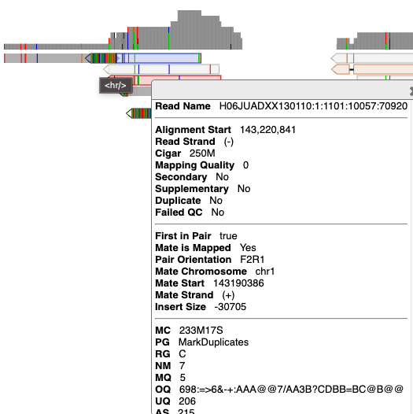

:::: {.callout type="blue" collapsible="true" title="Question : What do the blue, red and orange reads represent?"}
  When compared to the grey reads, the reads are identified due to their abnormal insert size. The causes could vary from a genomic feature (e.g. structural variant), RNA-seq (though not in this case), lack of size selection during library prep (there would be other signs as well). Toggleable via the gear icon on the right side of the track. Select under "Color by", "Pair Orientation & insert size (TLEN)"
::::
    
##### Step 6 – Utilizing track annotations

Let's try a different region

```shell
chr2:32,915,196-32,917,755
```

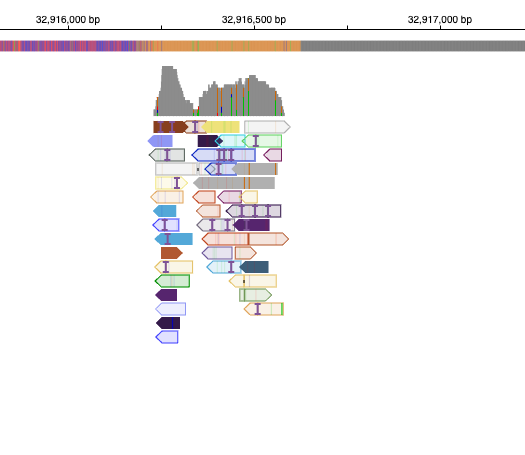

:::: {.callout type="blue" collapsible="true" title="Question : Why are almost all reads coloured?"}
  Similarly to the last question, the reads are highlighted due to the unexpected read orientation.
::::

What genes are these reads at? How would we find out?
- RefSeq is already loaded. We can try another annotation
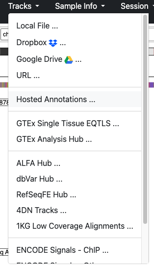
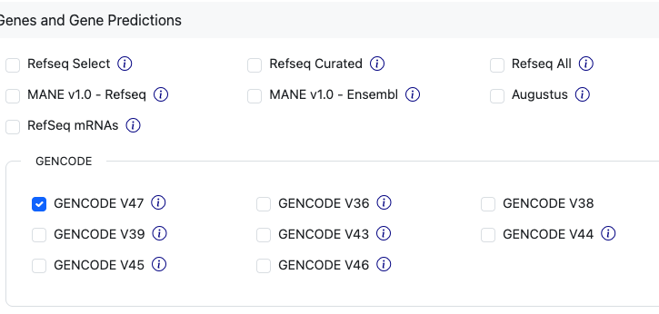 
We can see that the reads intersect a "lncRNA" (long non-coding RNA). 
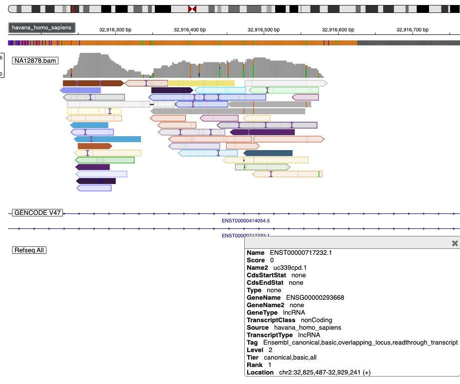 

#### VCF
##### Step 7 – Working with VCFs (Germline SNVs)
Let's load a VCF

```shell
https://42basepairs.com/download/web/giab/data_somatic/HG008/NIST/HG008-T_bulk/20240508p100/analysis/GRCh38/BCM_Revio_HG008T-p100_20260313/HG008-T_vs_HG008-N-P/small_variants/HG008-N-P.dipcall.germline.vcf.gz
https://42basepairs.com/download/web/giab/data_somatic/HG008/NIST/HG008-T_bulk/20240508p100/analysis/GRCh38/BCM_Revio_HG008T-p100_20260313/HG008-T_vs_HG008-N-P/small_variants/HG008-N-P.dipcall.germline.vcf.gz.tbi
```

These VCFs come from `HG008`, the GIAB pancreatic cancer tumour/normal cell-line pair, and not from `NA12878`. The BAM and VCFs belong to different people, so don't expect the reads to support these variants.

Then navigate to the coordinates :

```shell
chr1:143,206,141-143,206,141
```

Let's note what we see:  
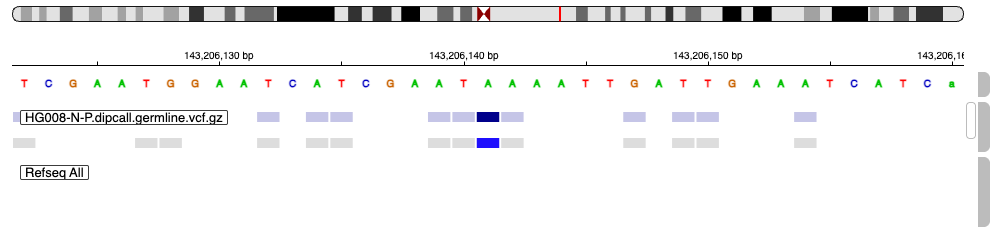 
Focusing on the non-greyed feature, what are the VCF features? Use the name and hover over the item for more information

Additionally, a snippet of the VCF for reference:
```
##fileformat=VCFv4.2
##FILTER=<ID=PASS,Description="All filters passed">
.
.
.
##FORMAT=<ID=GT,Number=1,Type=String,Description="Genotype">
##FORMAT=<ID=AD,Number=R,Type=Integer,Description="Allelic depths for the ref and alt alleles in the order listed">
##FILTER=<ID=HET1,Description="Heterozygous in the first haplotype">
##FILTER=<ID=HET2,Description="Heterozygous in the second haplotype">
##FILTER=<ID=GAP1,Description="Uncalled in the first haplotype">
##FILTER=<ID=GAP2,Description="Uncalled in the second haplotype">
##INFO=<ID=TRF,Number=0,Type=Flag,Description="Entry hits a tandem repeat region">
##INFO=<ID=TRFdiff,Number=1,Type=Float,Description="ALT TR copy difference from reference">
##INFO=<ID=TRFrepeat,Number=1,Type=String,Description="Repeat motif">
##INFO=<ID=TRFovl,Number=1,Type=Float,Description="Percent of ALT covered by TRF annotation">
##INFO=<ID=TRFstart,Number=1,Type=Integer,Description="Start position of discovered repeat">
##INFO=<ID=TRFend,Number=1,Type=Integer,Description="End position of discovered repeat">
##INFO=<ID=TRFperiod,Number=1,Type=Integer,Description="Period size of the repeat">
##INFO=<ID=TRFcopies,Number=1,Type=Float,Description="Number of copies aligned with the consensus pattern">
##INFO=<ID=TRFscore,Number=1,Type=Integer,Description="Alignment score">
##INFO=<ID=TRFentropy,Number=1,Type=Float,Description="Entropy measure">
##INFO=<ID=TRFsim,Number=1,Type=Float,Description="Similarity of ALT sequence to generated motif faux sequence">
##INFO=<ID=END,Number=1,Type=Integer,Description="End position of the variant">
##bcftools_pluginVersion=1.14+htslib-1.21
##bcftools_pluginCommand=plugin fill-tags -Oz -o results/asm_varcalls/GRCh38_HG008N~v6.3-dipz2k/annotations/GRCh38_HG008N-v6.3_dipcall-z2k.trfanno.end_info.vcf.gz -- results/asm_varcalls/GRCh38_HG008N~v6.3-dipz2k/annotations/GRCh38_HG008N-v6.3_dipcall-z2k.trfanno.vcf.gz -t END; Date=Wed Jan 14 14:06:11 2026
##bcftools_viewVersion=1.14+htslib-1.21
##bcftools_viewCommand=view -e ALT="<INV>" -Oz -o results/asm_varcalls/GRCh38_HG008N~v6.3-dipz2k/annotations/GRCh38_HG008N-v6.3_dipcall-z2k.trfanno.end_info.no_inv.vcf.gz results/asm_varcalls/GRCh38_HG008N~v6.3-dipz2k/annotations/GRCh38_HG008N-v6.3_dipcall-z2k.trfanno.end_info.vcf.gz; Date=Wed Jan 14 14:06:28 2026
##HiPhase_version="1.5.0-8af3f1e"
##HiPhase_command="hiphase --bam /mnt/miniwdl_task_container/work/_miniwdl_inputs/0/m84039_250325_050416_s2.hifi_reads.aligned.bam -t 24 --output-bam m84039_250325_050416_s2.hifi_reads.aligned.hiphase.bam --vcf /mnt/miniwdl_task_container/work/_miniwdl_inputs/0/GRCh38_HG008N-v6.3_smvar_dipcall-z2k.vcf.gz --output-vcf GRCh38_HG008N-v6.3_smvar_dipcall-z2k.hiphase.vcf.gz -r /mnt/miniwdl_task_container/work/_miniwdl_inputs/0/GRCh38_GIABv3_no_alt_analysis_set_maskedGRC_decoys_MAP2K3_KMT2C_KCNJ18.fasta --stats-file m84039_250325_050416_s2.hifi_reads.aligned.hiphase.stats --summary-file m84039_250325_050416_s2.hifi_reads.aligned.hiphase.summary.tsv --blocks-file m84039_250325_050416_s2.hifi_reads.aligned.hiphase.blocks.tsv --ignore-read-groups"
##FORMAT=<ID=PS,Number=1,Type=Integer,Description="Phase set identifier">
##FORMAT=<ID=PF,Number=1,Type=String,Description="Phasing flag">
#CHROM  POS     ID      REF     ALT     QUAL    FILTER  INFO    FORMAT  HG008N
chr1    89177   .       A       G       30      .       END=89177       GT:AD   1/1:0,2
chr1    143206141    .    A    G    30    .    TRF;END=143206141    GT:AD    0/1:70,2
```

:::: {.callout type="blue" collapsible="true" title="Question : What type of variant is it?"}
  SNP according to the "type"
::::
:::: {.callout type="blue" collapsible="true" title="Question : What are the feature's coordinates?"}
   Can be found under "LOC"
::::
:::: {.callout type="blue" collapsible="true" title="Question : What is the reference vs alt?"}
  "REF" represents the sequence found in the reference genome. "ALT" represents the sequence that was found in the sample. In this case it was a "A" vs "G" thus the SNP
  Also take note of the genotype in IGV : "A|G". This notation is different than in the VCF and carries some different interpretations. In VCFs the genotype field can present as \`0/1\` meaning unphased or \`0|1\` phased. Being phased means we know which allele belongs on which chromosome copy. The same cannot be said for unphased. Short read sequencing does not provide that resolution, and would need long reads (for example). That context is lost in IGV, and instead IGV displays the alleles as bases, e.g. A|G, using \`|\` as a fixed separator regardless of phasing.
::::
:::: {.callout type="blue" collapsible="true" title="Question : What is the depth?"}
  "AD" stands for allelic depth and represents the evidence/reads supporting each allele. It's interpreted by the genotype "A | G" and "70,2" meaning 70 reads support the reference and 2 reads support the alt allele.
::::
:::: {.callout type="blue" collapsible="true" title="Question : Compared to the features beside it, why are those features greyed out?"}
  Other SNPs were filtered. For the specific reason, see the "FILTER" section. Definitions for the filter are likely to be found within the header of the VCF file.
::::

##### Step 8 – Working with VCFs (Somatic Structural Variants)
Let's load another feature

```shell
https://42basepairs.com/download/web/giab/data_somatic/HG008/NIST/HG008-T_bulk/20240508p100/analysis/GRCh38/BCM_Revio_HG008T-p100_20260313/HG008-T_vs_HG008-N-P/structural_variants/HG008T-p100.severus.somatic.vcf.gz
https://42basepairs.com/download/web/giab/data_somatic/HG008/NIST/HG008-T_bulk/20240508p100/analysis/GRCh38/BCM_Revio_HG008T-p100_20260313/HG008-T_vs_HG008-N-P/structural_variants/HG008T-p100.severus.somatic.vcf.gz.tbi
```

And let's navigate to :

```shell
chr19:38,760,896-39,923,840
```

Let's note what we see:  
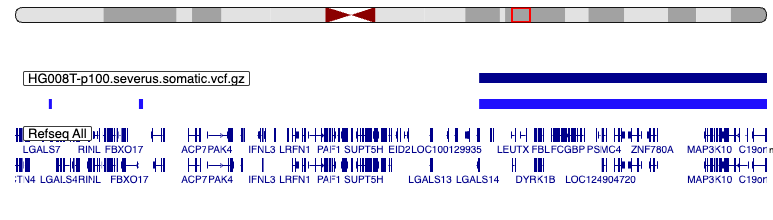 

Notice the huge feature that's been flagged.

For reference, this is how the VCF contents look:
```
##fileformat=VCFv4.2
##FILTER=<ID=PASS,Description="All filters passed">
##source=Severus_v1.6
.
.
.
##ALT=<ID=DEL,Description="Deletion">
##ALT=<ID=INS,Description="Insertion">
##ALT=<ID=DUP,Description="Duplication">
##ALT=<ID=INV,Description="Reciprocal Inversion">
##ALT=<ID=BND,Description="Breakend">
##FILTER=<ID=FAIL_LOWSUPP,Description="Less number of support, but ok in other samples">
##FILTER=<ID=FAIL_MAP_CONS,Description="Majority of variant reads have unreliable mappability">
##FILTER=<ID=FAIL_CONN_CONS,Description="Majority of variant reads have unreliable connections">
##FILTER=<ID=FAIL_LOWCOV_OTHER,Description="Low variant coverage in other samples">
##INFO=<ID=PRECISE,Number=0,Type=Flag,Description="SV with precise breakpoints coordinates and length">
##INFO=<ID=IMPRECISE,Number=0,Type=Flag,Description="SV with imprecise breakpoints coordinates and length">
##INFO=<ID=SVTYPE,Number=1,Type=String,Description="Type of structural variant">
##INFO=<ID=SVLEN,Number=1,Type=Integer,Description="Length of the SV">
##INFO=<ID=END,Number=1,Type=Integer,Description="End position of the SV">
##INFO=<ID=STRANDS,Number=1,Type=String,Description="Breakpoint strandedness">
##INFO=<ID=DETAILED_TYPE,Number=1,Type=String,Description="Detailed type of the SV">
##INFO=<ID=INSLEN,Number=1,Type=Integer,Description="Length of the unmapped sequence between breakpoint">
##INFO=<ID=MAPQ,Number=1,Type=Integer,Description="Median mapping quality of supporting reads">
##INFO=<ID=PHASESETID,Number=1,Type=String,Description="Matching phaseset ID for phased SVs">
##INFO=<ID=HP,Number=1,Type=Integer,Description="Matching haplotype ID for phased SVs">
##INFO=<ID=CLUSTERID,Number=1,Type=String,Description="Cluster ID in breakpoint_graph">
##INFO=<ID=INSSEQ,Number=1,Type=String,Description="Insertion sequence between breakpoints">
##INFO=<ID=MATE_ID,Number=1,Type=String,Description="MATE ID for breakends">
##INFO=<ID=INSIDE_VNTR,Number=1,Type=String,Description="True if an indel is inside a VNTR">
##INFO=<ID=ALIGNED_POS,Number=1,Type=String,Description="Position in the reference">
##INFO=<ID=LOW_COV_IN,Number=1,Type=String,Description="Samples that has low coverage in that region">
##INFO=<ID=INSIDE_WHITELIST,Number=1,Type=String,Description="SVs within the whitelist bed file">
##FORMAT=<ID=GT,Number=1,Type=String,Description="Genotype">
##FORMAT=<ID=DR,Number=1,Type=Integer,Description="Number of reference reads">
##FORMAT=<ID=DV,Number=1,Type=Integer,Description="Number of variant reads">
##FORMAT=<ID=VAF,Number=1,Type=Float,Description="Variant allele frequency">
##FORMAT=<ID=hVAF,Number=3,Type=Float,Description="Haplotype specific variant Allele frequency (H0,H1,H2)">
##INFO=<ID=BCSQ,Number=.,Type=String,Description="Local consequence annotation. Format: Consequence|gene|transcript|biotype|strand|amino_acid_change|dna_change">
##INFO=<ID=hetalt,Number=.,Type=String,Description="Samples with heterozygous REF/ALT genotype">
##INFO=<ID=homalt,Number=.,Type=String,Description="Samples with homozygous ALT/ALT or hemizygous ALT genotype">
#CHROM  POS     ID      REF     ALT     QUAL    FILTER  INFO    FORMAT  m84113_260205_082846_s3.demux.bc2055--bc2055.aligned.hiphase
chr1    151220118       severus_DEL306  N       <DEL>   60      PASS    PRECISE;SVTYPE=DEL;SVLEN=172;END=151220290;STRANDS=+-;MAPQ=60;PHASESETID=151409146|151409146;HP=1;BCSQ=sv:intron|PIP5K1A||protein_coding|+||;hetalt=m84113_260205_082846_s3.demux.bc2055--bc2055.aligned.hiphase        GT:VAF:hVAF:DR:DV       0/1:0.8:0,1,0:5:20
chr1    154714649       severus_BND18941        N       N.      60      PASS    IMPRECISE;SVTYPE=sBND;STRANDS=+;DETAILED_TYPE=loose_end;MAPQ=60;PHASESETID=154791972|154791972;HP=2;BCSQ=sv:intron|KCNN3||protein_coding|-||;hetalt=m84113_260205_082846_s3.demux.bc2055--bc2055.aligned.hiphase        GT:VAF:hVAF:DR:DV       0/1:0.16:0,0,0.26:26:5
```
:::: {.callout type="blue" collapsible="true" title="Question : What type of variant is it?"}
  It is a structural variant. Much larger than the single base of SNVs. The Alt also indicates it is a deletion event.
::::
:::: {.callout type="blue" collapsible="true" title="Question : How long is the feature?"}
  ~10.8 Mb according to the SV length field
::::
:::: {.callout type="blue" collapsible="true" title="Question : What is the feature's `ID` and what purpose does the ID field serve?"}
  "severus_DEL3275" and to act as a unique identifier
::::
:::: {.callout type="blue" collapsible="true" title="Question : How would we find out how many genes are affected by the feature?"}
  The BCFtools Consequence or BCSQ identifies the genes affected.
::::

#### BED/bigBed
##### Step 9 – Working with BigBed / External Annotation

Let's explore BED files. Load the following URL into the track
```
https://hgdownload.soe.ucsc.edu/gbdb/hg38/encode4/ccre/encodeCcreRegistry.bb
```

:::: {.callout type="blue" collapsible="true" title="Question : Notice anything different with the file suffix?"}
  It is a bigBed file. The same as a regular bed file but binarized, compressed and indexed for accessibility. IGV is able to only fetch the region on screen and does not require a separate index file. To find out more see the following [link](https://genome.ucsc.edu/goldenPath/help/bigBed.html)
::::

How to interpret the features described by the bed file? The UCSC genome browser describes the file in great detail, specifically: 
 

For more info see the following [link](https://genome.ucsc.edu/cgi-bin/hgTrackUi?hgsid=4159675625_pMjcCAWJ0iqsyPdZ6WOQ6gMFIklH&db=hg38&c=chr7&g=cCREregistry)

If we navigate to `TP53` by typing `TP53` in the search bar, we see the following:
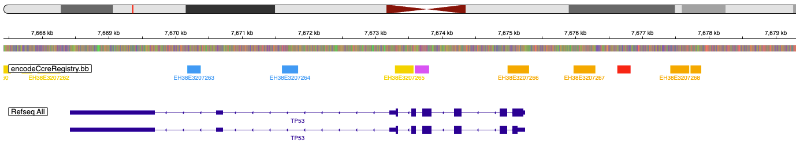

TP53 has 26 RefSeq transcripts, but IGV only shows 2 of them. We can access the settings on refSeq annotation through the gear on the right → Set track height → 700. All 26 rows appear.

:::: {.callout type="blue" collapsible="true" title="Question : What is the red feature? What is the importance of the feature and where it is located?"}
  It is a promoter-like element (PLS). ENCODE only assigns this class to regions near an annotated transcription start site. The main TP53 promoter is the cluster of red elements at the far right (~7,687 kb). The single red element at ~7,676.7 kb sits inside the full-length gene, in intron 1, just upstream of exon 2, which holds the start codon. Its promoter-like chromatin and a GENCODE V39 transcript starting there suggest a candidate alternative start site.
::::

### Part 2 - cBioPortal

#### Learning Objectives
- How to browse and make use of the visualization functions in cBioPortal
- Learn to query genes and datasets of interest
- Make use of visualizations to discover relationships and biological trends

Firstly, what is cBioPortal? [As per their about page, Multimodal data represented in interactive visualizations that facilitates biological discovery and clinical decisions](https://about.cBioPortal.org/). It incorporates patient-level cohort data such as mutations and clinical data.

##### Step 1 – Select the studies and build the query

Navigate to [https://www.cBioPortal.org/](https://www.cBioPortal.org/) and select the following two studies:   
  - Breast Cancer (METABRIC, Nature 2012 & Nature Commun 2016)
    - Consists of 2,509 samples of targeted sequencing on primary tumours with 549 normal matched
  - Breast Invasive Carcinoma (TCGA, PanCancer Atlas)
    - 1,084 samples as part of a large cohort that profiled 10,000 tumours across 33 cancer types

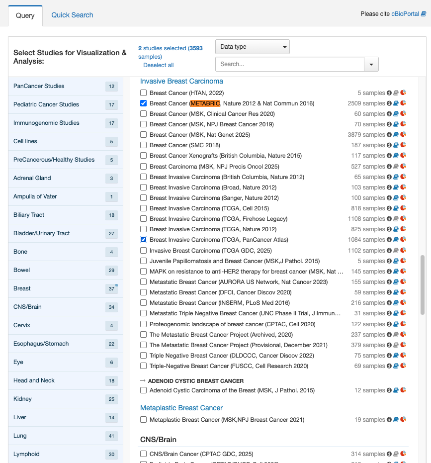 

Click "query by gene" at the footer and query the following :
```
TP53 PIK3CA BRCA1 BRCA2 PTEN STK11 CDH1 PALB2 CHEK2 ATM BARD1 RAD51C RAD51D FGFR2 TOX3 MAP3K1 ESR1 ERBB2 GATA3
```

These genes are commonly altered in breast cancer, and working with them in the tutorial will provide some insight of their significance.

 
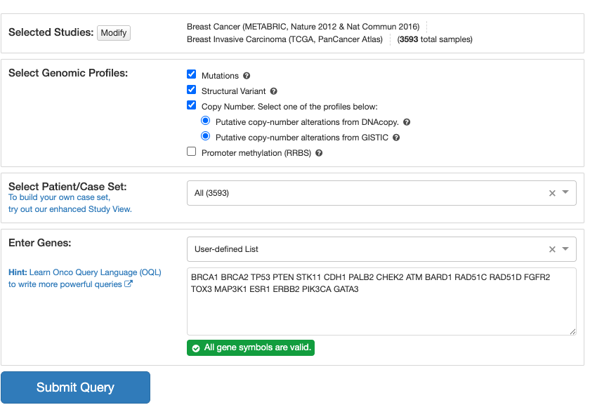  

##### Step 2 – OncoPrint

We are presented with an OncoPrint  
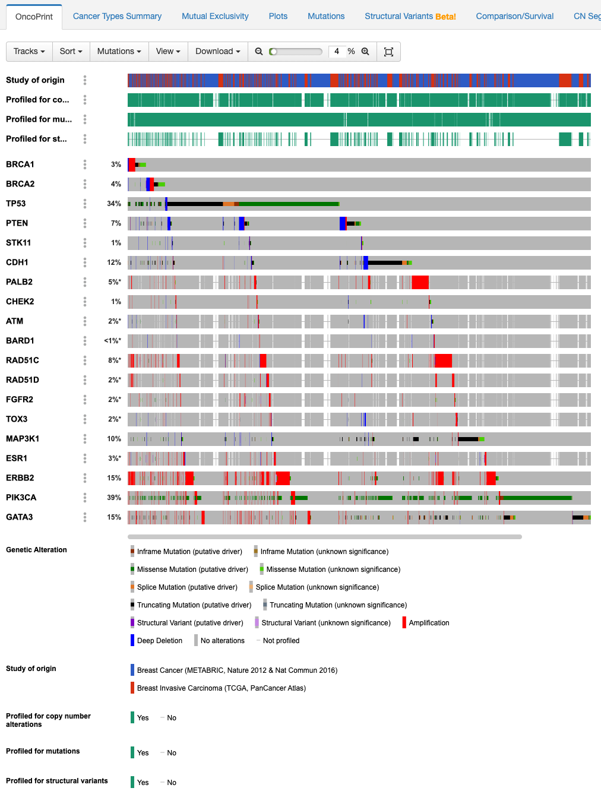 

:::: {.callout type="blue" collapsible="true" title="Question : What do the first four rows present and mean?"}
As indicated in the legend, the first four rows provide info on donors' membership in the respective datasets and whether they were profiled for copy number changes, mutations, and structural variants.
::::
:::: {.callout type="blue" collapsible="true" title="Question : We see multiple genes, focusing on `TP53` and `PIK3CA`, what can we infer?"}
The percentage represents the number of donors with genetic alterations, where the legend specifies the type and proportion of donors
::::

##### Step 3 – Cancer Types Summary

On the above tabs, navigate to the cancer types summary view   

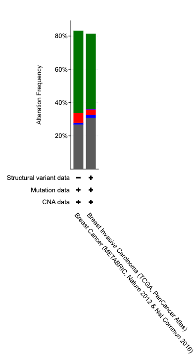

:::: {.callout type="blue" collapsible="true" title="Question : What does the barchart summarize for us?"}
  X-axis gives info on the dataset and included profiled genomic alteration types. The Bars provide a frequency of genomic alterations.
::::

##### Step 4 – Mutual Exclusivity

Moving on to mutual exclusivity, select significant only and sort by q-value starting with lowest/most significant

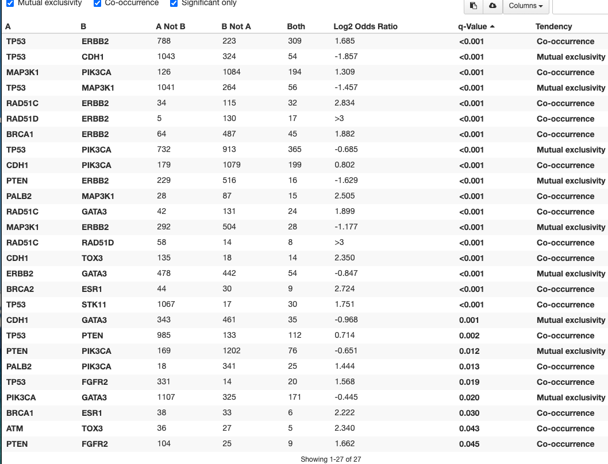

The first row denotes TP53 and ERBB2.

:::: {.callout type="blue" collapsible="true" title="Question : What does the finding of co-occurrence entail?"}
  Based on the two datasets, TP53 and ERBB2 are often both found to be altered
  [Perhaps an interesting link to look at](https://pmc.ncbi.nlm.nih.gov/articles/PMC3465532/#:~:text=The%20HER2%2DEnriched%20subtype%20\(HER2E\)%2C%20which%20has%20frequent%20HER2/ERBB2%20amplification%20\(80%25\)%2C%20had%20a%20hybrid%20pattern%20with%20a%20high%20frequency%20of%20TP53%20\(72%25\)%20and)
::::

Looking at the second row of TP53 and CDH1

:::: {.callout type="blue" collapsible="true" title="Question : What does the finding of mutual exclusivity entail?"}
  Very few examples exist in the two breast cancer datasets where both TP53 and CDH1 co-occur, in fact most donors have one or the other. This could signify a dependency specific to the cancer type.
::::

##### Step 5 – Plots

Exploring the plots tab next. Let's use the quick filter for FGA vs Dx

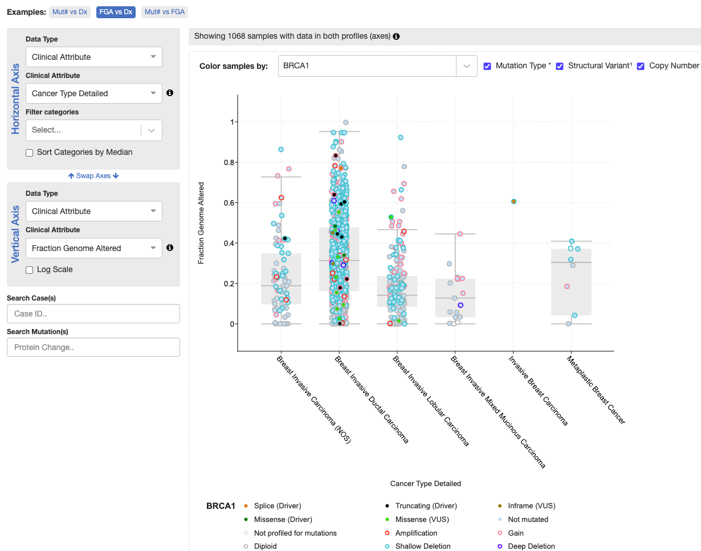 

:::: {.callout type="blue" collapsible="true" title="Question : What info can we glean from the plot?"}
  The TCGA datasets are split up into various types of breast carcinomas. Breast invasive ductal carcinoma shows the highest fraction of genome altered, signifying genomic instability.
::::

- Let's look at the mutations tab, specifically for gene TP53 

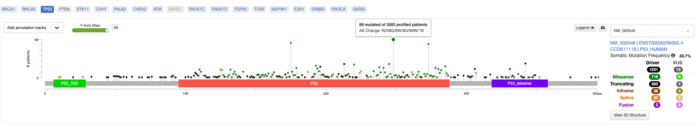  

##### Step 6 – Mutations

  - Let's look at the mutation with the highest donor count

:::: {.callout type="blue" collapsible="true" title="Question : Where does it occur in TP53?"}
  In the TP53 region that binds DNA. Amino acid 248
::::  
:::: {.callout type="blue" collapsible="true" title="Question : What type of mutation is it?"}
  Different types, but often missense
::::  
:::: {.callout type="blue" collapsible="true" title="Question : Are there any Post-Translational Modifications associated with the mutation?"}
  On the left, we can add annotation tracks. Specifically we're interested in Post-Translational Modifications (PTM). Scrolling around, no modification coincides with the mutation.
::::  
  
Speaking of annotations, what if we wanted to find out more about the mutation? What can we look up through OncoKB?

- Hovering over the first row of the mutations table, note the record of sample ID `MB-0211` with the protein change `R248Q`
- Hover on the dartboard icon under the column annotation
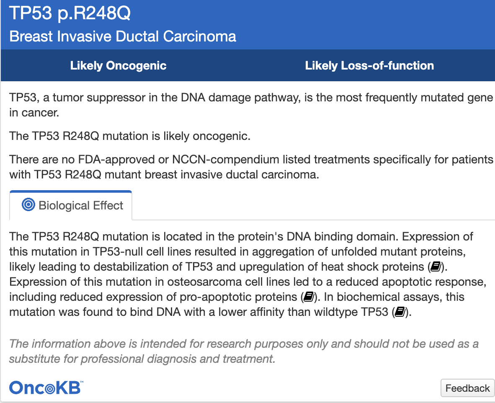  

##### Step 7 – Comparison/Survival

- Looking at survival curves. 

:::: {.callout type="blue" collapsible="true" title="Question : What can we understand about TP53 vs unaffected cohort (no alteration in any of the 19 queried genes)?"}
  Patients with TP53 mutations initially have poorer survival odds but around 180-200 months have better outcomes compared to the unaffected cohort.
::::

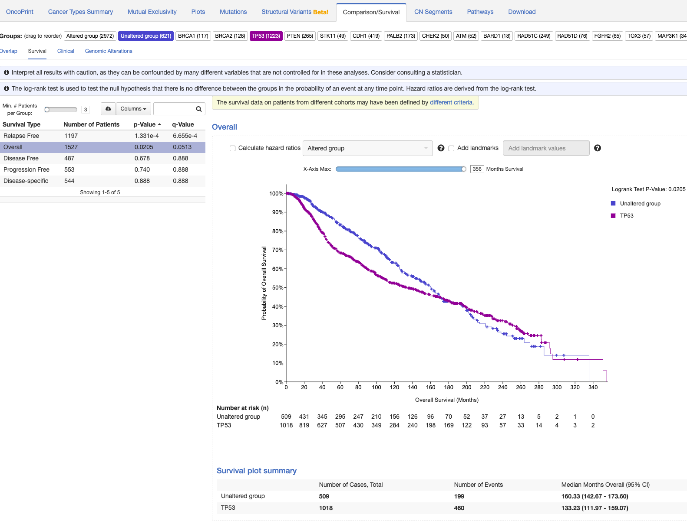  

##### Step 8 – CN Segments

- Lastly, let's look at copy number segments which brings us back to IGV. Looking at PIK3CA vs TP53

:::: {.callout type="blue" collapsible="true" title="Question : what differences do we observe?"}
  TP53 mutations are copy number losses while PIK3CA mutations are copy number gains.
::::

### Part 3 - COSMIC

COSMIC (Catalogue of Somatic Mutations in Cancer) is a curated knowledge base of somatic mutations drawn from the literature and large-scale studies, along with data from other assays (e.g., methylation) and analyses (e.g., drug resistance).

An example use-case would be exploration with cBioPortal to find trends and patterns followed up with validation and annotating significance in COSMIC.

#### Learning Objectives
- How to browse and make use of the visualization functions in COSMIC
- Navigate datasets by refining the search using visualization functions 

Navigate to [COSMIC](https://cancer.sanger.ac.uk/cosmic). You'll need an account to access the data. Follow the prompts at the following link : https://cancer.sanger.ac.uk/cosmic/register

##### Step 1 – Search for a gene

Search for `TP53` in the header search bar


Additionally, ensure you're on the correct genome build GRCh38. The search returns the results page which groups hits by type (Genes, Mutations, Samples, Cancers, etc.). We need to choose the gene TP53 to open the gene page.

##### Step 2 – Read the gene view
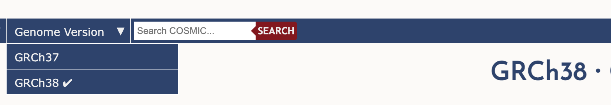

The central gene view plot displays various types of info along the length of the gene.

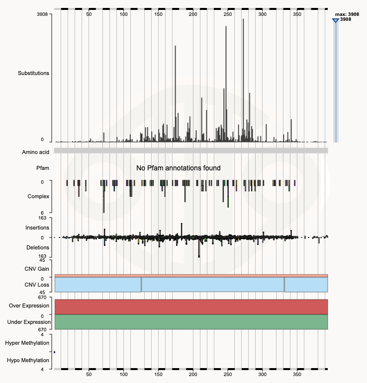

Hovering on the top substitution, we'll find the position to be `273`. We can further zoom in to that region for more info. 


##### Step 3 – Zoom to positions 270–275

Apply the filters on the left-hand side for `270-275`.


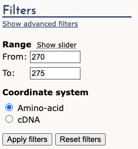

The result is the following barchart of substitutions.

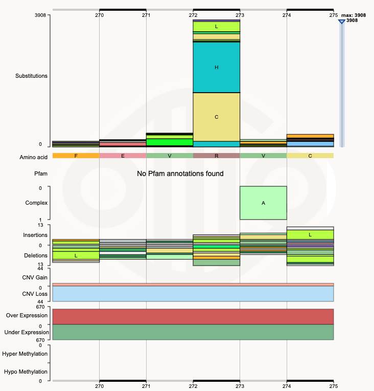

:::: {.callout type="blue" collapsible="true" title="Question : Which substitution is the most common at position `273` of the TP53 gene?"}
  p.R273H (c.818G>A) 1551
::::

##### Step 4 – Open the mutation page

Clicking on the mutation brings us to a page dedicated to the mutation. Here, a number of interesting things can be viewed, including samples with the mutation, related references, and pathways.
- The shape is the same (missense hotspots in the DNA-binding domain plus truncations everywhere), but COSMIC's top hotspot is R273 across all cancers, while in cBioPortal's two breast cohorts it was R248, with R175 and R273 close behind
- Different sample collections give different rankings of the most common mutation!

We can also observe the tissue type distribution of samples with the TP53 mutations.

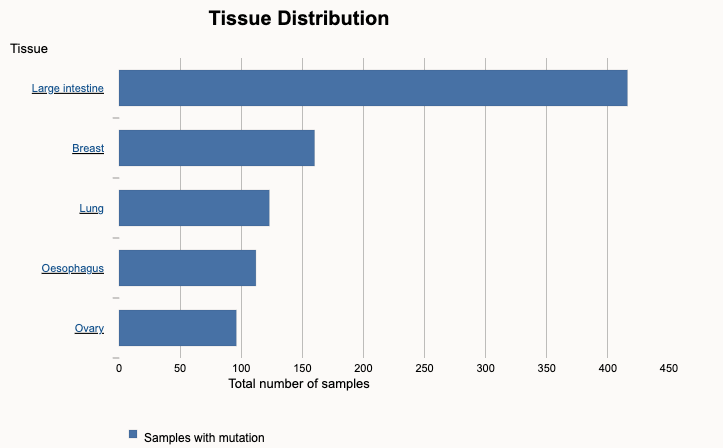

##### Step 5 – Jump to a tissue: the Cancer Browser

Clicking on the `Large Intestine` brings us to a page dedicated to `Large Intestine`. 

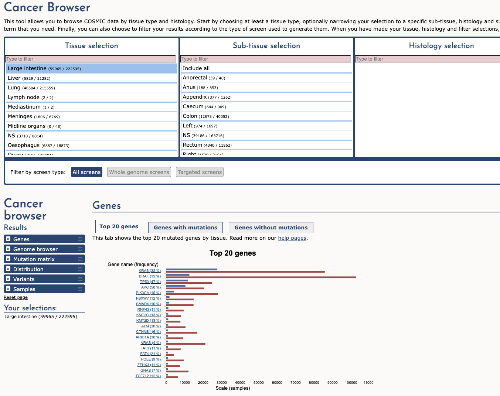

##### Step 6 – Back to TP53 with the tissue filter

We can then see the top genes mutated in Large intestinal samples. Clicking the TP53 mutation returns us to the TP53 page but with additional filters.

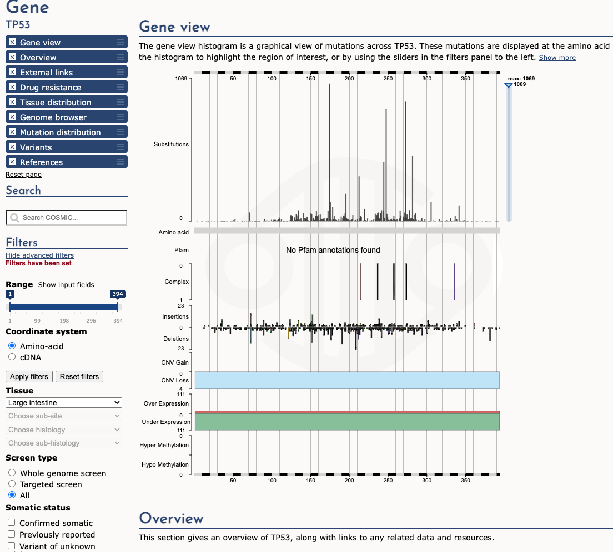

Note the left-hand filter with tissue type selection applied. The result is that the most represented mutation is now different. Previously it was `3908` at position `273` but the most frequent mutation is now `175` with `1069` mutation count. We can observe how different tissue types reflect different mutations.

### Part 4 - Advanced Exercises

#### Exercise 1 – Real genome or alignment artefact? (Part 1, BAM)
Go back to the two regions you looked at in NA12878.bam:

- Region 1: `chr1:143,220,111-143,221,807`
- Region 2: `chr2:32,915,196-32,917,755`

Do the reads in these regions reflect the actual genome of the sample, or are they mostly alignment artefacts? 
What in the IGV view supports your answer?

To help you decide, add two annotation tracks. Open Tracks → Hosted Annotations…, go to Mapping and Sequencing, and tick:

- __LowMap+SegDup__ (under Difficult regions from GIAB). GIAB uses this track to mark segmental duplications and regions that are hard to map with short reads.
- __Simple Repeats__ (under Repeats). In region 1 you should see one bar over the whole window, with the repeat unit `TCGAATGGAATCATCA`.

Does what you see in these tracks change or confirm your answer?

:::: {.callout type="blue" collapsible="true" title="Answer"}
Both regions are mostly alignment artefacts.

In region 1, most reads are drawn transparent, which means mapping quality 0, and each read has several mismatches. The few coloured pairs (red, blue, orange) also have MAPQ 0, and their mates are far away on chr1 or on chr14. LowMap+SegDup covers the whole window. This part of chr1 exists in several nearly identical copies, so reads that really come from another copy end up here, and the small differences between the copies show up as mismatches.

In region 2, the reads are short and heavily clipped, and almost every one has a different colour because the mates are spread over many chromosomes. Most of them are supplementary alignments with MAPQ 0. The reference sequence bar is solid orange, which is a run of about 400 G's, followed by a block of 1,000 Ns. Low-quality, G-rich pieces of unrelated reads stick to this run of G's.

Low mapping quality, evidence that doesn't agree (mates scattered everywhere), and a repeat or duplication underneath are the typical signs of an artefact. A real variant or SV would be supported by many well-mapped, independent reads telling the same story.
::::

#### Exercise 2 – TP53 in the germline VCF (Part 1, germline VCF)

HG008 is a pancreatic cancer patient. The germline variants in this file come from long-read (PacBio HiFi) sequencing of the patient’s normal tissue. The variants were called with dipcall, which builds the two chromosome copies from the long reads and compares each one with the reference. As you go through the variant and genotype fields, look out for what the long reads add that you would not usually get from short reads.

Go to `TP53` (`chr17:7,668,000-7,690,000`). Click the variant at `chr17:7,676,154`, then click its genotype cell. Go through every field in both popups and write down what you think each one means.

1. Is this variant germline or somatic? How can you tell?

:::: {.callout type="blue" collapsible="true" title="Answer"}
Germline. The variant is in the normal sample (HG008N), so the person was born with it. It is `rs1042522` (Use the annotation `ClinVar dbSNP` under `Variation`), the well-known `TP53` `Pro72Arg` variant. In most populations the arginine version (the ALT here) is actually the more common one: a “variant” only means different from the reference genome, not rare or harmful.
::::

2. What does `0|1` tell you that `0/1` would not?

:::: {.callout type="blue" collapsible="true" title="Answer"}
The pipe means the genotype is phased: we know which chromosome copy carries the `ALT` allele. This comes from the long reads (HiPhase). Note that IGV shows `A | G` in the popup either way, so check the PS field to see whether a variant is phased.
::::
3. Find another heterozygous variant in TP53 with the same PS value. Is its `ALT` allele on the same chromosome copy as the `ALT` at `7,676,154`?

:::: {.callout type="blue" collapsible="true" title="Answer"}
All heterozygous variants in `TP53` share PS `7498016`, so they belong to one phase block. Variants written the same way (`0|1`) have their ALT on the same copy; a `1|0` variant has its ALT on the other copy.
::::
4. Why is AD only `1,1` for this variant?

:::: {.callout type="blue" collapsible="true" title="Answer"}
This VCF was made by dipcall, which compares two genome assemblies with the reference rather than counting reads. Here AD counts assembly pieces, one per chromosome copy, so a heterozygous site shows `1,1` and a homozygous one `0,2`. For the same reason, QUAL is always `30`.
::::
5. Which fields in this VCF would you not expect to see in a germline VCF made from short reads?

:::: {.callout type="blue" collapsible="true" title="Answer"}
The main addition from the long reads is phasing. Most heterozygous genotypes are written with a pipe (`0|1`), and the PS (phase set) and PF (phasing flag) fields record which phase block each variant belongs to. Phase blocks here are tens of kilobases long, so a whole gene like `TP53` sits in one block. With short reads, most variants would be unphased (`0/1`) and these fields would be missing. Some other fields come from how this particular file was made rather than from the read length: dipcall compares two genome assemblies with the reference, so `AD` counts assembly pieces, `QUAL` is always `30`, and the filters (`HET1/2`, `GAP1/2`) describe problems with the assemblies. A short-read caller would instead give read counts (`AD`, `DP`) and genotype quality (`GQ`).
::::

#### Exercise 3 – KRAS and CDKN2A in the somatic SV VCF (Part 1, somatic VCF)

HG008 is a pancreatic cancer. The tumour and normal samples were sequenced with long reads. The SV variants are called by the long-read structural-variant caller Severusa which compared the tumour and normal to find SVs present only in the tumour. The resulting file contains the two classic pancreatic cancer events: a gain of the oncogene `KRAS` and a loss of the tumour suppressor `CDKN2A`.

|Gene|Locus|SV record
|--|--|--|
|KRAS|chr12:24,600,000-26,850,000|severus_DUP1372|
|CDKN2A|chr9:21,940,000-21,985,000|severus_DEL7384|

For each one, click the SV and its genotype cell, and note `SVTYPE`, `SVLEN`, `STRANDS`, the genes listed in `BCSQ`, `VAF`, `DR/DV` and `HP`.

1. Why would a tumour gain an extra copy of an oncogene but lose a tumour suppressor?

:::: {.callout type="blue" collapsible="true" title="Answer"}
KRAS sits in a `1.95 Mb` tandem duplication that covers 12 genes (`VAF` `0.36`, `HP` `1`). 

An extra copy of an oncogene increases its growth signal.

CDKN2A is removed by a `19.9 kb` deletion (`VAF 1`, `DR 0`, `DV 11`, `HP 1`). Losing a tumour suppressor removes a brake on cell division.

Oncogenes help a tumour when they become more active, and tumour suppressors help it when they are lost.
::::

2. The CDKN2A deletion has genotype `0/1`, yet its `VAF` is `1`. What could explain this?

:::: {.callout type="blue" collapsible="true" title="Answer"}
A `VAF` of `1` means none of the reads at the breakpoints show the normal sequence, so there is most likely no intact copy left: the other copy was probably lost by a separate event.

CDKN2A is completely inactivated in this tumour. Somatic genotypes are only approximate, and VAF is more informative.

Since HG008-T is a cell line, there are no normal cells to lower the VAF.
::::

3. What does the field `STRANDS` with the value `-+` tell you about the KRAS event?

:::: {.callout type="blue" collapsible="true" title="Answer"}
[`-+` describes a junction that faces outward](https://github.com/KolmogorovLab/Severus/blob/main/README.md#plotly-graphs), which is the signature of a tandem duplication. With short reads, the same event shows up as read pairs facing away from each other.
::::

#### Exercise 4 – cBioPortal (Part 2)

1. `BRCA1` and `BRCA2` are the best-known breast cancer genes, yet in the OncoPrint they are altered in only 3–4 % of patients. Why?

:::: {.callout type="blue" collapsible="true" title="Answer"}
BRCA1 and BRCA2 are famous because inherited (germline) variants in them strongly raise cancer risk. 

The TCGA and METABRIC data in cBioPortal are somatic, meaning only changes found in the tumour, so germline variants are not shown.

Germline BRCA1/2 carriers account for only about 5 % of breast cancers. BRCA1 can also be switched off by promoter methylation or by losing one copy, and neither counts as "altered" by default. 

How often a gene is mutated in tumours is not the same as how important it is for cancer risk.
::::

2. Summarise in one sentence what each view is useful for: OncoPrint, Cancer Types Summary, Mutual Exclusivity, Plots, Mutations, Comparison/Survival and CN Segments.

:::: {.callout type="blue" collapsible="true" title="Answer"}
|View|Useful for|
|--|--|
|OncoPrint|Seeing which patients have which alterations, across all queried genes at once|
|Cancer Types Summary|Comparing alteration frequency between studies or cancer types|
|Mutual Exclusivity|Testing whether two genes tend to be altered together or rarely together|
|Plots|Comparing any two attributes, for example fraction of genome altered by subtype|
|Mutations|Seeing where mutations fall on the protein (hotspots vs spread out) and their annotation|
|Comparison/Survival|Checking whether altered and unaltered patients differ in survival or clinical features|
|CN Segments|Looking at copy-number gains and losses along the genome, in an embedded IGV|


::::

#### Exercise 5 – COSMIC (Part 3)
1. What is COSMIC, and how is it different from cBioPortal?

:::: {.callout type="blue" collapsible="true" title="Answer"}

COSMIC, the Catalogue Of Somatic Mutations In Cancer, is run by the Wellcome Sanger Institute. 

Its team collects somatic mutations from thousands of published papers and genome screens, across all cancer types.

cBioPortal is organised around studies: you pick a cohort and see each patient's alterations together with clinical data such as survival.

COSMIC is organised around genes and mutations: you ask how often a particular mutation has been reported, and in which tissues.

COSMIC is free for academic use after registration; cBioPortal is open.
::::
2. What are other COSMIC features worth a look?

:::: {.callout type="blue" collapsible="true" title="Answer"}
A few worth further exploring: 

- the Cancer Gene Census (a curated list of cancer genes and their role), 
- Mutational Signatures (patterns that point to causes such as smoking or UV light), 
- the Cancer Mutation Census (mutations ranked by evidence that they drive cancer), 
- COSMIC-3D (mutations on protein structures), 
- Actionability (links to drugs and clinical trials) and the Cell Lines Project.
::::

#### Exercise 6 – Which tool for which question?

Which tool would you use to answer each of these questions?

1. Is this variant real in my sequencing data? What do the reads look like?

:::: {.callout type="blue" collapsible="true" title="Answer"}
IGV

It shows your own reads, with mapping quality, mismatches and read pairs
::::

2. How often is a gene altered in a cohort, with which other genes, and does it affect survival?

:::: {.callout type="blue" collapsible="true" title="Answer"}
cBioPortal

It combines cohort data with clinical outcomes
::::

3. Has this exact variant been seen before, in which tissues, and what papers report it?

:::: {.callout type="blue" collapsible="true" title="Answer"}
COSMIC

It collects somatic mutations from published studies, by tissue
::::

4. Is this variant clinically actionable?

:::: {.callout type="blue" collapsible="true" title="Answer"}
OncoKB (or CIViC)

Experts link variants to approved drugs and trials. OncoKB annotations also appear in cBioPortal
::::

5. Is this variant common in healthy people (likely benign germline)?

:::: {.callout type="blue" collapsible="true" title="Answer"}
gnomAD

It gives allele frequencies from hundreds of thousands of people
::::

In practice these tools are often used together: 

IGV to check that a variant is real, gnomAD to check that it is rare, 

COSMIC and cBioPortal to see whether it is known in cancer, 

and OncoKB to see whether it matters for treatment.


<!--chapter:end:020-module-2.Rmd-->

# Module 3 Genome Alignment

## Lecture
<iframe src="https://docs.google.com/presentation/d/10R9UkBE4ts3qVFKnISm4WkUuIXA2zT7s/preview" width="640" height="480" allow="autoplay"></iframe>

## Lab
#### 1. Purpose
We will practice genomic alignment tool, [BWA](https://github.com/lh3/BWA), and post-alignment tool, [Picard](https://broadinstitute.github.io/picard/) and [SAMtools](https://www.htslib.org/), with whole genome sequencing data.

#### 2. Dataset
[SRX4728544](https://www.ncbi.nlm.nih.gov/sra/SRX4728544): Whole Genome Sequencing of CRL-2324 breast cancer cell line
<br>
Due to huge size of the original data, please use __the following small datasets__.
<br>
* [SRR7890824_10M_1.fastq.gz](https://drive.google.com/file/d/15a8DxTOYFfkXlvw8x4RneoSkgvCBUlep/view?usp=drive_link)
* [SRR7890824_10M_2.fastq.gz](https://drive.google.com/file/d/1ljGSzJRYPylCJRi-1V8Zl56K4W34EwcH/view?usp=drive_link)
<br>
Tang et al., Establishing community reference samples, data and call sets for benchmarking cancer mutation detection using whole-genome sequencing, Nat Biotechnol. 2021 Sep;39(9):1151-1160. doi: 10.1038/s41587-021-00993-6. Epub 2021 Sep 9

#### 3. Workflow
1.Download human referecne genome
```{r eval=FALSE}
wget https://hgdownload.gi.ucsc.edu/goldenPath/hg38/bigZips/hg38.fa.gz
```

2. Indexing human reference genome. **This process may takes 1 hour.**
```{r eval=FALSE}
bwa index hg38.fa.gz
```

3. Check output
```{r eval=FALSE}
ls
```
`bwa index` will generate the following five files.

- [hg38.fa.gz.amb](https://drive.google.com/file/d/1O0GreTeeRAw__G9kYjMmk1zuk1xjeEG1/view?usp=drive_link)
- [hg38.fa.gz.ann](https://drive.google.com/file/d/1r9ynpMHSPFE_le8bGhLGPaxd0GTMsUUQ/view?usp=drive_link)
- [hg38.fa.gz.bwt](https://drive.google.com/file/d/1xarOkR4lIjbZz1M-4wUI0Q0yvrAP2C8q/view?usp=drive_link)
- [hg38.fa.gz.pac](https://drive.google.com/file/d/1w2tCGkK6IIgvBqFmKRPhSSxmLlHQRh2q/view?usp=drive_link)
- [hg38.fa.gz.sa](https://drive.google.com/file/d/160ZshdtvfP2KgDUS8QTwkGDHE_ummPkA/view?usp=drive_link)

4. Perform genomic alignment
```{r eval=FALSE}
bwa mem hg38.fa.gz SRR7890824_10M_1.fastq.gz SRR7890824_10M_2.fastq.gz -t 4 > SRR7890824_10M.sam
```
If more multithreds are available, increase number of -t option. For example, `-t 8`.

5. Add RG (read group information) for subsequent analytic tools and convert SAM format to BAM format.
```{r eval=FALSE}
picard AddOrReplaceReadGroups \
      INPUT=SRR7890824_10M.sam \
      OUTPUT=SRR7890824_10M.rg.bam \
      RGID=group1 \
      RGLB=lib1 \
      RGPL=ILLUMINA \
      RGPU=unit1 \
      RGSM=sample1 \
      VALIDATION_STRINGENCY=LENIENT
```

6. Sort BAM file
```{r eval=FALSE}
picard SortSam \
      INPUT=SRR7890824_10M.rg.bam \
      OUTPUT=SRR7890824_10M.sorted.bam \
      SORT_ORDER=coordinate \
      VALIDATION_STRINGENCY=SILENT
```

7. Mark duplicate
```{r eval=FALSE}
picard MarkDuplicates \
      INPUT=SRR7890824_10M.sorted.bam \
      OUTPUT=SRR7890824_10M.dedup.bam \
      METRICS_FILE=metrics.txt`
```

8. Make BAM index
```{r eval=FALSE}
samtools index SRR7890824_10M.dedup.bam
```
9. Finally, you will obtain the following BAM and BAM index files.
- [SRR7890824_10M.dedup.bam](https://drive.google.com/file/d/1FMnfCKE2B-s1oOr8gIQBDTPMYPU_kvqL/view?usp=drive_link)
- [SRR7890824_10M.dedup.bam.bai](https://drive.google.com/file/d/1bwOyuueLIVV8JkjRjFJ011ufBjXCtyYo/view?usp=drive_link)

<!--chapter:end:030-module-3.Rmd-->

# Module 4 Somatic Alterations 

## Lecture 

<iframe src="https://docs.google.com/presentation/d/16YgnBYJJh-RcssrLtr_F15ZTZy0U5Ta6OcNttKKofSo/preview" width="640" height="480" allow="autoplay"></iframe>

## Lab

### Introduction to Variant Discovery and Annotations in Cancer Data
***By Robert Eveleigh, MSc., Alain Pacis, PhD.***  
*https://github.com/c3g/GenPipes*

================================

This work is licensed under a [Creative Commons Attribution-ShareAlike 3.0 Unported License](http://creativecommons.org/licenses/by-sa/3.0/deed.en_US). This means that you are able to copy, share and modify the work, as long as the result is distributed under the same license.

================================

Welcome to this introductory tutorial on variant discovery and annotation, where you'll work through the process of identifying and interpreting genomic variants using real cancer sequencing data. 

In this workshop, we will focus only on whole genome data and provide command lines that allow detecting Single Nucleotide Variants (SNV). 
This workshop will show you how to launch individual steps of a complete DNA-Seq SNV pipeline using cancer data

##### Data Source
Throughout this lab, we'll be using HCC1395, a triple-negative breast cancer cell line derived from a primary ductal carcinoma, paired with its matched normal lymphoblastoid line, HCC1395BL, derived from the same patient. 
This tumor-normal pair isn't just a convenient teaching example — it's the reference standard adopted by the SEQC2 (Sequencing Quality Control Phase 2) consortium precisely because its somatic mutations and germline variants have been exhaustively validated across multiple sequencing platforms and bioinformatics pipelines, giving us a high-confidence "truth set" to check our own results against as we learn. 
Biologically, HCC1395 is a useful sample for this kind of exercise because it carries a well-characterized germline BRCA1 loss-of-function mutation alongside a somatically acquired TP53 mutation, plus additional alterations in genes like PTEN, CDKN2A, and BRCA2 — giving you a realistic mix of germline and somatic variant types, and a chance to see firsthand how variant calling, filtering, and functional annotation come together to distinguish an inherited cancer-predisposition variant from a tumor-acquired driver mutation. 

The HCC1395 sample pair was downloaded from public SRA archive HCC1395 tumor (SRR7890943) and HCC1395BL normal (SRR7890893).
Both normal and tumor were sequenced on Illumina NovaSeq 6000 using DNA from fresh cells with TruSeq PCR free library sequenced to ~70x coverage for the tumor and ~60x coverage for the normal.

By the end of this tutorial, you'll have taken processed sequencing data from this well-studied sample through the core steps of a variant discovery workflow — variant calling, and annotation — and interpreted the biological significance of what you find.
To do this, we will use a subset of the HCC1395/HCC1395BL dataset, focusing on a specific regions of chromosome 13 and 17 that containing 2 somatic (BRCA2 and TP53) and 1 germline (BRCA1).
Using four variant callers (VarScan2, VarDict, MuTecT2 and Strelka2) we will generate a unified callset of somatic/germline variants and annotate them using the CPSR/PCGR reporting system.


**For more details about** [HCC1395](https://pmc.ncbi.nlm.nih.gov/articles/PMC8532138/)

For practical reasons we subsampled the reads for variants of interests (refseq gene boundaries for BRCA1, BRCA2, and TP53 with 2kb padding) in the table below because running the whole dataset would take way too much time and resources. 
See `Module4/data/regions.bed` for the exact coordinates of the regions we will be using in this practical.


###### Environment setup
```{.bash}
# Get the workshop data
export COURSE_REPO=module4_repo
mkdir -p Module4
cd Module4

git clone https://github.com/insilicool/cwb_workshop_2026.git $COURSE_REPO
ln -s $COURSE_REPO/data/alignment alignment
ln -s $COURSE_REPO/data/regions.bed regions.bed
ln -s $COURSE_REPO/data/Homo_sapiens.GRCh38.af-only-gnomad.regions_only.vcf.gz* .
ln -s $COURSE_REPO/scripts/commands.sh commands.sh

# copy the workshop savedResults as pairedVariants
tar -xzf $COURSE_REPO/data/savedResults.tar.gz
mv savedResults pairedVariants

# Pull container
singularity pull docker://ghcr.io/c3g/genpipes_in_a_container:latest

# Spin up container.  Take a few moments to set up, you should see a prompt like this: Singularity>
export BIND_LIST=$(realpath $PWD)
export GENPIPES_SHARED_CVMFS=cvmfs && \
mkdir -p $GENPIPES_SHARED_CVMFS && \
singularity run \
    --cleanenv \
    -S /var/run/cvmfs \
    -B ${GENPIPES_SHARED_CVMFS}:/cvmfs-cache \
    -B "$BIND_LIST" \
    --fusemount "container:cvmfs2 cvmfs-config.computecanada.ca /cvmfs/cvmfs-config.computecanada.ca" \
    --fusemount "container:cvmfs2 soft.mugqic /cvmfs/soft.mugqic" \
    --fusemount "container:cvmfs2 ref.mugqic /cvmfs/ref.mugqic" \
    genpipes_in_a_container_latest.sif

# Set up the environment
export REF=${MUGQIC_INSTALL_HOME}/genomes/species/Homo_sapiens.GRCh38/

#Run module avail to see full C3G software stack
module avail
```

###### Software requirements
The workshop commands use software provided by the MUGQIC module system in the
`c3genomics/genpipes:v6.2.0` environment. Load the modules needed for each
step with the `module load` commands in this README; the commands purge and
load modules as needed rather than requiring every tool to be loaded at once.

| Software | Version used |
| --- | --- |
| [SAMtools](https://www.htslib.org/) | 1.14 |
| [VarScan2](https://varscan.sourceforge.net/) | 2.4.3 |
| [VarDictJava](https://github.com/AstraZeneca-NGS/VarDictJava) | 1.4.8 |
| [GATK (GenomeAnalysisTK)](https://gatk.broadinstitute.org/) | 4.6.0.0 |
| [Strelka2](https://github.com/Illumina/strelka) | 2.9.10 |
| [bcftools](https://www.htslib.org/) | 1.15, 1.23 |
| [HTSlib (bgzip, tabix)](https://www.htslib.org/) | 1.14 |
| [vt](https://github.com/atks/vt) | 0.57 |
| [bcbio.variation.recall](https://github.com/chapmanb/bcbio.variation) | 0.2.6 |
| [PCGR](https://github.com/sigven/pcgr) | 2.3.1 |
| [IGVtools](https://software.broadinstitute.org/software/igv/igvtools) | 2.3.14 |
| [OpenJDK](https://openjdk.org/) | 17.0.1, 8u72 |
| [Perl](https://www.perl.org/) | 5.34.0 |
| [R / Bioconductor](https://www.bioconductor.org/) | R 4.1.0 / Bioconductor 3.13 |
| [Python](https://www.python.org/) | 3.10.4, 2.7.18 |
| [MUGQIC tools](https://github.com/MUGQIC/mugqic_tools) | 2.12.7 |

##### Original Setup

The initial structure of your folders should look like this:
```
<ROOT>
|-- alignments/              # aligments from the center (down sampled)
    `-- HCC1395BL_normal     # The blood sample directory
        `-- HCC1395BL*_?     # Lane directory by run number. Contains the fastqs
    `-- HCC1395_tumor        # The tumor sample directory
        `-- HCC1395*_?       # Lane directory by run number. Contains the fastqs
|-- savedResults             # Folder containing precomputed results
|-- scripts                  # cheat sheet folder
```


###### Cheat file
**You can either run each code block below or run all commands using `bash commands.sh` ** [commands.sh](Module4/scripts/commands.sh)

### Getting started
So you've just received an email from the sequencing center indicating that your data is ready for download.

**What should you do ?** [solution](Module4/solutions/_data.md)

You have now processed your data using best practices and should have one BAM for normal and tumor.

Let's inspect the BAM files to see what is in there.

```{.bash}
module load mugqic/samtools/1.14
ls -l alignment/HCC1395BL_normal/
samtools view -H alignment/HCC1395BL_normal/HCC1395BL_normal.subset.bam

```
**How was this data processed?** [solution](Module4/solutions/_view1.md)

```{.bash}
samtools view -H alignment/HCC1395BL_normal/HCC1395BL_normal.subset.bam | grep "@RG"

```

You should have your 1 read group entry.

**Why did we use the -H switch?** [Solution](Module4/solutions/_view2.md)

**Try without. What happens?** [Solution](Module4/solutions/_view3.md)

### Variant Discovery in Cancer

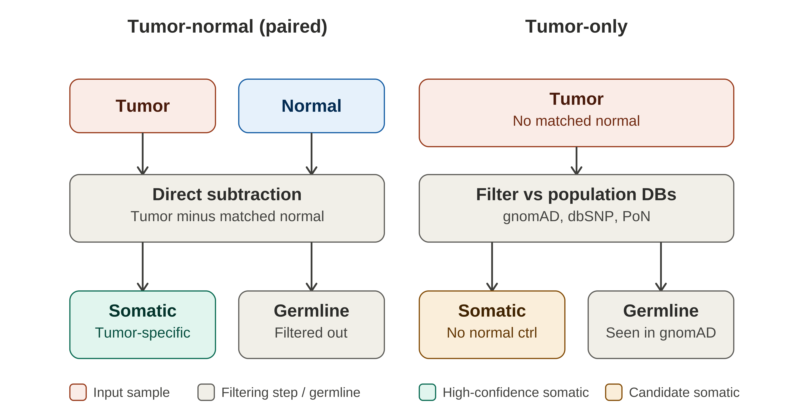

Tumor-normal (paired): the gold standard because the normal acts as a per-patient control for both germline variation and technical artifacts.


Tumor-only: with no matched normal, callers substitute population databases (gnomAD, dbSNP, ExAC, etc.) and/or a panel of normals (PoN) to guess which variants are likely germline (common in the population) versus somatic.
This is inherently weaker e.g. private/rare germline variants can get miscalled as somatic.
PON can be useful to filter out recurrent technical artifacts, especially when using the same sequencing platform and library prep (WGS and WES - same baits) as the PoN samples, but it won't help with private germline variants.

Before we start variant discovery, let's look at the structure of the VCF file. 

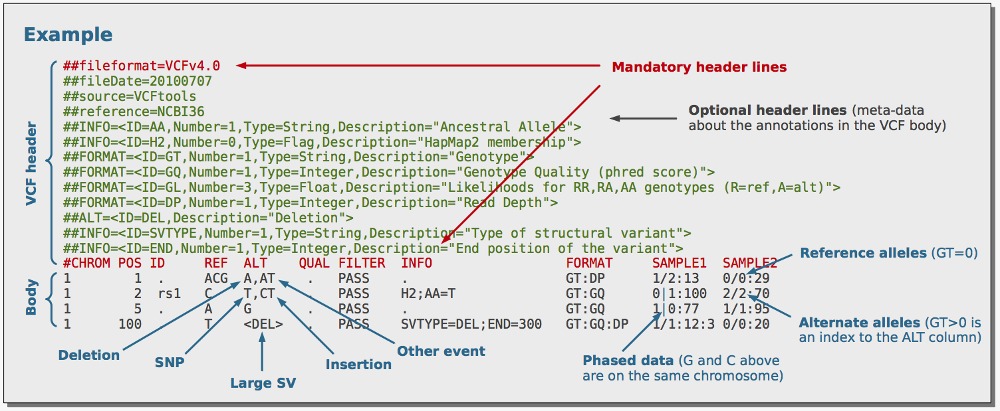

Briefly, the VCF format is is flexible and extensible, allowing for the inclusion of various types of information about each variant in a text file format (most likely stored in a compressed manner) that contains:
- A header denoted with ## or # containing meta-data information 
- A body containing information about a position in the genome. The VCF format is flexible and extensible, allowing for the inclusion of various types of information about each variant.

Notes:
1. ##INFO=: describes the INFO field, which contains additional information about the variant, typicaly with caller-specifics, annotations etc.
2. ##FORMAT=: describes the FORMAT field, which contains information about the genotype of each sample at that position. One set of FORMAT fields is provided for each SAMPLE in the VCF file.
3. #CHROM, POS, ID, REF, ALT, QUAL, FILTER, INFO, FORMAT: these are the standard columns in the VCF file. The first 8 columns are fixed and contain information about the variant itself. The last two columns contain information about the genotype of each sample at that position.
4. The first and second variant in the example contain multi-allelic variants, which are represented in the ALT field as a comma-separated list of alternate alleles.  More on this in the following section on multi-allelic variants.

Now that we have a basic understanding of the VCF format, let's look at the different variant callers we will be using in this practical.

Until recently, the main difference between the different callers is the way they handle the data and the statistical model they use to call variants.
Most of SNV and indel callers use either Baysian, threshold or t-test approach for variant discovery. 
However, more variant discovery tools are making use of machine learning (ML), for discovery (e.g. DeepSomatic, Clair3), variant filtering, prioritization or annotations.

In this practical we will be focusing on well known non-ML variant callers.
Here we will try four variant callers.

##### Variant Callers Comparison (High-level overview more will be explained in the following sections)

| Caller | Read-support model | Region-calling logic | Local realignment |
|---|---|---|---|
| **VarScan2** | mpileup counts only | Heuristic thresholds + Fisher's exact test | None |
| **VarDict** | Direct BAM read counts | Heuristic thresholds + statistical test (`testsomatic.R`) | **Yes** — on the fly, soft-clip based |
| **Mutect2** | Local reassembly (haplotype graph) | Bayesian genotype-likelihood model | Yes — full local assembly |
| **Strelka2** | Local reassembly | Bayesian mixture model | Yes — full local assembly |

many, MANY others can be found here:
https://www.biostars.org/p/19104/

We will then apply and ensemble approach to combine the results of the different callers and generate a unified callset.


In our case, let's start with:

```{.bash}
mkdir -p pairedVariants

```

##### Varscan 2

VarScan2 (Koboldt et al., Genome Research, 2012) takes a fundamentally different approach from the other three callers in this practical. It uses a heuristic method and a statistical test based on the number of aligned reads supporting each allele.

The caller works directly on read counts pulled from samtools mpileup output — it never touches the BAM files itself. This is why, as we set up earlier, region restriction for VarScan2 has to happen at the mpileup step rather than through a flag native to VarScan2.

Requirements for running Samtools mpileup and VarScan2:
- A Normal/tumor SAM/BAM file that has been coordinate sorted.
- The reference sequence ("reference.fasta") to which reads were aligned, in FASTA format.
- The SAMtools software package.
- The VarScan2 software package (Java-based).


```{.bash}
# SAMTools mpileup
##Good practice to purge all modules before loading new ones
module purge && \
module load mugqic/samtools/1.14 && \
samtools mpileup -d 1000 -B -q 10 -Q 10 \
  -f ${REF}/genome/Homo_sapiens.GRCh38.fa \
  -l regions.bed \
  alignment/HCC1395BL_normal/HCC1395BL_normal.subset.bam \
  alignment/HCC1395_tumor/HCC1395_tumor.subset.bam \
  > pairedVariants/HCC1395.varscan2.mpileup

```
[note on samtools mpileup command](Module4/notes/_mpileup1.md)

The Varscan2 heuristic method refers to a set of user-configurable read-count thresholds applied at every candidate position: 
- Minimum read depth (--min-coverage, default 8), 
- Minimum number of reads supporting the variant allele (--min-reads2, default 2), 
- Minimum variant allele frequency (--min-var-freq, default 0.20 — though for tumor samples this is commonly relaxed to 0.05–0.10 to catch subclonal variants)
- Minimum base quality (--min-avg-qual, default 15)

The "statistical test" is where VarScan2 becomes specifically useful for a tumor-normal pair like HCC1395/HCC1395BL: for every position that passes the heuristic filters, 
VarScan2's somatic-calling mode (varscan somatic) applies a Fisher's exact test comparing the read counts supporting the reference vs. variant allele in the normal sample 
against the same counts in the tumor sample. Based on that comparison (and the --somatic-p-value threshold, default 0.05) each variant gets classified into one of four categories:

1. **Germline**: The variant is present in the normal sample but not in the tumor sample.
2. **Somatic**: The variant is present in the tumor sample but not in the normal sample.
3. **LOH** (Loss of Heterozygosity): The variant is present in both, but at a higher allele fraction in the tumor
4. **Unknown**: The variant cannot be classified into any of the above categories.

```{.bash}
# Varscan2
module purge && \
module load mugqic/java/openjdk-jdk-17.0.1 mugqic/VarScan/2.4.3 mugqic/htslib/1.14 mugqic/bcftools/1.15 && \
java -Xmx2000M -jar $VARSCAN2_JAR somatic \
  pairedVariants/HCC1395.varscan2.mpileup \
  pairedVariants/HCC1395.varscan2 \
  --min-coverage 3 \
  --min-var-freq 0.05 \
  --p-value 0.10 \
  --somatic-p-value 0.05 \
  --strand-filter 0 \
  --output-vcf 1 \
  --mpileup 1 && \
bgzip -cf  \
 pairedVariants/HCC1395.varscan2.snp.vcf \
  > pairedVariants/HCC1395.varscan2.snp.vcf.gz && \
tabix -pvcf pairedVariants/HCC1395.varscan2.snp.vcf.gz && \
bgzip -cf  \
 pairedVariants/HCC1395.varscan2.indel.vcf \
  > pairedVariants/HCC1395.varscan2.indel.vcf.gz && \
tabix -pvcf pairedVariants/HCC1395.varscan2.indel.vcf.gz && \
bcftools \
  concat -a \
  pairedVariants/HCC1395.varscan2.snp.vcf.gz \
  pairedVariants/HCC1395.varscan2.indel.vcf.gz | \
sed 's/TUMOR/HCC1395_NS_T_1/g'   | \
sed 's/NORMAL/HCC1395BL_NS_N_1/g' \
> pairedVariants/HCC1395.varscan2.vcf && \
bgzip -cf  \
 pairedVariants/HCC1395.varscan2.vcf \
  > pairedVariants/HCC1395.varscan2.vcf.gz && \
tabix -pvcf pairedVariants/HCC1395.varscan2.vcf.gz

```
Note: Using bgzip and tabix to compress and index the VCF files is a good practice, especially for large datasets, as it allows for efficient random access to specific regions of the file without needing to decompress the entire file.

**Note on VarScan2 parameters used above** [here](Module4/solutions/_varscan1.md)

**From the VarScan2 output, how many germline, LOH, and somatic, variants were called?** [solution](Module4/solutions/_varscan2.md)

Open the vcf file and look at the header and the first few lines of the body.

Let's look at the mandatory fields in the VCF file.

```{.bash}
# View Mandatory fields (-E means to use extended regex)
zgrep -E "##fileformat|#CHROM" pairedVariants/HCC1395.varscan2.vcf.gz
```

```
##fileformat=VCFv4.1
#CHROM	POS	ID	REF	ALT	QUAL	FILTER	INFO	FORMAT	HCC1395BL_NS_N_1	HCC1395_NS_T_1

```

The FORMAT metadata fields describe the per-sample genotype information. The body of the VCF the FORMAT field is a colon-separated list of subfields, and each sample column contains the corresponding values for those subfields.

```{.bash}
# View FORMAT fields
zgrep -E "##FORMAT" pairedVariants/HCC1395.varscan2.vcf.gz
```

```
##FORMAT=<ID=GT,Number=1,Type=String,Description="Genotype">
##FORMAT=<ID=GQ,Number=1,Type=Integer,Description="Genotype Quality">
##FORMAT=<ID=DP,Number=1,Type=Integer,Description="Read Depth">
##FORMAT=<ID=RD,Number=1,Type=Integer,Description="Depth of reference-supporting bases (reads1)">
##FORMAT=<ID=AD,Number=1,Type=Integer,Description="Depth of variant-supporting bases (reads2)">
##FORMAT=<ID=FREQ,Number=1,Type=String,Description="Variant allele frequency">
##FORMAT=<ID=DP4,Number=1,Type=String,Description="Strand read counts: ref/fwd, ref/rev, var/fwd, var/rev">
```

The INFO metadata fields describe additional information about the variant itself. The body of the VCF the INFO field is a semicolon-separated list of subfields, and each variant line contains the corresponding values for those subfields.

```{.bash}
# View INFO fields
zgrep "##INFO" pairedVariants/HCC1395.varscan2.vcf.gz
```

```
##INFO=<ID=DP,Number=1,Type=Integer,Description="Total depth of quality bases">
##INFO=<ID=SOMATIC,Number=0,Type=Flag,Description="Indicates if record is a somatic mutation">
##INFO=<ID=SS,Number=1,Type=String,Description="Somatic status of variant (0=Reference,1=Germline,2=Somatic,3=LOH, or 5=Unknown)">
##INFO=<ID=SSC,Number=1,Type=String,Description="Somatic score in Phred scale (0-255) derived from somatic p-value">
##INFO=<ID=GPV,Number=1,Type=Float,Description="Fisher's Exact Test P-value of tumor+normal versus no variant for Germline calls">
##INFO=<ID=SPV,Number=1,Type=Float,Description="Fisher's Exact Test P-value of tumor versus normal for Somatic/LOH calls">

```

Looking at the header how can you differentiate between the germline, LOH, and somatic variants? [solution](Module4/solutions/_varscan3.md)

Using the SS field in the VCF file, let's extract all variants using bcftools view variant with the somatic status.

```{.bash}
# Extract somatic variants
module purge && \
module load mugqic/bcftools/1.15 mugqic/htslib/1.14 && \
bcftools view -Oz -i 'INFO/SS="2"' -o pairedVariants/HCC1395.varscan2.somatic.vcf.gz \
pairedVariants/HCC1395.varscan2.vcf.gz && tabix -pvcf pairedVariants/HCC1395.varscan2.somatic.vcf.gz

# Sanity check (remove the header and count the number of lines)
zgrep -v "^#" pairedVariants/varscan2.somatic.vcf.gz | wc -l
```

This verifies that there are indeed 58 somatic variants, as varscan2 previously identified.

Let's look at the first somatic variant in the vcf file.

```{.bash}
# View the first somatic variant (-A1 means to show 1 line after the match)
zgrep -A1 "#CHROM" pairedVariants/HCC1395.varscan2.somatic.vcf.gz

```

```
#CHROM	POS	ID	REF	ALT	QUAL	FILTER	INFO	FORMAT	HCC1395BL_NS_N_1	HCC1395_NS_T_1
chr13	32315128	.	G	A	.	PASS	DP=191;SOMATIC;SS=2;SSC=50;GPV=1;SPV=9.8238e-06	GT:GQ:DP:RD:AD:FREQ:DP4	0/0:.:65:62:0:0%:29,33,0,0	0/1:.:126:98:26:20.97%:51,47,16,10

```

Notice the normal sample (HCC1395BL_NS_N_1) has a genotype of 0/0 (homozygous reference) with 65 reads (DP) and the tumor sample (HCC1395_NS_T_1) has a genotype of 0/1 (heterozygous variant with 126 reads (DP)).

How would you extract the germline and LOH variants into one vcf file? (Hint: use the OR (|) operator in bcftools view)

<details>
<summary>How to extract germline and LOH variants</summary>

```{.bash}
# Extract germline and LOH variants
module purge && \
module load mugqic/bcftools/1.15 mugqic/htslib/1.14 && \
bcftools view -Oz -i 'INFO/SS="1" | INFO/SS="3"' -o pairedVariants/HCC1395.varscan2.germline.loh.vcf.gz \
pairedVariants/HCC1395.varscan2.vcf.gz && tabix -pvcf pairedVariants/HCC1395.varscan2.germline.loh.vcf.gz

##Sanity check (remove the header and count the number of lines)
zgrep -v "^#" pairedVariants/HCC1395.varscan2.germline.loh.vcf.gz | wc -l 
```
</details>


##### Vardict

Vardict (Lai et al., Nucleic Acids Research, 2016) is a versatile variant caller that can handle both germline and somatic variants. 
Similar to Varscan2, the caller uses user-tuned (e.g. minimum allele frequency (-f), minimum read support, minimum quality) heuristic approach to identify candidate variants and then applies statistical tests to classify them (implemented by testsomatic.R script, conceptually in the same family as VarScan2's Fisher's exact test).
VarDict performs its own intrinsic local realignment on the fly for more accurate allele frequencies for indels, and also rescues soft clipped reads to identify indels not present in the alignments or as additional support for existing indels. 
This is similar to the kind of local reassembly step that Mutect2 and Strelka2 performs.

```{.bash}
module purge && \
module load mugqic/java/openjdk-jdk1.8.0_72 mugqic/VarDictJava/1.4.8 mugqic/samtools/1.14 mugqic/perl/5.34.0 mugqic/R_Bioconductor/4.1.0_3.13 mugqic/htslib/1.14 && \
java -Xmx6000M -classpath $VARDICT_HOME/lib/VarDict-1.4.8.jar:$VARDICT_HOME/lib/commons-cli-1.2.jar:$VARDICT_HOME/lib/jregex-1.2_01.jar:$VARDICT_HOME/lib/htsjdk-2.8.0.jar com.astrazeneca.vardict.Main \
  --G ${REF}/genome/Homo_sapiens.GRCh38.fa \
  -N HCC1395 \
  -b "alignment/HCC1395_tumor/HCC1395_tumor.subset.bam|alignment/HCC1395BL_normal/HCC1395BL_normal.subset.bam" \
  -f 0.03 -Q 10 -c 1 -S 2 -E 3 -g 4 -th 3 \
  regions.bed | \
$VARDICT_BIN/testsomatic.R  | \
perl $VARDICT_BIN/var2vcf_paired.pl \
    -N "HCC1395_NS_T_1|HCC1395BL_NS_N_1" \
    -f 0.03 -P 0.9 -m 4.25 -M | \
bgzip -cf  \
  > pairedVariants/HCC1395.vardict.vcf.gz && \
tabix -pvcf pairedVariants/HCC1395.vardict.vcf.gz && \
zgrep -v "^#" pairedVariants/HCC1395.vardict.vcf.gz | wc -l
```
**Note on vardict parameters available** [here](Module4/notes/_vardict.md)  

Then we can extract somatic, germline and LOH variants using bcftools view variant with the INFO/STATUS field:
Note the use of the regular expression operator (~) to match the string in the INFO/STATUS field i.e for somatic variants we are looking for the string "Somatic" in the INFO/STATUS field so LikelySomatic and StrongSomatic will be matched.

```{.bash}
## Extract somatic variants
module purge && \
module load mugqic/bcftools/1.15 mugqic/htslib/1.14 && \
bcftools \
  view -f PASS -i 'INFO/STATUS~".*Somatic"' \
  pairedVariants/HCC1395.vardict.vcf.gz | \
bgzip -cf  \
  > pairedVariants/HCC1395.vardict.somatic.vcf.gz && \
tabix -pvcf pairedVariants/HCC1395.vardict.somatic.vcf.gz && \
zgrep -v "^#" pairedVariants/HCC1395.vardict.somatic.vcf.gz | wc -l

## Extract germline and LOH variants
module purge && \
module load mugqic/bcftools/1.15  mugqic/htslib/1.14 && \
bcftools \
  view -f PASS -i 'INFO/STATUS~"Germline" | INFO/STATUS~".*LOH"' \
  pairedVariants/HCC1395.vardict.vcf.gz | \
bgzip -cf  \
  > pairedVariants/HCC1395.vardict.germline.loh.vcf.gz && \
tabix -pvcf pairedVariants/HCC1395.vardict.germline.loh.vcf.gz && \
zgrep -v "^#" pairedVariants/HCC1395.vardict.germline.loh.vcf.gz | wc -l

```
There are 556 variants in discovered by VarDict, but only 19 somatic variants and 267 germline/LOH variants. Where did the other 270 variants go? [solution](Module4/solutions/_vardict1.md)

##### GATK MuTecT2

Mutect2 (Benjamin et al., part of GATK4) takes yet another approach from the two callers we've already covered. 
It's the most computationally sophisticated, and unlike VarScan2/VarDict, it doesn't rely on simple allele-count thresholds at all; the calling decision is built entirely on a probabilistic model.

*Active region detection and local assembly*

Rather than evaluating every single position independently, Mutect2 first scans the BAM for "active regions" — windows where the pileup shows enough evidence of possible variation to be worth a closer look, 
using a quick approximation of its own somatic likelihood model to flag these regions. Within each active region, Mutect2 builds a local assembly graph from the reads and reconstructs candidate haplotypes — this is the similar local-reassembly machinery that gives VarDict its edge over VarScan2 for indels, 
just implemented via full graph-based assembly rather than VarDict's lighter soft-clip realignment.

*The Bayesian somatic genotyping model* 
For each candidate haplotype, Mutect2 computes a Tumor LOD (TLOD) score — essentially the log-odds that the site is a real somatic variant rather than reference, based on the tumor reads' support. 
If you supply a matched normal (as we're doing with HCC1395/HCC1395BL), it also computes a Normal LOD (NLOD), the log-odds that the normal sample's reads are reference rather than showing the same variant — this is what lets Mutect2 actively subtract out anything the normal sample also carries, rather than just noting the overlap the way VarScan2's Fisher's exact test does.
As a result, Mutect2 can call somatic variants even when the normal sample has a low-level presence of the same variant (e.g., due to contamination or mosaicism), as long as the tumor's support is strong enough to outweigh it.

As a results Mutect2 only calls somatic variants, and does not classify germline or LOH variants.

```{.bash}
# Variants MuTecT2
module purge && \
module load mugqic/java/openjdk-jdk-17.0.1 mugqic/GenomeAnalysisTK/4.6.0.0 mugqic/python/3.10.4 && \
gatk --java-options "-Xmx6000M" \
  Mutect2 \
  --pair-hmm-implementation AVX_LOGLESS_CACHING_OMP --native-pair-hmm-threads 3 \
  --max-reads-per-alignment-start 0 --read-validation-stringency LENIENT \
  --af-of-alleles-not-in-resource 0.0000025 \
  --f1r2-tar-gz pairedVariants/HCC1395.f1r2.tar.gz \
  --reference ${REF}/genome/Homo_sapiens.GRCh38.fa \
  --input alignment/HCC1395_tumor/HCC1395_tumor.subset.bam \
  --tumor-sample HCC1395_NS_T_1 \
  --input alignment/HCC1395BL_normal/HCC1395BL_normal.subset.bam \
  --normal-sample HCC1395BL_NS_N_1 \
  --germline-resource Homo_sapiens.GRCh38.af-only-gnomad.regions_only.vcf.gz \
  --intervals regions.bed \
  --output pairedVariants/HCC1395.mutect2.vcf.gz

```
Mutect2 itself is deliberately permissive, it emits a broad candidate callset with annotations, but doesn't do the final PASS/FAIL determination
That's the job of a second tool, *FilterMutectCalls*, which applies a whole battery of additional filters and probabilistic models e.g
- Cross-sample contamination model (fed by a separate *CalculateContamination* step)
- Orientation-bias filtering (important for FFPE samples, less relevant for cell-line data like ours, the *--f1r2-tar-gz* argument above)
- Hard filter blacklist against any panel of normals (PON; a set of unrelated normal samples run through Mutect2 to flag recurrent technical artifacts)

To filter for somatic SNPs:

```{.bash}
# Filtering
module purge && \
module load mugqic/java/openjdk-jdk-17.0.1 mugqic/GenomeAnalysisTK/4.6.0.0 mugqic/bcftools/1.15 mugqic/htslib/1.14 && \
gatk --java-options "-Xmx1000M" \
  LearnReadOrientationModel  \
  --input pairedVariants/HCC1395.f1r2.tar.gz \
  --output pairedVariants/HCC1395.read-orientation-model.tar.gz && \
gatk --java-options "-Xmx1000M" \
  FilterMutectCalls  \
  --reference ${REF}/genome/Homo_sapiens.GRCh38.fa \
  --variant pairedVariants/HCC1395.mutect2.vcf.gz \
  --ob-priors pairedVariants/HCC1395.read-orientation-model.tar.gz \
  --output pairedVariants/HCC1395.mutect2.flt.vcf.gz && \
bcftools view -f PASS -Oz -o pairedVariants/HCC1395.mutect2.somatic.vcf.gz pairedVariants/HCC1395.mutect2.flt.vcf.gz && \
tabix -pvcf pairedVariants/HCC1395.mutect2.somatic.vcf.gz && \
zgrep -v "^#" pairedVariants/HCC1395.mutect2.somatic.vcf.gz | wc -l
```
Notice that Mutect2 only calls 10 somatic variants


##### Strelka2

Strelka2 (Kim et al., Nature Methods, 2018) is Illumina's own entry in this comparison, and its design goal was explicitly to solve 
the runtime and accuracy problems of earlier-generation Bayesian callers — including its own predecessor, the original Strelka — 
while staying in the same broad "probabilistic model" family as Mutect2 rather than the heuristic family VarScan2/VarDict lean toward.

*A shared four-stage workflow for both germline and somatic modes* 
Strelka2's somatic and germline analyses (we're using the somatic workflow for HCC1395/HCC1395BL) follow the same high-level pipeline: 
1. Parameter estimation from the sample data itself
2. Candidate variant discovery.
3. Realignment and variant probability inference
4. Empirical scoring and filtration. 

That first stage — adaptively estimating parameters from your own data rather than using fixed defaults, 
is a meaningful departure from VarScan2 and VarDict, both of which apply the same fixed heuristic thresholds regardless of what the sequencing data actually looks like.

Let's call somatic variant with Strelka2 on our tumor-normal pair:

```{.bash}
# Strelka2 somatic (region.bed must be bgzipped and tabix indexed)
module purge && \
module load mugqic/htslib/1.14 mugqic/python/2.7.18 mugqic/Strelka2/2.9.10 && \
cat regions.bed | bgzip -cf > regions.bed.gz && \
tabix -f -pbed regions.bed.gz && \
rm -rf pairedVariants/strelka2_somatic && \
python $STRELKA2_HOME/bin/configureStrelkaSomaticWorkflow.py \
  --normalBam alignment/HCC1395BL_normal/HCC1395BL_normal.subset.bam \
  --tumorBam alignment/HCC1395_tumor/HCC1395_tumor.subset.bam \
  --referenceFasta ${REF}/genome/Homo_sapiens.GRCh38.fa \
  --callRegions regions.bed.gz \
  --runDir pairedVariants/strelka2_somatic && \
python pairedVariants/strelka2_somatic/runWorkflow.py \
  -m local  \
  -j 3 \
  -g 6 \
  --quiet
```

```{.bash}
# Filter for somatic (update_genotypes_strelka.py adds FORMAT GT to samples; strelka2 uses a non-standard format)
module purge && \
module load mugqic/bcftools/1.15 mugqic/htslib/1.14 mugqic/mugqic_tools/2.12.7 mugqic/python/3.10.4 && \
bcftools \
  concat -a  \
  pairedVariants/strelka2_somatic/results/variants/somatic.snvs.vcf.gz \
  pairedVariants/strelka2_somatic/results/variants/somatic.indels.vcf.gz | \
sed 's/TUMOR/HCC1395_NS_T_1/g'   | \
sed 's/NORMAL/HCC1395BL_NS_N_1/g'   | \
bgzip -cf  \
  > pairedVariants/HCC1395.strelka2.vcf.gz && \
tabix -pvcf pairedVariants/HCC1395.strelka2.vcf.gz && \
  python3 $PYTHON_TOOLS/update_genotypes_strelka.py \
      -i pairedVariants/HCC1395.strelka2.vcf.gz \
      -o pairedVariants/HCC1395.strelka2.gt.vcf.gz \
      -n HCC1395BL_NS_N_1 \
      -t HCC1395_NS_T_1 && \
bcftools \
  view -f PASS -Oz \
 -o pairedVariants/HCC1395.strelka2.somatic.vcf.gz \
 pairedVariants/HCC1395.strelka2.gt.vcf.gz
```

Let's call germline variants with Strelka2:

```{.bash}
module purge && \
module load mugqic/htslib/1.14 mugqic/python/2.7.18 mugqic/Strelka2/2.9.10 && \
rm -r -f pairedVariants/strelka2_germline && \
python $STRELKA2_HOME/bin/configureStrelkaGermlineWorkflow.py \
  --bam alignment/HCC1395BL_normal/HCC1395BL_normal.subset.bam \
  --bam alignment/HCC1395_tumor/HCC1395_tumor.subset.bam \
  --referenceFasta ${REF}/genome/Homo_sapiens.GRCh38.fa \
  --callRegions regions.bed.gz \
  --exome \
  --runDir pairedVariants/strelka2_germline && \
python pairedVariants/strelka2_germline/runWorkflow.py \
  -m local  \
  -j 3 \
  -g 6 \
  --quiet
```

```{.bash}
# Filter germline
module purge && \
module load mugqic/htslib/1.14 mugqic/vt/0.57 mugqic/bcftools/1.15 && \
zcat pairedVariants/strelka2_germline/results/variants/variants.vcf.gz  | \
sed 's/TUMOR/HCC1395_NS_T_1/g'   | \
sed 's/NORMAL/HCC1395BL_NS_N_1/g'   | \
bgzip -cf  \
  > pairedVariants/HCC1395.strelka2.germline.vcf.gz && \
tabix -pvcf pairedVariants/HCC1395.strelka2.germline.vcf.gz && \
bcftools \
  view -f PASS -Oz \
 -o pairedVariants/HCC1395.strelka2.germline.loh.vcf.gz \
 pairedVariants/HCC1395.strelka2.germline.vcf.gz
```

We have now generated all somatic and germline/LOH vcf for all four variant callers.  Time to merge them.

##### Ensemble approach

Why ensemble approaches?

The core problem: no single caller in your panel has both high sensitivity and high specificity, and their errors typically don't overlap
VarScan2's heuristic thresholds, VarDict's realignment-plus-heuristic hybrid, and Mutect2/Strelka2's Bayesian assembly-based models each make systematically different mistakes. 
This is the whole rationale behind consensus calling: benchmarking work comparing caller combinations found that the noise (false positives) returned by any single caller doesn't 
fully overlap with the noise from a different caller, so accepting only the intersection of multiple callers filters out a meaningful fraction of each caller's individual false positives 
while retaining true positives that tend to be recovered by more than one method.

However, before we can merge the results, we need to make sure of two things: 
1. The sample names are consistent across all vcf files (they are which is why sed was used in many of the commands above to rename the sample columns to HCC1395_NS_T_1 and HCC1395BL_NS_N_1)
2. Standardize variant representation across all vcf files. This is important because different callers may represent the same variant in different ways (e.g., left-aligned vs. right-aligned indels, different representations of multi-allelic sites).

The first issue has already been dealt with.  Standardization will be performed next using vt decompose and vt normalize.  The vt decompose command splits multi-allelic variants into multiple lines, and vt normalize left-aligns indels and ensures consistent representation of variants.
The later is important, it left-aligns and trims every indel to one canonical position and minimal REF/ALT representation, so the same real-world mutation reported by two callers collapses to an identical VCF record rather than looking like two different variants a few base pairs apart.
This is also important when annotating variants which is why our variant reporting system CPSR/PCGR checks and runs vt decompose and normalize on the input vcf files before annotation.

Let decompose and normalize the somatic and germline/LOH vcf files:


```{.bash}
# Decompose and normalize 4 somatic vcf files (AD field is Number=R in the VCF spec but use Number=., so we need to fix that first)
for i in pairedVariants/HCC1395.*.somatic.vcf.gz; do \
OUT=$(echo "$i" | sed 's#somatic#somatic.vt#g') ; \
echo $i ; \
module purge && \
module load mugqic/htslib/1.14 mugqic/vt/0.57 && \
zcat $i | \
sed 's/ID=AD,Number=./ID=AD,Number=R/' | \
vt decompose -s - | \
vt normalize \
    -r ${REF}/genome/Homo_sapiens.GRCh38.fa \
    - | \
bgzip -cf > ${OUT} && \
tabix -p vcf ${OUT} ; \
done
```

```{.bash}
# Decompose and normalize 3 germline vcf files 
for i in pairedVariants/HCC1395.*.germline.loh.vcf.gz; do \
OUT=$(echo "$i" | sed 's#germline.loh#germline.loh.vt#g') ; \
echo $i ; \
module purge && \
module load mugqic/htslib/1.14 mugqic/vt/0.57 && \
zcat $i | \
sed 's/ID=AD,Number=./ID=AD,Number=R/' | \
vt decompose -s - | \
vt normalize \
    -r ${REF}/genome/Homo_sapiens.GRCh38.fa \
    - | \
bgzip -cf > ${OUT} && \
tabix -p vcf ${OUT} ; \
done
```

**Were any of the file decomposed and normalized?** [Solution](Module4/solutions/_vt1.md)

Let's generate the ensemble call set for somatic

```{.bash}
# Unified callset (order matters, INFO and FORMAT fields are added in the order of the input files, keep variants found by 2 callers)
module purge && \
module load mugqic/bcbio.variation.recall/0.2.6 mugqic/bcftools/1.15 mugqic/java/openjdk-jdk1.8.0_72 && \
$BCBIO_VARIATION_RECALL_HOME/bcbio.variation.recall ensemble \
  --cores 2 --numpass 1 \
  --names mutect2,strelka2,vardict,varscan2 \
  pairedVariants/HCC1395.ensemble.somatic.vcf.gz \
  ${REF}/genome/Homo_sapiens.GRCh38.fa \
  pairedVariants/HCC1395.mutect2.somatic.vt.vcf.gz \
  pairedVariants/HCC1395.strelka2.somatic.vt.vcf.gz \
  pairedVariants/HCC1395.vardict.somatic.vt.vcf.gz \
  pairedVariants/HCC1395.varscan2.somatic.vt.vcf.gz && \
zgrep -v "^#" pairedVariants/HCC1395.ensemble.somatic.vcf.gz | wc -l
```

The individual somatic vt vcf contain 10, 7, 19 and 58 (mutect2, strelka2, vardict, varscan2) variants respectively.
After ensemble process, the unified callset contains a total of 9 variants. 7 variant found by all 4 callers and 2 variant found by 2 callers.


Let's generate the ensemble call set for germline/LOH

```{.bash}
# Unified callset (order matters, INFO and FORMAT fields are added in the order of the input files, keep variants found by 2 callers)
module purge && \
module load mugqic/bcbio.variation.recall/0.2.6 mugqic/bcftools/1.15 mugqic/java/openjdk-jdk1.8.0_72 && \
$BCBIO_VARIATION_RECALL_HOME/bcbio.variation.recall ensemble \
  --cores 2 --numpass 1 \
  --names strelka2,vardict,varscan2 \
  pairedVariants/HCC1395.ensemble.germline.vcf.gz \
  ${REF}/genome/Homo_sapiens.GRCh38.fa \
  pairedVariants/HCC1395.strelka2.germline.loh.vt.vcf.gz \
  pairedVariants/HCC1395.vardict.germline.loh.vt.vcf.gz \
  pairedVariants/HCC1395.varscan2.germline.loh.vt.vcf.gz && \
zgrep -v "^#" pairedVariants/HCC1395.ensemble.germline.vcf.gz | wc -l
```

There are a lot more germlines calls:
strelka2: 478
vardict2: 267
varscan2: 638

There are 672 in the union of the three callers.


##### CPSR/PCGR — turning a VCF into a clinically interpretable report

By this point in the practical, we have an unannotated VCF from four different callers. CPSR and PCGR are the next logical steps: it takes these VCFs and adds
context to the variants.

*CPSR (Cancer Predisposition Sequencing Reporter)* — interprets germline variants (like our HCC1395 BRCA1 mutation, shared with the matched normal), 
asking "did this person inherit a cancer-predisposing variant?"

*PCGR (Personal Cancer Genome Reporter)* — interprets somatic variants (the tumor-only mutations, like our HCC1395 TP53 hit), asking "is this a cancer-driving event, is it actionable? Are there treatments?"

Each follow these procedures to annotate and classify variants:

1. Functional annotations using Ensembl's *Variant Effect Predictor (VEP)* with LOFTEE VEP plugin to flags high-confidence loss-of-function variants, 
   dbNSFP to add pre-computed in silico deleteriousness predictions and cancerhotspots.org to flags positions that are recurrently mutated across thousands of real tumors
2. Layering on cancer-specific knowledge databases: [CPSR](https://sigven.github.io/cpsr/articles/annotation_resources.html) and [PCGR](https://sigven.github.io/pcgr/articles/annotation_resources.html) use different knowledge databases to annotate variants with clinical relevance. [note on knowledge databases used by CPSR](Module4/notes/_knowledge_databases.md)
3. Applying a standardized classification scheme

To generate the full PCGR report, first CPSR needs to be run on the germline variants, then PCGR can be run on the somatic variants.  The final output is a set of HTML reports that can be viewed in a web browser.

First we have to prepare the germline vcf for CPSR.  
We will add CPSR/PCGR specific INFO fields to the germline vcf, and then filter for variants using those fields.
CPSR also requires a single sample vcf, so we will extract the normal sample from the germline vcf.

```{.bash}
# CPSR vcf prep (retain calls from all three caller with tumor and normal depth >=10 and tumor and normal variant allele frequency >=0.05)
# -f filter for variants found by at least 3 callers, -v germline (for strelka2 germline AD format), -t HCC1395_NS_T_1 (tumor sample name)
module purge && \
module load mugqic/mugqic_tools/2.12.7 mugqic/python/3.10.4 mugqic/bcftools/1.15 mugqic/htslib/1.14 && \
python3 $PYTHON_TOOLS/format2pcgr.py \
  -i pairedVariants/HCC1395.ensemble.germline.vcf.gz \
  -o pairedVariants/HCC1395.ensemble.germline.format.vcf.gz \
  -f 3 \
  -v germline \
  -t HCC1395_NS_T_1 && \
bcftools \
  view -Oz -i'TDP>=10 && TVAF>=0.05 && NDP>=10 && NVAF>=0.05' \
  pairedVariants/HCC1395.ensemble.germline.format.vcf.gz | \
bcftools \
  view -Oz -s ^HCC1395_NS_T_1 | \
bcftools \
  sort -Oz \
 -o pairedVariants/HCC1395.ensemble.germline.flt.vcf.gz && \
tabix -pvcf  \
    pairedVariants/HCC1395.ensemble.germline.flt.vcf.gz

```

What did the above command add to the germline vcf? [solution](Module4/solutions/_cpsr1.md)

Now we can run CPSR on the germline vcf to generate a report.  As it's running, watch the output log to see what it's doing.  It will take a few minutes to complete.

```{.bash}
module purge && \
module load mugqic/pcgr/2.3.1 && \
mkdir -p pairedVariants/cpsr && \
cpsr --force_overwrite --secondary_findings --gwas_findings --pgx_findings --panel_id 0 \
    --input_vcf pairedVariants/HCC1395.ensemble.germline.flt.vcf.gz \
    --refdata_dir $PCGR_DATA \
    --vep_dir $PCGR_VEP_CACHE \
    --output_dir pairedVariants/cpsr \
    --genome_assembly grch38 \
    --sample_id HCC1395
```
```
##Noteworthy CPSR logs:
cpsr-validate-input-arguments - INFO - All sites seem to be decomposed - skipping decomposition of multiallelic sites
cpsr-validate-input-arguments - INFO - Limiting variant set to cancer predisposition loci (virtual panel id(s): '0')
cpsr-settings - INFO - Include incidental/secondary findings (ACMG recommended list v3.3): ON
cpsr-settings - INFO - Include low to moderate cancer risk variants from genome-wide association studies: ON
cpsr-settings - INFO - Include pharmacogenetic findings (PgX - variants related to potential toxicity to chemotherapy): ON
cpsr-vcfanno - INFO - (ClinVar, CIViC, dbNSFP, dbMTS, GERP, GWAS catalog, gnomAD non-cancer subset)
cpsr-gene-annotate - INFO - Number of PASSed variant calls: 245
cpsr-report-generation - INFO - Variants were found in the following cancer predisposition genes: BRCA1, BRCA2, TP53
```

Feel free to explore the CPSR report in your browser or the other generated file. 
The report is located in the `pairedVariants/cpsr` directory.

However, we could wait to generate the PCGR report which will also add important germline variant from CPSR report via the yaml file.  This is the next step.

```{.bash}
# PCGR vcf prep (retain calls from all two caller with tumor and normal depth >=10 and tumor and normal variant allele frequency >=0.05)
# -f filter for variants found by at least 2 callers, -v somatic (for strelka2 somatic TAR/TIR indel format), -t HCC1395_NS_T_1 (tumor sample name)
module purge && \
module load mugqic/mugqic_tools/2.12.7 mugqic/python/3.10.4 mugqic/bcftools/1.15 mugqic/htslib/1.14 && \
python3 $PYTHON_TOOLS/format2pcgr.py \
        -i pairedVariants/HCC1395.ensemble.somatic.vcf.gz \
        -o pairedVariants/HCC1395.ensemble.somatic.format.vcf.gz \
        -f 2 \
        -v somatic \
        -t HCC1395_NS_T_1  && \
bcftools \
  view -Oz -i'TDP>=10 && TVAF>=0.05 && NDP>=10 && NVAF<=0.05' \
  -o pairedVariants/HCC1395.ensemble.somatic.flt.vcf.gz \
 pairedVariants/HCC1395.ensemble.somatic.format.vcf.gz && \
tabix -pvcf  \
  pairedVariants/HCC1395.ensemble.somatic.flt.vcf.gz 
```
Note: Coverage and allele frequency filters applied to both tumor and normal samples may need to be adjusted depending on purity or based on contamination estimates.


```{.bash}
## PCGR command (-tumor_site 6 is for breast cancer)
module purge && \
module load mugqic/pcgr/2.3.1 && \
mkdir -p pairedVariants/pcgr && \
pcgr --force_overwrite \
    --tumor_site 6 \
    --assay WGS \
    --call_conf_tag TAL --tumor_dp_tag TDP --tumor_af_tag TVAF --tumor_dp_min 10 --tumor_af_min 0.05 \
    --control_dp_tag NDP --control_af_tag NVAF --control_dp_min 10 --control_af_max 0.05 \
    --input_vcf pairedVariants/HCC1395.ensemble.somatic.flt.vcf.gz  \
    --input_cpsr pairedVariants/cpsr/HCC1395.cpsr.grch38.classification.tsv.gz \
    --input_cpsr_yaml pairedVariants/cpsr/HCC1395.cpsr.grch38.conf.yaml \
    --refdata_dir $PCGR_DATA \
    --vep_dir $PCGR_VEP_CACHE \
    --output_dir pairedVariants/pcgr \
    --genome_assembly grch38 \
    --sample_id HCC1395
```

PCGR has other functionalities that are out of scope for this practical.  For more information, please refer to the [PCGR documentation](https://sigven.github.io/pcgr/articles/running.html).
i.e. tumor burden estimation, mutational signature analysis, copy number analysis, RNA expression analysis, and RNA gene fusion interpretation, etc.


### Functional Annotations
*How does PCGR use VEP to determine functional consequence?*

PCGR runs VEP as its first annotation step (before layering on all the cancer-database annotations we discussed — COSMIC, CIViC, TSgene, etc.), 
and the CSQ INFO field is where VEP's raw functional-consequence prediction lives. You can read more about the CSQ format in [VEP's own documentation](https://jun2026.archive.ensembl.org/info/docs/tools/vep/vep_formats.html#vcfout).

Look at the annotated ensemble VCF with `less`:

```{.bash}
less -S pairedVariants/pcgr/HCC1395.pcgr.grch38.pass.vcf.gz
```
Can you find the `CSQ=` field in the INFO column?

VEP's consequence `CSQ` field is pipe-delimited. A trimmed version of the format looks like:

```
CSQ=Allele|Consequence|IMPACT|SYMBOL|Gene|Feature_type|Feature|BIOTYPE|EXON|INTRON|HGVSc|HGVSp|cDNA_position|CDS_position|Protein_position|Amino_acids|Codons|Existing_variation|...
```
And critically — one variant gets one CSQ entry per transcript it overlaps, separated by commas. 
So, a variant that overlaps 15 transcripts will have 15 comma-separated blocks inside a single `CSQ=` tag.

*Worked example: our BRCA2 somatic stop-gain*

Here's the first transcript block from our `13:32339132 G>T` variant (Side note: it's a high confidence variant called by all four callers `CALLERS=mutect2,strelka2,varscan2,vardict` ):

```
T|stop_gained|HIGH|BRCA2|ENSG00000139618|Transcript|ENST00000380152|protein_coding|11/27||ENST00000380152.8:c.4777G>T|ENSP00000369497.3:p.Glu1593Ter|4976/11954|4777/10257|1593/3418|E/*|Gaa/Taa|COSV66463787|...
```

What do these CSQ fields means? [solution](Module4/solutions/_vep1.md)

How does PCGR report the "most relevant" transcript for each variant?


Let's look at the all the overlapping transcripts for our BRCA2 variant:

```{.bash}
# bcftools (use the VEP plugin to extract the CSQ field)
 module purge && \
 module load mugqic/bcftools/1.23 && \
 bcftools +split-vep -r "13:32339132" \
 pairedVariants/pcgr/HCC1395.pcgr.grch38.pass.vcf.gz \
 -f '%CHROM\t%POS\t%REF\t%ALT\t%SYMBOL\t%Feature\t%Consequence\t%HGVSc\t%HGVSp\t%CANONICAL\t%MANE_SELECT\n' \
 -d \
 -A tab \
 2>/dev/null
```
Let's look more closely at the these results [solution](Module4/solutions/_vep2.md)

Now we know that the selection of the "most relevant" transcript is essential for downstream interpretation.

But how does PCGR determine which transcript is the "most relevant" for a given variant? I gave you a hint above [solution](Module4/solutions/_vep3.md)

### Beyond VEP: what else does PCGR add to this INFO field

We will not go into the details of all the annotations added by PCGR, but you can find a complete list of all the INFO fields in the [PCGR documentation](https://sigven.github.io/pcgr/articles/annotation_resources.html).

But everything after the CSQ/flattened-VEP block in this record is not from VEP at all — it's PCGR's cancer-database layer, already attached to this exact variant:

e.g.
`TSG;TSG_SUPPORT=NCG&CancerMine:132` — flags BRCA2 as a known tumor suppressor gene
`BIOMARKER_MATCH=civic|...` — a direct match to CIViC clinical evidence entries
`ONCOGENICITY=Oncogenic;ONCOGENICITY_CODE=ONCG_OVS1|ONCG_OP4` — PCGR's automated application of the ClinGen/CGC/VICC oncogenicity classification framework: 
OVS1 ("Oncogenic Very Strong-1") is the code for a null/loss-of-function variant in a gene where loss-of-function is a known mechanism of cancer 
— exactly what a BRCA2 nonsense mutation is — combined with a supporting-level code (OP4), together pushing this variant to an overall "Oncogenic" call

Exercise: Find another somatic mutation with a predicted High or Moderate impact, find the CANONICAL transcript and its associated annotations. [solution](Module4/solutions/_pcgr1.md)

Feel free to explore the PCGR report in your browser or the other generated file. Before moving to the last section.

Suggested activities:
- Use the content section (top right) to navigate to the `Variant classification` section. Look at the BRAC2 and TP53 variants. Click on the triangle by the gene name to expand the variant details. Look at the VEP and PCGR annotations. 
- Navigate to the `Germline findings` section. Look at the BRCA1 variant. Click on the triangle by the gene name to expand the variant details. Look at the VEP and PCGR annotations.
- Lastly for more information about classification of variants, versioning of databases etc. navigate `documentation section` of the report. Click `database versions` to see the version of each database used in the report. Click on `Report Content` tab to see how variants are classified and other functions.


##### Data visualisation
The Integrative Genomics Viewer (IGV) is an efficient visualization tool for interactive exploration of large genome datasets. 

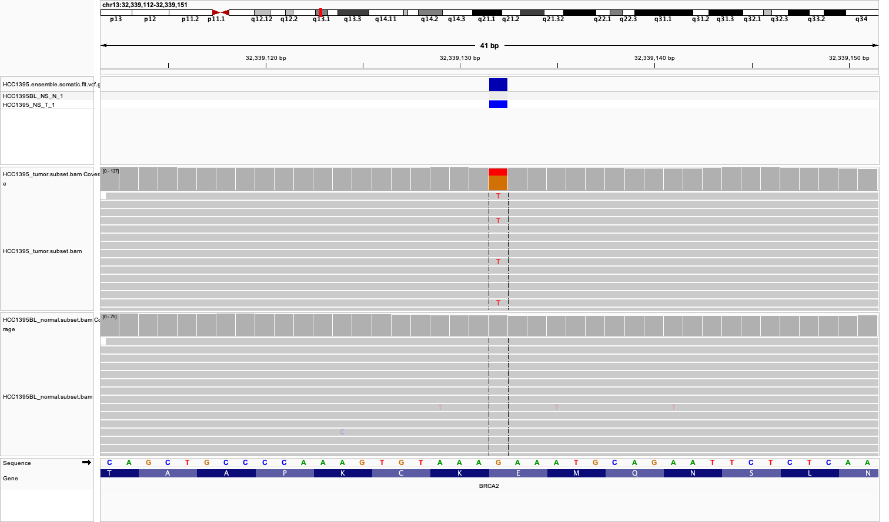

1. Open IGV
2. Chose the reference genome corresponding to those use for alignment (hg38)
3. Load bam files (normal and tumor)
4. Load vcf files (pairedVariants/HCC1395.ensemble.somatic.flt.vcf.gz)

Explore/play with the data: 
 
   - Find somatic variants
   - Look around...

[solution](Module4/solutions/_igv1.md)

### Exit the container environment

```{.bash}
exit

```

##### Acknowledgments

I would like to thank all my colleagues for their past and ongoing contributions to the development and preparation of this workshop.

*Past contributors*: Joel Fillon, Louis Letourneau, Edouard Henrion, François Lefebvre, and Maxime Caron.

*Current contributors*: Robert Eveleigh, Alain Pacis, Aline Rangel, Mathieu Bourgey, Hector Galvez, and Guillaume Bourque.

I would also like to acknowledge the SEQC2 Consortium for making publicly available data for the HCC1395 benchmark sample, which supports the practical exercises in this workshop.

The format of the tutorial has been inspired from Mar Gonzalez Porta.

<!--chapter:end:040-module-4.Rmd-->

# Module 5

## Lecture

```{=html}
<div style="width:100%; aspect-ratio:16/9;">
  <iframe
    src="https://docs.google.com/presentation/d/1ckYUDRURp57VL5lj4P-XAhuno5kfcVxV/embed?start=false&loop=false&delayms=3000"
    style="width:100%; height:100%; border:0;"
    allowfullscreen>
  </iframe>
</div>
```

## Lab

Download the latest version of the R Markdown file to run on your instance:
```{bash, eval=FALSE}
cd /home/ubuntu/CourseData/Module5/codes && \
wget -O 050-module-5_runVersion.Rmd \
https://raw.githubusercontent.com/JeffBCC96/CBW_Rong/main/050-module-5_runVersion.Rmd
```

```{r setup, include=FALSE, eval=FALSE}
# The data are not on GitHub, so the R code of this module is NOT run when the book is knit
# (eval=FALSE). Run the chunks by hand on the course instance: each plotting chunk saves
# its figure in img_dir, and the book only shows these saved PNGs.
# All relative paths below are relative to the project root
knitr::opts_knit$set(root.dir = "~/CourseData/Module5/")
knitr::opts_chunk$set(message = FALSE, warning = FALSE)

# Folder for the figures, relative to the project root: Module5/img next to this Rmd
# img_dir <- "Module5/img"
# dir.create(img_dir, showWarnings = FALSE, recursive = TRUE)
# save_fig <- function(p, name, width = 7, height = 5, dpi = 150) {
#   ggplot2::ggsave(file.path(img_dir, paste0(name, ".png")), p,
#                   width = width, height = height, dpi = dpi)
# }
```

# Dataset

We use the **SEQC-II tumor purity titration** (Xiao *et al.*, *Nat Biotechnol* 2021, PMID 34504346). DNA from the breast cancer cell line **HCC1395** (tumor) was mixed with DNA from its matched B-lymphoblastoid line **HCC1395BL** (normal) at known ratios, then sequenced by WGS (\~100x).

| Sample (BAM prefix) | Role   | Tumor : Normal DNA | True Tumor DNA fraction |
|---------------------|--------|--------------------|-------------------------|
| SPP_GT_0-1_1        | Normal | 0 : 1              | 0.00                    |
| SPP_GT_1-19_1       | Tumor  | 1 : 19             | 0.05                    |
| SPP_GT_1-9_1        | Tumor  | 1 : 9              | 0.10                    |
| SPP_GT_1-4_1        | Tumor  | 1 : 4              | 0.20                    |
| SPP_GT_1-1_1        | Tumor  | 1 : 1              | 0.50                    |
| SPP_GT_3-1_1        | Tumor  | 3 : 1              | 0.75                    |
| SPP_GT_1-0_1        | Tumor  | 1 : 0              | 1.00                    |

Because the true purity is known, this dataset is ideal for checking how well a copy-number tool estimates purity and ploidy as the tumor fraction drops.

- BAMs: `data/NCBI_SEQCII_SPP/<sample>.bwa.dedup.bam` (already aligned with BWA-MEM and duplicate-marked)
- Reference: GDC **GRCh38.d1.vd1** (GRCh38 + decoy, HLA and viral contigs; 2,779 contigs, `chr` prefix)

------------------------------------------------------------------------

# Run cobalt , amber , purple

PURPLE (Hartwig Medical Foundation, part of [hmftools](https://github.com/hartwigmedical/hmftools)) estimates **tumor purity, ploidy and allele-specific copy number** from two independent signals:

| Tool | Signal | Why it matters |
|-------------------|-------------------|----------------------------------|
| **AMBER** | **B-allele frequency (BAF)** at germline heterozygous SNPs | A het SNP has BAF = 0.5 in the normal. In tumor regions with allelic imbalance (LOH, gains of one allele) the BAF moves away from 0.5, and how far it moves depends on purity. |
| **COBALT** | **Read-depth ratio** tumor / normal in 1 kb windows, GC-corrected | Depth is proportional to total copy number, diluted by the normal cells. |
| **PURPLE** | Combines BAF + depth ratio | Searches the purity/ploidy combinations that best explain both signals together, then gives a copy number and minor/major allele copy number for every segment. |

```{r, echo=FALSE, out.width='100%', fig.align='center'}
knitr::include_graphics("Module5/img/cobalt_amber_purple.png")
```

We ran the jobs on the Alliance cluster **Rorqual**. AMBER and COBALT require WGS BAM files and are computationally resource-intensive, so they cannot be run on our current cloud instance. However, we can review the code to understand how these tools work, including their inputs and outputs. We can then run PURPLE on the current instance using the results generated by AMBER and COBALT.

## 1. COBALT: read-depth ratios

```{bash, eval=FALSE}
# parameter
HMF=/cvmfs/ref.mugqic/genomes/hmftools/hmf_pipeline_resources.38_v5.31
COBALT_JAR='#path to cobalt tool'
JAVA_MEM=48G
THREADS=8
GC=$HMF/copy_number/GC_profile.1000bp.38.cnp             # COBALT + PURPLE
NORMAL_ID=SPP_GT_0-1_1
TUMOR_ID=SPP_GT_1-0_1

# Run
java -Xmx${JAVA_MEM} -jar $COBALT_JAR \
  -reference     $NORMAL_ID \
  -reference_bam data/NCBI_SEQCII_SPP/${NORMAL_ID}.bwa.dedup.bam \
  -tumor         $TUMOR_ID \
  -tumor_bam     data/NCBI_SEQCII_SPP/${TUMOR_ID}.bwa.dedup.bam \
  -gc_profile    $GC \
  -threads       $THREADS \
  -output_dir    results/cobalt/$TUMOR_ID
```

| Parameter | Meaning |
|-------------------------|-----------------------------------------------|
| `-reference`, `-reference_bam` | Normal sample ID and BAM. The normal is used for its own depth profile, to detect germline copy-number changes and the sex of the individual. |
| `-tumor`, `-tumor_bam` | Tumor sample ID and BAM |
| `-gc_profile` | 1 kb GC/mappability profile. COBALT counts reads in each 1 kb window and divides by the median depth of windows with the same GC content, so GC bias is removed. |
| `-threads`, `-output_dir` | As for AMBER |

Optional: `-pcf_gamma` (segmentation penalty; higher gives fewer, longer segments), `-tumor_only_diploid_bed` (tumor-only mode: regions assumed diploid instead of a normal).

**Outputs** (`Mathieu_purple/cobalt/<tumor>/`):

| File | Content |
|-------------------------|-----------------------------------------------|
| `<tumor>.cobalt.ratio.tsv.gz` | One row per 1 kb window: read depths, `tumorGCRatio`, `referenceGCRatio`, `referenceGCDiploidRatio`. **-1** = window not usable (low mappability, extreme GC). |
| `<tumor>.cobalt.ratio.pcf` | Segments of the tumor ratio; the `mean` column is **log2** |
| `<normal>.cobalt.ratio.pcf` | Segments of the normal ratio |
| `<normal>.cobalt.ratio.median.tsv` | Median normal ratio per chromosome. \~1.0 = two copies; \~0.5 = one copy. |
| `<sample>.cobalt.gc.median.tsv` | Median depth per GC bucket (the GC correction curve) |

## 2. AMBER: B-allele frequencies

```{bash, eval=FALSE}
# Parameters
HMF=/cvmfs/ref.mugqic/genomes/hmftools/hmf_pipeline_resources.38_v5.31
AMBER_JAR='#path to amber tool'
HET_LOCI=$HMF/copy_number/GermlineHetPon.38.vcf.gz       # AMBER
GENOME_VERSION=38
THREADS=8
JAVA_MEM=48G

NORMAL_ID=SPP_GT_0-1_1
TUMOR_ID=SPP_GT_1-0_1

# Run
java -Xmx${JAVA_MEM} -jar $AMBER_JAR \
  -reference          $NORMAL_ID \
  -reference_bam      data/NCBI_SEQCII_SPP/${NORMAL_ID}.bwa.dedup.bam \
  -tumor              $TUMOR_ID \
  -tumor_bam          data/NCBI_SEQCII_SPP/${TUMOR_ID}.bwa.dedup.bam \
  -loci               $HET_LOCI \
  -ref_genome_version $GENOME_VERSION \
  -threads            $THREADS \
  -output_dir         results/amber/$TUMOR_ID
```

| Parameter | Meaning |
|-------------------------|-----------------------------------------------|
| `-reference` | Sample ID of the **normal**. hmftools call the matched normal the "reference". |
| `-reference_bam` | BAM of the normal; used to find the SNPs that are heterozygous in this individual |
| `-tumor` | Sample ID of the tumor; used to name the output files |
| `-tumor_bam` | BAM of the tumor; BAF is measured at the normal's het sites |
| `-loci` | Candidate SNP sites to check (`GermlineHetPon`) |
| `-ref_genome_version` | `37` or `38`; selects chromosome naming and built-in resources |
| `-threads` | Number of threads |
| `-output_dir` | Output folder (one per tumor) |

Useful optional parameters, kept at their defaults here: `-min_mapping_quality`, `-min_base_quality` and `-tumor_min_depth` (read filters); `-tumor_only` (no normal available).

**Outputs** (`Mathieu_purple/amber/<tumor>/`):

| File | Content |
|-------------------------|-----------------------------------------------|
| `<tumor>.amber.baf.tsv.gz` | One row per het site: `tumorBAF`, `tumorModifiedBAF`, `tumorDepth`, `normalBAF`, `normalDepth` |
| `<tumor>.amber.baf.pcf` | Segments of the tumor BAF (piecewise-constant fit) |
| `<tumor>.amber.qc` | QC: contamination, consanguinity, uniparental disomy |
| `<tumor>.amber.contamination.tsv` | Evidence for contamination (alt reads at sites homozygous in the normal) |
| `<normal>.amber.homozygousregion.tsv` | Long runs of homozygosity in the normal |

## 3. PURPLE: purity, ploidy and copy number

```{bash, eval=FALSE}
# parameters
PURPLE_JAR=~/CourseData/Module5/tools/purple_v4.0.1.jar
GENOME_VERSION=38
THREADS=3
JAVA_MEM=10G

cd ~/CourseData/Module5
GC=reference/GC_profile.1000bp.38.cnp
ENSEMBL=reference/ensembl_data
REF_GENOME=reference/Homo_sapiens.GRCh38.fa

# Tumors samples:
# SPP_GT_1-19_1; SPP_GT_1-9_1;SPP_GT_1-4_1; SPP_GT_1-1_1;SPP_GT_3-1_1; SPP_GT_1-0_1
NORMAL_ID=SPP_GT_0-1_1
TUMOR_ID=SPP_GT_1-0_1


# run
java -Xmx${JAVA_MEM} -jar $PURPLE_JAR \
  -tumor              $TUMOR_ID \
   -gc_profile        $GC \
  -amber              Mathieu_purple/amber/$TUMOR_ID \
  -cobalt             Mathieu_purple/cobalt/$TUMOR_ID \
  -ensembl_data_dir   $ENSEMBL \
  -ref_genome         $REF_GENOME \
  -ref_genome_version $GENOME_VERSION \
  -threads            $THREADS \
  -output_dir         Mathieu_purple/purple_test/$TUMOR_ID
```

| Parameter | Meaning |
|-------------------------|-----------------------------------------------|
| `-tumor` | Tumor sample ID; must match the AMBER/COBALT file names |
| `-amber` | Folder with the AMBER output for this tumor |
| `-cobalt` | Folder with the COBALT output for this tumor |
| `-gc_profile` | Same GC profile as COBALT |
| `-ensembl_data_dir` | Gene annotation, for the gene-level copy-number table |
| `-ref_genome`, `-ref_genome_version` | Reference FASTA and its version (38) |
| `-min_purity` / `-max_purity` | Range of purities PURPLE searches. The default minimum (0.08) would exclude our 5% sample, so it is lowered to 0.03. |
| `-threads`, `-output_dir` | As above |

Other important parameters, not used in this run:

| Parameter | Meaning |
|-------------------------|-----------------------------------------------|
| `-reference <normal ID>` | Name of the matched normal. **Without it PURPLE runs in tumor-only mode** (`runMode = TUMOR` in `purity.tsv`; the log shows `reference(NONE)`). For a paired analysis add `-reference $NORMAL_ID`. |
| `-somatic_vcf` | Somatic SNVs/indels, e.g. the Strelka2 or ensemble VCF from GenPipes. Their allele frequencies give a third, independent purity estimate, which helps most at low purity. |
| `-structural_vcf` | Structural variants (e.g. Manta/GRIDSS); breakpoints sharpen segment boundaries. |
| `-driver_gene_panel`, `-somatic_hotspots`, `-germline_hotspots` | Turn on the driver catalog. All three must be given together; PURPLE stops with *"somatic_hotspots is a mandatory argument when running drivers"* otherwise. |
| `-min_ploidy` / `-max_ploidy` | Range of ploidies to search (defaults 1 - 8) |

**Outputs** (`Mathieu_purple/purple/`):

| File | Content |
|-------------------------|-----------------------------------------------|
| `<tumor>.purple.purity.tsv` | Best fit: `purity`, `ploidy`, `gender`, `wholeGenomeDuplication`, `status`, plus the min/max of each estimate |
| `<tumor>.purple.purity.range.tsv` | Score of every purity/ploidy combination tested (shows how confident the fit is) |
| `<tumor>.purple.cnv.somatic.tsv` | Final copy-number segments: `copyNumber`, `minorAlleleCopyNumber`, `majorAlleleCopyNumber`, `bafCount`, `depthWindowCount` |
| `<tumor>.purple.cnv.gene.tsv` | Min/max copy number per gene, and the region with the lowest CN (`minRegionStart/End`) |
| `<tumor>.purple.segment.tsv` | Segments before smoothing, with the observed BAF / ratio and the fitted values |
| `<tumor>.purple.qc` | QC summary: status, contamination, gender from AMBER and COBALT, number of deleted genes |
| `plot/` | Genome-wide plots: `copynumber.png`, `segment.png`, `purity.range.png`, ... |

## First look at the results: estimated vs. "true" purity

```{r, eval=FALSE}
library(tidyverse)

# function to convert tumor DNA fraction to purity
tdf_to_purity <- function(tdf, ploidy = 2) {
  2 * tdf / (ploidy * (1 - tdf) + 2 * tdf)
}

true_fraction <- tibble(
  sample      = c("SPP_GT_1-19_1", "SPP_GT_1-9_1", "SPP_GT_1-4_1",
                  "SPP_GT_1-1_1",  "SPP_GT_3-1_1", "SPP_GT_1-0_1"),
  true_fraction = c(0.05, 0.10, 0.20, 0.50, 0.75, 1.00))

purple_fit <- list.files("Mathieu_purple/purple", pattern = "purple.purity.tsv$",
                         full.names = TRUE) %>%
  set_names(~ basename(.x) %>% str_remove(".purple.purity.tsv")) %>%
  map_dfr(read_tsv, .id = "sample", show_col_types = FALSE) %>%
  select(sample, purity, minPurity, maxPurity, ploidy, gender, runMode) %>% 
  left_join(., true_fraction, by = 'sample') %>% 
  mutate(., estimated_purity_from_fraction = tdf_to_purity(true_fraction, ploidy = ploidy) )


p <- ggplot(purple_fit, aes(estimated_purity_from_fraction, purity)) +
  geom_abline(linetype = "dashed", colour = "grey50") +
  # geom_errorbar(aes(ymin = minPurity, ymax = maxPurity), width = 0.02) +
  geom_point(size = 3, colour = "red3") +
  coord_equal(xlim = c(0, 1), ylim = c(0, 1)) +
  labs(x = "Estimated purity based on tumor DNA Fraction", y = "PURPLE purity",
       title = "PURPLE purity estimates on the SEQC-II dilution series") +
  theme_bw(base_size = 13)
```

```{r, echo=FALSE, out.width='70%', fig.align='center'}
knitr::include_graphics("Module5/img/purity_estimated_vs_true.png")
```

***Summary***

| Sample (BAM prefix) | Role | Tumor : Normal DNA | True Tumor DNA fraction | "True" Purity (estimated based on tDNA fraction) | Purity (estimated by PURPLE) |
|------------|------------|------------|------------|------------|------------|
| SPP_GT_0-1_1 | Normal | 0 : 1 | 0.00 | 0.00 | 0.00 |
| SPP_GT_1-19_1 | Tumor | 1 : 19 | 0.05 | 0.04 | 0.15 |
| SPP_GT_1-9_1 | Tumor | 1 : 9 | 0.10 | 0.07 | 0.16 |
| SPP_GT_1-4_1 | Tumor | 1 : 4 | 0.20 | 0.14 | 0.16 |
| SPP_GT_1-1_1 | Tumor | 1 : 1 | 0.50 | 0.41 | 0.43 |
| SPP_GT_3-1_1 | Tumor | 3 : 1 | 0.75 | 0.68 | 0.69 |
| SPP_GT_1-0_1 | Tumor | 1 : 0 | 1.00 | 1.00 | 0.99 |

Questions for discussion:

1.  Down to which true purity does PURPLE estimate purity correctly? What happens below that, and why do the BAF and depth signals become hard to separate from noise?

2.  The 100% tumor has `QCStatus FAIL_CONTAMINATION` (AMBER contamination 0.85). Is this real contamination, or a consequence of this tumor/normal pair?

# Run Genpipe

[GenPipes](https://genpipes.readthedocs.io) is the C3G workflow manager. It turns a readset file plus configuration (`.ini`) files into a bash script that submits one Slurm job per task, with the correct dependencies between jobs.

In GenPipes 6 the old `tumor_pair` pipeline is part of **`dnaseq`**, selected with `-t somatic_ensemble`. The *ensemble* protocol calls somatic SNVs/indels with several callers (MuTect2, Strelka2, VarDict, VarScan2) and keeps a consensus. It also runs Manta (SVs), Sequenza, PURPLE and CNVkit (copy number), and annotates with PCGR/CPSR.

### 1. Load the environment

```{bash, eval=FALSE}
# GenPipes and all its tools are distributed on CVMFS by C3G
export MUGQIC_INSTALL_HOME=/cvmfs/soft.mugqic/root   # root of the C3G software/genome stack
module use $MUGQIC_INSTALL_HOME/modulefiles         # make the mugqic/* modules visible
module load mugqic/genpipes/6.2.0

export RAP_ID='#put the slurm account' # Slurm account; the rorqual.ini passes it as "-A $RAP_ID"
export JOB_MAIL="you@example.com" # e-mail for job END/FAIL notifications
```

> `module load` only works in a **login shell**. In scripts use `#!/bin/bash -l`.

### 2. Input files

#### Readset file (`readsets.tsv`, tab-separated)

One line per sequencing readset. GenPipes groups readsets by `Sample`.

| Column | Meaning |
|-------------------------|-----------------------------------------------|
| `Sample` | Sample name; it must match the names used in the pairs file |
| `Readset` | Unique readset ID (sample + library/lane) |
| `Library` | Library ID; only used for read-group tags during alignment |
| `RunType` | `PAIRED_END` or `SINGLE_END` |
| `Run`, `Lane` | Sequencing run and lane; only used for read groups |
| `Adapter1/2` | Adapter sequences for trimming (empty: not trimming) |
| `QualityOffset` | Base-quality encoding; 33 for all modern Illumina data |
| `BED` | Capture regions for exome/panel data; empty for WGS |
| `FASTQ1/2` | Raw reads; empty here because we start from BAMs |
| `BAM` | Input BAM; GenPipes would convert it back to FASTQ in step 1 |

```{bash, eval=FALSE}
cat codes/genpipes_somatic_ensemble/readsets.tsv | column -t -s $'\t'
# Sample         Readset             Library        RunType     Run  Lane  ...  QualityOffset  ...  BAM
# SPP_GT_0-1_1   SPP_GT_0-1_1.L001   SPP_GT_0-1_1   PAIRED_END  1    1    ...  33             ...  .../SPP_GT_0-1_1.bwa.dedup.bam
# ...
```

#### Pairs file (`pairs.csv`, comma-separated, no header)

`<pair name>,<normal sample>,<tumor sample>`. Every tumor is paired with the same normal.

```{bash, eval=FALSE}
cat codes/genpipes_somatic_ensemble/pairs.csv
# pair_1-19_1,SPP_GT_0-1_1,SPP_GT_1-19_1
# pair_1-9_1,SPP_GT_0-1_1,SPP_GT_1-9_1
# pair_1-4_1,SPP_GT_0-1_1,SPP_GT_1-4_1
# pair_1-1_1,SPP_GT_0-1_1,SPP_GT_1-1_1
# pair_3-1_1,SPP_GT_0-1_1,SPP_GT_3-1_1
# pair_1-0_1,SPP_GT_0-1_1,SPP_GT_1-0_1
```

### 3. Re-using existing BAMs: make them match the GenPipes reference

Steps 1-4 of the protocol (BAM → FASTQ, trimming, BWA-MEM2 alignment, duplicate marking) are already done for our BAMs, so we start at step 5. GenPipes then expects each sample's BAM at `alignment/<sample>/<sample>.sorted.dup.bam`.

There is one catch. Our BAMs were aligned to GRCh38.d1.vd1 (2,779 contigs), but GenPipes uses `Homo_sapiens.GRCh38` (195 contigs). The first 195 contigs are identical in name, length and order; the remaining 2,584 are HLA, decoy and viral sequences. Strelka2 and Manta stop with *"Reference genome mismatch: Reference fasta file is missing a chromosome found in the BAM"*. **GATK ReorderSam** rewrites each BAM against the GenPipes sequence dictionary:

```{bash, eval=FALSE}
gatk --java-options "-Xmx20G" ReorderSam \
  -I  data/NCBI_SEQCII_SPP/SPP_GT_0-1_1.bwa.dedup.bam \
  -O  results/genpipes_somatic_ensemble/alignment/SPP_GT_0-1_1/SPP_GT_0-1_1.sorted.dup.bam \
  -SD /cvmfs/ref.mugqic/genomes/species/Homo_sapiens.GRCh38/genome/Homo_sapiens.GRCh38.dict \
  --ALLOW_INCOMPLETE_DICT_CONCORDANCE true \
  --CREATE_INDEX true \
  --VALIDATION_STRINGENCY SILENT \
  --TMP_DIR /lustre10/scratch/rongma/CBW/tmp
```

| Parameter | Meaning |
|-------------------------|-----------------------------------------------|
| `-I` / `-O` | Input BAM / output BAM, written where GenPipes expects the duplicate-marked BAM |
| `-SD` | Sequence dictionary (`.dict`) of the target reference; defines the new header |
| `--ALLOW_INCOMPLETE_DICT_CONCORDANCE true` | Accept a BAM with *more* contigs than the reference. Reads on the extra contigs become unmapped (about 1% of reads). |
| `--CREATE_INDEX true` | Write the `.bai` index next to the BAM |
| `--VALIDATION_STRINGENCY SILENT` | Do not stop on minor SAM-format warnings |
| `--TMP_DIR` | Directory for temporary sort files; use a large file system, because node-local `$SLURM_TMPDIR` can fill up with \~180 GB BAMs |

The full Slurm array script (7 samples, \~3-5 h each) is `codes/genpipes_somatic_ensemble/01_reorder_bams.sbatch`.

### 4. Configuration files

GenPipes reads a stack of `.ini` files; a parameter in a later file overrides the same parameter in an earlier file.

```{bash, eval=FALSE}
INIS="$GENPIPES_INIS/dnaseq/dnaseq.base.ini \
      $GENPIPES_INIS/dnaseq/dnaseq.cancer.ini \
      $GENPIPES_INIS/common_ini/rorqual.ini \
      codes/genpipes_somatic_ensemble/custom.ini"
```

| File | Role |
|-------------------------|-----------------------------------------------|
| `dnaseq.base.ini` | Default tools, module versions and genome (GRCh38) for the DNA-seq pipeline |
| `dnaseq.cancer.ini` | Settings for the somatic protocols: caller parameters, HMF resources for PURPLE, PCGR, etc. |
| `rorqual.ini` | Cluster-specific settings: Slurm flags, CPUs/memory per node, account (`-A $RAP_ID`) |
| `custom.ini` | Our overrides: account and longer walltimes for AMBER/COBALT/PURPLE/Picard on deep WGS |

Example override in `custom.ini`:

``` ini
[amber]
cluster_walltime=12:00:0
```

### 5. Generate the job script

```{bash, eval=FALSE}
genpipes dnaseq \
  -t somatic_ensemble \
  -c $INIS \
  -r codes/genpipes_somatic_ensemble/readsets.tsv \
  -p codes/genpipes_somatic_ensemble/pairs.csv \
  -o results/genpipes_somatic_ensemble \
  -s 5-33,35-37,39 \
  -j slurm \
  -g results/genpipes_somatic_ensemble/genpipes_somatic_ensemble_cmd.sh
```

| Parameter | Meaning |
|-------------------------|-----------------------------------------------|
| `dnaseq` | Pipeline to run |
| `-t somatic_ensemble` | Protocol: tumor/normal pairs, ensemble of somatic callers |
| `-c` | List of `.ini` files (order matters, later overrides earlier) |
| `-r` | Readset file |
| `-p` | Tumor/normal pairs file (required for the somatic protocols) |
| `-o` | Output directory; all results and job logs go here |
| `-s 5-33,35-37,39` | Steps to run. **1-4** skipped: BAMs are already aligned and duplicate-marked. **34** (`sym_link_fastq_pair`) skipped: needs raw FASTQs. **38** (`cram_output`) skipped: it only makes a CRAM copy of the BAMs. |
| `-j slurm` | Job scheduler (`slurm`, `pbs`, or `batch` to run locally) |
| `-g` | File in which to write the generated bash script; nothing is submitted yet |
| `--sanity-check` | (optional) Only check that every input file exists, then exit. Run this first! |

List all steps of the protocol with `genpipes dnaseq --help`. Key steps of `somatic_ensemble`:

| Step | Name | What it does |
|-------------------|-------------------|----------------------------------|
| 5 | `set_interval_list` | Splits the genome at N-gaps to parallelise calling |
| 6 | `conpair_concordance_contamination` | Checks the tumor and normal come from the same person and estimates contamination |
| 7-8 | `metrics_dna_*` | Picard and mosdepth alignment / coverage metrics |
| 9 | `sequenza` | Purity, ploidy and allele-specific copy number (Sequenza) |
| 10 | `manta_sv_calls` | Structural variants |
| 11-13 | `strelka2_paired_*` | Somatic and germline small variants (Strelka2) |
| 14 | `purple` | AMBER + COBALT + PURPLE (section above) |
| 15-17 | `rawmpileup`, `paired_varscan2` | Somatic calls with VarScan2 |
| 18-19 | `paired_mutect2`, `merge_mutect2` | Somatic calls with GATK MuTect2 |
| 20-21 | `vardict_paired` | Somatic calls with VarDict |
| 22 | `ensemble_somatic` | Consensus of the somatic callers (bcbio ensemble) |
| 28 | `cnvkit_batch` | Copy number with CNVkit |
| 30, 32 | `report_cpsr`, `report_pcgr` | Germline (CPSR) and somatic (PCGR) clinical reports |
| 33 | `run_multiqc` | One QC report for all samples |

### 6. Submit

Running `bash genpipes_somatic_ensemble_cmd.sh` would submit all **1,231 jobs** at once. Rorqual allows at most **1,000 queued jobs per user**, so plain submission fails part-way. GenPipes includes a tool that cuts the script into chunks and keeps the queue below a limit:

```{bash, eval=FALSE}
genpipes tools chunk_and_submit_genpipes \
  results/genpipes_somatic_ensemble/genpipes_somatic_ensemble_cmd.sh \
  results/genpipes_somatic_ensemble/chunks \
  -n 20 -q 900 -s 300 -S slurm
```

| Parameter | Meaning |
|-------------------------|-----------------------------------------------|
| 1st argument | The script generated in step 5 |
| 2nd argument | Folder where the chunks and their submission status are stored |
| `-n 20` | Jobs per chunk |
| `-q 900` | Maximum number of our jobs in the queue (stay below the 1,000 limit) |
| `-s 300` | Seconds to wait before checking the queue again when it is full |
| `-S slurm` | Scheduler |

The tool must keep running until every chunk is submitted, so start it with `nohup` (or in `tmux`). If it is interrupted, run `genpipes tools submit_genpipes <chunk folder>` to resume; chunks already submitted (`chunk_N.done`) are skipped.

### 7. Monitor and find the results

```{bash, eval=FALSE}
squeue -u $USER | wc -l                                    # jobs still queued or running
ls results/genpipes_somatic_ensemble/job_output/           # one log per job, grouped by step
ls results/genpipes_somatic_ensemble/pairedVariants/       # per-pair variant calls
ls results/genpipes_somatic_ensemble/pairedVariants/ensemble/   # consensus somatic / germline VCFs
```

GenPipes writes a `.done` file for each finished job. If you run the same command again, it only regenerates the jobs whose outputs are missing or out of date, so a failed run can be restarted.

------------------------------------------------------------------------

# Analyze the purple results

- Check the quality of each PURPLE run and compare the estimated purity with the truth.

- Understand how PURPLE chooses purity and ploidy.

- Read the raw signals (read depth and B-allele frequency) and the fitted copy number.

- Find genes that are gained, lost, deleted or show loss of heterozygosity (LOH).

- Plot any gene or chromosome with all the evidence in one figure.

## Key concepts (read this first)

| Term | Meaning |
|-------------------------|-----------------------------------------------|
| **Copy number (CN)** | How many copies of a DNA segment a cell has. Normal human cells have 2 (one from each parent). |
| **Purity** | Fraction of cells in the sample that are tumor cells. The rest are normal cells with CN = 2. |
| **Ploidy** | Average copy number across the tumor genome. HCC1395 is about 2.8, i.e. near-triploid. |
| **Major / minor allele CN** | The two parental copies are counted separately. A segment with CN 3 can be 2+1 (major 2, minor 1) or 3+0 (major 3, minor 0). |
| **BAF (B-allele frequency)** | At a heterozygous SNP (A/B), the fraction of reads that carry the B allele. It is 0.5 in a normal cell. |
| **LOH (loss of heterozygosity)** | One parental allele is lost (minor CN = 0). The BAF then moves to 0 or 1. If the remaining allele is duplicated, CN stays 2: **copy-neutral LOH (cnLOH)**. |
| **Depth ratio** | Tumor read depth divided by normal read depth in a window. It goes up with gains and down with losses. |

PURPLE combines two independent signals:

- **COBALT** measures the **depth ratio** in 1 kb windows → tells us the *total* copy number.
- **AMBER** measures the **BAF** at germline heterozygous SNPs → tells us how the copies are split between the two alleles.

Both signals are **diluted by normal cells**. With purity *p*, a segment with tumor copy number *CN* and minor-allele copy number *m* is expected to show:

$$\text{depth ratio} =\frac{p \cdot CN + (1-p)\cdot 2}{p \cdot \text{ploidy} + (1-p)\cdot 2}\qquad\text{BAF} =\frac{p \cdot m + (1-p)\cdot 1}{p \cdot CN + (1-p)\cdot 2}$$

PURPLE searches for the purity and ploidy that make these predictions match the observed data best, across the whole genome.

Let's see what these formulas mean in practice. The table shows the expected signal of four common events at different purities (tumor ploidy fixed at 2.8):

```{r, eval=FALSE}
library(tidyverse)

expected_signal <- function(purity, cn, minor, ploidy = 2.8) {
  tibble(
    depth_ratio = (purity * cn + (1 - purity) * 2) / (purity * ploidy + (1 - purity) * 2),
    BAF         = (purity * minor + (1 - purity) * 1) / (purity * cn + (1 - purity) * 2)
  )
}

events <- tribble(
  ~event,                  ~cn, ~minor,
  "Normal (1+1)",           2,   1,
  "Deep deletion (0+0)",    0,   0,
  "Copy-neutral LOH (2+0)", 2,   0,
  "Gain (3+1)",             4,   1
)

crossing(events, purity = c(1, 0.5, 0.2, 0.05)) %>%
  mutate(expected_signal(purity, cn, minor)) %>%
  mutate(across(c(depth_ratio, BAF), ~ round(.x, 2))) %>%
  arrange(event, desc(purity))
```

**What to notice**

- At purity 1, a deep deletion has depth ratio 0, and cnLOH has BAF 0 (or 1): very clear signals.
- At purity 0.05, every event gives a depth ratio close to the genome average and a BAF close to 0.5. The tumor signal is tiny compared with the noise, so low-purity samples are hard to fit.
- The BAF of a deleted region is undefined at purity 1 (no reads at all). In a mixed sample the remaining reads come only from normal cells, so the BAF goes back to 0.5.

## Setup

```{r, eval=FALSE}
# Packages used in this lab
library(tidyverse)   # data manipulation (dplyr, tidyr, readr) and plotting (ggplot2)
library(patchwork)   # stack several ggplots into one figure (p1 / p2)
library(stringr)     # string helpers
library(data.table)
# Helper functions written for this lab (see codes/purple_lab_functions.R):
#   purity_info          named vector: sample -> true purity
#   sort_by_purity()     order file names by the true purity of the sample
#   load_purple_sample() read all AMBER / COBALT / PURPLE files of one sample
#   plot_gene()          multi-track figure of one gene
#   plot_chromosome()    multi-track figure of one chromosome
#   plot_cn_region()     multi-track figure of any chr:start-end
#   classify_gene_cn()   label genes as gain / loss / deep deletion / LOH ...
#   save_cn_plot()       save a figure as PDF + PNG
source("codes/purple_lab_functions.R")

if (!requireNamespace("R.utils", quietly = TRUE)) {
  install.packages("R.utils")
}

library(R.utils)

purple_dir <- "./Mathieu_purple/purple/" # purity_info
```

## A tour of the output files (one sample)

Before analysing the results, let's look at **every file** that AMBER, COBALT and PURPLE wrote for one sample, what each file is for, and what is inside. We use the 100% tumor `SPP_GT_1-0_1`; every other sample has the same files.

### How the files fit together

```         
 tumor BAM + normal BAM
        │
        ├── AMBER  ──► amber.baf.tsv.gz   (BAF at every het SNP)
        │                 └─► amber.baf.pcf      (BAF segments)
        │
        ├── COBALT ──► cobalt.ratio.tsv.gz (depth ratio in 1 kb windows)
        │                 └─► cobalt.ratio.pcf   (depth segments)
        │
        └────────────► PURPLE
                          ├─► purple.purity.range.tsv  (score of every purity/ploidy tried)
                          │      └─► purple.purity.tsv (the best fit)
                          ├─► purple.segment.tsv       (all segments, observed + fitted values)
                          │      └─► purple.cnv.somatic.tsv (final copy-number segments)
                          │             └─► purple.cnv.gene.tsv (copy number per gene)
                          └─► purple.qc, plot/*.png
```

AMBER and COBALT turn the BAMs into two signals; PURPLE combines them, fits purity and ploidy, and turns the signals into copy numbers for segments and genes.

```{r, eval=FALSE}
tour_sample <- "SPP_GT_1-0_1"
tour_dirs <- c(AMBER  = file.path("./Mathieu_purple/amber",  tour_sample),
               COBALT = file.path("./Mathieu_purple/cobalt", tour_sample),
               PURPLE = "./Mathieu_purple/purple")

# List every file with its size. The purple/ folder holds all samples, so keep this sample only.
tour_files <- lapply(names(tour_dirs), function(tool) {
  f <- list.files(tour_dirs[[tool]], full.names = TRUE, recursive = TRUE)
  if (tool == "PURPLE") f <- f[grepl(tour_sample, basename(f)) | basename(f) == "purple.version"]
  tibble(tool, file = str_remove(f, paste0(tour_dirs[[tool]], "/")), size_MB = round(file.size(f) / 1e6, 2))
}) %>% bind_rows()

print(tour_files, n = Inf)
```

Two small helpers to look inside the files:

```{r, eval=FALSE}
# peek(): print the first lines of a file exactly as they are on disk (works for .gz too)
peek <- function(path, n = 4, width = 150) {
  con <- if (grepl("\\.gz$", path)) gzfile(path) else file(path)
  on.exit(close(con))
  lines <- readLines(con, n = n)
  cat(str_trunc(lines, width), sep = "\n")
}

# columns(): list the columns of a table with their type and first values
columns <- function(path, n = 3) {
  read_tsv(path, n_max = n, show_col_types = FALSE) %>% glimpse()
}

amber_dir  <- tour_dirs[["AMBER"]]
cobalt_dir <- tour_dirs[["COBALT"]]
purple_f   <- function(suffix) file.path(purple_dir, paste0(tour_sample, suffix))
```

## AMBER: B-allele frequency

| File | What it is | When to use it |
|------------------|--------------------------------|----------------------|
| `<tumor>.amber.baf.tsv.gz` | **Main output.** One row per SNP that is heterozygous in the normal (\~1.7 million rows) | Plot BAF along the genome; check allelic imbalance / LOH in a region |
| `<tumor>.amber.baf.pcf` | Segments of the tumor BAF (piecewise-constant fit) | Input for PURPLE; quick view of where the BAF changes |
| `<tumor>.amber.qc` | QC summary: contamination, consanguinity, uniparental disomy | First thing to check |
| `<tumor>.amber.contamination.tsv` (+ `.vcf.gz`) | SNPs that are **homozygous** in the normal; any other allele in the tumor suggests DNA from another person | Investigate a contamination warning |
| `<normal>.amber.homozygousregion.tsv` | Long runs of homozygosity in the **normal** | Detect consanguinity or uniparental disomy in the patient |
| `amber.version` | AMBER version and build date | Reproducibility |

```{r, eval=FALSE}
# **`amber.baf.tsv.gz`**
cat('amber.baf.tsv.gz\n')
peek(file.path(amber_dir, paste0(tour_sample, ".amber.baf.tsv.gz")))
cat('\n\n')

# **`amber.baf.pcf`**: the `mean` column is the average **tumorModifiedBAF** of the segment; `n.probes` is the number of SNPs in it.
cat('amber.baf.pcf\n')
peek(file.path(amber_dir, paste0(tour_sample, ".amber.baf.pcf")))
# cat('\n\n')


# # **`amber.qc`**: key-value pairs.
# cat('amber.qc\n')
# peek(file.path(amber_dir, paste0(tour_sample, ".amber.qc")), n = 15)
# cat('\n\n')

# # **`amber.contamination.tsv`**: sites homozygous in the normal (`normalAltSupport` = 0). If many sites have alt reads in the tumor (`tumorAltSupport` \> 0), the tumor may contain DNA from someone else.
# cat('amber.contamination.tsv\n')
# peek(file.path(amber_dir, paste0(tour_sample, ".amber.contamination.tsv")))
# cat('\n\n')
# 
# 
# # **`<normal>.amber.homozygousregion.tsv`**: regions where the normal has (almost) only homozygous SNPs (`homCount` vs `hetCount`). Long regions on many chromosomes suggest consanguinity. Note that this file writes chromosomes without the `chr` prefix.
# cat('amber.homozygousregion.tsv\n')
# peek(file.path(amber_dir, "SPP_GT_0-1_1.amber.homozygousregion.tsv"))
# cat('\n\n')
```

| Column | Meaning |
|-------------------------|-----------------------------------------------|
| `chromosome`, `position` | SNP location (1-based) |
| `tumorBAF` | Fraction of tumor reads with the B allele: 0.5 balanced, 0 or 1 = LOH |
| `tumorModifiedBAF` | BAF folded to the upper half: 0.5 + \|BAF − 0.5\|. Easier to segment because the two bands become one. |
| `tumorDepth` | Tumor reads covering the SNP |
| `normalBAF`, `normalModifiedBAF`, `normalDepth` | Same for the normal; normalBAF should be close to 0.5 |

## COBALT: read-depth ratio

| File | What it is | When to use it |
|------------------|-------------------------------|-----------------------|
| `<tumor>.cobalt.ratio.tsv.gz` | **Main output.** One row per 1 kb window (\~3 million rows), tumor and normal depth and GC-corrected ratios | Plot depth along the genome; look for gains / losses |
| `<tumor>.cobalt.ratio.pcf` | Segments of the tumor ratio | Input for PURPLE; quick view of copy-number steps |
| `<normal>.cobalt.ratio.pcf` | Segments of the normal ratio | Spot germline copy-number changes |
| `<normal>.cobalt.ratio.median.tsv` | Median normal ratio per chromosome | Sex of the patient (chrX \~0.5 = one X) and whole-chromosome germline changes |
| `<sample>.cobalt.gc.median.tsv` | Mean/median depth, and median depth per GC bucket | See how strongly depth depends on GC (the GC-correction curve) |
| `cobalt.version` | COBALT version | Reproducibility |

**`cobalt.ratio.tsv.gz`**

```{r, eval=FALSE}
# The first windows of chr1 are telomere sequence (N), so their values are -1
# peek(file.path(cobalt_dir, paste0(tour_sample, ".cobalt.ratio.tsv.gz")))
read_tsv(file.path(cobalt_dir, paste0(tour_sample, ".cobalt.ratio.tsv.gz")),
         n_max = 5000, show_col_types = FALSE) %>% head(5)

# A few usable windows further along chr1
read_tsv(file.path(cobalt_dir, paste0(tour_sample, ".cobalt.ratio.tsv.gz")),
         n_max = 5000, show_col_types = FALSE) %>%
  filter(tumorGCRatio >= 0) %>%
  head(5)
```

| Column | Meaning |
|-------------------------|-----------------------------------------------|
| `chromosome`, `position` | Start of the 1 kb window (1, 1001, 2001, ...) |
| `referenceReadDepth`, `tumorReadDepth` | Raw read depth in the window |
| `referenceGCRatio`, `tumorGCRatio` | Depth divided by the median depth of windows with the same GC content: GC-corrected, genome average about 1. **This is the tumor depth ratio we plot.** |
| `referenceGCDiploidRatio` | Normal ratio, further normalised so a normal diploid region is 1 (accounts for the sex chromosomes) |
| `referenceGCContent`, `tumorGCContent` | GC content of the reads in the window |
| value **-1** | Window not used (N bases, low mappability, extreme GC) |

```{r, eval=FALSE}

# **`cobalt.ratio.pcf`**: same layout as the AMBER pcf. Here `mean` is a **log2** ratio: use `2^mean` to get back to the ratio scale.
peek(file.path(cobalt_dir, paste0(tour_sample, ".cobalt.ratio.pcf")))


# **`<normal>.cobalt.ratio.median.tsv`**: one line per chromosome. Look at chrX (\~0.5: only one X) and chr16 (\~0.57: part of chr16 is lost in the normal itself).
read_tsv(file.path(cobalt_dir, "SPP_GT_0-1_1.cobalt.ratio.median.tsv"), show_col_types = FALSE) %>%
  filter(chromosome %in% c("chr1", "chr6", "chr16", "chr19", "chrX", "chrY"))

```

**`cobalt.gc.median.tsv`**: two blocks. The first gives the sample's mean and median depth; the second the median depth for each GC percentage.\
**It is important to account for GC bias, as sequencing read counts can vary substantially across regions with different GC content.** Depth is not constant across GC content: in the normal it drops from about 116 (25% GC) to about 90 (60% GC), and both samples lose depth below \~25% GC. If this bias were not removed, GC-rich and GC-poor regions would look like losses or gains. COBALT divides each window's depth by the median of its GC bucket (this curve), so the `tumorGCRatio` / `referenceGCRatio` values are free of GC bias.

```{r, eval=FALSE}
# The file has 3 header lines (#sampleMean/sampleMedian, their values, #gcBucket/median);
# skip all 3 and force numeric columns, otherwise the "#gcBucket" line is read as data
# and both columns become text (ggplot then draws no line).
read_gc_median <- function(path) {
  read_tsv(path, skip = 3, col_names = c("gcBucket", "median"), col_types = "dd")
}
p <- bind_rows(
  tumor  = read_gc_median(file.path(cobalt_dir, paste0(tour_sample, ".cobalt.gc.median.tsv"))),
  normal = read_gc_median(file.path(cobalt_dir, "SPP_GT_0-1_1.cobalt.gc.median.tsv")),
  .id = "sample") %>%
  ggplot(aes(gcBucket, median, colour = sample)) + geom_line(linewidth = 1) +
  labs(x = "GC content of the 1 kb window (%)", y = "Median read depth") + theme_bw()
```

```{r, echo=FALSE, out.width='70%', fig.align='center'}
knitr::include_graphics("Module5/img/cobalt_gc_median.png")
```

## PURPLE: purity, ploidy and copy number

| File | What it is | When to use it |
|------------------|--------------------------------|----------------------|
| `<tumor>.purple.purity.tsv` | **The best fit**: purity, ploidy, sex, status, plus the uncertainty range | Report purity/ploidy |
| `<tumor>.purple.purity.range.tsv` | Score of every purity/ploidy combination tested (\~16,000 rows) | Check whether other solutions are almost as good |
| `<tumor>.purple.cnv.somatic.tsv` | **Final copy-number segments** (\~300 rows) | Copy number of any region; genome plots; input for downstream tools |
| `<tumor>.purple.cnv.gene.tsv` | **Copy number per gene** (\~37,000 genes) | Is my gene deleted / gained / LOH? |
| `<tumor>.purple.segment.tsv` | All segments before merging (\~9,500 rows), with observed and fitted values and the **germline status** | Debug a call: compare observed vs fitted ratio and BAF |
| `<tumor>.purple.qc` | QC summary | First thing to check |
| `<tumor>.purple.somatic.clonality.tsv` | Clonality peaks of somatic SNVs | **Empty here**: no somatic VCF (`-somatic_vcf`) was given |
| `plot/*.png` | PURPLE's own figures (purity.range, segment, copynumber, map) | Quick visual QC |
| `plot/<tumor>.somatic_data.tsv` | Data behind the somatic-variant plots | **Empty here**, same reason |
| `purple.version` | PURPLE version | Reproducibility |

Files that PURPLE can also write but that are **missing** in this run: `purple.driver.catalog.somatic.tsv` (needs `-driver_gene_panel`), the germline files (`purple.germline.*`, need a matched normal via `-reference`), and `purple.somatic.vcf.gz` (needs `-somatic_vcf`).

**`purple.purity.tsv`**: one line, the chosen fit (columns explained in the QC section).

```{r, eval=FALSE}
columns(purple_f(".purple.purity.tsv"), n = 1)
```

**`purple.purity.range.tsv`**: every fit that was tried, best first.

| Column | Meaning |
|-------------------------|-----------------------------------------------|
| `purity`, `ploidy` | The combination tested |
| `score` | How badly it explains the data; **lower is better** |
| `normFactor` | Scaling between observed ratio and copy number for this fit |
| `diploidProportion` | Fraction of the genome that would be diploid |
| `somaticPenalty` | Penalty from somatic variants (0 without a somatic VCF) |

```{r, eval=FALSE}
read_tsv(purple_f(".purple.purity.range.tsv"), show_col_types = FALSE) %>% head(8)
```

**`purple.cnv.somatic.tsv`**: the final segments (columns explained in the *PURPLE segments* section below). The `method` column says how the copy number was obtained:

| `method` | Meaning |
|---------------------------|---------------------------------------------|
| `BAF_WEIGHTED` | From depth and BAF of the segment itself (most reliable) |
| `LONG_ARM` | Too little data; copied from the rest of the chromosome arm |
| `STRUCTURAL_VARIANT`, `GERMLINE_*` | Other inference methods (not used in this run) |
| `UNKNOWN` | Could not be inferred |

```{r, eval=FALSE}
cnv_tour <- read_tsv(purple_f(".purple.cnv.somatic.tsv"), show_col_types = FALSE)
head(cnv_tour)
count(cnv_tour, method)
```

**`purple.cnv.gene.tsv`**: one row per gene (columns explained in the *Gain, Loss, Deletion and LOH* section below).

```{r, eval=FALSE}
read_tsv(purple_f(".purple.cnv.gene.tsv"), show_col_types = FALSE) %>%
  filter(gene %in% c("CDKN2A", "MYC", "TP53")) %>%
  dplyr::select(chromosome, start, end, gene, minCopyNumber, maxCopyNumber,
                minMinorAlleleCopyNumber, somaticRegions, chromosomeBand)
```

**`purple.segment.tsv`**: the most detailed table, useful to understand *why* PURPLE made a call. Important columns:

| Column | Meaning |
|-------------------------|-----------------------------------------------|
| `germlineStatus` | State of the **normal** in this segment: `DIPLOID` (normal), `HET_DELETION`, `HOM_DELETION`, `AMPLIFICATION`, `NOISE`, `CENTROMETIC` (sic), `EXCLUDED`, `UNKNOWN` |
| `observedTumorRatio`, `observedNormalRatio` | Measured depth ratios of the segment |
| `observedBAF`, `bafCount` | Measured (folded) BAF and the number of SNPs |
| `tumorCopyNumber`, `minorAlleleCopyNumber`, `majorAlleleCopyNumber` | Copy numbers implied by the chosen purity/ploidy |
| `fittedTumorCopyNumber`, `fittedBAF` | Nearest whole-number solution and its expected BAF |
| `minorAlleleCopyNumberDeviation`, `majorAlleleCopyNumberDeviation` | Distance from a whole number: large values = poor fit or subclonal |
| `support` | What defines the segment start: `NONE` (depth/BAF change), `CENTROMERE`, `TELOMERE`, or an SV type if SVs were given |

```{r, eval=FALSE}
segment_tour <- read_tsv(purple_f(".purple.segment.tsv"), show_col_types = FALSE)
count(segment_tour, germlineStatus, sort = TRUE)
```

Most segments are `DIPLOID` in the normal. The `HET_DELETION` segments are places where the **normal** has only one copy: mostly large parts of chr6 (\~58 Mb) and chr16 (\~53 Mb) in this cell line. PURPLE treats these as germline events, so they are not reported as tumor losses.

**`purple.qc`**

```{r, eval=FALSE}
peek(purple_f(".purple.qc"), n = 20)
```

## Which file answers which question?

| Question | File | Column(s) |
|--------------------|-----------------------------|------------------------|
| What is the purity and ploidy of my tumor? | `purple.purity.tsv` | `purity`, `ploidy` |
| How sure is PURPLE about it? | `purple.purity.range.tsv`, `plot/*purity.range.png` | `score` |
| Did the run pass QC? | `purple.qc`, `amber.qc` | `QCStatus` |
| What is the copy number of gene X? | `purple.cnv.gene.tsv` | `minCopyNumber`, `maxCopyNumber`, `minMinorAlleleCopyNumber` |
| What is the copy number of region chr:start-end? | `purple.cnv.somatic.tsv` | `copyNumber`, `major/minorAlleleCopyNumber` |
| Is a region LOH? | `purple.cnv.somatic.tsv` (minor CN = 0), confirmed in `amber.baf.tsv.gz` | `minorAlleleCopyNumber`, `tumorBAF` |
| Is a change germline or somatic? | `purple.segment.tsv`, normal ratio in `cobalt.ratio.tsv.gz` | `germlineStatus`, `referenceGCDiploidRatio` |
| What does the raw evidence look like? | `cobalt.ratio.tsv.gz`, `amber.baf.tsv.gz` | `tumorGCRatio`, `tumorBAF` (or use `plot_gene()` below) |

### Load the files

```{r, eval=FALSE}
# purity range
purple.purity_ranges <- list.files("./Mathieu_purple/purple/plot/",
                                   pattern = "purity.range.png", full.names = TRUE)
purple.purity_ranges <- normalizePath(sort_by_purity(purple.purity_ranges))


# segment
segfiles <- list.files("./Mathieu_purple/purple/plot/",
                       pattern = "segment.png", full.names = TRUE)
segfiles <- normalizePath(sort_by_purity(segfiles))

# CN files
copyNumberFiles <- list.files("./Mathieu_purple/purple/plot/",
                              pattern = "copynumber.png", full.names = TRUE)
copyNumberFiles <- normalizePath(sort_by_purity(copyNumberFiles))

# MAC
MAP <- list.files("./Mathieu_purple/purple/plot/",
                  pattern = "map.png", full.names = TRUE)
MAP <- normalizePath(sort_by_purity(MAP))


# arrange plots
library(png)    # readPNG(): read a PNG file into a matrix of pixels
library(grid)   # rasterGrob(): turn the pixels into a drawable object
# combine_pngs(): put several PNG files into one figure, each panel titled
# with its sample ID and true purity. Panels are filled row by row.
#   labels: panel titles; default = sample ID + true purity, "" = no title
combine_pngs <- function(files, ncol = 3, labels = NULL, purity = purity_info) {
  if (is.null(labels)) {
    ids    <- str_extract(basename(files), "SPP_GT_[0-9]+-[0-9]+_[0-9]+")
    labels <- sprintf("%s  (true tDNA fraction %g%%)", ids, 100 * purity[ids])
  }
  panels <- lapply(seq_along(files), function(i) {
    p <- wrap_elements(full = rasterGrob(readPNG(files[i]), interpolate = TRUE))   # image as a patchwork panel
    if (nzchar(labels[i])) {
      p <- p + labs(title = labels[i]) +
        theme(plot.title = element_text(face = "bold", size = 14, hjust = 0.5))
    }
    p
  })
  wrap_plots(panels, ncol = ncol)
}
```

### All four plots for one sample

Change `idx` to look at another sample (1 = 5% tDNA fraction ... 6 = 100% tDNA fraction).

```{r, eval=FALSE}
idx <- 6
one_sample <- c(purple.purity_ranges[idx], segfiles[idx], copyNumberFiles[idx], MAP[idx])
sid <- str_extract(basename(one_sample[1]), "SPP_GT_[0-9]+-[0-9]+_[0-9]+")

# 2 x 2 figure; each PNG already has its own title, so only the sample is labelled (on top)
p <- combine_pngs(one_sample, ncol = 2, labels = rep("", 4)) +
  plot_annotation(title = sprintf("%s  (true tDNA fraction %g%%)", sid, 100 * purity_info[[sid]])) &
  theme(plot.title = element_text(face = "bold", size = 18, hjust = 0.5))
```

```{r, echo=FALSE, out.width='100%', fig.align='center'}
knitr::include_graphics("Module5/img/purple_plots_SPP_GT_1-0_1.png")
```

## Selection of purity

PURPLE tries a grid of purity (y axis) × ploidy (x axis) combinations and gives each one a score: how badly the predicted depth ratio and BAF fit the data (**lower is better**). In the `purity.range.png` plots:

- colours show the score relative to the best fit; **blue** = within 10% of the best, red = poor;
- the dashed lines and labels mark the chosen purity and ploidy;
- several separate blue spots mean several solutions explain the data almost as well (e.g. ploidy 1.4 vs 2.8 at the same purity). This is a common source of errors, because doubling all copy numbers often fits the data equally well.

```{r, eval=FALSE}
p <- combine_pngs(purple.purity_ranges)
```

```{r, echo=FALSE, out.width='100%', fig.align='center'}
knitr::include_graphics("Module5/img/purple_purity_range_all.png")
```

**What to notice.**

- **100%**: one sharp blue spot at purity 99%, ploidy 2.82 (plus a small one at ploidy \~1.4, the "half" solution).
- **75%**: still one clear solution, at the right purity.
- **50%**: two blue spots: the chosen fit (43%, ploidy 2.86) and an alternative at about 73% purity with ploidy \~4.8. PURPLE picked the right one, but the data alone almost allow the other.
- **20% and below**: the blue region is a horizontal band at \~15% purity that stretches over many ploidies: PURPLE cannot tell the ploidy, and it reports about the same purity for all three samples.

## BAF vs copy number: does the fit explain the data?

This plot checks a purity/ploidy fit directly against the data.

**Observed (coloured density).** Each PURPLE segment (from `purple.segment.tsv`) has:

- an **observed BAF** (`observedBAF`, folded to 0.5-1), and
- an **observed depth ratio** (`observedTumorRatio`), which we turn into a tumor copy number with

$$CN = \frac{\text{ratio}\cdot\big(p\cdot\text{ploidy} + (1-p)\cdot 2\big) - (1-p)\cdot 2}{p}$$

Segments with many het SNPs count more (the density is weighted by `bafCount`). Only autosomal segments that are diploid in the normal are used.

**Expected (black dots).** For the same purity *p*, every allele state "major+minor" (e.g. `2+1`) predicts where its segments should fall:

$$\text{BAF} = \frac{p\cdot\text{major} + (1-p)}{p\cdot(\text{major}+\text{minor}) + 2(1-p)}, \qquad CN = \text{major}+\text{minor}$$

**A good fit puts the dense clouds on the black dots.** The functions behind the plot (in `codes/purple_lab_functions.R`):

``` r
expected_CN(ratio, p, CN_R = ploidy)     # depth ratio -> tumor copy number
calc_baf(purity, nA = minor, nB = major) # expected BAF of an allele state
plot_baf_cn(sample_id, purity = NULL, ploidy = NULL, min_baf_count = 10, max_cn = 8)
```

By default `plot_baf_cn()` uses PURPLE's fitted purity and ploidy. With these values, `expected_CN()` gives back PURPLE's own `tumorCopyNumber`.

```{r, eval=FALSE}
p <- plot_baf_cn("SPP_GT_1-0_1")
```

```{r, echo=FALSE, out.width='80%', fig.align='center'}
knitr::include_graphics("Module5/img/baf_cn_SPP_GT_1-0_1.png")
```

**100% purity.** The clouds sit on whole-number states: a big cloud on `2+0` (copy-neutral LOH), and others on `1+0`, `3+0`, `4+0`, `2+1`, `4+1`, `2+2`. Balanced states (`1+1`, `2+2`) appear slightly right of 0.5: folding a noisy BAF to 0.5-1 always pushes it up a little.

```{r, eval=FALSE}
p <- plot_baf_cn("SPP_GT_1-1_1")

# Test another solution
# The purity-range plot of SPP_GT_1-1_1 had a second blue spot at about 73% purity and ploidy 4.8. Give these values to plot_baf_cn()
# plot_baf_cn("SPP_GT_1-1_1", purity = 0.73, ploidy =4.8 ) # 4.8  2
```

```{r, echo=FALSE, out.width='80%', fig.align='center'}
knitr::include_graphics("Module5/img/baf_cn_SPP_GT_1-1_1.png")
```

**50% purity.** All states move towards BAF 0.5 because of the normal cells (`2+0` is now at BAF \~0.71 instead of 1), but the clouds still sit on the predicted dots. The fit is good.

**Another solution:** The clouds still sit on predicted dots, only every state has one more copy: `2+0` becomes `3+1`, `2+1` becomes `3+2`, `1+0` becomes `2+1`. Both solutions explain the same BAF and depth data, which is why PURPLE found two blue spots. PURPLE prefers the solution with fewer copy-number changes and lower ploidy (here the correct one).

### Low purity

```{r, eval=FALSE}
p <- plot_baf_cn("SPP_GT_1-9_1")
```

```{r, echo=FALSE, out.width='80%', fig.align='center'}
knitr::include_graphics("Module5/img/baf_cn_SPP_GT_1-9_1.png")
```

At 10% purity all expected states are squeezed close to BAF 0.5, and the observed segments form one blurred cloud: many purity/ploidy combinations fit equally badly or well, so the fit cannot be trusted.

**Try it:** run `plot_baf_cn()` on `SPP_GT_3-1_1` with PURPLE's fit, then with `purity = 0.5`. How do the dots move relative to the clouds?

### check specific chromosome

```{r, eval=FALSE}
p <- plot_chromosome("SPP_GT_1-0_1", "chr1")
```

```{r, echo=FALSE, out.width='100%', fig.align='center'}
knitr::include_graphics("Module5/img/chromosome_SPP_GT_1-0_1_chr1.png")
```

## Segment

Each point in `segment.png` is one copy-number segment, placed at its **major** (x) and **minor** (y) allele copy number.

- Point size = number of BAF points supporting the segment (bigger = more evidence).
- Colour = how far the segment is from a whole number of copies (blue = close, red = far).

In a good fit, most large points sit on integer values (1+1, 2+0, 2+1, ...). Points spread between integers suggest the purity/ploidy is wrong or the sample is subclonal.

```{r, eval=FALSE}
p <- combine_pngs(segfiles)   # one figure, panels titled with sample ID and true purity
```

```{r, echo=FALSE, out.width='100%', fig.align='center'}
knitr::include_graphics("Module5/img/purple_segment_all.png")
```

**What to notice.** At 50-100% purity the large points cluster on whole-number states (1+1, 2+0, 2+1, 2+2, ...). At 5-10% purity the points line up along straight lines instead of clusters: with so little tumor signal, PURPLE can place a segment almost anywhere along these lines, so the major/minor split is not determined.

## Copy number distribution

`copynumber.png` is a histogram of the fitted copy number, weighted by the number of BAF points. Colours split each bar by minor-allele copy number (MACN0 = LOH, MACN1, MACN2). For a good fit the peaks sit on whole numbers. For HCC1395 the largest peak is CN 2 with MACN0, i.e. copy-neutral LOH covers a big part of the genome.

```{r, eval=FALSE}
p <- combine_pngs(copyNumberFiles)   # one figure, panels titled with sample ID and true
```

```{r, echo=FALSE, out.width='100%', fig.align='center'}
knitr::include_graphics("Module5/img/purple_copynumber_all.png")
```

**What to notice.** From 50% to 100% purity the histograms look alike: a sharp peak at CN 2 that is almost all MACN0 (copy-neutral LOH), plus peaks at 3 and 4. At 5% and 10% there is almost no MACN0 at all and the copy numbers form a broad, continuous hump between 1.5 and 3.5: the LOH and the integer copy-number states are no longer resolved.

## MinorAlleleCopy

`map.png` (minor-allele ploidy) is the same idea for the **minor** allele: a histogram of minor-allele copy number, coloured by total copy number. The bar at 0 is the amount of LOH in the genome.

```{r, eval=FALSE}
p <- combine_pngs(MAP)   # one figure, panels titled with sample ID and true purity
```

```{r, echo=FALSE, out.width='100%', fig.align='center'}
knitr::include_graphics("Module5/img/purple_map_all.png")
```

**What to notice.** At 50-100% purity the tallest bar is at minor CN 0: a large part of the genome is LOH. At 20% the LOH is still partly found (bars near 0-0.2). At 5% and 10% the distribution is centred on 1: PURPLE no longer sees the LOH, because the BAF shift it causes is too small (see the expected-signal table in the introduction).

# Some examples of Gain, Loss, Deletion and LOH

`<sample>.purple.cnv.gene.tsv` summarises the copy number of every gene. A gene can overlap several segments, so PURPLE reports the minimum and maximum.

| Column | Meaning |
|-------------------------|-----------------------------------------------|
| `minCopyNumber`, `maxCopyNumber` | Lowest / highest copy number over the gene |
| `minMinorAlleleCopyNumber` | Lowest minor-allele copy number (0 = LOH somewhere in the gene) |
| `minRegionStart`, `minRegionEnd` | Region of the gene with the lowest copy number |
| `somaticRegions` | Number of segments overlapping the gene |

```{r, eval=FALSE}
sample_id <- "SPP_GT_1-0_1"   # sample analysed in this section
somatic_cnv_gene <- read_tsv(paste0(purple_dir, sample_id, ".purple.cnv.gene.tsv"), show_col_types = FALSE)
sample_ploidy    <- read_tsv(paste0(purple_dir, sample_id, ".purple.purity.tsv"), show_col_types = FALSE)$ploidy

somatic_cnv_gene <- classify_gene_cn(somatic_cnv_gene, ploidy = sample_ploidy)
sample_ploidy
```

`classify_gene_cn()` gives each gene one label, **relative to the ploidy of the sample** (a gene with 3 copies is a gain in a diploid tumor but normal in a triploid one). Rules, checked in this order:

| Event         | Rule                                       |
|---------------|--------------------------------------------|
| Deep deletion | min CN \< 0.5: no copy left in the tumor   |
| Amplification | max CN \> 3 × ploidy                       |
| Gain          | min CN ≥ ploidy + 1                        |
| Loss          | max CN ≤ ploidy − 1                        |
| cnLOH         | minor CN \< 0.5 and CN between 1.5 and 2.5 |
| LOH           | minor CN \< 0.5, any other CN              |
| Neutral       | anything else                              |

```{r, eval=FALSE}
somatic_cnv_gene %>%
  filter(!chromosome %in% c("chrX", "chrY")) %>%
  count(event, sort = TRUE)
```

A scatter of all genes: x = highest copy number, y = lowest minor-allele copy number.

```{r, eval=FALSE}
p <- somatic_cnv_gene %>%
  filter(!chromosome %in% c("chrX", "chrY")) %>%
  ggplot(aes(x = maxCopyNumber, y = minMinorAlleleCopyNumber, colour = event)) +
  geom_jitter(size = 0.6, width = 0.05, height = 0.05, alpha = 0.5) +
  geom_vline(xintercept = sample_ploidy, linetype = 2) +
  labs(x = "Max copy number", y = "Min minor-allele copy number",
       title = paste(sample_id, "- one dot per gene; dashed line = ploidy")) +
  # bigger, opaque dots in the legend only (the plot keeps small transparent dots)
  guides(colour = guide_legend(override.aes = list(size = 4, alpha = 1))) +
  theme_bw()
```

```{r, echo=FALSE, out.width='80%', fig.align='center'}
knitr::include_graphics("Module5/img/gene_cn_events_SPP_GT_1-0_1.png")
```

Some well-known cancer genes in this sample:

```{r, eval=FALSE}
genes_of_interest <- c("CDKN2A", "FBXL17", "MYC", "CCND1", "BRCA2", "TP53", "PTEN", "BRCA1", "PIK3CA", "PTPRC")

somatic_cnv_gene %>%
  filter(gene %in% genes_of_interest) %>%
  dplyr::select(chromosome, gene, minCopyNumber, maxCopyNumber, minMinorAlleleCopyNumber, event) %>%
  mutate(across(where(is.numeric), ~ round(.x, 2))) %>%
  arrange(event)
```

| Gene | What we see | Meaning |
|-------------------|-------------------|----------------------------------|
| **CDKN2A**, **FBXL17** | CN ≈ 0 | **Deep (homozygous) deletion**: both copies lost. CDKN2A is a classic tumor suppressor. |
| **MYC** | CN ≈ 6, minor 0 | **Gain** of one allele only (6+0) |
| **CCND1**, **BRCA2** | CN ≈ 4-5 | **Gain** |
| **PTEN**, **BRCA1** | CN ≈ 2, minor 0 | **Copy-neutral LOH**: one allele lost, the other duplicated |
| **TP53** | CN ≈ 2.8, minor 0 | **LOH** without a change in total copy number relative to ploidy |

Example: **CDKN2A** (chr9:21,967,751-21,994,490). Each dot is one gene on chr9; the copy number drops to 0 around CDKN2A.

```{r, eval=FALSE}
cdkn2a <- c(21967751, 21994490)

p_all <- somatic_cnv_gene %>% filter(chromosome == "chr9") %>%
  ggplot(aes(x = start / 1e6, y = maxCopyNumber)) + geom_point(size = 0.5) +
  geom_vline(xintercept = cdkn2a / 1e6, linetype = 2, colour = "red3") +
  labs(x = "chr9 (Mb)", y = "Max CN") + theme_bw()

p_zoom <- somatic_cnv_gene %>% filter(chromosome == "chr9", between(start, 21.5e6, 22.5e6)) %>%
  ggplot(aes(x = start / 1e6, y = maxCopyNumber)) + geom_point() +
  geom_vline(xintercept = cdkn2a / 1e6, linetype = 2, colour = "red3") +
  labs(x = "chr9 (Mb), zoom 21.5-22.5", y = "Max CN") + theme_bw()

p <- p_all | p_zoom
```

```{r, echo=FALSE, out.width='90%', fig.align='center'}
knitr::include_graphics("Module5/img/chr9_CDKN2A_gene_cn.png")
```

# Visualize a gene or a chromosome

The figures above each show one signal. To judge a copy-number call, we want **all the evidence in one figure**. The functions from `codes/purple_lab_functions.R` draw these tracks (top to bottom):

| Track | Data | What to look for |
|-------------------|----------------------------------|-------------------|
| Normal ratio | COBALT depth of the normal, purple line = segments | Should be flat at 1. A change here is **germline**, not tumor. |
| Tumor ratio | COBALT depth of the tumor, red line = segments. Background colour = PURPLE minor-allele CN (beige 0 = LOH, blue 1, lilac 2+, grey = too few SNPs) | Steps = changes in total copy number |
| Copy number | PURPLE fitted total (black), major (red), minor (blue) CN | PURPLE's interpretation of the two signals |
| Normal BAF | AMBER BAF of the normal | Always around 0.5 (these SNPs were chosen as heterozygous in the normal) |
| Tumor BAF | AMBER BAF of the tumor | 0.5 = balanced; two bands = imbalance; 0 and 1 = LOH |
| Genes | Selected genes (red) and other genes (grey) | Which genes are hit |
| Ref het SNPs per 1 Mb | Number of AMBER SNPs per 1 Mb | Few SNPs = weak BAF evidence (e.g. centromeres) |

Red dashed lines mark PURPLE's lowest-copy-number region within the gene.

## One gene: `plot_gene()`

``` r
plot_gene(sample_id, gene_name, flank = 250e3, show_cn = FALSE)
```

- `sample_id`: e.g. `"SPP_GT_1-0_1"`
- `gene_name`: gene symbol as in `purple.cnv.gene.tsv`
- `flank`: bases shown on each side of the gene (default 250 kb)
- `show_cn`: add the PURPLE copy-number track (default `FALSE`, same layout as `Mathieu_purple/plots_gene_region/SPP_GT_1-0_1_chr5_FBXL17.pdf`)

**Deep deletion: FBXL17.** The tumor ratio drops to 0 between the red lines (no tumor reads at all) while the normal stays at 1, and there are no BAF points inside: both copies are gone.

```{r, eval=FALSE}
p <- plot_gene("SPP_GT_1-0_1", "FBXL17")
```

```{r, echo=FALSE, out.width='80%', fig.align='center'}
knitr::include_graphics("Module5/img/gene_SPP_GT_1-0_1_FBXL17.png")
```

**Deep deletion: CDKN2A**, now with the copy-number track (`show_cn = TRUE`):

```{r, eval=FALSE}
p <- plot_gene("SPP_GT_1-0_1", "CDKN2A", show_cn = TRUE)
```

```{r, echo=FALSE, out.width='80%', fig.align='center'}
knitr::include_graphics("Module5/img/gene_SPP_GT_1-0_1_CDKN2A.png")
```

**Copy-neutral LOH: GATA3.** The tumor ratio is flat and the copy number is 2, exactly like a normal region, but the tumor BAF is at 0 and 1: one allele was lost and the other duplicated. Depth alone would miss this event; only the BAF reveals it.

```{r, eval=FALSE}
p <- plot_gene("SPP_GT_1-0_1", "GATA3", flank = 2e6, show_cn = TRUE)
```

```{r, echo=FALSE, out.width='80%', fig.align='center'}
knitr::include_graphics("Module5/img/gene_SPP_GT_1-0_1_GATA3.png")
```

## One chromosome: `plot_chromosome()`

``` r
plot_chromosome(sample_id, chr, genes = NULL, show_cn = TRUE, show_arms = TRUE, baf_lines = TRUE)
```

- `chr`: chromosome name with the `chr` prefix, e.g. `"chr9"`
- `genes`: optional gene names to mark on the gene track
- `show_arms`: top track with the **p arm** and **q arm**; the dotted vertical line in every track is the centromere (taken from the PURPLE segment that starts at the centromere)
- `baf_lines`: in the tumor BAF track, two dashed lines per PURPLE segment, drawn at *b* and 1−*b* so they sit on both BAF bands:
  - **black (thick)** = mean observed BAF of the segment (`observedBAF`)
  - **orange (thin)** = BAF expected for the nearest whole-number state (rounded major+minor) at PURPLE's purity, as in `plot_baf_cn()`
  - orange on top of black = the segment fits a whole-number state; separated lines = it does not (noise, subclonal change, or wrong fit). For balanced states (2+2) the black line sits a little away from 0.5: folding a noisy BAF always pushes it outwards.
- On long regions the 1 kb depth windows are summarised as medians of larger bins, and at most 50,000 BAF points are drawn (the caption says so).

```{r, eval=FALSE}
p <- plot_chromosome("SPP_GT_1-0_1", "chr9", genes = "CDKN2A")
```

```{r, echo=FALSE, out.width='80%', fig.align='center'}
knitr::include_graphics("Module5/img/chromosome_SPP_GT_1-0_1_chr9.png")
```

**Reading chr9 from left to right:** the start of 9p is gained with both alleles (4 copies, 2+2, BAF at 0.5); then comes a long copy-neutral LOH region (2+0, BAF at 0 and 1) that contains the CDKN2A deep deletion; most of 9q has 3 copies (2+1, two BAF bands around 0.33 and 0.67), followed by a second LOH region near the end of the chromosome.

## Effect of purity on the signal

The same deletion (FBXL17) in samples with decreasing purity. Watch the depth ratio inside the deletion and the tumor BAF bands move towards the normal values.

```{r, eval=FALSE}
for (s in c("SPP_GT_1-0_1", "SPP_GT_1-1_1", "SPP_GT_1-9_1")) {
  p <- plot_gene(s, "FBXL17")
}
```

```{r, echo=FALSE, out.width='80%', fig.align='center'}
knitr::include_graphics(c("Module5/img/gene_SPP_GT_1-0_1_FBXL17.png",
                          "Module5/img/gene_SPP_GT_1-1_1_FBXL17.png",
                          "Module5/img/gene_SPP_GT_1-9_1_FBXL17.png"))
```

With the formulas from the introduction (ploidy 2.8; the region around FBXL17 is cnLOH, 2+0):

| Purity | Depth ratio inside the deletion | Depth ratio of the neighbours | Tumor BAF of the neighbours | Tumor BAF inside the deletion |
|---------------|---------------|---------------|---------------|---------------|
| 1.0 | 0 | 0.71 | 0 / 1 | no SNP reads |
| 0.5 | 0.41 | 0.83 | 0.25 / 0.75 | 0.5 (only normal reads left) |
| 0.1 | 0.86 | 0.96 | 0.45 / 0.55 | 0.5 |

At 50% purity the deletion is still clear: the observed ratio is about 0.52 inside versus 0.87 outside, and the neighbours' BAF bands sit near 0.28 / 0.72 (close to the table; PURPLE estimated 43% rather than 50% purity for this sample). Inside the deletion the BAF goes **back to 0.5** because all remaining reads come from normal cells. At 10% purity the differences are smaller than the noise.

## Any region: `plot_cn_region()`

For a region that is not a single gene, give the coordinates directly:

```{r, eval=FALSE}
p <- plot_cn_region("SPP_GT_1-0_1", chr = "chr5", start = 100e6, end = 115e6,
                    genes = c("FBXL17", "APC"), title = "chr5:100-115 Mb")
```

```{r, echo=FALSE, out.width='80%', fig.align='center'}
knitr::include_graphics("Module5/img/region_SPP_GT_1-0_1_chr5_100-115Mb.png")
```

## Saving figures

`save_cn_plot()` writes a PDF and a PNG; the height is chosen from the number of tracks.

```{r, eval=FALSE}
# p <- plot_gene("SPP_GT_1-0_1", "FBXL17")
# save_cn_plot(p, "Mathieu_purple/plots_gene_region/SPP_GT_1-0_1_chr5_FBXL17")
# 
# p <- plot_chromosome("SPP_GT_1-0_1", "chr9", genes = "CDKN2A")
# save_cn_plot(p, "Mathieu_purple/plots_chromosome/SPP_GT_1-0_1_chr9")
```

# Exercises

1.  Plot `TP53` in `SPP_GT_1-0_1` with `show_cn = TRUE`. Is it LOH, a gain or a loss? How does the tumor BAF support your answer?
2.  Pick one gene labelled `Gain` and one labelled `Loss` in the table from `classify_gene_cn()` and plot them. Do the depth ratio and BAF agree with the label?
3.  Plot chr17 for `SPP_GT_1-0_1` and for `SPP_GT_3-1_1` (75%). Which events are still easy to see at 75% purity?
4.  Run `classify_gene_cn()` on `SPP_GT_1-1_1` (50%). Is CDKN2A still called a deep deletion? Why might PURPLE's call change at lower purity?
5.  Look at the normal-ratio track of chr16. What do you see, and why does it matter for interpreting the tumor?
6.  Plot `PTEN` with `flank = 2e6, show_cn = TRUE`. The tumor ratio shows two small focal events right next to the gene (a short gain and a short drop to 0), but the PURPLE copy-number track is flat. Why might PURPLE not call them? (Hint: count the depth windows and BAF points they contain.)

<!--chapter:end:050-module-5.Rmd-->

# Module 6 Transcriptomics RNA-seq

## Lecture

```{=html}
<!--<iframe width="640" height="360" src="YOUTUBE EMBED LINK" title="YouTube video player" frameborder="0" allow="accelerometer; autoplay; clipboard-write; encrypted-media; gyroscope; picture-in-picture; web-share" referrerpolicy="strict-origin-when-cross-origin" allowfullscreen></iframe>
-->
```

```{=html}
<!--<iframe src="https://docs.google.com/presentation/d/1QvGRiCufntRCvnF_h-Uihu64VYgJPqep/preview" width="640" height="480" allow="autoplay"></iframe>  
-->
```

## Lab

### 0. Introduction to the dataset

#### Biological background

About 70% of breast cancers are hormone receptor (HR)-positive and HER2-negative. For patients with metastatic disease of this subtype, the standard of care combines endocrine therapy with a CDK4/6 inhibitor. Three such drugs are approved: palbociclib, ribociclib, and abemaciclib.

CDK4 and CDK6 drive cells from the G1 phase into the S phase of the cell cycle. They do this by phosphorylating the retinoblastoma protein (Rb). Blocking them arrests tumour cells in G1. Although these drugs prolong progression-free survival, most patients eventually develop resistance. Few treatment options remain after that.

The three inhibitors share the same nominal targets, but abemaciclib also inhibits several other kinases. This raises the possibility that tumours become resistant to each drug through different routes.

#### The study

The data for this lab comes from:

> Navarro-Yepes J, Kettner NM, Rao X, *et al.* **Abemaciclib Is Effective in Palbociclib-Resistant Hormone Receptor-Positive Metastatic Breast Cancers.** *Cancer Research* 2023;83(19):3264–3283. PMID: [37384539](https://pubmed.ncbi.nlm.nih.gov/37384539/). RNA-seq data: GEO [GSE222367](https://www.ncbi.nlm.nih.gov/geo/query/acc.cgi?acc=GSE222367).

The authors generated drug-resistant versions of MCF7, a widely used ER-positive/HER2-negative breast cancer cell line. To create abemaciclib-resistant (AR) cells, they cultured several independent pools of MCF7 cells in medium with increasing concentrations of abemaciclib (0.5, 1.0, and 1.5 µM) in a stepwise manner over about 7 months. This produced one resistant line per concentration. Each line was then maintained in medium containing that concentration of the drug.

The resistant and parental cells were profiled by RNA sequencing. Thousands of genes were differentially expressed between abemaciclib-resistant and parental cells. Pathway analysis showed that the resistant cells upregulated oxidative phosphorylation (OXPHOS), reactive oxygen species, and lipid metabolism pathways. Consistent with this, they relied on mitochondrial respiration for energy and were sensitive to an OXPHOS inhibitor. In contrast, palbociclib-resistant cells upregulated epithelial-to-mesenchymal transition and G2/M pathways and remained sensitive to abemaciclib. Overall, the study concluded that resistance to the two drugs follows distinct transcriptional programs.

#### The samples used in this lab

We will compare two groups:

| Group | Sample prefix | Description |
|------------------------|------------------------|------------------------|
| Resistant | `AR1_MCF7` | MCF7 cells resistant to the first abemaciclib dose |
| Control | `MCF7` | Parental, drug-sensitive MCF7 cells |

Each group includes biological replicates. You will find out how many in the first exercise, using `samples.txt`. Replicates are essential for the downstream statistical analysis. They allow us to distinguish real expression differences between conditions from normal variation between cultures.

The reads are paired-end Illumina sequences. Processing a full human RNA-seq dataset takes hours and a lot of memory. To keep the exercises fast, the data has been reduced to a subset of reads.

#### The reference genome

We align the reads to **human chromosome 22 only**, rather than the full genome. The `refs` folder contains:

- `chr22.fa`: the DNA sequence of chromosome 22 in FASTA format
- `chr22.gtf`: the gene annotation for chromosome 22 in GTF format, describing the coordinates of genes, transcripts, and exons

Chromosome 22 is one of the smallest human chromosomes, about 51 Mb long and carrying several hundred protein-coding genes. Building an index for it takes minutes instead of hours. Because of this, most reads in the dataset come from other chromosomes and will not align. The gene counts we produce will only cover genes on chromosome 22, so at the of this module when we are doing differential gene expression analysis, you should use the provided full expression dataset. This reference genome was downloaded from [ftp.ensembl.org](https://ftp.ensembl.org/pub/release-116/fasta/homo_sapiens/dna/)

#### Workflow overview

In this lab we take the raw reads all the way to a gene expression table. The scripts provided are for one sample, to practice you will write the scripts for the rest of samples in this dataset for all AR1_MCF7 and MCF7 replicates.

1.  **Quality control** of the raw reads (FastQC)
2.  **Trimming** of adapters and low-quality bases (fastp), with a summary of all QC reports (MultiQC)
3.  **Reference preparation**, building the alignment index (HISAT2, samtools)
4.  **Alignment** of reads to the reference with a splice-aware aligner (HISAT2), followed by sorting and indexing (samtools)
5.  **Visualization** of the alignments (IGV)
6.  **Gene expression** (htseq-count)
7.  **Differential expression analysis** (edgeR)

The resulting count tables are the input for differential expression analysis between `AR1_MCF7` and `MCF7` in the next module.

### 1. Setting the environment variables

An RNA-seq analysis produces many intermediate files: raw reads, trimmed reads, alignments, and expression tables. To keep these organized, we define environment variables that point to a folder for each stage. Commands can then refer to `$RNA_ALIGN_DIR` instead of a long path. This makes the commands shorter, less error-prone, and easy to reuse on a different system by changing only `RNA_HOME`.

The reference variables all build on `RNA_REF_INDEX`. The HISAT2 index prefix (`chr22`), the genome sequence (`chr22.fa`), and the annotation (`chr22.gtf`) share the same base name. To keep the exercise fast, we only use human chromosome 22 rather than the whole genome.

Note that these variables have been copied to the .bashrc file and you need to do that when you work on your own system after the workshop. Another option is to run this block again when you open a new terminal or reconnect.

``` bash
# Top-level working directory for this module
export RNA_HOME=~/workspace/Module6

# One directory per analysis stage
export RNA_DATA_DIR=$RNA_HOME/data          # raw FASTQ files
export RNA_DATA_TRIM_DIR=$RNA_HOME/trimmed  # adapter/quality-trimmed FASTQ files
export RNA_ALIGN_DIR=$RNA_HOME/alignment    # SAM/BAM alignment files
export RNA_EXP_DIR=$RNA_HOME/expression     # gene count tables

# Reference files (chromosome 22 only)
export RNA_REFS_DIR=$RNA_HOME/refs
export RNA_REF_INDEX=$RNA_REFS_DIR/chr22    # prefix for the HISAT2 index files
export RNA_REF_FASTA=$RNA_REF_INDEX.fa      # genome sequence (FASTA)
export RNA_REF_GTF=$RNA_REF_INDEX.gtf       # gene annotation (GTF)
```

In the workshop environment all the tools needed were installed for you. Follow this page from the Griffith lab for complete instructions for RNAseq [Tool Installation](https://rnabio.org/module-00-setup/0000/10/01/Installation/) when you work on your own system.

### 2. Explore data in your workspace

The course data is stored in a shared, read-only location, so we copy it into our own workspace before working with it. The data is in FASTQ format. Each sequencing read occupies four lines:

1.  a header line starting with `@` (the read name)
2.  the nucleotide sequence
3.  a `+` separator line
4.  a quality string with one Phred quality score per base, encoded as an ASCII character

The files are gzip-compressed (`.fastq.gz`) to save space. Most bioinformatics tools read compressed files directly.

Before any analysis, we run FastQC on each file. FastQC produces an HTML report with plots of per-base quality, GC content, sequence duplication, overrepresented sequences, and adapter content. These reports help us decide whether the reads need trimming, and they reveal problems with the library or the sequencing run.

``` bash
mkdir -p $RNA_HOME
cp -r ~/CourseData/Module6/data $RNA_HOME

# check the data
cd $RNA_DATA_DIR
ls

# folder to collect all QC reports
mkdir qc
fastqc --outdir qc *.fastq.gz 
```

How many samples and replicates are there in the dataset?

What is the sequencing depth of each sample? (Find the number of lines in each file and compare to QC report)

What is r1 and r2 in the file names indicating?

<details>

<summary>Show Answer</summary>

*Hints:* - `samples.txt` describes the experimental design: which sample belongs to which condition and replicate. Biological replicates are needed to estimate variability when testing for differential expression later. - Each read takes four lines in a FASTQ file, so dividing the line count by 4 gives the number of reads. Because the files are compressed, decompress them while counting (`zcat file.fastq.gz | wc -l`). Running `wc -l` directly on a `.gz` file counts lines in the compressed binary data, which is meaningless. - The data is paired-end. Each DNA fragment was sequenced from both ends. Read 1 and read 2 of a pair come from the same fragment and appear in the same order in the two files. Tools must always receive both files of a pair together.

``` bash
cd $RNA_DATA_DIR

# experimental design
cat samples.txt

# number of lines per file and divide by 4 for number of reads
wc -l *fastq.gz
```

</details>

### 3. Trimming and QC

Raw reads often contain sequencing adapter sequences. Adapters appear when the cDNA fragment is shorter than the read length. Reads also tend to lose quality toward their 3′ end. Both problems can reduce alignment rates or cause misalignments.

`fastp` scans the reads and does several things in one pass: - detects and removes adapters automatically - trims low-quality bases - discards reads that become too short - writes its own HTML/JSON QC report

For paired-end data, fastp processes R1 and R2 together so that the pairs stay synchronized. If one read of a pair is discarded, its mate is handled accordingly.

With many samples, opening one FastQC or fastp report per file becomes tedious. MultiQC searches a directory for reports from supported tools, including FastQC and fastp, and combines them into a single interactive report. This makes it easy to compare samples side by side and spot outliers.

``` bash
mkdir -p $RNA_DATA_TRIM_DIR

# example for one sample; repeat (or loop) for every sample
fastp \
  -i AR1_MCF7_rep1_r1.fastq.gz -I AR1_MCF7_rep1_r2.fastq.gz \
  -o $RNA_DATA_TRIM_DIR/AR1_MCF7_rep1_r1.fastq.gz \
  -O $RNA_DATA_TRIM_DIR/AR1_MCF7_rep1_r2.fastq.gz \
  --detect_adapter_for_pe \
  -h qc/AR1_MCF7_rep1_fastp.html \
  -j qc/AR1_MCF7_rep1_fastp.json   # MultiQC reads the JSON file

multiqc qc -o qc/multiqc_report
```

Summarize all samples QC with MultiQC

``` bash
# aggregate all reports found in qc/ into one summary report
multiqc qc -o qc/multiqc_report
```

### 4. Prepare the reference genome for alignment

Searching every read against the raw genome sequence would be far too slow. Aligners therefore first build an index, a compressed data structure that allows sequences to be looked up very quickly. HISAT2 uses a hierarchical index based on the Burrows–Wheeler transform / FM-index. This only needs to be done once per reference genome.

- `hisat2_extract_splice_sites.py` reads the GTF annotation and writes the coordinates of known exon–exon junctions. Because RNA-seq reads come from spliced mRNA, a single read can span an intron. Known junctions help HISAT2 align these split reads correctly. The file can be passed to `hisat2` with `--known-splicesite-infile`. It can also be passed to `hisat2-build` with `-p` parallel process - provide number of cores, `--ss`, together with `--exon` from `hisat2_extract_exons.py`, to build a splice-aware index.
- `hisat2-build` creates the index from the FASTA file. It writes several files named `chr22.1.ht2`, `chr22.2.ht2`, and so on. The second argument (`chr22`) is the prefix that we later pass to `hisat2 -x`.
- `samtools faidx` creates a `.fai` index of the FASTA file. This allows tools such as samtools and IGV to retrieve any region of the genome quickly.

``` bash
mkdir $RNA_REFS_DIR
cd $RNA_REFS_DIR

# the required reference files .fa and .gtf
cp ~/CourseData/Module6/refs/chr22.fa $RNA_REFS_DIR
cp ~/CourseData/Module6/refs/chr22.gtf $RNA_REFS_DIR

# extract known splice sites and exons from the annotation .gtf
hisat2_extract_splice_sites.py chr22.gtf > chr22.splicesites.txt
hisat2_extract_exons.py chr22.gtf > chr22.exons.txt

# build the HISAT2 index (output files: chr22.*.ht2)
hisat2-build -p 2 --ss $RNA_REF_INDEX.splicesites.txt --exon $RNA_REF_INDEX.exons.txt $RNA_REF_FASTA $RNA_REF_INDEX

# FASTA index for fast random access to the sequence (creates chr22.fa.fai)
samtools faidx chr22.fa
```

### 5. Alignment with HISAT2

HISAT2 is a splice-aware aligner. It maps each read pair to its location in the genome and allows a read to be split across an intron. The options used here:

- `-x` sets the index prefix.
- `-1` and `-2` give the paired read files (R1 and R2).
- `-S` names the output SAM file.
- `--summary-file` saves the alignment statistics: total reads, the percentage aligned uniquely, the percentage aligned to multiple locations, and the overall alignment rate.
- `--rg-id` and `--rg SM:/LB:/PL:/PU:` add read group information to the SAM header and each read. HISAT2 doesn’t need them for alignment, but some other tools often require read groups, and they help keep track of samples if you merge BAM files later. Note that `--rg` only works alongside `--rg-id`.
- `--rg-id` is a unique ID for this set of reads. The file’s base name works well.
- `SM` sample name sample group name. Just be aware if you merge aligned reads those replicates will be combined to one sample.
- `LB` library name.
- `PL` the sequencing platform ILLUMINA

The overall alignment rate is one of the most important QC metrics. Here the reference is only chromosome 22, so most reads will legitimately not align. Expect a low rate.

The output is in SAM format, a plain-text file with one line per alignment. SAM files are large and slow to process, so we convert them with `samtools sort`. This produces a BAM file, the compressed binary equivalent, and sorts the alignments by genomic coordinate. `samtools index` then creates a `.bai` index. This lets programs such as IGV and htseq-count jump directly to a genomic region without reading the whole file. Once the BAM file is created, you can delete the SAM file to save space.

If you trimmed your reads in the previous step, you can align the trimmed files from `$RNA_DATA_TRIM_DIR` instead of the raw files.

``` bash
mkdir $RNA_ALIGN_DIR
cd $RNA_ALIGN_DIR

# align one paired-end sample to chr22
hisat2 -x $RNA_REF_INDEX \
  --dta --rna-strandness RF \
  -1 $RNA_DATA_DIR/AR1_MCF7_rep1_r1.fastq.gz \
  -2 $RNA_DATA_DIR/AR1_MCF7_rep1_r2.fastq.gz \
  -S AR1_MCF7_rep1.sam \
  --summary-file AR1_MCF7_rep1_summary.txt \
  --rg-id=AR1_MCF7_rep1 \
  --rg SM:AR1_MCF7 \
  --rg LB:AR1_MCF7_rep1 \
  --rg PL:ILLUMINA

# convert SAM to compressed BAM, sorted by genomic position
samtools sort -o AR1_MCF7_rep1.bam AR1_MCF7_rep1.sam

# index the BAM file (creates AR1_MCF7_rep1.bam.bai)
samtools index AR1_MCF7_rep1.bam

```

- Explore the summary.txt output file

- Try FastQC on the aligned reads. FastQC accepts BAM files as input (`fastqc AR1_MCF7_rep1.bam`). Compare the report with the one from the raw reads. `samtools flagstat AR1_MCF7_rep1.bam` also gives a quick summary of mapped and properly paired reads.

- Download the BAM file together with its `.bai` index, and try visualizing them in IGV. Remember that this data covers only chromosome 22 of the genome, so load the human reference (hg38) in IGV and navigate to chr22. Look for reads piling up on exons and for split reads spanning introns, which IGV draws as thin connecting lines.

### 6. Gene count estimation

To measure gene expression, we count how many reads (here, read pairs) overlap the exons of each gene. The resulting table of raw counts is the input for differential expression tools such as edgeR or DESeq2. These tools expect raw, unnormalized counts.

`htseq-count` compares each alignment with the gene annotation in the GTF file. The options used here:

- `--format bam --order pos`: the input is a BAM file sorted by position, as produced by `samtools sort`. For paired-end data, htseq-count needs to know the sort order to find the two mates of each pair.
- `--mode intersection-strict`: a read is counted for a gene only if the entire read falls within that gene's exons. Reads that partly overlap introns or intergenic regions are not counted. Reads compatible with more than one gene are reported as `__ambiguous` rather than assigned.
- `--stranded reverse`: the library was prepared with a stranded protocol (e.g. dUTP/TruSeq Stranded), in which read 1 maps to the strand opposite the gene. Setting strandedness correctly is essential. A wrong setting can make most counts disappear or assign reads to the wrong overlapping gene. Use `yes` for forward-stranded libraries and `no` for unstranded ones.
- `--minaqual 1`: skip alignments with mapping quality below 1. This removes reads that align equally well to several locations and therefore cannot be confidently assigned.
- `--type exon --idattr gene_id`: count over `exon` features in the GTF, and group exons by their `gene_id` so that counts are reported per gene.
- `--additional-attr gene_name`: add the gene symbol as an extra column next to the gene ID, for readability.

The output has one line per gene with its read count. It ends with summary lines (`__no_feature`, `__ambiguous`, `__too_low_aQual`, `__not_aligned`, `__alignment_not_unique`) that show how many reads were not assigned to any gene, and why. Check these lines: a very large `__no_feature` count often means the strandedness setting is wrong.

``` bash
mkdir $RNA_EXP_DIR
cd $RNA_EXP_DIR

htseq-count --format bam --order pos --mode intersection-strict \
  --stranded reverse --minaqual 1 --type exon \
  --idattr gene_id --additional-attr gene_name \
  $RNA_ALIGN_DIR/AR1_MCF7_rep1.bam $RNA_REF_GTF > AR1_MCF7_rep1_genes.chr22.tsv

# inspect the result
head AR1_MCF7_rep1_genes.chr22.tsv
tail -n 5 AR1_MCF7_rep1_genes.chr22.tsv   # summary

```

### 7. Differential Expression Analysis

In this section, we start from a **protein-coding-only HTSeq count matrix**. gene-level read counts for 6 RNA-seq samples that have already been restricted to protein-coding genes. This data contains the complete genome except non-coding RNAs, pseudogenes, etc. that were removed in an earlier filtering step. We compare MCF7 breast cancer cells across two conditions with three replicates each.

the standard **edgeR** workflow consists of these steps:

1.  Load the count matrix and build sample metadata
2.  Filter out low-count genes
3.  Normalize library sizes (TMM)
4.  Explore the data with QC plots
5.  Estimate dispersion and fit a model
6.  Test a contrast of interest and visualize the results: `AR1_MCF7` (Abemaciclib-resistant, dose 1) vs `MCF7` (control)

At the end of the workshop, you can use the practice expression data with two more groups (`AR_MCF7` and `PR_MCF7`) to repeat the analysis yourself and test `PR_MCF7` (Palbociclib-resistant) vs `AR_MCF7` as an exercise.

Transfer the expression data to your workspace, and you can move to Rstudio for the rest of this module.

``` bash
cd $RNA_EXP_DIR

# copy the complete expression dataset and sample metadata
cp ~/CourseData/Module6/expression/expression_data.txt ./
cp ~/CourseData/Module6/expression/sample_metadata.txt ./

```

#### Load packages and data

Load the necessary packages, they are installed and ready to use. On your own environment you might need to install them for the first time. 

``` r
library(edgeR)
library(ggplot2)
library(ggrepel)
library(DT)
```

``` r
# work in your workspace directory
setwd("~/workspace/Module6/expression/")

count_file <- "expression_data.txt"
metadata_file <- "sample_metadata.txt"

counts <- read.delim(count_file, row.names = 1, check.names = FALSE, stringsAsFactors = FALSE)
metadata <- read.delim(metadata_file, stringsAsFactors = FALSE)

metadata$group <- factor(metadata$group)
count_mat <- as.matrix(counts)

dim(count_mat)
head(count_mat)

DT::datatable(metadata, rownames = FALSE, options = list(dom = "t"))

```

#### Make a DGEList object

edgeR stores counts, sample info, and (later) normalization factors and dispersions together in a single `DGEList` object.

``` r
dge <- DGEList(counts = count_mat, group = metadata$group)
dge$samples
```

#### QC: sequencing depth per sample

Large differences in library size are expected and are exactly what normalization corrects for -- but it's worth checking there isn't a sample with a dramatically low read count, which could indicate a failed library.

``` r
libsize_df <- data.frame(sample   = factor(colnames(dge), levels = colnames(dge)),
                          lib_size = dge$samples$lib.size / 1e6,
                          group    = metadata$group)

ggplot(libsize_df, aes(x = sample, y = lib_size, fill = group)) +
  geom_col() +
  labs(title = "Sequencing depth per sample", x = NULL,
       y = "Library size (millions)", fill = "Group") +
  theme_minimal(base_size = 12) +
  theme(axis.text.x = element_text(angle = 45, hjust = 1),
        panel.grid.major.x = element_blank(),
        plot.margin = margin(5.5, 5.5, 11, 11))
```

#### Filter out low-count genes

Genes with very few reads across all samples carry little statistical power and mostly add noise (and multiple-testing burden) to the analysis. edgeR's `filterByExpr()` keeps genes with enough counts to be reliably tested in at least one group.

``` r
keep <- filterByExpr(dge, group = metadata$group)
cat(sprintf("Keeping %d of %d genes\n", sum(keep), length(keep)))
```

The density plot below compares log-CPM distributions before and after filtering -- the discarded genes are the peak of near-zero-count genes on the far left.

``` r
logcpm_before <- edgeR::cpm(dge, log = TRUE)
logcpm_kept   <- logcpm_before[keep, , drop = FALSE]

density_df <- rbind(
  data.frame(logcpm = as.vector(logcpm_before), sample = rep(colnames(dge), each = nrow(logcpm_before)), set = "before filtering"),
  data.frame(logcpm = as.vector(logcpm_kept),   sample = rep(colnames(dge), each = nrow(logcpm_kept)),   set = "after filtering")
)

ggplot(density_df, aes(x = logcpm, group = interaction(sample, set), color = set)) +
  geom_density() +
  scale_color_manual(values = c("before filtering" = "grey70", "after filtering" = "steelblue")) +
  labs(title = "log-CPM density before/after filtering", x = "log-CPM", y = "Density", color = NULL) +
  theme_minimal(base_size = 12)
```

Apply the gene filter to the data

``` r
dge <- dge[keep, , keep.lib.sizes = FALSE]
```

#### Normalize with TMM

Trimmed Mean of M-values (TMM) normalization corrects for differences in RNA composition between samples (not just sequencing depth), which keeps highly-expressed genes in one sample from skewing the comparison.

``` r
dge <- calcNormFactors(dge, method = "TMM")
dge$samples
```

#### QC: MDS plot

A multidimensional scaling (MDS) plot is edgeR's version of PCA -- samples that are more similar in expression sit closer together. We expect replicates to cluster and the two groups to separate.

``` r
mds <- plotMDS(dge, plot = FALSE)
var_pct <- round(100 * mds$var.explained[mds$dim.plot])
mds_df <- data.frame(dim1 = mds$x, dim2 = mds$y,
                      sample = colnames(dge), group = metadata$group)

ggplot(mds_df, aes(x = dim1, y = dim2, color = group)) +
  geom_point(size = 3) +
  ggrepel::geom_text_repel(aes(label = sample), size = 3, color = "grey30",
                            show.legend = FALSE, max.overlaps = Inf,
                            box.padding = 0.4, segment.color = "grey60") +
  labs(title = "MDS plot (all samples)",
       x = sprintf("Leading logFC dim %d (%d%%)", mds$dim.plot[1], var_pct[1]),
       y = sprintf("Leading logFC dim %d (%d%%)", mds$dim.plot[2], var_pct[2]),
       color = "Group") +
  theme_minimal(base_size = 12) +
  theme(legend.position = "right")
```

#### Design matrix and dispersion estimation

We build one design matrix for the two groups and estimate dispersion using all 6 samples together, which gives a more stable estimate than fitting each sample individually.

``` r
design <- model.matrix(~0 + group, data = metadata)
colnames(design) <- levels(metadata$group)

design
```

``` r
dge <- estimateDisp(dge, design, robust = TRUE)
cat(sprintf("Common dispersion: %.4f (BCV = %.3f)\n",
            dge$common.dispersion, sqrt(dge$common.dispersion)))
```

The biological coefficient of variation (BCV) plot shows how variance (dispersion) changes with expression level -- lowly-expressed genes are typically noisier (higher BCV).

``` r
plotBCV(dge, main = "Biological coefficient of variation")
```

#### Fit the model and define contrasts

We use a quasi-likelihood (QL) F-test (`glmQLFit`/`glmQLFTest`), which is recommended by edgeR for bulk RNA-seq as it accounts for uncertainty in the dispersion estimate and gives more robust error control than the classic likelihood-ratio test.

``` r
fit <- glmQLFit(dge, design, robust = TRUE)
```

A contrast is defined as `pos - neg`, so a **positive logFC means higher expression in `pos`**, and a negative logFC means higher expression in `neg`. We keep track of that mapping so the volcano plot can label the axis accordingly.

``` r
contrasts <- makeContrasts(
  AR1_vs_MCF7 = AR1_MCF7 - MCF7,
  levels = design
)

contrast_groups <- list(
  AR1_vs_MCF7 = c(pos = "AR1_MCF7", neg = "MCF7")
)
```

#### Visualization

Helper functions for visualization

So the same steps can be reused for any contrast (including the one you'll run yourself on the practice dataset at the end), we define one function that runs the test, tables, and plots for a given contrast, and one helper that picks which genes to label on the volcano plot.

Genes are ranked by a blend of significance (FDR) and effect size (\|log2FC\|), so the labeled genes are both strongly *and* significantly changed rather than just the single most extreme metric; up to 15 genes are labeled on each side (Up / Down).

``` r
top_labels <- function(df, n = 15) {
  if (nrow(df) == 0) return(character(0))
  combined_rank <- rank(df$FDR, ties.method = "average") +
    rank(-abs(df$logFC), ties.method = "average")
  df$gene[order(combined_rank)][seq_len(min(n, nrow(df)))]
}

run_contrast <- function(contrast_name) {
  qlf <- glmQLFTest(fit, contrast = contrasts[, contrast_name])

  ## adjust.method = "BH" (Benjamini-Hochberg) controls the false discovery
  ## rate across all genes tested; it is edgeR's default, spelled out here
  ## since the FDR column drives both the significance calls and the
  ## volcano plot's y-axis.
  tt <- topTags(qlf, n = Inf, sort.by = "PValue", adjust.method = "BH")$table
  tt$gene <- rownames(tt)
  tt <- tt[, c("gene", setdiff(colnames(tt), "gene"))]

  fdr_cutoff <- 0.05
  fc_cutoff  <- 1
  pos_group  <- contrast_groups[[contrast_name]][["pos"]]
  neg_group  <- contrast_groups[[contrast_name]][["neg"]]

  tt$negLog10FDR <- -log10(pmax(tt$FDR, 1e-300))
  tt$status <- "Not sig."
  tt$status[tt$FDR < fdr_cutoff & tt$logFC >=  fc_cutoff] <- "Up"
  tt$status[tt$FDR < fdr_cutoff & tt$logFC <= -fc_cutoff] <- "Down"
  tt$status <- factor(tt$status, levels = c("Down", "Not sig.", "Up"))

  list(qlf = qlf, table = tt, pos = pos_group, neg = neg_group,
       fdr_cutoff = fdr_cutoff, fc_cutoff = fc_cutoff)
}

plot_ma <- function(result, contrast_name) {
  plotMD(result$qlf, main = sprintf("MA plot: %s", contrast_name))
  abline(h = 0, col = "grey40")
}

plot_volcano <- function(result, contrast_name) {
  tt <- result$table
  up_labels   <- top_labels(tt[tt$status == "Up", ],   n = 15)
  down_labels <- top_labels(tt[tt$status == "Down", ], n = 15)
  tt$label <- ifelse(tt$gene %in% c(up_labels, down_labels), tt$gene, NA)

  n_up   <- sum(tt$status == "Up")
  n_down <- sum(tt$status == "Down")
  x_range <- range(tt$logFC, na.rm = TRUE)
  y_min   <- min(tt$negLog10FDR, na.rm = TRUE)

  ggplot(tt, aes(x = logFC, y = negLog10FDR, color = status)) +
    geom_point(alpha = 0.6, size = 1.4) +
    geom_vline(xintercept = c(-result$fc_cutoff, result$fc_cutoff), linetype = "dashed", color = "grey50") +
    geom_hline(yintercept = -log10(result$fdr_cutoff), linetype = "dashed", color = "grey50") +
    ggrepel::geom_text_repel(aes(label = label), color = "black", size = 3,
                              max.overlaps = Inf, min.segment.length = 0,
                              box.padding = 0.4, segment.color = "grey40",
                              na.rm = TRUE, show.legend = FALSE) +
    scale_color_manual(values = c("Down" = "#0072B2", "Not sig." = "grey80", "Up" = "#D55E00"),
                        drop = FALSE) +
    annotate("text", x = x_range[1], y = y_min, label = paste("<- higher in", result$neg),
             hjust = 0, vjust = 1.5, size = 3, color = "grey40", fontface = "italic") +
    annotate("text", x = x_range[2], y = y_min, label = paste("higher in", result$pos, "->"),
             hjust = 1, vjust = 1.5, size = 3, color = "grey40", fontface = "italic") +
    labs(title = sprintf("Volcano plot: %s", contrast_name),
         subtitle = sprintf("%d up / %d down (BH FDR < %.2f, |log2FC| >= %g); labeled: up to 15 per side (FDR + |FC|)",
                             n_up, n_down, result$fdr_cutoff, result$fc_cutoff),
         x = sprintf("log2 fold-change (%s vs %s)", result$pos, result$neg),
         y = "-log10(FDR, BH-adjusted)",
         color = NULL) +
    coord_cartesian(clip = "off") +
    theme_minimal(base_size = 12) +
    theme(plot.title = element_text(face = "bold"),
          plot.subtitle = element_text(color = "grey30", size = 9),
          panel.grid.minor = element_blank(),
          legend.position = "top",
          plot.margin = margin(5.5, 5.5, 11, 5.5))
}
```

#### AR1_MCF7 vs MCF7

In the following steps we will use the helper functions to run the differential analysis and visualize results. 

Compare Abemaciclib resistant MCF7 cells to the parental MCF7 samples.

``` r
res_ar1 <- run_contrast("AR1_vs_MCF7")

# write results table
write.table(res_ar1$qlf, "AR1_vs_MCF7.txt", sep = '\t')

# View summary
summary(decideTests(res_ar1$qlf))
```

Create mean-difference plot (aka MA plot) which shows log fold-changes on the y-axis against average expression on the x-axis, and colour highlights differentially expressed genes in a fitted model.

``` r
plot_ma(res_ar1, "AR1_vs_MCF7")
```

Generate the volcano plot, colour and label the differentially expressed genes.

``` r
plot_volcano(res_ar1, "AR1_vs_MCF7")
```

Explore the complete table of DE results

``` r
DT::datatable(res_ar1$table[, c("gene", "logFC", "logCPM", "PValue", "FDR")],
              rownames = FALSE, filter = "top",
              options = list(pageLength = 10)) |>
  DT::formatSignif(columns = c("logFC", "logCPM", "PValue", "FDR"), digits = 3)
```

For practice, you can copy/download the practice data from `~/CourseData/Module6/practice/expression/practice_expression_data.txt` and `~/CourseData/Module6/practice/expression/practice_sample_metadata.txt` and make the changes in this script for differential expression analysis between the two drug resistant cell groups, Abemaciclib-resistant (AR_MCF7) vs. Palbociclib-resistant (PR_MCF7)

<details>

<summary>Show Hints</summary>

*Hints:*

- add the respective file paths to the above R script
- pay attention to the new `design` matrix generated with the sample metadata
- make changes to the `contrasts` and `contrast_groups` using the sample names from `design`
- helper functions remain the same
- run the final steps with the new contrasts for PR vs AR sample groups

</details>

<!--chapter:end:060-module-6.Rmd-->


# Module 7 | From Gene Alteration to Gene Effect 

## Lecture

<!-- PUT MY LINK HERE!!!!!!!!!!!! -->
<iframe src="https://docs.google.com/presentation/d/18y1L6ftJpHAlFfFvX12euB0fZ650i-EY/preview" width="640" height="480" allow="autoplay"></iframe>  

## Lab

### Part 1. Introduction

**Author**: Aqsa Alam

#### 1.1: Description of the Lab

In previous modules, you learned how to identify somatic variants. But identifying a variant is only the first step. What does that variant actually mean? 

A change in a DNA sequence does not automatically mean that a gene is dysfunctional or that the change contributes to cancer. To investigate its potential effect, we need to understand where the variant occurs, predict its molecular consequence, and examine what is already known about the affected gene and its variant.

In this lab, you will explore somatic variants from two pancreatic ductal adenocarcinoma (PDAC) cases using **bcftools** and **awk**, and annotate those variants using **SnpEff**. You will explore the resulting annotations and HTML summary reports to investigate the types of variants present and their predicted effects on genes and transcripts. You will then examine selected variants in the context of existing databases and scientific evidence. To explore differences in annotation algorithms, you will also use **Ensembl Variant Effect Predictor (VEP)** to investigate a variant of your choice.

Throughout the lab, keep one thing in mind: **a predicted consequence is not the same thing as a demonstrated functional effect, and does not automatically establish that the variant contributes to cancer.** Your goal is to use the available evidence to develop an informed hypothesis of what the variants might mean.

#### 1.2: Our data

The data we will be using in this lab has been downloaded from the International Cancer Genome Consortium (ICGC) ARGO Data Platform, from a study of pancreatic ductal adenocarcinoma (PDAC) called [PACA-CA (*Pancreatic Cancer Harmonized ‘Omics’ analysis for Personalized Treatment*)](https://platform.icgc-argo.org/program/PACA-CA).The study is also described [here](https://www.icgc-argo.org/page/96/panchope). The dataset consists of two tumour samples, each from a different patient, which was analyzed using a matched normal (in which DNA from a patient's tumour is analyzed alongside DNA from a normal blood sample from the same patient).  This comparison helps distinguish variants in the tumour from variants in the patient's healthy cells.

:::: {.callout type="purple"}
**DATA SOURCES**

**2. Patient 1: Single-Nucleotide Variants (SNVs)**

- [PACA-CA.DO49419.SA520262.wgs.20201012.gatk-mutect2.somatic.snv.open-filter.vcf.gz](https://platform.icgc-argo.org/file/FL36108)

**1. Patient 2: Insertions and Deletions (InDels)**

- [PACA-CA.DO35350.SA520304.wgs.20201011.gatk-mutect2.somatic.indel.open-filter.vcf.gz](https://platform.icgc-argo.org/file/FL36576)


Both datasets have the following features:

- **Assay:** Whole-genome sequencing (WGS)
- **Instrument:** Illumina
- **Genome build:** GRCh38
- **Variant caller:** GATK Mutect2
- **File processing:** bcftools view
- **Sample type:** Primary tumour, with matched normal sequencing used for somatic variant calling
- **Access:** Open-access, filtered VCF

The two cases contain different sets of variants:

| Case | Variant set | Genes of interest |
|---|---|---|
| Patient 1 | Single-nucleotide variants (SNVs) | KRAS, BRCA2 |
| Patient 2 | Insertions and deletions (InDels) | SMAD4, TP53 |

**Note:** These are two separate patients, not one combined tumour profile.
::::

The raw VCF data has been significantly filtered as per ICGC ARGO's [Open Access Variant Filtering workflow](https://docs.icgc-argo.org/docs/analysis-workflows/dna-open-access-filtering). Open access regions are also described in detail [here](https://github.com/icgc-argo/open-access-regions). This is to prevent accidental disclosure of germline variants which might identify a patient and compromise their privacy. This gives us the ability to explore real cancer data without the need for special permissions, at the expense of some data loss.


:::: {.callout type="blue"}
Before running any commands, consider:<br>
**1.** What information can we get from a list of genomic variants?<br>
**2.** If we know that a variant occurs in a cancer-associated gene, do we know what the variant does?<br>
::::


#### 1.3: Our tools 

We will use three command-line tools, one web-based tool, and explore some databases.

**bcftools** 

bcftools is a collection of tools for working with VCF and BCF files. In this lab, we will use it to inspect variant calls, count records, and examine fields. 

To see the manual for bcftools, try one of the following commands:

```
$ bcftools --help
$ man bcftools 
```

**SnpEff**

SnpEff annotates genetic variants by comparing their genomic positions and alleles with existing gene and transcript annotations. It predicts consequences such as:

- **missense variant:** a coding change that alters an amino acid
- **synonymous variant:** a coding change that does not alter an amino acid
- **stop_gained or nonsense variant:** a change that introduces a premature stop codon
- **frameshift_variant:** an insertion or deletion that shifts the coding reading frame
- **intron_variant:** a variant located within an intron 

SnpEff also annotates variants by impact level:

- **HIGH impact:** the variant is assumed to have disruptive impact in the protein and probably causes protein truncation, loss of function, or nonsense-mediated decay<br>
- **MODERATE impact:** a non-disruptive variant that might change protein effectiveness<br>
- **LOW impact:** assumed to be mostly harmless or unlikely to change protein behaviour<br>
- **MODIFIER impact:** usually non-coding variants or variants affecting non-coding genes, where predictions are difficult or there is no evidence of impact<br>

The documentation is the most thorough source of explanations for SnpEff outputs. You may find this useful to consult during the lab: [SnpEff Documentation](https://pcingola.github.io/SnpEff/snpeff/inputoutput/).

To see the manual for SnpEff, try the following command:

```
$ java -jar /usr/local/snpEff/snpEff.jar --help
```

:::: {.callout type="yellow"}
**Important consideration:** SnpEff **predicts** molecular consequences. It does not **determine** that a variant changes protein function, causes cancer, or predicts response to treatment.
::::


**awk**

awk is a command-line tool for processing and analyzing structured text. It reads input line by line, splits each line into fields (by default, separated by whitespace), and lets you select, extract, or manipulate specific fields. It is extremely useful for pattern-matching and extracting particular lines from a VCF-file, such as looking for lines that contain particular genes of interest.

To see the manual for awk, try one of the following commands:

```
$ awk --help
$ man awk
```

**Ensembl Variant Effect Predictor (VEP)**

(From the homepage:) Ensembl VEP predicts the effect of your variants (SNPs, insertions, deletions, CNVs or structural variants) on gene transcripts and protein sequence, as well as regulatory regions. It reports reference data including gene and variant phenotype associations and population allele frequencies to facilitate variant prioritisation and interpretation.

You can access Ensembl VEP here: [Ensembl VEP Homepage](https://useast.ensembl.org/info/docs/tools/vep/index.html)<br>
The web browser version is here: [Ensembl VEP Web Browser Version](https://useast.ensembl.org/Tools/VEP) (note: the browser version is very slow and often times out. If you get a time out error, just refresh and try again).

**Variant Databases**

Lastly, we will explore several databases that collect and organize existing evidence about genetic variants. These resources can help us investigate whether a variant has been previously reported, what is known about its clinical significance, and whether it may be relevant to cancer diagnosis or treatment.

- **[CIViC](https://civicdb.org/):** A community-curated database of evidence linking cancer variants to clinical significance, including potential implications for diagnosis, prognosis, and treatment.
- **[OncoKB](https://www.oncokb.org/):** A precision oncology knowledge base that summarizes the biological and clinical significance of cancer alterations, including evidence for their relevance to specific therapies.
- **[ClinVar](https://www.ncbi.nlm.nih.gov/clinvar/):** A public database of submitted interpretations of genetic variants and their relationships to health conditions. Entries may differ in their evidence, classification, and relevance to the cancer context being investigated.

:::: {.callout type="yellow"}
**Important consideration:** Databases are often built by public submission or curated from published literature. A database entry does not automatically establish that a variant drives cancer or is clinically actionable. Similarly, a variant missing from a database does not automatically imply that the variant is not involved in cancer or is not clinically actionable. The variant may simply not have been reported or evaluated yet. **The absence of evidence is not evidence of absence!**
::::


### Part 2: Inspect the data

#### 2.1. Copy the files

Navigate to your workspace directory and create a subdirectory for your work (call it whatever you want; here, I'm calling it module7):

```
$ cd workspace/
$ mkdir module7
$ cd module7
```

Copy the VCF files to your workspace. We will simplify the file names for the rest of the workshop.List the files:

```
$ cp ../CourseData/Module7/PACA-CA.DO49419.SA520262.wgs.20201012.gatk-mutect2.somatic.snv.open-filter.vcf.gz patient1_snvs.vcf.gz
$ cp ../CourseData/Module7/PACA-CA.DO35350.SA520304.wgs.20201011.gatk-mutect2.somatic.indel.open-filter.vcf.gz patient2_indels.vcf.gz
$ ls 
```

:::: {.callout type="blue"}
**Questions:**

1. Which files have been provided??
2. Which one contains SNVs? Which ones contains indels?
3. What file extension do you see? What might it indicate?
::::


#### 2.2. Examine the VCF header

VCF stands for **Variant Call Format.** It is a standard format used in bioinformatics for representing genetic variants.

First, display the header of Patient 1's VCF:

```
$ bcftools view -h patient1_snvs.vcf.gz | less 
```
Do the same for patient 2. Examine the header.

A VCF contains two main components:

1. Header lines, beginning with #, that describe the file, reference genome, samples, and fields.
2. Variant records, which describe individual variants

The header ends with a column-name line beginning with #CHROM.

:::: {.callout type="blue"}
**Questions:**

1. What do the following FORMAT fields represent: `DP`, `AD`, `AF`?
2. What do the following FILTER fields represent: `PASS`, `map_qual`, `germline`?
3. What version of Mutect was used to process the results?
4. What does `PASS` indicate?
::::

#### 2.3. Understand the VCF columns

Each variant record describes a difference between the reference genome and an observed alternate allele.

| Column | Meaning |
|---|---|
| `CHROM` | Chromosome or contig containing the variant |
| `POS` | Genomic position of the variant |
| `ID` | Variant identifier, if available |
| `REF` | Reference allele |
| `ALT` | Alternate allele |
| `QUAL` | Variant-call quality score |
| `FILTER` | Whether the record passed the applied filters |
| `INFO` | Additional information about the variant |
| `FORMAT` | Description of sample-level fields |
| Sample column(s) | Genotype and other sample-level information |

For example, a simplified record might look like this:

```text
chr1  1778559  .  G  A  .  PASS  DP=29  GT:AD  0|1:8,3  0|0:18,0
```

Here, the reference allele is `G`, while the alternate allele is `A`. The total sequencing depth (DP) is 29 reads. The AD field indicates the number of reads supporting each allele, in reference–alternate order. The first sample has 8 reads supporting the reference allele and 3 supporting the alternate allele, while the second sample has 18 reads supporting the reference allele and 0 supporting the alternate allele. The GT field indicates the genotype of each sample: 0|1 for the first sample and 0|0 for the second sample.

:::: {.callout type="blue"}
**Questions**

1. Which column tells you where a variant occurs?
2. Which columns tell you what sequence was observed and what sequence it differs from?
3. Does a `PASS` record necessarily represent a cancer-driving mutation?
4. Does the presence of an alternate allele (an allele different from the reference sequence) mean that the variant is somatic (i.e, acquired in the tumour rather than inherited)?
::::

### 2.4. Look at the first few variant records

Display the first five variant records from Patient 1:

```
$ bcftools view -H patient1_snvs.vcf.gz | head -n 5
```

The `-H` option excludes the header, allowing you to see only variant records. The `head` command limits the output to the first five lines.

Repeat for Patient 2:

```
$ bcftools view -H patient2_indels.vcf.gz | head -n 5
```

:::: {.callout type="blue"}
**Questions**

1. What type of information can you read directly from these records?
2. What do you notice about the difference between the `ALT` fields in the patient with the SNV data vs. the patient with the indel data?
3. Can you identify a gene from these columns alone?
4. Can you determine the effect of a variant on a protein from the `REF` and `ALT` fields alone?
5. Why might two variants with different genomic positions have very different biological consequences?
::::

### Part 3. Summarize the variant calls with bcftools

Before annotating the variants, we should understand the contents of our input files.

#### 3.1. Count the variant records

Count the number of variant records in Patient 1's VCF:

```
$ bcftools view -H patient1_snvs.vcf.gz | wc -l
```

Repeat for Patient 2:

```
$ bcftools view -H patient2_indels.vcf.gz | wc -l
```

The `wc -l` command counts the number of lines. Here, each line represents a variant record.


:::: {.callout type="blue"}
**Questions**

1. Which file contains more variant records?
2. Does having more called variants mean that a tumour is more aggressive?
3. Why should we avoid comparing these counts without knowing how the samples and variant sets were generated?
::::

#### 3.2. Generate a summary with bcftools stats

Run the following command for Patient 1:

```bash
$ bcftools stats patient1_snvs.vcf.gz > patient1_stats.txt
```

Then inspect the summary:

```bash
$ less patient1_stats.txt
```

Press `q` to exit `less`.

Repeat for Patient 2:

```bash
$ bcftools stats patient2_indels.vcf.gz > patient2_stats.txt
```

The output includes summary statistics about the VCF records. Depending on the input, these can include the number of records, SNPs, insertions, deletions, transitions, transversions, and other metrics.

You can  also find the relevant statistics directly with:

```
$ grep '^SN' patient1_stats.txt
$ grep '^SN' patient2_stats.txt
```

:::: {.callout type="blue"}
**Questions**

1. How many records does the summary report?
2. How many samples does the summary report? Why are there this many number of samples?
::::

Finish examining the stats, then exit with `q`.

### Part 4. Annotate variants with SnpEff

#### 4.1. What are we adding to the VCF?

So far, our VCF tells us where the variants are and which alternate alleles were called. However, the records may not directly tell us whether a variant lies within a coding exon, changes an amino acid, introduces a stop codon, or affects a splice site.

SnpEff uses an existing genome annotation database to predict these consequences.

Conceptually, the process is:

<div align="center">

Variant coordinates and alleles  
+  
reference genome and gene annotations  
=  
predicted molecular consequences

</div>

SnpEff does not experimentally test each protein. Instead, it applies standardized computational rules to available sequence and annotation information to generate consistent, reproducible predictions of variant effects.

#### 4.2: Exploring Available SnpEff Databases

Before annotating variants, SnpEff needs a database containing reference genome and gene annotation information. The database determines which genes and transcripts SnpEff uses to predict the consequences of each variant.

SnpEff provides a command to list available genome databases. Run:

```
$ java -jar /usr/local/snpEff/snpEff.jar databases | less
```

You can also search the output for human genome databases associated with GRCh38:

```
$ java -jar /usr/local/snpEff/snpEff.jar databases | grep 'GRCh38'
```

The output lists database identifiers and information about their availability. Depending on the SnpEff installation, it may include databases that are configured but not yet downloaded. While we have already installed the database we need, `GRCh38.p14`, you can install any database using the `download` command.

:::: {.callout type="blue"}
**Questions**

1. Why is it important to use a database compatible with the reference genome used to call the variants?
::::

The reference genome that was used to generate the VCFs for this lab was **GRCh38**, so we will be using **GRCh38.p14** (the `.p14` bit refers to a patch release or fix).

#### 4.3. Annotattion

Run SnpEff on Patient 1's SNV VCF:

```
$ java -jar /usr/local/snpEff/snpEff.jar -v -stats patient1_snpeff_summary.html GRCh38.p14 patient1_snvs.vcf.gz > patient1_snvs_annotated.vcf
```

This command has several components:

- `java -jar /usr/local/snpEff/snpEff.jar`: runs SnpEff.
- `-v`: enables verbose output.
- `-stats patient1_snpeff_summary.html`: requests an HTML summary report.
- `GRCh38.p14`: specifies the genome annotation database.
- `patient1_snvs.vcf.gz`: the input VCF.
- `>`: redirects the annotated VCF output into a new file.
- `patient1_snvs_annotated.vcf`: the output file containing the annotations.

The original VCF remains unchanged.


Repeat the process for Patient 2:

```
$ java -jar /usr/local/snpEff/snpEff.jar -v -stats patient2_snpeff_summary.html GRCh38.p14 patient2_indels.vcf.gz > patient2_indels_annotated.vcf
```

You can use the following list command to see new files at the top of the list:

```
$ ls -lt
```

:::: {.callout type="blue"}
**Questions**

1. Which new files were generated?
2. Why is it useful to preserve the original VCF rather than overwrite it?
3. What information do you expect to find in the annotated VCF that was absent from the original file?
4. What assumptions does this annotation process rely on?
::::
 
#### 4.4. Inspect the annotated VCF

First, inspect the header of the annotated file:

```
$ bcftools view -h patient1_snvs_annotated.vcf | less
```

Look for an INFO field called `ANN` by doing the following in `less`:

```
/ANN(hit enter)
```

Inspect the line. This tells you how to read the new annotations. The `ANN` field contains predicted annotations associated with each variant. These can include the predicted consequence, impact category, gene, transcript, and other information.

Now inspect the first five annotated variant records and look at the `ANN` field.

```
$ bcftools view -H patient1_snvs_annotated.vcf | head -n 5
```

:::: {.callout type="blue"}
**Questions**

1. What has changed between the original and annotated VCFs?
2. Which original fields have been retained?
3. Where are the annotations stored?
4. Does adding an annotation change the underlying variant call?
5. Why might a single variant have more than one annotation?
::::

Repeat the above steps with Patient 2.

### Part 5. Interpret the SnpEff HTML summary

#### 5.1. Open the summary report

Open `patient1_snpeff_summary.html` in your web browser. Repeat with `patient2_snpeff_summary.html`.

These reports provide an overview of the consequences predicted across the input variant set. Explore the summary and consider what each statistic represents.

The report includes information such as:

- Counts of variants and annotations.
- Predicted variant effects or consequences.
- Impact categories.
- Genes affected by variants.
- Distribution of consequences across different genomic regions.

:::: {.callout type="blue"}
**Questions**

1. What is the largest effect by impact: high, low, moderate, or modifier? Is this the same for Patient 2? Why is it the largest category?
2. Can you conclude that one patient’s cancer is more aggressive from these summaries alone?
3. Why would it be misleading to rank patients by the number of HIGH-impact annotations alone?
4. Why might a single variant have more than one annotation?
::::

### Part 6. Examine individual variant annotations

The summary tells us what is present across the dataset. Now we will examine individual records to understand what SnpEff predicts for particular variants.

#### 6.1. Extract the ANN field

Use `bcftools query` to extract the variant coordinates, alleles, and SnpEff annotation field, so we are not distracted by other fields in the VCF when viewing annotations:

```
$ bcftools query -f '%CHROM\t%POS\t%REF\t%ALT\t%INFO/ANN\n' patient1_snvs_annotated.vcf > patient1_annotations.tsv
```

Inspect the output:

```
$ head -n 5 patient1_annotations.tsv
```

Repeat for Patient 2.

The output is a tab-separated file containing the genomic location, reference allele, alternate allele, and `ANN` annotations.

A single `ANN` field may contain multiple annotations, separated by commas. Within an individual annotation, fields are separated by vertical bars (`|`). 


:::: {.callout type="blue"}
**Questions**

1. What do the first four fields of an ANN entry represent?
2. What is the difference between a variant's predicted consequence and its impact category?
3. Why can a single genomic variant have multiple ANN entries?
::::

#### 6.2. Investigate a variant in a gene of interest

Select a variant annotated in one of the genes of interest for your patient.

- **Patient 1:** investigate a variant in KRAS or BRCA2.
- **Patient 2:** investigate a variant in SMAD4 or TP53.

These genes are known to be altered in PDAC. You can search the annotation file using **awk**:

```
$ cat patient1_snvs_annotated.vcf | awk '/KRAS/'
```

Use the annotated VCF and the extracted annotation table to find the relevant record.

Record the following information for one of the transcripts:

| Question | Your answer |
|---|---|
| Gene | |
| Chromosome and position | |
| Reference allele (REF) | |
| Alternate allele (ALT) | |
| Coding change (c.?), if available) | |
| Protein change (p.?), if available) | |
| Predicted consequence | |
| SnpEff impact category | |
| Transcript identifier, if available | |

(Note: for information about coding and protein change notation, see here: [HGVS Nomenclature](https://hgvs-nomenclature.org/stable/recommendations/general/)

:::: {.callout type="blue"}
**Questions**

1. What does the annotation allow you to conclude?
2. What remains unknown?
::::

#### 6.3. Interpret the consequence

Use the following guide to interpret common consequence terms.

| Consequence | What it generally means |
|---|---|
| `missense_variant` | A coding change predicts a different amino acid |
| `synonymous_variant` | A coding change predicts the same amino acid |
| `stop_gained` | A change introduces a premature stop codon |
| `frameshift_variant` | An insertion or deletion changes the reading frame of a coding sequence |
| `splice_donor_variant` | A variant affects a splice donor region |
| `splice_acceptor_variant` | A variant affects a splice acceptor region |
| `intron_variant` | A variant lies within an intron |
| `3_prime_UTR_variant` | A variant lies in the 3′ untranslated region |
| `upstream_gene_variant` | A variant lies upstream of a gene, according to the annotation |

These terms describe predicted molecular consequences relative to annotated genomic features and transcripts. They do not, by themselves, establish the full biological effect.

:::: {.callout type="blue"}
**Questions**

1. Which of these consequences could directly alter the amino acid sequence?
2. Why might a synonymous variant still be biologically relevant in some circumstances?
3. Why could an intronic or untranslated-region variant matter even if it does not change an amino acid?
4. Does every frameshift have the same effect on a gene?
::::

### Part 7. From gene function to cancer interpretation

A molecular consequence is only one part of variant interpretation. To understand the potential significance of a variant, we also need to understand the gene and investigate the available evidence.

#### 7.1. Investigate the gene

Choose the gene associated with the variant you selected. You should have the coding or protein change in hand. For example, one entry is:

```
chr1    13421103        G       A       A|missense_variant|MODERATE|PRAMEF20|PRAMEF20|transcript|NM_001099852.2|protein_coding|4/4|c.1273G>A|p.Val425Ile|1372/1597|1273/1428|425/475||
```

In this example entry, we can see the following gene, coding change, and protein change:

```
Gene: PRAMEF20
Coding change: c.1273G>A
Protein change: p.Val425Ile
```

Search the literature for your variant (a cursory Google search is usually a good place to start. Supply the gene, coding notation, and protein change if applicable). You can use [GeneCards](https://www.genecards.org/) for information about human genes.

You can also use NCBI's variation viewer to look at collated information for the variant, including in dbSNP: [NCBI variation viewer](https://www.ncbi.nlm.nih.gov/variation/view/). For this resource, type in the chromosome and coordinates in the search bar (ex. `chr13: 32379471-32379471`) and scroll down to see exact or nearby variants. 


:::: {.callout type="blue"}
**Questions**

1. Why does knowing a gene's function help us interpret a variant?
2. What is the pathogenicity of your variant (pathogenic, benign, etc)?
3. If a gene is a tumour suppressor, does every variant in that gene disrupt its function?
5. What is the difference between a plausible hypothesis and a demonstrated functional effect?
::::

### 7.2. Investigate variant evidence

Look at the following resources:

- **[CIViC](https://civicdb.org/):** a community-curated resource containing evidence about the clinical significance of variants in cancer.
- **[OncoKB](https://www.oncokb.org/):** a precision oncology knowledge base that summarizes the biological and clinical significance of cancer alterations, including evidence for their relevance to specific therapies.
- **[ClinVar](https://www.ncbi.nlm.nih.gov/clinvar/):** a public database of submitted interpretations of genetic variants and their relationships to health conditions.

Look up your selected variant or gene where possible. Record whether you find a matching variant, a relevant gene-level entry, or no useful record.

| Resource | What did you find? | What can you infer? |
|---|---|---|
| CIViC | | |
| OncoKB | | |
| ClinVar | | |

If you cannot find the exact variant, record that result rather than substituting a different variant in the same gene without noting the distinction.

:::: {.callout type="blue"}
**Questions**

1. What kind of information does each resource provide?
2. Does finding a variant in a cancer database prove that it drives cancer?
3. Does a ClinVar entry automatically establish that a variant is pathogenic or benign? Why or why not?
4. If a database has no entry for your variant, does that mean the variant has no biological or clinical significance?
5. Why might two variants in the same gene have very different levels of evidence?
6. What additional information might be needed before concluding that a variant contributes to the development of this patient's cancer?
::::

### Part 8. Compare SnpEff and Ensembl VEP

SnpEff is not the only tool used to annotate variants. Ensembl's Variant Effect Predictor (VEP) is another widely used tool for predicting the consequences of genetic variants.

For this exercise, use the Ensembl VEP web interface:

[Ensembl VEP Web Interface](https://useast.ensembl.org/Tools/VEP)

The browser version may be slow or time out. If this happens, you may just need to try again.

1. Select up to three variants from your annotated VCF file, i.e. the `_annotated.vcf` file (you can also use variants from the four known oncogenic genes provided above)
2. Copy the chromosome, position, reference allele, and alternate allele into the VEP interface using the required input format. Below is an example. There is no need to copy the whole line; you can stop at the `FILTER` column.

```
chr13   32379471        .       G       A       .       PASS
```

3. Select a reference assembly that matches the input data. In our case, we will use GRCh38.p14.
4. Run the annotation and inspect the results. You can click on the "run instant VEP for current line" button for faster results.
5. Compare the predicted consequences with those reported by SnpEff.

Record your comparison:

| Variant | SnpEff consequence | VEP consequence | Same or different? |
|---|---|---|---|
| Variant 1 | | | |
| Variant 2 | | | |
| Variant 3 | | | |

:::: {.callout type="blue"}
**Questions**

1. Did the tools predict the same consequence for every variant?
2. If they differed, did they annotate the same transcript?
3. Could differences in transcript selection, annotation releases, or prediction rules explain the discrepancy?
4. If both tools agree, does this experimentally confirm the predicted effect?
5. If they disagree, what would you investigate before deciding how to interpret the variant?
::::

Do not assume that one tool is automatically correct. A discrepancy is a reason to investigate the underlying annotations and assumptions.

### Part 9. Final interpretation

Return to the variant you selected.

Write a short interpretation of your favourite variant. Your response should address the following:

1. **The alteration:** What is the genomic variant?
2. **The annotation:** What molecular consequence did SnpEff predict?
3. **The gene:** What is the normal function of the affected gene, and how is it relevant to cancer?
4. **The evidence:** What did you find in the databases or literature?
5. **The hypothesis:** What effect might this variant have?
6. **The uncertainty:** What can you not conclude from the available information?

Your interpretation should distinguish between a predicted molecular consequence, a demonstrated functional effect, a contribution to cancer, and a potential clinical implication.

You are not expected to prove that your selected variant is a cancer driver. You are expected to make a reasoned interpretation of the available evidence and explain its limitations.

:::: {.callout type="blue"}
**Final questions**

1. Why is a gene's function not enough to determine the effect of an individual variant?
2. What additional evidence would help establish whether a variant contributes to cancer?
3. What would you need to know before deciding whether a variant could inform treatment?
::::

:::: {.callout type="purple"}
**Key takeaway**

A variant annotation is a starting point for interpretation, not the final answer.

We began with a difference in DNA sequence, used genome annotations to predict its molecular consequence, investigated the affected gene and available evidence, and then formed our hypothesis.
::::

<!--chapter:end:070-module-7.Rmd-->

# Module 8 - Pathway Enrichment Analysis

```{r data-dir-intro, include=FALSE}
# Location of the Module 8 files (data/, BYODdata/, image/):
# - on the course server: ~/CourseData/Module8
# - when the book is built from the repository: Module8
data_dir <- if (dir.exists("~/CourseData/Module8")) "~/CourseData/Module8" else "Module8"
```

*<font color="#827e9c">Veronique Voisin</font>*


This module will cover how to use differential expression output to generate pathway enrichment results.

## Lecture

<!--<iframe src="GOOGLE SLIDES LINK/preview" width="640" height="480" allow="autoplay"></iframe>
-->

## Presentation of the dataset

* This module is a continuation of the transcriptomics module 6 and we will use the same dataset. This dataset contains bulk RNA-seq data of a model of breast cancer. The gene counts were deposited to the Gene Expression Omnibus (GEO) database under accession ***GSE222367*** and are publicly available.

* RNA was extracted from MCF7, a breast cancer cell line under different conditions: parental cell line and cell line samples resistant to the drugs palbociclib or abemaciclib.

* Biological replicates were available for each condition.

* RNA-seq library was prepared and sequenced using an Illumina HiSeq 2500 sequencer.

* Sequence reads were mapped to the human reference genome (Gencode GRCh38) using TopHat as aligner.

* The BAM files with mapped reads for each sample were sorted and then used as input for HTSeq 0.11.0 in order to generate read count data at the gene level.

* We retrieved the gene counts and performed differential expression analysis using a negative binomial generalized linear model, followed by pathway enrichment analysis.


```{r fig-mychart, echo=FALSE, fig.cap="GEO dataset", out.width="60%"}
knitr::include_graphics(file.path(data_dir, "image/GEOscreenshot.png"))
```

## Lab

[8.1 Lab practical Differential Expression](#de_mod8)

[8.2 Lab practical Defined gene list (g:Profiler)](#gprofiler_mod8)

[8.3 Lab practical Ranked gene list (fGSEA)](#fgsea_mod8)

[8.4 Lab practical BYOD - Differential Expression (Palbo-resistant vs Abema-resistant)](#byod_mod8)

<!--chapter:end:080-module-8.Rmd-->

# Module 8.1 Lab: Differential Expression {#de_mod8}


**This work is licensed under a [Creative Commons Attribution-ShareAlike 4.0 Unported License](https://creativecommons.org/licenses/by-sa/4.0/deed.en). This means that you are able to copy, share and modify the work, as long as the result is distributed under the same license.**


We perform differential expression analysis using a negative binomial generalized linear model using the edgeR package.

## Install and load libraries
```{r}
## CRAN and Bioconductor setup
if (!requireNamespace("BiocManager", quietly = TRUE))
  install.packages("BiocManager")

## List of CRAN packages
cran_packages <- c(
  "tidyverse",
  "ggrepel"
)

# List of Bioconductor packages
bioc_packages <- c(
  "edgeR"
)

# Install CRAN packages if not already installed
for (pkg in cran_packages) {
  if (!requireNamespace(pkg, quietly = TRUE)) {
    install.packages(pkg)
  }
}

# Install Bioconductor packages if not already installed
for (pkg in bioc_packages) {
  if (!requireNamespace(pkg, quietly = TRUE)) {
    BiocManager::install(pkg)
  }
}

# Load the libraries

# CRAN packages
library(tidyverse)
library(ggrepel)
# Bioconductor packages
library(edgeR)

# create the results folder (if it does not exist yet) to save the outputs
# dir.create("results", showWarnings = FALSE)

```

```{r data-dir-de}
# Location of the Module 8 files (data/, BYODdata/, image/):
# - on the course server: ~/CourseData/Module8
# - when the book is built from the repository: Module8
data_dir <- if (dir.exists("~/CourseData/Module8")) "~/CourseData/Module8" else "Module8"
```

<!--
```{block, type="rmd-caution"}
In the Ubuntu (course server) session, the `dir.create()` line above and every `write.csv()` line in this lab use `~/workspace/Module8/results` instead of `results`, so your results are saved in `~/workspace/Module8/results`.
```
-->

## Data used for this comparison
For this analysis, we are going to compare the Palbo-resistant cell lines (3 biological replicates) versus the parental cell lines (3 biological replicates)
```{r dataset, echo=FALSE, fig.cap="GEO dataset", out.width="60%"}
knitr::include_graphics(file.path(data_dir, "image/GEOscreenshot.png"))
```


### generate a DGE object
```{r}
# 1. Find the count files
files <- list.files(path = file.path(data_dir, "data"), pattern = "\\.txt\\.gz$", full.names = TRUE)

# 2. Sample names from the file names (strip the extension)
samples <- sub("_S.*", "", basename(files))

# 3. Read the files into a DGEList
#    HTSeq output has no header: column 1 = gene ID, column 2 = count.
#    R reads gzipped files directly, so no need to decompress.
dge <- readDGE(files, columns = c(1, 2), header = FALSE, labels = samples)

# 4. Remove HTSeq summary rows (__no_feature, __ambiguous, etc.)
dge <- dge[!grepl("^__", rownames(dge)), , keep.lib.sizes = FALSE]

# 5. (Optional) add group information
dge$samples$group <- factor(
  c("parental", "parental", "parental",
    "palbo_resistant", "palbo_resistant", "palbo_resistant"),
  levels = c("parental", "palbo_resistant")   # parental = reference
)
```


## Filter low-count genes and TMM-normalize
```{r}
keep <- filterByExpr(dge, group = dge$samples$group)
dge  <- dge[keep, , keep.lib.sizes = FALSE]
dge  <- calcNormFactors(dge, method = "TMM")
cat("Genes retained after filtering:", nrow(dge), "\n")
```

```{r mds-calc, fig.show='hide'}
mds <- plotMDS(dge, col = as.numeric(dge$samples$group), main = "MDS (logCPM)")
```


```{r}
group = dge$samples$group
var_pct <- round(100 * mds$var.explained[mds$dim.plot])
mds_df <- data.frame(dim1 = mds$x, dim2 = mds$y,
                      sample = colnames(dge), group = group)

ggplot(mds_df, aes(x = dim1, y = dim2, color = group)) +
  geom_point(size = 3) +
  ggrepel::geom_text_repel(aes(label = sample), size = 3, color = "grey30",
                            show.legend = FALSE, max.overlaps = Inf,
                            box.padding = 0.4, segment.color = "grey60") +
  labs(title = "MDS plot (all samples)",
       x = sprintf("Leading logFC dim %d (%d%%)", mds$dim.plot[1], var_pct[1]),
       y = sprintf("Leading logFC dim %d (%d%%)", mds$dim.plot[2], var_pct[2]),
       color = "Group") +
  theme_minimal(base_size = 12) +
  theme(legend.position = "right")
```


##  Design (~0 + group) and named contrast
```{r}
design <- model.matrix(~ 0 + group, data = dge$samples)
colnames(design) <- levels(dge$samples$group)   # "parental", "palbo_resistant"
 
contr <- makeContrasts(
  resistant_vs_parental = palbo_resistant - parental,   # + logFC = up in resistant
  levels = design
)

head(design)
```


##  Dispersion estimation and quasi-likelihood GLM
```{r}
dge <- estimateDisp(dge, design, robust = TRUE)
fit <- glmQLFit(dge, design, robust = TRUE)
 
par(mfrow = c(1, 2)); plotBCV(dge); plotQLDisp(fit)

qlf <- glmQLFTest(fit, contrast = contr[, "resistant_vs_parental"])
 
res <- topTags(qlf, n = Inf, sort.by = "PValue")$table
res$gene <- rownames(res)
```
## Calculating ranking score and export full results
```{r}
res$score = sign(res$logFC) * -log10(res$PValue)
head(res)
```

##visualization
```{r}
### histogram of the ranking score
hist(res$score, breaks=100, col="orchid", xlab = "score", main = "Histogram of score")

### volcano plot

```


```{r volcano, fig.width=7, fig.height=6}
# Step 1: add -log10(FDR), and label each gene Up / Down / Not sig
res <- res %>%
  mutate(
    negLogFDR = -log10(FDR),
    status = case_when(
      FDR < 0.05 & logFC > 0 ~ "Up",
      FDR < 0.05 & logFC < 0 ~ "Down",
      TRUE ~ "Not sig"
    )
  )

# Step 2: pick the top 15 most significant genes on each side, to label
top_up   <- res %>% filter(status == "Up")   %>% arrange(FDR) %>% slice_head(n = 15)
top_down <- res %>% filter(status == "Down") %>% arrange(FDR) %>% slice_head(n = 15)
top_genes <- bind_rows(top_up, top_down)

# Step 3: plot
ggplot(res, aes(x = logFC, y = negLogFDR, color = status)) +
  geom_point() +
  scale_color_manual(values = c("Up" = "#D55E00", "Down" = "#0072B2", "Not sig" = "grey")) +
 ggrepel::geom_text_repel(data = top_genes, aes(label = gene), max.overlaps = Inf) +
  labs(x = "log2 Fold Change", y = "-log10(FDR)", color = "Status")+
  coord_cartesian(ylim = c(0, 4.5)) +
  theme_classic()
```


## Result output
```{r}
print(summary(decideTests(qlf, adjust.method = "BH", p.value = 0.05)))
# write.csv(res, "results/edgeR_resistant_vs_parental_all_genes.csv", row.names = FALSE)

```

## Version of packages and R
```{r}
sessionInfo()
```


<!--chapter:end:081-module-8-DifferentialExpression.Rmd-->

# Module 8.2 Lab: Defined gene list (g:Profiler) {#gprofiler_mod8}


**This work is licensed under a [Creative Commons Attribution-ShareAlike 4.0 Unported License](https://creativecommons.org/licenses/by-sa/4.0/deed.en). This means that you are able to copy, share and modify the work, as long as the result is distributed under the same license.**

Authors: Veronique Voisin, Ruth Isserlin 

Presenter: Veronique Voisin

## Introduction

During this practical lab, we will perform pathway enrichment analysis using a defined gene list.

## Goal of the exercise 1

For this exercise, our goal is to run pathway enrichment analysis using g:Profiler and explore the results.
g:Profiler performs a gene-set enrichment analysis using a hypergeometric test (Fisher’s exact test). The [Gene Ontology](http://geneontology.org/) Biological Process, [Reactome](https://reactome.org/) and [WikiPathways](https://www.wikipathways.org/) sources are going to be used as pathway databases. 
We wil also upload our custom geneset file.

g:Profiler can be used using the website at https://biit.cs.ut.ee/gprofiler/gost. However, for this practical lab, we will run it from the g:Profiler R package.

We will run the query and explore the table of results and visualize the results as bar and dot plots.

One of the greatest features of [g:Profiler](https://biit.cs.ut.ee/gprofiler/gost) is that it is updated on a regular basis and most of the previous versions are available online ont the [gprofiler archive](https://biit.cs.ut.ee/gprofiler/page/archives).

The [gprofielr2](https://biit.cs.ut.ee/gprofiler/page/r) -[g:Profiler](https://biit.cs.ut.ee/gprofiler/gost) R implementation is a wrapper for the web version.  You require an internet connection to get enrichment results.  


## Data

g:Profiler requires a list of genes. For this analysis, we used genes we found to be differentially expressed in palbociclib-resistant samples compared with parental samples from the breast cancer cell line MCF7 (see chapter 1.

## Exercise 1 - prepare the gene lists {#exercise-1-defined}

This exercise requires the file "edgeR_resistant_vs_parental_all_genes.csv" located in the data folder.


### Step 1 - Install and Load libraries
```{r message=FALSE, warning=FALSE}
# List of CRAN packages
cran_packages <- c(
  "tidyverse",
  "knitr",
  "kableExtra",
  "glue",
  "patchwork",
  "ggdendro",
  "pheatmap",
  "gprofiler2"
)
# Install CRAN packages if not already installed
for (pkg in cran_packages) {
  if (!requireNamespace(pkg, quietly = TRUE)) {
    install.packages(pkg)
  }
}
# Load the libraries
library(tidyverse)
library(knitr)
library(kableExtra)
library(glue)
library(patchwork)
library(ggdendro)
library(pheatmap)
library(gprofiler2)

# create the results folder (if it does not exist yet) to save the outputs
# dir.create("results", showWarnings = FALSE)
```

```{r data-dir-gprofiler}
# Location of the Module 8 files (data/, BYODdata/, image/):
# - on the course server: ~/CourseData/Module8
# - when the book is built from the repository: Module8
data_dir <- if (dir.exists("~/CourseData/Module8")) "~/CourseData/Module8" else "Module8"
```

<!--
```{block, type="rmd-caution"}
In the Ubuntu (course server) session, the `dir.create()` line above and every `write.csv()` line in this lab use `~/workspace/Module8/results` instead of `results`, so your results are saved in `~/workspace/Module8/results`.
```
-->


### Step 2 - Prepare the define gene lists
```{r}
res = read.csv(file.path(data_dir, "data/edgeR_resistant_vs_parental_all_genes.csv"))

UPgenes <- res$gene[res$logFC>0 &  res$FDR <= 0.001]
DOWNgenes <- res$gene[res$logFC<0 &  res$FDR <= 0.001]

```


### Step 3 - Run g:Profiler
The next step is to run pathway enrichment analysis using [gost g:Profiler](https://biit.cs.ut.ee/gprofiler/gost) using the g:Profiler2 R package.
For detailed descriptions of all the parameters that can be specified for the gost g:profiler function see the R package information - [here](https://cran.r-project.org/web/packages/gprofiler2/index.html) and [here](https://rdrr.io/cran/gprofiler2/man/gost.html).

For this query we are specifying - 

  * query - the set of genes of interest, as loaded in from the gene list file (`query_set`).
  * significant - set to TRUE so that g:Profiler returns only the pathways that it deems significant (adjusted p-value below its default threshold of 0.05). We will filter these results further in a next step.
  * ordered_query - set to FALSE (because we are not taking into account the order of the list)
  * exclude_iea - set to TRUE. We are removing the electronic inferred annotations from the GO database
  * correction_method - set to fdr.  by default g:Profiler uses g:Scs
  * organism - set to "hsapiens" for homo sapiens.  Organism names are constructed by concatenating the first letter of the name and the family name (according to gprofiler2 documentation)
  * source - the geneset source databases to use for the analysis.  We recommend using GO biological process (GO:BP), WikiPathways (WP) and Reactome (Reac) but there are additional sources you can add (GO molecular function or cellular component(GO:MF, GO:CC), KEGG, transcription factors (TF), microRNA targets (MIRNA), corum complexes (CORUM), Human protein atlas (HPA),Human phenotype ontology (HP) )
  * evcodes - set to TRUE so that g:Profiler also returns the genes of our list found in each pathway (column `intersection`, genes separated by a comma). It makes the query a little slower.

#### run g:Profiler with the up genes
```{r run gprofiler supplied gs}
query_set = UPgenes 

gprofiler_results_UPgenes <- gost(query = query_set ,
                          significant=TRUE,
                          ordered_query = FALSE,
                          exclude_iea=TRUE,
                          correction_method = "fdr",
                          organism = "hsapiens",
                          source = c("REAC","WP","GO:BP"),
                          evcodes = TRUE)


```

#### observe the results
```{r}
#get the gprofiler results table
enrichment_results <- gprofiler_results_UPgenes$result

#display the names of all columns
colnames(enrichment_results)

#display the top rows
head(enrichment_results)

```

#### YOUR TURN: run g:Profiler with the down genes (use same parameters as above)
```{r, eval=FALSE}
##Tip: remove eval=FALSE chunk option to run the code
query_set = XXXX

gprofiler_results_DOWNgenes <- gost(query = XXXX,
                          significant = XXXX,
                          ordered_query = XXXX,
                          exclude_iea = XXXX,
                          correction_method = XXXX,
                          organism = XXXX,
                          source = c("XXXX","XXXX","XXXX"),
                          evcodes = XXXX)

##observe the results (same as for the UP genes)
```


### Clear visualization of the results

The enrichment_results dataframe contains different columns. Let's rearrange the table to display the most important information. We will arrange the table so it contains: the database origin, the name of each of the pathway, term size , query size, intersection size and adjusted pvalue. - 

  * Term size: number of genes in the pathway as it is in the database
  * Query size: number of genes in our gene list
  * Intersection size: number of genes overlapping between our gene list and the tested pathway
  * pvalue: adjusted pvalue (corrected for multiple hypothesis testing using the Benjamini-Hochberg method)
  
The results are ordered by significance, from the most significant pathway (lowest p-value) to the least significant.

```{r}
enrichment_results <- gprofiler_results_UPgenes$result
enrichment_results$p_value <- formatC(enrichment_results$p_value, format = "e", digits = 2)

enrichment_results = enrichment_results[ , c("source", "term_name", "term_size", "query_size", "intersection_size", "p_value")]

kable(head(enrichment_results, n=20), caption = "Enrichment Result") %>%
kable_styling(bootstrap_options = c("striped", "condensed"), font_size = 10)
```

#### YOUR TURN: visualize the results with the down genes (use same parameters as above)
```{r, eval=FALSE}
##Tip: remove eval=FALSE chunk option to run the code

enrichment_results <- XXXX
enrichment_results$p_value <- formatC(XXXX)

enrichment_results = enrichment_results[ , c("XXXX", "XXXX", "XXXX", "XXXX", "XXXX", "XXXX")]

kable(head(enrichment_results, n=20), caption = "Enrichment Result") %>%
kable_styling(bootstrap_options = c("striped", "condensed"), font_size = 10)

```

### Step 4 - Explore top table of results

For this analysis, we chose to use 3 databases: GO:BP, Reactome and Wikipathways. 
If we look at the top table only, we are only going to see the results of GO:BP but it is interesting to look at the top results for each of the 3 databunique(enrichment_results$source)

```{r}
enrichment_results <- gprofiler_results_UPgenes$result
##Get the name of the databases
unique(enrichment_results$source) 

##Filter the dataframe to retrieve only the Reactome results
enrichment_results_Reac <- enrichment_results %>%
  filter(source == "REAC")

##Now display the top 20 pathways
kable(head(enrichment_results_Reac, n=20), caption = "Enrichment Result") %>%
kable_styling(bootstrap_options = c("striped", "condensed"), font_size = 10)
                                                  
```

#### YOUR TURN:  DISPLAY THE TOP 20 PATHWAYS FOR THE WIKIPATHWAY DATABASE ("WP") and the down genes
```{r, eval=FALSE}
enrichment_results <- gprofiler_results_DOWNgenes$result
##Get the name of the databases
unique(enrichment_results$source) 

##Filter the dataframe to retrieve only the Reactome results
enrichment_results_WP <- enrichment_results %>%
  XXXX(source == "XXXX")

##Now display the top 20 pathways
kable(head(enrichment_results_WP, n=20), caption = "Enrichment Result") %>%
kable_styling(bootstrap_options = c("striped", "condensed"), font_size = 10)
                                                  
```

### Step 5 - Filter results by geneset size

Restrict the results to just the ones that have at maximum gene-set size of 1000 and a minimum gene-set size of 10 and with an adjusted pvalue of 0.05.- 

  * maximum gene-set size of 1000: will remove very generic pathway terms that are less informative like "regulation of gene expression"
  * minimum gene-set size of 10: will remove small pathways where the pvalue is significant athough the overlap size is very small
  * p_thres: aim is to retrieve only pathways that are significant under this adjusted pvalue threshold of 0.01 (1% false positive)


```{r echo=TRUE}
enrichment_results <- gprofiler_results_UPgenes$result 

min_gs_size = 10
max_gs_size = 1000
p_thres = 0.01
# filter by params defined above
# by default we have set the max and min gs size to 250 and 3, respectively.


##the pvalue was stored as a character vector, we have to transform back into a numerical vector to be able to use it to filter values
enrichment_results$p_value <- as.numeric(enrichment_results$p_value) 

enrichment_results_mxgssize_1000_min_10_adjp_0_01 <- 
                        subset(enrichment_results,
                                   term_size >= min_gs_size & 
                                   term_size <= max_gs_size & 
                                   p_value <= p_thres )

#
myrows = nrow(enrichment_results_mxgssize_1000_min_10_adjp_0_01)

print(glue("It results in {myrows} selected pathways with maximum gene-set size of {max_gs_size} and minimum gene-set of {min_gs_size} with an adjusted p-value of {p_thres} . "))

```


#### YOUR TURN: using the enrichment results for the down genes, use gene-set size filters and FDR filters and display the results 


In a second step, try different thresholds of maximum gene-set size and adjusted pvalue threshold: 500 and 250 for  * max_gs_size and 0.05 or 0.001 for pvalue- 

   * Option 1 
     *  max_gs_size = 500
     * p_thres = 0.001
  
or

   * Option 2 
     *  max_gs_size = 250
     *  p_thres = 0.05

How many pathways do you get for each option (nrow())??

```{r, eval=FALSE}
enrichment_results <- gprofiler_results_DOWNgenes$result 

min_gs_size = XXXX
max_gs_size = XXXX
p_thres = XXXX
# filter by params defined above
# by default we have set the max and min gs size to 250 and 3, respectively.


##the pvalue was stored as a character vector, we have to transform back into a numerical vector to be able to use it to filter values
enrichment_results$p_value <- as.numeric(enrichment_results$p_value) 

enrichment_results <- XXXXX
                        
#
myrows = nrow(enrichment_results)

print(glue("It results in {myrows} selected pathways with maximum gene-set size of {max_gs_size} and minimum gene-set of {min_gs_size} with an adjusted p-value of {p_thres} . "))

```


### Step 6 - Run g:profiler with your own genesets (example using BaderLab genesets)

With regards to pathway sets there are two options when using [g:Profiler](https://biit.cs.ut.ee/gprofiler/gost) - 

  * Use the genesets that are supplied by [g:Profiler](https://biit.cs.ut.ee/gprofiler/gost) as we just did.
  * Upload your own genesets. 
  
The most common reasons for supplying your own genesets is the ability to use up to date annotations or in-house annotations that might not be available in the public sphere yet.  It can be used to test the enrichment in a particular pathway of interest that might not be in the general pathway database but that you obtained for example by extracting the data from a published paper.
You need to format this pathway in a [.gmt file](https://www.gsea-msigdb.org/gsea/doc/GSEAUserGuideFrame.html).

In this example, we will upload the Baderlab gene set file that contains multiple database sources. We  filtered the gene-set prior to uploading the gene-set file to g:Profiler. 
The Baderlab gene set file combines different sources of databases and you can find more information at: https://baderlab.org/GeneSets


 '''Why do we filter the geneset before running gprofiler'''

The g:Profiler interface only allows for filtering genesets by size only after the analysis is complete.  After the analysis is complete means the filtering is happening after Multiple hypothesis testing.  Filtering prior to the analysis will generate more robust results because we exclude the uninformative large genesets prior to testing changing the sets that multiple hypothesis filtering will get rid of.  

We have 1 example of  gmt files with different filtering thresholds :
  * genesets less of equal than 500 genes


The format of the GMT file is described [https://software.broadinstitute.org/cancer/software/gsea/wiki/index.php/Data_formats#GMT:_Gene_Matrix_Transposed_file_format_.28.2A.gmt.29](here) and consists of rows with the following

  * Name
  * Description
  * tab delimited list of genes a part of this geneset
  
Write out the gmt file with genenames


In order to use your own genesets with g:Profiler you need to upload the the file to g:Profiler server first.  The function will return an ID that you need to specify in the organism parameter of the g:Profiler gost function call. 
It is done by using the upload_GMT_file() function which is included in the gprofiler2 package.
Note: it took about 2 minutes to run this chunck of code.


```{r}
dest_gmt_file_500 =file.path(data_dir, "data/Human_GOBP_AllPathways_filtered_500orLessV2.gmt")

custom_gmt_max500 <- upload_GMT_file(
                        gmtfile=dest_gmt_file_500)

UPgenes <- res$gene[res$logFC>0 &  res$FDR <= 0.001]
DOWNgenes <- res$gene[res$logFC<0 &  res$FDR <= 0.001]


gprofiler_results_custom_max500_UPgenes <- gost(query = UPgenes  ,
                                     significant=TRUE,
                                      ordered_query = FALSE,
                                      exclude_iea=TRUE,
                                     correction_method = "fdr",
                                 organism = custom_gmt_max500,
                                     evcodes = TRUE
                                     )
enrichment_results_UPgenes <- gprofiler_results_custom_max500_UPgenes$result

enrichment_results_UPgenes$parents <- sapply(
  enrichment_results_UPgenes$parents,
  function(x) paste(x, collapse = ", ")
)
 
##Now display the top 20 pathways
kable(head(enrichment_results_UPgenes, n=20), caption = "Enrichment Result") %>%
kable_styling(bootstrap_options = c("striped", "condensed"), font_size = 10)
 
 
# write.csv( enrichment_results_UPgenes, "results/enrichment_results_gprofiler_UPgenes.csv")
```


#### YOUR TURN: perform the same task with the down genes
```{r, eval=FALSE}


gprofiler_results_custom_max500_DNgenes <- gost(
                                      query = XXXX  ,
                                     significant=XXXX,
                                      ordered_query = XXXX,
                                      exclude_iea=XXXX,
                                     correction_method = "XXX",
                                 organism = XXXX,
                                     evcodes = XXXX
                                     )

enrichment_results_DNgenes <- gprofiler_results_custom_max500_DNgenes$result


enrichment_results_DNgenes$parents <- sapply(
  enrichment_results_DNgenes$parents,
  function(x) paste(x, collapse = ", ")
)

kable(head(enrichment_results_DNgenes, n=20), caption = "Enrichment Result") %>%
kable_styling(bootstrap_options = c("striped", "condensed"), font_size = 10)

# write.csv( enrichment_results_DNgenes, "results/enrichment_results_gprofiler_DNgenes.csv")
```

## Exercise 2 - visualization
We will use clusterProfiler style visualization.
### Step 1 - Bar plot
```{r echo=TRUE}
##Calculate a score (small very significant adjusted p value will turn into a large score)

enrichment_results_UPgenes <- gprofiler_results_custom_max500_UPgenes$result

enrichment_results_UPgenes$score = -log10(as.numeric(enrichment_results_UPgenes$p_value))

enrichment <- enrichment_results_UPgenes %>%
  as_tibble() %>%
  arrange(desc(score)) %>%
  slice_head(n = 20)

p = ggplot(enrichment, aes(reorder(term_name, score), score)) +
  geom_col(aes(fill = score), width=0.8) +
  scale_fill_gradient(low = "#C1F6F8", high = "#00BFC4")+
  coord_flip() +
  labs(x="", y="Normalized Enrichment Score",title="Pathway enrichment analysis ") + 
  theme_minimal()

p


```

### Step 2 - Dot plot with segment
```{r}

enrichmentTop20 <- enrichment %>%
  arrange(desc(score)) %>%
  slice_head(n = 20)

p = ggplot(enrichmentTop20, aes(
  y = fct_reorder(term_name, score),
  x = score,
  color = score,
  size = score
)) +
  geom_point() +
  scale_color_gradientn(
    colours = c("#56A443", "#8AA443", "#f7ca64"),
    trans = "log10",
    guide = guide_colorbar(reverse = FALSE, order = 1)
  ) +
  scale_size_continuous(range = c(4, 8)) +
  theme_bw(base_size = 12) +
  xlab("score -log10(adj pvalue)") +
  ylab(NULL) +
  ggtitle("Pathway Enrichment Analysis") +
  theme(
    axis.text.y = element_text(size = 10)
  )
p
```

### Step 4 - Hierarchical Cluster
The problem with the earlier visualization, which represents the top 20 pathways, is that it does not account for the overlap between gene sets. As you can observe, many pathways have similar names because they share a substantial number of genes. To provide a more accurate and efficient representation of the results, and to obtain a quicker and clearer overview, it would be more appropriate to aggregate and summarize pathways with substantial gene overlap, thereby reducing redundancy.

Our first approach is to use hierarchical clustering based on a distance matrix that measures the similarity between pathways according to the number of genes they have in common, allowing us to visualize their relationships.

```{r echo=TRUE}

enrichment_results_UPgenes <- gprofiler_results_custom_max500_UPgenes$result

enrichment_results_UPgenes$score = -log10(as.numeric(enrichment_results_UPgenes$p_value))

# Top 20 enriched terms
enrichmentTop20 <- enrichment_results_UPgenes %>%
  arrange(desc(score)) %>%
  slice_head(n = 20)

```

#### Calculating the distance matrix using the jaccard coefficient
- Many pathways share genes, so similar biological processes can appear under different pathway names. To group similar pathways, we look at how many genes they have in common. 
- The Jaccard coefficient measures the shared genes relative to all unique genes in the two pathways, from 0 (no overlap) to 1 (identical).
- The overlap coefficient measures the shared genes relative to the smaller pathway and shows when one pathway is mostly contained within another, from 0 (no overlap) to 1 (smaller pathway contained into larger one). 

```{r jaccard-overlap, echo=FALSE, fig.cap="Jaccard and overlap coefficients for two gene sets.", out.width="110%"}
knitr::include_graphics(file.path(data_dir, "image/jaccard_Overlap_coefficient.png"))
```


We convert these scores into distances (1 − score) and use them to group similar pathways into broader biological themes.

##Illustration with Jaccard Coefficient
```{r echo=TRUE}

# Convert genes to lists
# (the intersection column, returned by g:Profiler with evcodes = TRUE, contains
# the genes of our list found in each pathway, separated by a comma)
gene_lists <- strsplit(enrichment_results_UPgenes$intersection, ",")

# Calculate Jaccard similarity matrix
n <- length(gene_lists)
jaccard_mat <- matrix(0, n, n)
rownames(jaccard_mat) <- enrichment_results_UPgenes$term_name
colnames(jaccard_mat) <- enrichment_results_UPgenes$term_name

for (i in seq_len(n)) {
  for (j in seq_len(n)) {
    intersection <- length(intersect(gene_lists[[i]], gene_lists[[j]]))
    union        <- length(union(gene_lists[[i]],     gene_lists[[j]]))
    jaccard_mat[i, j] <- intersection / union
  }
}


labs <- enrichment_results_UPgenes$term_name
labs <- ifelse(nchar(labs) > 30, paste0(substr(labs, 1, 27), "..."), labs)
rownames(jaccard_mat) <- colnames(jaccard_mat) <- make.unique(labs)

keep <- sample(seq_len(nrow(jaccard_mat)), min(20, nrow(jaccard_mat)))
jaccard_sub <- jaccard_mat[keep, keep]


# Heatmap
p <- pheatmap(
  jaccard_sub,
  color           = colorRampPalette(c("white", "#C6DBEF", "#6BAED6", "#2171B5", "#08306B"))(100),
  breaks          = seq(0, 1, length.out = 101),
  display_numbers = F,
  #number_format   = "%.2f",
  #number_color    = "black",
  #fontsize_number = 8,
  clustering_distance_rows = as.dist(1 - jaccard_sub),
  clustering_distance_cols = as.dist(1 - jaccard_sub),
  border_color    = "grey90",
  fontsize_row    = 7,
  fontsize_col    = 7,
  angle_col       = 45,
  main            = "Jaccard coefficient (20 random gene sets)"
)


```


##Illustration with Overlap Coefficient
```{r echo=TRUE}

# Calculate Overlap coefficient matrix (reuses gene_lists and n from above)
overlap_mat <- matrix(0, n, n)

for (i in seq_len(n)) {
  for (j in seq_len(n)) {
    intersection <- length(intersect(gene_lists[[i]], gene_lists[[j]]))
    smaller      <- min(length(gene_lists[[i]]), length(gene_lists[[j]]))
    overlap_mat[i, j] <- intersection / smaller
  }
}

rownames(overlap_mat) <- colnames(overlap_mat) <- make.unique(labs)

# Use the same 20 gene sets as the Jaccard heatmap so the two can be compared
overlap_sub <- overlap_mat[keep, keep]


# Heatmap
p <- pheatmap(
  overlap_sub,
  color           = colorRampPalette(c("white", "#C6DBEF", "#6BAED6", "#2171B5", "#08306B"))(100),
  breaks          = seq(0, 1, length.out = 101),
  display_numbers = F,
  clustering_distance_rows = as.dist(1 - overlap_sub),
  clustering_distance_cols = as.dist(1 - overlap_sub),
  border_color    = "grey90",
  fontsize_row    = 7,
  fontsize_col    = 7,
  angle_col       = 45,
  main            = "Overlap coefficient (20 random gene sets)"
)

```


##Hierarchical Clustering

plot_hclust_enrichment: helper function to cluster the top enriched pathways by gene overlap (Jaccard distance) and plot them next to the dendrogram
```{r echo=TRUE}

plot_hclust_enrichment = function(enrichment_results, n_top = 20, n_clusters = 8) {

  enrichment_results$score <- -log10(as.numeric(enrichment_results$p_value))

  # Top n_top enriched terms
  enrichmentTop <- enrichment_results %>%
    arrange(desc(score)) %>%
    slice_head(n = n_top)

  top_terms <- enrichmentTop %>%
    arrange(as.numeric(p_value))

  # Jaccard similarity matrix
  # (the intersection column contains the genes of our list found in each pathway)
  gene_lists <- strsplit(top_terms$intersection, ",")
  n          <- length(gene_lists)

  jaccard_mat <- matrix(0, n, n,
                        dimnames = list(top_terms$term_name, top_terms$term_name))

  for (i in seq_len(n)) {
    for (j in seq_len(n)) {
      inter <- length(intersect(gene_lists[[i]], gene_lists[[j]]))
      uni   <- length(union(gene_lists[[i]],     gene_lists[[j]]))
      jaccard_mat[i, j] <- inter / uni
    }
  }

  # Hierarchical clustering 
  dist_mat   <- as.dist(1 - jaccard_mat)
  hc         <- hclust(dist_mat, method = "average")
  term_order <- hc$labels[hc$order]

  # The first level is drawn at the bottom of the bar plot, matching the
  # first dendrogram leaf (y = 1)
  top_terms$term_name <- factor(top_terms$term_name, levels = term_order)
  top_terms$neglog10p <- -log10(as.numeric(top_terms$p_value))

  #  Cut tree into k branches (cannot have more branches than terms)
  k        <- min(n_clusters, n)
  clusters <- cutree(hc, k = k)

  top_terms$cluster <- factor(clusters[as.character(top_terms$term_name)])

  # Bar plot (full, coloured by cluster)
  base_colours <- c("#1D9E75", "#3A7DC9", "#E07B39", "#9B59B6",
                    "#E74C3C", "#F1C40F", "#1ABC9C", "#E91E63")
  # Interpolate extra colours when more than 8 clusters are requested
  if (k <= length(base_colours)) {
    cluster_colours <- base_colours
  } else {
    cluster_colours <- colorRampPalette(base_colours)(k)
  }

  p_bar <- ggplot(top_terms, aes(x = neglog10p, y = term_name, fill = cluster)) +
    geom_col(alpha = 0.85, width = 0.7) +
    scale_y_discrete(expand = c(0, 0.5)) +
    scale_fill_manual(values = cluster_colours[seq_len(k)],
                      name   = "Branch") +
    labs(x = expression(-log[10](p-value)), y = NULL) +
    theme_bw(base_size = 10) +
    theme(
      panel.grid.major.y = element_blank(),
      axis.text.y        = element_text(size = 8),
      legend.position    = "right"
    )

  #  Dendrogram 
  dend_data <- dendro_data(hc, type = "rectangle")
  seg       <- dend_data$segments

  p_dend <- ggplot(seg) +
    geom_segment(aes(x = y, y = x, xend = yend, yend = xend),
                 colour = "grey40", linewidth = 0.45) +
    scale_x_reverse(expand = expansion(mult = c(0.02, 0))) +
    scale_y_continuous(limits = c(0.5, n + 0.5), expand = c(0, 0)) +
    labs(x = "Jaccard distance") +
    theme_void() +
    theme(
      axis.title.x = element_text(size = 8, colour = "grey50", margin = margin(t = 4)),
      axis.text.x  = element_text(size = 7, colour = "grey60"),
      plot.margin  = margin(0, 4, 0, 0)
    )

  #  Combined plot 
  p_combined <- p_dend + p_bar +
    plot_layout(widths = c(3, 1))

  #  Keep only the top hit per branch 
  top_per_cluster <- top_terms %>%
    group_by(cluster) %>%
    slice_min(as.numeric(p_value), n = 1, with_ties = FALSE) %>%
    ungroup() %>%
    arrange(as.numeric(p_value)) %>%
    mutate(term_name = factor(as.character(term_name),
                              levels = rev(as.character(term_name))))

  #  Simple barplot — one representative term per branch 
  p_simple <- ggplot(top_per_cluster,
                     aes(x = neglog10p, y = term_name, fill = cluster)) +
    geom_col(alpha = 0.88, width = 0.6) +
    geom_text(aes(label = sprintf("p = %.2e", as.numeric(p_value))),
              hjust = -0.1, size = 3, colour = "grey30") +
    scale_fill_manual(values = cluster_colours[seq_len(k)],
                      name   = "Branch") +
    scale_x_continuous(expand = expansion(mult = c(0, 0.25))) +
    labs(
      x     = expression(-log[10](p-value)),
      y     = NULL,
      title = "Top term per branch"
    ) +
    theme_bw(base_size = 11) +
    theme(
      panel.grid.major.y = element_blank(),
      axis.text.y        = element_text(size = 9),
      legend.position    = "bottom",
      plot.title         = element_text(size = 11, face = "bold")
    )

  # n_terms and n_clusters are returned so the figure height can be set
  # from them in the chunk options
  return(list(combined = p_combined, top_per_branch = p_simple,
              n_terms = n, n_clusters = k))
}

```

#### Running the function on the top 20 pathways
```{r echo=TRUE}

enrichment_results_UPgenes <- gprofiler_results_custom_max500_UPgenes$result

hc_plots <- plot_hclust_enrichment(enrichment_results = enrichment_results_UPgenes, n_top = 20, n_clusters = 10)
```

The figure height grows with the number of pathways (combined plot) and the number of clusters (top term per branch), so the bars do not overlap.
```{r echo=TRUE, fig.width=10, fig.height=if (exists("hc_plots")) max(5, 0.15 * hc_plots$n_terms + 1.5) else 5}
hc_plots$combined
```

```{r echo=TRUE, fig.width=8, fig.height=if (exists("hc_plots")) max(3, 0.35 * hc_plots$n_clusters + 1.5) else 5}
hc_plots$top_per_branch
```

#### YOUR TURN Running the function with your defined number of pathways and clusters
```{r eval=FALSE, include=FALSE}

enrichment_results_UPgenes <- gprofiler_results_custom_max500_UPgenes$result

hc_plots <- plot_hclust_enrichment(enrichment_results = enrichment_results_UPgenes, n_top = XXXX, n_clusters = XXXX)
```

```{r eval=FALSE, include=FALSE, fig.width=10, fig.height=if (exists("hc_plots")) max(5, 0.15 * hc_plots$n_terms + 1.5) else 5}
hc_plots$combined
```

```{r eval=FALSE, include=FALSE, fig.width=8, fig.height=if (exists("hc_plots")) max(3, 0.35 * hc_plots$n_clusters + 1.5) else 5}
hc_plots$top_per_branch
```

NOTE: In the next module, you will learn a better approach to address redundancy and visualize enriched gene sets as networks using Cytoscape and EnrichmentMap.


<!--chapter:end:082-module-8-DefineGeneList.Rmd-->

# Module 8.3 Lab: Ranked gene list (fGSEA) {#fgsea_mod8}


**This work is licensed under a [Creative Commons Attribution-ShareAlike 4.0 Unported License](https://creativecommons.org/licenses/by-sa/4.0/deed.en). This means that you are able to copy, share and modify the work, as long as the result is distributed under the same license.** 

Authors: Veronique Voisin, Ruth Isserlin 

Presenter: Veronique Voisin


## Introduction

This practical lab contains one exercise. It uses [fGSEA](https://github.com/alserglab/fgsea) to perform a gene-set enrichment analysis. 

## Goal of the exercise

Learn how to run fGSEA and explore the results.

## Data

We will perform gene-set enrichment analysis using the output of the differential expression analysis comparing the palbo-resistant and the MCF7 parental cell line. We won't use only the signficant differentially expressed genes but we will rank all genes from top up-regulated to down-regulated. The non significant genes stays in the rank file.

## Background

The goal of this lab is to:

  * Upload the 2 required files into GSEA, 
  * Adjust relevant parameters, 
  * Run fGSEA, 
  * Open and explore the gene-set enrichment results. 
  
The 2 required files are:

  1. a rank file (.rnk) 
  1. a pathway definition file (.gmt).

#### Rank File
To generate a rank file (.rnk),  a score (-log10(pvalue) * sign(logFC)) was calculated from the edgeR differential expression results. A gene that is significantly differentially expressed (i.e associated with a very small pvalue, close to 0) will be assigned a high score.<br>The sign of the logFC indicates if the gene has an expression which is higher in Palbo-resistant (logFC > 0, the score will have a + sign) or higher in Parental (logFC < 0, the score will have a - sign). It is used to rank the genes from top up-regulated to top down-regulated (**all genes have to be included**). 

## Exercise 1 - prepare the gene lists {#exercise-1-ranked}

This exercise requires the file "edgeR_resistant_vs_parental_all_genes.csv" located in the data folder.


### Step 1 - Install and Load libraries
```{r message=FALSE, warning=FALSE}
# CRAN and Bioconductor setup
if (!requireNamespace("BiocManager", quietly = TRUE))
  install.packages("BiocManager")
# List of CRAN packages
cran_packages <- c(
  "tidyverse",
  "knitr",
  "kableExtra",
  "glue",
  "ggridges",
  "data.table"
)
# List of Bioconductor packages
bioc_packages <- c(
  "fgsea",
  "clusterProfiler",
  "enrichplot"
) 
# Install CRAN packages if not already installed
for (pkg in cran_packages) {
  if (!requireNamespace(pkg, quietly = TRUE)) {
    install.packages(pkg)
  }
}
# Install Bioconductor packages if not already installed
for (pkg in bioc_packages) {
  if (!requireNamespace(pkg, quietly = TRUE)) {
    BiocManager::install(pkg)
  }
}
# Load the libraries
library(tidyverse)
library(knitr)
library(kableExtra)
library(glue)
library(ggridges)
library(data.table)

# Bioconductor packages
library(fgsea)
library(clusterProfiler)
library(enrichplot)

# create the results folder (if it does not exist yet) to save the outputs
# dir.create("results", showWarnings = FALSE)
```

```{r data-dir-fgsea}
# Location of the Module 8 files (data/, BYODdata/, image/):
# - on the course server: ~/CourseData/Module8
# - when the book is built from the repository: Module8
data_dir <- if (dir.exists("~/CourseData/Module8")) "~/CourseData/Module8" else "Module8"
```

<!--
```{block, type="rmd-caution"}
In the Ubuntu (course server) session, the `dir.create()` line above and every `write.csv()` line in this lab use `~/workspace/Module8/results` instead of `results`, so your results are saved in `~/workspace/Module8/results`.
```
-->


### Step 2 - Prepare the rank file , upload the gmt file and run fgsea

[fGSEA](https://bioconductor.org/packages/release/bioc/html/fgsea.html) is an R package that runs a fast Gene Set Enrichment Analysis.

In the below command the following options have been specified:

  * pathways - list of genesets to use for the calculation
  * stats - genes and their associated statistic, sorted ( rank file)
  * max_size - maximum size for individual gene sets. 
  * min_size - minimum size for individual gene sets
  * gseaParam - GSEA parameter value

```{block, type="rmd-caution"}
gseaParam - GSEA parameter value.  All ranks will be raised to this power when calculating the ES scores.  Equivalent to the weight in the original GSEA algorithm.  
```

```{r}
res = read.csv(file.path(data_dir, "data/edgeR_resistant_vs_parental_all_genes.csv"))

gmtfile = file.path(data_dir, "data/Human_GOBP_AllPathways_noPFOCR_no_GO_iea_September_14_2026_symbol.gmt")
pathways <- fgsea::gmtPathways(gmtfile)

## rank file formatted for gsea
ranks <- setNames(res$score, res$gene)
ranks <- ranks[!is.na(ranks) & !is.na(names(ranks))]
ranks <- sort(ranks, decreasing = TRUE)

set.seed(543) ## to get reproducible results

## running fgsea
fgseaRes <- fgsea(

pathways = pathways,
stats = ranks,
minSize = 10,
maxSize = 500,
nperm = 2000
)

fgseaRes <- fgseaRes[order(fgseaRes$padj), ]
```

Save the full fgsea results table to the results folder.

```{r}
#the leadingEdge column is a list of genes for each pathway,
#convert it to text (genes separated by a comma) so that it can be written to a csv file.
fgseaRes_to_save <- copy(fgseaRes)
fgseaRes_to_save$leadingEdge <- sapply(fgseaRes_to_save$leadingEdge, paste, collapse = ",")

# write.csv(fgseaRes_to_save, "results/fgsea_results_resistant_vs_parental.csv", row.names = FALSE)
```

```{block, type="rmd-tip"}
Set **gseaParam** to 2 if you want to add more weight on the most top up-regulated and top down-regulated. <br> **2** is a more stringent parameter and it will result in less gene-sets significant under FDR <0.05.
```

### Step 3 - Examine the results

Examining the results

Get the top results and visualize as table

```{r top-pathways}
topPathwaysUp <- fgseaRes[ES > 0][head(order(pval), n=10), pathway]
topPathwaysDown <- fgseaRes[ES < 0][head(order(pval), n=10), pathway]
topPathways <- c(topPathwaysUp, rev(topPathwaysDown))
plotGseaTable(pathways[topPathways], ranks, fgseaRes, gseaParam=0.5)

```


When examining the results there are a few things to look for:

Check the number of gene-sets that have been used for the analysis.   

```{block, type="rmd-tip"}
 A small number (a few hundred genesets if using baderlab genesets) could indicate an issue with identifier mapping.
```

Check the number of sets that have FDR less than 0.25 – in order to determine what thresholds to start with when creating the enrichment map. It is not uncommon to see a thousand gene sets pass the threshold of FDR less than 0.25. FDR less than 0.25 is a very lax threshold and for robust data we can set thresholds of FDR less than 0.05 or lower.

Number of pathways with corrected pvalue < 0.05

```{r num-top-pathways-corpval005}
length(which(fgseaRes$padj < 0.05))
```

Number of pathways with corrected pvalue < 0.01

```{r num-top-pathways-corpval001}
length(which(fgseaRes$padj < 0.01))
```

Number of Palbo-resistant (up -regulated) pathways with corrected pvalue < 0.05

```{r num-top-pathways-corpval005-up}
length(which(fgseaRes$padj < 0.05 & fgseaRes$ES > 0))
```

Number of Parental (down -regulated) pathways with corrected pvalue < 0.05

```{r num-top-pathways-corpval005-down}
length(which(fgseaRes$padj < 0.05 & fgseaRes$ES < 0))
```


### Step 4 - Explore the tabular format of the results

#### Palbo-resistant (up-regulated genes)

```{r top-pathways-up}
topPathwaysUp <- fgseaRes[ES > 0][head(order(pval), n=5), pathway]

top_palbo_hits <- fgseaRes[which(fgseaRes$pathway %in% topPathwaysUp),]

#format the pathway name colum so that it is easier to see the whole table
top_palbo_hits$pathway <- substr(top_palbo_hits$pathway, start = 1, stop=35)

kable(head(top_palbo_hits), caption = "Top Palbo-resistant pathways") %>%
kable_styling(bootstrap_options = c("striped", "condensed"), font_size = 10)


```


#### Parental (down-regulated genes)

```{r top-pathways-down}
topPathwaysDown <- fgseaRes[ES < 0][head(order(pval), n=5), pathway]

top_parental_hits <- fgseaRes[which(fgseaRes$pathway %in% topPathwaysDown),]

#format the pathway name colum so that it is easier to see the whole table
top_parental_hits$pathway <- substr(top_parental_hits$pathway, start = 1, stop=35)

kable(head(top_parental_hits), caption = "Top Parental pathways") %>%
kable_styling(bootstrap_options = c("striped", "condensed"), font_size = 10)
```

### Step 5 - Visualize the top results

Visualize the top results as different sorts of plots, as demonstrated in the first part of the lab.

#### GSEA style Enrichment Plots

In order to create GSEA Enrichment plots we need to use the packages:

  * [clusterProfiler](https://bioconductor.org/packages/release/bioc/html/clusterProfiler.html) and
  * [enrichplot](https://bioconductor.org/packages/release/bioc/html/enrichplot.html)

clusterProfiler runs with its own set of pathways that it parses from GO or KEGG or MSigDB or other sources that are coded into the package.  It does not take as input the standard GMT file. If you want to use your own pathway definitions you need to translate it into a dataframe where for every gene in a given pathway there is a row with the pathway name and the gene.

In order to generate an enrichment plot with enrichplot we need the fgsea results in the datastructure returned by clusterProfiler.  To run fGSEA in this way we need:

  * the ranks file, as before
  * the pathways as a data frame.

Below we show how to run fGSEA using the clusterProfiler package and user supplied pathway definitions.

```{r}
#translate our gmt file (a named list of genesets) into a dataframe
#with one row per gene in each pathway.
TERMS <- data.frame(
    name = rep(names(pathways), lengths(pathways)),
    gene = unlist(pathways, use.names = FALSE)
  )

# specify the gene ranks, and make sure it is in descending order.
gsea_scores <- ranks
gsea_scores <- gsea_scores[!is.na(gsea_scores)]
gsea_scores <- sort(gsea_scores, decreasing = TRUE)

# Set a seed for reproducibility
set.seed(123)

#Run fgsea using clusterProfiler, with the same gene-set size limits as above.
selected_gsea <- clusterProfiler::GSEA(
    geneList = gsea_scores,
    TERM2GENE = TERMS,
    minGSSize = 10,
    maxGSSize = 500,
    pvalueCutoff = 1,
    verbose = FALSE,
    pAdjustMethod = "fdr",
    scoreType = "std",
    eps = 0
  )

```

Print out a few of the top enrichment plots

```{r}
all_figures <- list()

#generate GSEA plots for the top Parental (down-regulated) genesets that we have already seen in the table above
rows_to_use <- which(selected_gsea@result$ID %in% topPathwaysDown)

for(i in seq_along(rows_to_use)){
  row_number = rows_to_use[i]

  #format the title for the enrichment plot
  pw_des <- selected_gsea@result$Description[row_number]
  pw_pval <- selected_gsea@result$pvalue[row_number]
  pw_pval <- format(pw_pval, scientific = F, digits = 3)
  pw_qval <- selected_gsea@result$p.adjust[row_number]
  pw_qval <- format(pw_qval, scientific = F, digits = 3)
  pw_nes <- selected_gsea@result$NES[row_number]
  pw_nes <- format(pw_nes, scientific = F, digits = 2)
  pw_es <- selected_gsea@result$enrichmentScore[row_number]
  pw_es <- format(pw_es, scientific = F, digits = 2)
  mytitle <- glue::glue('{pw_des}\n(pval: {pw_pval}, qval: {pw_qval}, NES: {pw_nes}, ES: {pw_es})')


  figure <- enrichplot::gseaplot2(
    selected_gsea,
    geneSetID = selected_gsea@result$ID[row_number],
    title = mytitle,
    color = "green2",
    base_size = 12,
    rel_heights = c(1.5, 0.5, 1),
    subplots = 1:3,
    pvalue_table = F,
    ES_geom = "line"
  )

  all_figures[[i]] <- figure
}

```

```{r}
#display the first 3 enrichment plots
for (figure in head(all_figures, 3)) {
  print(figure)
}
```

#### Bar plots

  * top pathways associated with Parental

```{r}
topPathwaysDown <- fgseaRes[ES < 0][head(order(pval), n=20), pathway]

enrichment_results_topdown <- fgseaRes[which(fgseaRes$pathway %in% topPathwaysDown),]

#change the name to be just the first part of the name
enrichment_results_topdown$pathway <- unlist(lapply(enrichment_results_topdown$pathway, FUN=function(x){unlist(strsplit(x,split = "%"))[1]}))
#make sure that names are unique after shortening them (the same name can come from different databases)
enrichment_results_topdown$pathway <- make.unique(enrichment_results_topdown$pathway)

##Calculate a score: the absolute value of the NES.
##(the pvalues of the top pathways are all very close to each other, so the NES is more informative here)
enrichment_results_topdown$score = abs(enrichment_results_topdown$NES)

enrichmentTidy <- enrichment_results_topdown %>%
  as_tibble() %>%
  arrange(desc(score)) %>%
  slice_head(n = 20)

p = ggplot(enrichmentTidy, aes(reorder(pathway, score), score)) +
  geom_col(aes(fill = score), width=0.8) +
  scale_fill_gradient(low = "#C1F6F8", high = "#00BFC4")+
  coord_flip() +
  labs(x="", y="Normalized Enrichment Score (absolute value)",
       title="Pathway enrichment analysis - \nParental") +
  theme_minimal()

p
```

```{r}
##YOUR TURN##

## Generate the same bar plot for the top 20 Palbo-resistant results.
## Change the colour of the bars to a different colour as
## they are a different phenotype than the Parental set.
```

#### Dot plot

  * top pathways associated with Parental

```{r}

p = ggplot(enrichment_results_topdown, aes(
  y = fct_reorder(pathway, score),
  x = score,
  color = score,
  size = size
)) +
  geom_point() +
  scale_color_gradientn(
    colours = c("lightpink", "lightblue", "blue"),
    guide = guide_colorbar(reverse = FALSE, order = 1)
  ) +
  scale_size_continuous(range = c(4, 8), name = "genes in set") +
  theme_bw(base_size = 12) +
  xlab("Normalized Enrichment Score (absolute value)") +
  ylab(NULL) +
  ggtitle("Pathway Enrichment Analysis - \n Parental") +
  theme(
    axis.text.y = element_text(size = 7)
  )
p
```
```{r}
##YOUR TURN##

## Generate the same dot plot for the top 20 Palbo-resistant results.
## Change the colour of the dots to a different colour range as
## they are a different phenotype than the Parental set.
```


#### Ridge plots

  * top pathways associated with either class

```{r message=FALSE, warning=FALSE}
# Filter significant pathways (adjusted p-value < 0.05) and take
# the top 5 for each class (highest positive NES and most negative NES)
significant_pathways <- fgseaRes[padj < 0.05]
topPathways <- rbind(
  head(significant_pathways[NES > 0][order(-NES)], 5),
  head(significant_pathways[NES < 0][order(NES)], 5)
)

# Create a data.frame for plotting with the gene ranks for each of the top pathways
ridge_data <- rbindlist(lapply(topPathways$pathway, function(pw) {
  genes <- pathways[[pw]]
  data.frame(
    gene = genes,
    stat = ranks[genes],
    pathway = pw
  )
}))


# get NES for each of the top pathways
nes_map <- setNames(topPathways$NES, topPathways$pathway)

# Add NES values to ridge_data
ridge_data$NES <- nes_map[ridge_data$pathway]

#change the name to be just the first part of the name (because the actual names are too long)
#and make sure that names are unique after shortening them
short_names <- make.unique(unlist(lapply(topPathways$pathway, FUN=function(x){unlist(strsplit(x,split = "%"))[1]})))
names(short_names) <- topPathways$pathway
ridge_data$pathway <- short_names[ridge_data$pathway]

#get rid of na values for genes found in the gene set but not ranked in our dataset.
ridge_data <- ridge_data[!is.na(ridge_data$stat),]

ggplot(ridge_data, aes(x = stat, y = reorder(pathway, NES), fill = NES)) +
  geom_density_ridges(scale = 2, alpha = 0.8) +
  scale_fill_gradient2(
    low = "blue", mid = "white", high = "red", midpoint = 0,
    name = "NES"
  ) +
  theme_ridges() +
  theme(legend.position = "right",axis.text.y = element_text(size = 6)) +
  labs(
    title = "Ridgeplot of Gene Stats\n for Top Enriched Pathways",
    x = "Gene-level Statistic",
    y = "Pathway"
  )
```

NOTE: In the next module, you will learn a better approach to address redundancy and visualize enriched gene sets as networks using Cytoscape and EnrichmentMap.


<!--chapter:end:083-module-8-RankedGeneList.Rmd-->

# Module 8.4 Lab: BYOD - Differential Expression (Palbo-resistant vs Abema-resistant) {#byod_mod8}


**This work is licensed under a [Creative Commons Attribution-ShareAlike 4.0 Unported License](https://creativecommons.org/licenses/by-sa/4.0/deed.en). This means that you are able to copy, share and modify the work, as long as the result is distributed under the same license.**


We perform differential expression analysis comparing the Palbo-resistant and the Abema-resistant MCF7 cell lines using a negative binomial generalized linear model using the edgeR package.

## Install and load libraries
```{r}
## CRAN and Bioconductor setup
if (!requireNamespace("BiocManager", quietly = TRUE))
  install.packages("BiocManager")

## List of CRAN packages
cran_packages <- c(
  "tidyverse",
  "ggrepel"
)

# List of Bioconductor packages
bioc_packages <- c(
  "edgeR"
)

# Install CRAN packages if not already installed
for (pkg in cran_packages) {
  if (!requireNamespace(pkg, quietly = TRUE)) {
    install.packages(pkg)
  }
}

# Install Bioconductor packages if not already installed
for (pkg in bioc_packages) {
  if (!requireNamespace(pkg, quietly = TRUE)) {
    BiocManager::install(pkg)
  }
}

# Load the libraries

# CRAN packages
library(tidyverse)
library(ggrepel)
# Bioconductor packages
library(edgeR)

# create the results folder (if it does not exist yet) to save the outputs
# dir.create("results", showWarnings = FALSE)

```

```{r data-dir-byod}
# Location of the Module 8 files (data/, BYODdata/, image/):
# - on the course server: ~/CourseData/Module8
# - when the book is built from the repository: Module8
data_dir <- if (dir.exists("~/CourseData/Module8")) "~/CourseData/Module8" else "Module8"
```

<!--
```{block, type="rmd-caution"}
In the Ubuntu (course server) session, the `dir.create()` line above and every `write.csv()` line in this lab use `~/workspace/Module8/results` instead of `results`, so your results are saved in `~/workspace/Module8/results`.
```
-->

## Data used for this comparison
For this analysis, we are going to compare the Palbo-resistant cell lines (MCF7 1.2 Palbo-resistant, 3 biological replicates) versus the Abema-resistant cell lines (MCF7 0.5 Abema-resistant, 3 biological replicates). The count files are in the BYODdata folder.
```{r byod-dataset, echo=FALSE, fig.cap="GEO dataset (GSE222367): samples used for the Palbo-resistant vs Abema-resistant comparison", out.width="60%"}
knitr::include_graphics(file.path(data_dir, "BYODdata/BYOD_GEO.png"))
```


### generate a DGE object
```{r}
# 1. Find the count files
files <- list.files(path = file.path(data_dir, "BYODdata"), pattern = "\\.txt\\.gz$", full.names = TRUE)

# 2. Sample names from the file names (strip the extension)
samples <- sub("_S.*", "", basename(files))

# 3. Read the files into a DGEList
#    HTSeq output has no header: column 1 = gene ID, column 2 = count.
#    R reads gzipped files directly, so no need to decompress.
dge <- readDGE(files, columns = c(1, 2), header = FALSE, labels = samples)

# 4. Remove HTSeq summary rows (__no_feature, __ambiguous, etc.)
dge <- dge[!grepl("^__", rownames(dge)), , keep.lib.sizes = FALSE]

# 5. (Optional) add group information
#    files are listed in this order: GSM6921640-42 (Palbo-resistant),
#    then GSM6921655-57 (Abema-resistant)
dge$samples$group <- factor(
  c("palbo_resistant", "palbo_resistant", "palbo_resistant",
    "abema_resistant", "abema_resistant", "abema_resistant"),
  levels = c("abema_resistant", "palbo_resistant")   # abema_resistant = reference
)

# check that each sample has the right group
dge$samples[, c("files", "group")]
```


## Filter low-count genes and TMM-normalize
```{r}
keep <- filterByExpr(dge, group = dge$samples$group)
dge  <- dge[keep, , keep.lib.sizes = FALSE]
dge  <- calcNormFactors(dge, method = "TMM")
cat("Genes retained after filtering:", nrow(dge), "\n")
```

```{r byod-mds-calc, fig.show='hide'}
mds <- plotMDS(dge, col = as.numeric(dge$samples$group), main = "MDS (logCPM)")
```


```{r}
group = dge$samples$group
var_pct <- round(100 * mds$var.explained[mds$dim.plot])
mds_df <- data.frame(dim1 = mds$x, dim2 = mds$y,
                      sample = colnames(dge), group = group)

ggplot(mds_df, aes(x = dim1, y = dim2, color = group)) +
  geom_point(size = 3) +
  ggrepel::geom_text_repel(aes(label = sample), size = 3, color = "grey30",
                            show.legend = FALSE, max.overlaps = Inf,
                            box.padding = 0.4, segment.color = "grey60") +
  labs(title = "MDS plot (all samples)",
       x = sprintf("Leading logFC dim %d (%d%%)", mds$dim.plot[1], var_pct[1]),
       y = sprintf("Leading logFC dim %d (%d%%)", mds$dim.plot[2], var_pct[2]),
       color = "Group") +
  theme_minimal(base_size = 12) +
  theme(legend.position = "right")
```


##  Design (~0 + group) and named contrast
```{r}
design <- model.matrix(~ 0 + group, data = dge$samples)
colnames(design) <- levels(dge$samples$group)   # "abema_resistant", "palbo_resistant"

contr <- makeContrasts(
  palbo_resistant_vs_abema_resistant = palbo_resistant - abema_resistant,   # + logFC = up in Palbo-resistant
  levels = design
)

head(design)
```


##  Dispersion estimation and quasi-likelihood GLM
```{r}
dge <- estimateDisp(dge, design, robust = TRUE)
fit <- glmQLFit(dge, design, robust = TRUE)
 
par(mfrow = c(1, 2)); plotBCV(dge); plotQLDisp(fit)

qlf <- glmQLFTest(fit, contrast = contr[, "palbo_resistant_vs_abema_resistant"])
 
res <- topTags(qlf, n = Inf, sort.by = "PValue")$table
res$gene <- rownames(res)
```
## Calculating ranking score and export full results
```{r}
res$score = sign(res$logFC) * -log10(res$PValue)
head(res)
```

##visualization
```{r}
### histogram of the ranking score
hist(res$score, breaks=100, col="orchid", xlab = "score", main = "Histogram of score")

### volcano plot

```


```{r byod-volcano, fig.width=7, fig.height=6}
# Step 1: add -log10(FDR), and label each gene Up / Down / Not sig
res <- res %>%
  mutate(
    negLogFDR = -log10(FDR),
    status = case_when(
      FDR < 0.05 & logFC > 0 ~ "Up",
      FDR < 0.05 & logFC < 0 ~ "Down",
      TRUE ~ "Not sig"
    )
  )

# Step 2: pick the top 15 most significant genes on each side, to label
top_up   <- res %>% filter(status == "Up")   %>% arrange(FDR) %>% slice_head(n = 15)
top_down <- res %>% filter(status == "Down") %>% arrange(FDR) %>% slice_head(n = 15)
top_genes <- bind_rows(top_up, top_down)

# Step 3: plot
ggplot(res, aes(x = logFC, y = negLogFDR, color = status)) +
  geom_point() +
  scale_color_manual(values = c("Up" = "#D55E00", "Down" = "#0072B2", "Not sig" = "grey")) +
 ggrepel::geom_text_repel(data = top_genes, aes(label = gene), max.overlaps = Inf) +
  labs(title = "Palbo-resistant vs Abema-resistant",
       subtitle = "Up = higher in Palbo-resistant, Down = higher in Abema-resistant",
       x = "log2 Fold Change", y = "-log10(FDR)", color = "Status")+
  coord_cartesian(ylim = c(0, 4.5)) +
  theme_classic()
```


## Result output
```{r}
print(summary(decideTests(qlf, adjust.method = "BH", p.value = 0.05)))
# write.csv(res, "results/edgeR_palbo_resistant_vs_abema_resistant_all_genes.csv", row.names = FALSE)

```

## YOUR TURN

Now use the differential expressed genes and perform pathway enrichment analysis using g:Profiler or fgsea as described in Module 8


## Additional exercise

Use the genes from Module 5 (BRCA1, BRCA2 and TP53) and build a protein protein interaction network with the String All in Cytoscape and discover their shared interactors. Perform pathway enrichment analysis on the created network.

```{r byod-hcc1395-clinical, echo=FALSE, fig.cap="Clinically relevant features of HCC1395 (Module 5): BRCA1 germline stop-gain, BRCA2 somatic stop-gain and TP53 somatic missense mutations, and the EIF3K-CYP39A1 fusion transcript.", out.width="60%"}
knitr::include_graphics(file.path(data_dir, "BYODdata/hcc1395_clinical.png"))
```

Query the 3 genes with the STRING protein query in Cytoscape (species Homo sapiens, full STRING network, confidence score cutoff 0.40, maximum 30 additional interactors).

```{r byod-string1, echo=FALSE, fig.cap="STRING protein query in Cytoscape with BRCA1, BRCA2 and TP53.", out.width="100%"}
knitr::include_graphics(file.path(data_dir, "BYODdata/string1.png"))
```

The resulting network contains the 3 genes and their shared interactors. Run the STRING functional enrichment to see which pathways are enriched in the network.

```{r byod-string2, echo=FALSE, fig.cap="STRING network of BRCA1, BRCA2, TP53 and their interactors (33 nodes, 225 edges), with the STRING enrichment table: DNA repair pathways are the most enriched.", out.width="100%"}
knitr::include_graphics(file.path(data_dir, "BYODdata/string2.png"))
```


<!--chapter:end:084-module-8-BYOD_DEG.Rmd-->

# Module 9 - Variant to Networks

##  Network Visualization and Analysis with Cytoscape

*<font color="#827e9c">Ruth Isserlin, Veronique Voisin</font>*
 
## Lecture
 
 **Module 9.1 Cytoscape** 
 
 [Cytoscape - Lecture](https://docs.google.com/presentation/d/1jSXse8uGd_tgm5TGgJ9XtJT2D6UeMxAy/edit?usp=sharing&ouid=111291532077779107490&rtpof=true&sd=true)
 
 [Enrichment Map - Lecture](https://docs.google.com/presentation/d/1_twlSWSwSDgfKjYHJVY1yjqrth_HZ_l0/edit?usp=sharing&ouid=111291532077779107490&rtpof=true&sd=true)
 
 **Module 9.1 Cytoscape Lab**

[Introduction to practical Cytoscape Lab (slides)]()

 **Module 9.2 - g:profiler Visualization in Cytoscape **
 

## Lab

[9.1 Lab practical Cytoscape Primer](#cytoscape_mod9) 

[9.2 Lab practical g:Profile Visualization in Cytoscape](#gprofiler_mod9) 

<!--<iframe width="640" height="360" src="YOUTUBE EMBED LINK" title="YouTube video player" frameborder="0" allow="accelerometer; autoplay; clipboard-write; encrypted-media; gyroscope; picture-in-picture; web-share" referrerpolicy="strict-origin-when-cross-origin" allowfullscreen></iframe>
-->

<!--<iframe src="GOOGLE SLIDES LINK/preview" width="640" height="480" allow="autoplay"></iframe>  
-->


<!--chapter:end:090-module-9.Rmd-->

# Module 9 Lab Primer: Cytoscape Primer {#cytoscape_mod9}

**This work is licensed under a [Creative Commons Attribution-ShareAlike 3.0 Unported License](http://creativecommons.org/licenses/by-sa/3.0/deed.en_US). This means that you are able to copy, share and modify the work, as long as the result is distributed under the same license.**

By Gary Bader, Ruth Isserlin, Veronique Voisin

## Goal of the exercise

**Create a network and customize it.**

The goal of this exercise is to learn how to create a network in Cytoscape and customize id. In this example, the proteins are the entities represented as nodes in the network and known physical interactions are the connections between the proteins that are represented as edges. We will overlay 2 additional pieces of information about these proteins, mutation information per protein as node color and mutation expression as node size.

## Data

  * The data used in this exercise is a set of protein - protein interactions and associated attributes.  

## Start the exercise

To start the lab practical section, first create a cytoscape_primer_files directoty on your computer and download the files below.

```{block, type="rmd-datadownload"}
Right click on link below and select "Save Link As...".

Place it in the corresponding module directory of your CBW work directory.
```
<br>
<br>
Two files are needed for this exercise:

  * [networktable.txt](./Module9/cytoscape_primer/data/network_table.txt)
  * [nodeattribute.txt](./Module9/cytoscape_primer/data/node_attribute.txt)
  
## Exercise 1a - Create Network from table

  1. Launch Cytoscape
  1. Locate the top menu bar and select **File**,--> **Import**, --> **Network from File…**.
  
  
  
  <ol start=3 type="1">
<li>  Browse your computer and select the file [networktable.txt](./Module9/cytoscape_primer/data/network_table.txt)
</ol>
  <ol start=4 type="1">
<li> An **Import Network from Table** dialog box opens. The 3 columns of the table should be set as "source", "interaction" and "target" respectively. </ol>
  
  
    

```{block, type="rmd-tip"}  
  
  Cytoscape will assume, by default,  will look for the column names that start with "source", "interaction" and "target".  It will assume that any other column is an interaction attribute (edge attribute)  
  
  * This is just an example file.  You can import files with any number of additional columns and choose to ignore all columns except for the ones that you want to import or import all of them.  Although Cytoscape tries to guess the data type of each column and the type (ie. is it an attribute associated with source node, target nodes or the interaction) you are able to fine tune everything.  
  
  
  
```
<br>
<br>
 <ol start=5 type="1">
<li>  Click "Ok".
</ol>  

  
  
  * A network containing the proteins as blue square nodes and interaction as edges should be displayed in the main Cytoscape window.

```{block, type="rmd-rcybox"}
**Equivalent RCy3 code — Create network from a table file**
```

### Setting up cytoscape variables -

  The values of the below variables depends on where you are running your R Code and where you are running your Cytoscape.  There are a lot of different combinations but it is important to understand your set up.  
  Almost always you will be running cytoscape on your computer or laptop.  Something that you can interact with directly. But often we might run our code on:
  
  1. A Docker on your computer
  1. A docker on a remote machine
  1. AWS cloud
  1. another cloud service. 
  
  When we send commands to cytoscape we need to specify where cytoscape is.  We have defined a variable that we will use for every command we send to cytoscape telling it where the cytoscape host is:
  1. From RStudio on your computer to cytoscape on your computer - current_cytoscape_baseurl = "http://localhost:1234/v1"
  1. From docker implementation of Rstudio on your computer to cytoscape on your computer - current_cytoscape_baseurl = "http://host.docker.internal:1234/v1"  
  1. From AWS Rstudio to cytoscape on your computer - 
    a. Set up ssh tunnel from your computer to AWS as follows - 
```{r tunnel-rcybox, eval=FALSE}
ssh -i <studentname>.pem -R 1234:localhost:1234 ubuntu@can.uhn-hpc.ca
```
    a. current_cytoscape_baseurl = "http://localhost:1234/v1"
    
  When cytoscape loads or saves files, it can not save to the docker or the cloud.  It only has access to the files on the computer that it is running.  So the path to files saved or accessed by cytoscape need to be on the machine that is running cytoscape.  Initialize the variable to a directory on your computer that you want to save all your results
  
  path_to_save_cytoscape = "/Users/risserlin/CBW_Workshop_results/Module9"

```{r setup_cyto-rcybox, eval=FALSE}
library(RCy3)

is_remote = TRUE
current_cytoscape_baseurl = "http://host.docker.internal:1234/v1"

#make sure this directory is created ahead of time.  We can't create this directory from this instance of RStudio.  
path_to_save_cytoscape = "/Users/risserlin/CBW_Workshop_results/Module9"

# Confirm Cytoscape is running and reachable
cytoscapePing(base.url = current_cytoscape_baseurl)
```


```{r exercise1a-rcybox, eval=FALSE}

# Read the network table into R
network_df <- read.table(
  "./Module9/cytoscape_primer/data/network_table.txt",
  header = TRUE, sep = "\t", stringsAsFactors = FALSE
)

# The table has columns: source, interaction, target
# createNetworkFromDataFrames() takes a separate edges data frame and
# an optional nodes data frame.  Here we build edges directly from the table.
edges_df <- data.frame(
  source      = network_df$source,
  target      = network_df$target,
  interaction = network_df$interaction,
  stringsAsFactors = FALSE
)

# Create the network in Cytoscape
network_suid <- createNetworkFromDataFrames(
  edges      = edges_df,
  title      = "Cytoscape Primer Network",
  collection = "Module 9",
  base.url = current_cytoscape_baseurl
)

# Confirm the network was created
message("Network SUID: ", network_suid)
```

  
## Exercise 1b - Load node attributes

  1. Locate the Cytoscape top menu bar and select **File**,--> **Import**,--> **Table from File…**. 
  

  1. Browse your computer and select the file [nodeattribute.txt](./Module9/cytoscape_primer/data/node_attribute.txt)
  
  1. click "Open".

  1. An "Import Table from Columns" dialog appears. 
  

  
  1. Click on "OK".
  
  1. You should be able to see the imported attributes in the node table. 
  

<br>
<br>
```{block, type="rmd-note"}
  i. The key column is assumed to be the first column in your table.  
  i. The key is the column in the loaded attribute file used to match your attributes to your network. 
  i. **key column for Network** is the column in the Network that the key is matched to.  (In this network there isn't the ability to set this value because that is the only attribute associated with the nodes in our network but normally this drop box will be selectable)
  i. The key and matching column need to match perfectly (unless you have specified that case does not matter). 
  
  

```
<br>
<br>


```{block, type="rmd-tip"}  
  Similar to the **Import Network from Table**, everything about the import is customizable.  Cytoscape does its best to guess the datatypes of each column but you are able to fine tune it.  
  


  
  There are also advanced options if you want to:
  
  * change the file delimiter
  * skip lines
  * specify the header column
    

    
```

```{block, type="rmd-rcybox"}
**Equivalent RCy3 code — Load node attributes from a file**
```

```{r exercise1b-rcybox, eval=FALSE}
# Read the node attribute table into R
node_attributes <- read.table(
  "./Module9/cytoscape_primer/data/node_attribute.txt",
  header = TRUE, sep = "\t", stringsAsFactors = FALSE
)

# loadTableData() merges the data frame into the Cytoscape node table.
# The 'data.key.column' is the column in node_attributes that matches
# the node name column in Cytoscape (default: "name").
loadTableData(
  data            = node_attributes,
  data.key.column = colnames(node_attributes)[1],  # first column is the key
  table           = "node",
  table.key.column = "name",
  network         = network_suid,
  base.url = current_cytoscape_baseurl
)

message("Node attributes loaded successfully.")
```

## Exercise 1c - Map node attributes to Visual Style


  1. Go to "Control Panel" on the left side and select the "Style" tab. Make sure that you are in the "Node" tab.<br>
  

  1. Select the "Fill Color" field 
  1. expand it by clicking on the right arrow. 
  
  
  1. Set "Column" to "expression" and "Mapping Type" to "Continuous Mapping".
  
  
  1. This will change the colours of the nodes to the default colour coding.
  
  
  1. Double click on the continuos mapping colour box to manually adjust the colour and other settings.  
 
  1. At the bottom of the "Style" tab, check the box "Lock node width and height".
  

  1. Select the "Size" field and 
  1. expand it by clicking on the right arrow. 
  1. Set "Column" to "mutation" and "Mapping Type" to "Continuous Mapping".
  
  
  1. Your resulting network maps expression to the colour of the node and the size of the node to the number of mutations.
  <br>
<br>
```{block, type="rmd-bonus"}

  1. Adjust the setting on the colour mapping.  Change the colour scheme.  Change the maximum and minimum values.
  1. Adjust the setting on the size mapping.  Make the nodes bigger with higher values.
  1.  Even though the network is small, play around with the layouts.

```

```{block, type="rmd-rcybox"}
**Equivalent RCy3 code — Map node attributes to visual properties**
```

```{r exercise1c-rcybox, eval=FALSE}
# ── Colour: map 'expression' column to node fill colour ─────────────────────

# Set a continuous colour mapping: low expression = blue, mid = white, high = red
# First get the range of the expression values from the node table
node_table_current <- getTableColumns(table = "node", network = network_suid,base.url = current_cytoscape_baseurl)
expr_min <- min(node_table_current$expression, na.rm = TRUE)
expr_max <- max(node_table_current$expression, na.rm = TRUE)
expr_mid <- (expr_min + expr_max) / 2

setNodeColorMapping(
  table.column  = "expression",
  table.column.values = c(expr_min, expr_mid, expr_max),
  colors        = c("#0000FF", "#FFFFFF", "#FF0000"),  # blue -> white -> red
  mapping.type  = "continuous",
  network       = network_suid,
  base.url = current_cytoscape_baseurl
)

# ── Size: map 'mutation' column to node size ──────────────────────────────────

mut_min <- min(node_table_current$mutation, na.rm = TRUE)
mut_max <- max(node_table_current$mutation, na.rm = TRUE)

setNodeSizeMapping(
  table.column        = "mutation",
  table.column.values = c(mut_min, mut_max),
  sizes               = c(30, 100),   # smallest to largest node size in pixels
  mapping.type        = "continuous",
  network             = network_suid,
  base.url = current_cytoscape_baseurl
)

# Lock node width and height so size mapping applies uniformly
lockNodeDimensions(TRUE, 
                   base.url = current_cytoscape_baseurl)

message("Visual style mappings applied.")
```

## Exercise 2 - Work with larger networks

Cytoscape supplies a few demo networks that you can play around with.  When you open cytoscape you are presented with a Start Panel where you can choose to reload a previous session or load in one of the sample networks.  


  1.  You do not need to re-open cytoscape to open the starter panel.  Locate the Cytoscape top menu bar and select **View**,--> **Show Starter panel**. 
  

  1.  Double click on the **Affinity Purification Network** to open it.

  1.  If you already have a session open then you will receive a warning that the current session will be lost.  Before proceeding make sure your current session is saved.  (Click on cancel.  Then, **File** --> **Save as**)<br>
  

  
  1. Once the network has loaded you will see a network of protein interactions derived from an affinity purification experiment.  Bait proteins are represented as pink hexagons and their corresponding prey proteins blue boxes. 
    

  1. Using this larger network play around with the different layouts
  <br>
<br>
```{block, type="rmd-bonus"}  
  1. Search for the node "VPR"
  1. select all of the prey proteins associated with "VPR"
```

```{block, type="rmd-rcybox"}
**Equivalent RCy3 code — Save current session, open a sample network, apply layouts, search for a node and select its neighbours**
```

Save current session before moving onto the next example - This is a little bit difficult because cytoscape is running on your computer but you are running this code from your instance which is in the cloud.  the path to the file from within the instance is not the same as the one that cytoscape will see on your computer.  


```{r exercise2-rcybox, eval=FALSE}
# ── Save the current session before switching networks ───────────────────────
saveSession(filename = file.path(path_to_save_cytoscape, 
                                 "my_session.cys"),
            base.url = current_cytoscape_baseurl)

# ── Open the Affinity Purification sample network ────────────────────────────
# Cytoscape ships sample sessions in its installation directory.
# The easiest way via RCy3 is to open the session file directly if you know
# its path, or to use the openSession command:
openSession(
  file.location = file.path(
    Sys.getenv("CYTOSCAPE_HOME", "/Applications/Cytoscape_v3.10.5"),
    "sampleData", "sessions", "Affinity Purification.cys"
  ), base.url = current_cytoscape_baseurl
)

# Get the SUID of the newly loaded network
ap_suid <- getNetworkSuid(base.url = current_cytoscape_baseurl)

# ── Try different layouts ─────────────────────────────────────────────────────
# List available layout algorithms
getLayoutNames(base.url = current_cytoscape_baseurl)

# Apply a force-directed layout
layoutNetwork("force-directed", network = ap_suid,
              base.url = current_cytoscape_baseurl)

# Apply a hierarchical layout
layoutNetwork("hierarchical", network = ap_suid,
              base.url = current_cytoscape_baseurl)

# ── Search for the node "VPR" and select its first neighbours ────────────────
# Select VPR by name
selectNodes(nodes = "VPR", by.col = "name", network = ap_suid,
            base.url = current_cytoscape_baseurl)

# Expand selection to include all directly connected (first-neighbour) nodes
selectFirstNeighbors(network = ap_suid,
                     base.url = current_cytoscape_baseurl)

# Retrieve the names of all currently selected nodes
selected <- getSelectedNodes(network = ap_suid,
                             base.url = current_cytoscape_baseurl)
message("Selected nodes: ", paste(selected, collapse = ", "))
```

## Exercise 3 - Perform basic enrichment analysis using EnrichmentTable

In Module 8 we performed detailed enrichment analysis with g:profiler and GSEA.  We supplied gene lists and ranked expression sets in order to perform the analysis.  What if you want to run a quick enrichment analysis with a given network or a given subset of the network?  The easiest way to do this is to use the cytoscape app EnrichmentTable.  EnrichmentTable will query g:profiler directly with the given network or subnetwork.  Not all of the parameters that are available in the web version can be tweaked from the enrichmentmap table app but it can be an easy way to quickly see enrichment results.

We will select the bait protein VPR and all its associated prey proteins to use for an enrichment analysis. 
<br>
<br>
```{block, type="rmd-note"}
**Bait Protein** - Is the labelled protein in an affinity purification experiment that is pulled down.<br>  
**Prey Protein** - are the proteins that are associated with the bait protein when it is pulled down and are assumed to interact with the bait protein.<br>
**First neighbor** - are all the nodes that are directly connected to the given node
```
<br>
<br>
  1. In the search bar enter "VPR".  Press enter.
  
  
  1. VPR is now the only highlighted node in the network.  In order to select all its associated preys we need to select all the nodes that are connected to VPR, all of VPR's first neighbours.  There are two ways to select the first neighbours:
  i. In the top menu bar click on **Select** --> **Nodes** --> **First neighbors of selected nodes** --> **undirected**
  i. Click on the **first neighbor** button, , in the quick links button set.

<ol start=3 type="1">
<li>Click on the "Enrichment Table" in the Table Panel.</li>
</ol>

```{block, type="rmd-tip"}
If the Enrichment Table tab is not in the Table Panel, Open Enrichment Table.  Go to:<br>
Tools --> Enrichment Table --> Perform Gene Enrichment <br>
to launch Enrichment Table Tab.<br><br>


```

<ol start=4 type="1">
<li>Click on the cog icon in the top right hand corner of the Enrichment Table panel
  
</li>
</ol>

<ol start=5 type="1">
<li>This will bring up a panel with the adjustable settings.  There are only 5 adjustable parameters- </li>
</ol>
  i. **Organism** - This shows a list of organisms that are available on the g:Profiler site.  
  i. **Gene ID column** - the column in the current network that you want to use to search g:Profiler with.  Ideally this should be a column specifying the Gene Name or other identifier.
  i. **Multiple testing correction** - change to fdr.
  i. **Adjusted p-value threshold (min 0 max 1)** - leave as 0.05.  If you are getting too many results you can make this value smaller.
  i. **Include inferred GO annotations (IEA)** - by default the search will exclude inferred from electronic annotation GO terms.  If you want to include them, select this option. <br>
    

  <br>
<br>
```{block, type="rmd-tip"}  
  By default, EnrichmentTable automatically uses all the databases available on the g:Profiler site.  There is no way to filter prior to running the analysis.  You need to filter the results after the analysis has been run.  This **will** change the results because you end up filtering the results after the multiple correction and the multiple correction is dependent on the number of genesets you are testing with.  
```
 <br>
<br>

<ol start=6 type="1">
<li>Filter the EnrichmentTable results to show only GO&#58;BP, Reactome and Wikipathway, similar to what we used in Module 2. </li>
</ol>  
  i. Click on the filter icon in the top left hand corner of the enrichment table results. <br> 
  i. Next to **Select Categories** select *Gene Ontology Biological Process*, *Reactome*, *Wikipathways*.  To select multiple options click and hold *command* key on Mac or *Shift* on Windows. <br> 
  i. click on **OK**
  i. The EnrichmentTable will update to only include the sets from  *Gene Ontology Biological Process*, *Reactome*, *Wikipathways*.<br> 

```{block, type="rmd-rcybox"}
**Equivalent RCy3 code — Select VPR and its first neighbours, then run g:Profiler enrichment directly from R**
```

```{r exercise3-rcybox, eval=FALSE}
library(gprofiler2)

# ── Select VPR and its first neighbours ──────────────────────────────────────
selectNodes(nodes = "VPR", by.col = "name", network = ap_suid,
            base.url = current_cytoscape_baseurl)
selectFirstNeighbors(network = ap_suid,
                     base.url = current_cytoscape_baseurl)

# Get the names of all selected nodes (VPR + prey proteins)
vpr_neighbourhood <- getSelectedNodes(network = ap_suid,
                                      base.url = current_cytoscape_baseurl)
message("Nodes in VPR neighbourhood: ", length(vpr_neighbourhood))

# ── Run g:Profiler enrichment directly from R ─────────────────────────────────
# This replicates what EnrichmentTable does internally, with full control over
# all parameters including source filtering before multiple testing correction.
gp_results <- gost(
  query             = vpr_neighbourhood,
  organism          = "hsapiens",
  correction_method = "fdr",
  user_threshold    = 0.05,
  evcodes           = TRUE,           # include evidence codes (like IEA filter)
  sources           = c("GO:BP", "REAC", "WP")  # GO:BP, Reactome, WikiPathways
)

# View the top results
if (!is.null(gp_results)) {
  results_df <- gp_results$result
  results_df <- results_df[order(results_df$p_value), ]
  print(head(results_df[, c("term_name", "source", "p_value", "term_size",
                             "intersection_size")], 20))
} else {
  message("No significant enrichment results found.")
}
```

## Exercise 3B - create Enrichment Map and Enhanced graphics nodes from EnrichmentTable {#enrichmenttabl-features}

<ol start=1 type="1">
<li> To create an Enrichment Map from the EnrichmentTable results, Click on the EM logo in the top left hand bar in the ErichmentTable Panel.<br>   </li>
</ol>
  i. This will bring up an EM options panel with very limited parameter adjustments.  You can only change the name of the network and the connectivity threshold.  You have already specified the p-value threshold when you originally performed the analysis.  If you want to create your network with a more permissive q-value you need to go back to the EnrichmentTable search panel. Click on **OK**<br>  
  i. This will create an Enrichment Map in a new network and represents all the *Gene Ontology Biological Process*, *Reactome*, *Wikipathways* terms enriched for the VPR and its prey protein set. <br> 

```{block, type="rmd-rcybox"}
**Equivalent RCy3 code — Build an Enrichment Map from g:Profiler results using the EnrichmentMap Cytoscape app**
```

Cytoscape has no access to the files that we create on the instance or remote server.  We need to upload the file to Cytoscape so it can see it.  

```{r upload_files_to_cytoscape, eval=FALSE}
#if using docker we need to replace all the the paths to the host path
if(is_remote) {
  upload_em_file <- function(localPath) {
      # EnrichmentMap's upload endpoint is on the root port, 
      #not under /v1
     base_no_v1 <- sub("/v1$", "", current_cytoscape_baseurl)
  
    bname <- basename(localPath)
    r <- httr::POST(
      url = paste(base_no_v1,
      '/enrichmentmap/textfileupload?fileName=', 
                  bname, sep=""),
      config = list(),
      body = list(file = httr::upload_file(localPath)),
      encode = "multipart",
      handle = NULL
    )
    httr::content(r,"parsed")$path
  }
  
}
```


```{r exercise3b-rcybox, eval=FALSE}
library(RCy3)

# ── Write g:Profiler results to a file that EnrichmentMap can read ────────────
# EnrichmentMap accepts g:Profiler results via its file-based input.
# gprofiler2::gost() can write a GMT-compatible file directly.

em_dir <- "./Module9/cytoscape_primer/em_output"
dir.create(em_dir, showWarnings = FALSE, recursive = TRUE)

gp_gem_file <- file.path(em_dir, "vpr_gprofiler.gem.txt")

# Write the g:Profiler results in the Generic Enrichment Map (GEM) format
if (!is.null(gp_results)) {
  gem_df <- data.frame(
    Name        = gp_results$result$term_name,
    Description = gp_results$result$term_id,
    pvalue      = gp_results$result$p_value,
    qvalue      = gp_results$result$p_value,  # gost returns fdr-corrected p_value
    phenotype = 1,
    genes       = sapply(gp_results$result$intersection, paste, collapse = ","),
    stringsAsFactors = FALSE
  )
  write.table(gem_df, file = gp_gem_file, sep = "\t",
              quote = FALSE, row.names = FALSE, col.names = TRUE)
}

#if cytoscape is remote then upload the file we just created
if(is_remote) {
    gp_gem_file <- upload_em_file(gp_gem_file)
  }

# ── Build the Enrichment Map via the RCy3 / EM command interface ──────────────
# Use commandsRun() to call the EnrichmentMap build command directly
em_command <- paste(
  "enrichmentmap build",
  paste0("analysisType=", "generic"),
  paste0("enrichmentsDataset1=", gp_gem_file),
  paste0("pvalue=",   "1.0"),    # already filtered by gost; keep all
  paste0("qvalue=",   "0.05"),
  paste0("coefficients=", "COMBINED"),
  paste0("similaritycutoff=", "0.375"),
  sep = " "
)

commandsRun(em_command,base.url = current_cytoscape_baseurl)

message("Enrichment Map created from VPR neighbourhood g:Profiler results.")
```

## Exercise 4 - Load network from NDex

[NDex](https://www.ndexbio.org/) is an open-source repository where scientists can store, share, manipulate and publish biological network data.  Networks are viewable on the web through their webapp but can also be downloaded directly into cytoscape so you can search, manipulate, integrate and analyze the given network for yourselves.

For the purpose of this exercise we are going to load in a network from the publication [A protein landscape of Breast Cancer](https://www.science.org/doi/10.1126/science.abf3066?url_ver=Z39.88-2003&rfr_id=ori:rid:crossref.org&rfr_dat=cr_pub%20%200pubmed).  This publication is associated with multiple networks the the authors of this paper created and shared in NDex - https://www.ndexbio.org/index.html#/networkset/4423340d-e8e3-11eb-b666-0ac135e8bacf

  1. Start a new session.  **File** --> **Close**
  1. In the Network Search bar (located at the top of the control panel) make sure that the search provider is set to NDex.  <br> 
  
<br>
<br>
```{block, type="rmd-tip"}    
It should be set to NDex by default but click on down arrow to see the different data sources you can search for.  Later in the workshop we will be using this bar to query GeneMania.
```
<br>
<br>
<ol start=3 type="1">
<li> Enter *MCF7_All_PPI>=0.9* into the search box, Click on the search icon. <br> </li></ol>

<ol start=4 type="1">
<li> A search results box will appear. The *MCF7_All_PPI>=0.9* network is just one of the networks associated with this publication.  Eventhough you are searching for this specific network, other networks associated with the original paper will also show up in the search results as well as others.<br> </li>
</ol>

<ol start=5 type="1">
<li> Click on the green down arrow next to *MCF7_All_PPI>=0.9*, the network will start to import.</li></ol>

<ol start=6 type="1">
<li> Once the network has been loaded, click on **Close Dialog** </li></ol>

<ol start=7 type="1">
<li> Resulting network loaded into cytoccape.<br>  </li></ol>
<br>
<br>
```{block, type="rmd-note"} 
**Description taken from [NDex record](https://www.ndexbio.org/viewer/networks/84e36f91-ecb7-11eb-b666-0ac135e8bacf)**<br>

  * Baits are shown as yellow box, and 
  * preys as grey circle. 
  * Size of each node represents number of patients with alterations in each protein. 
  * Dotted line represents the physical protein-protein association (validated in other studies) with high Integrated Association Stringency score.
```

<br>
<br>
```{block, type="rmd-bonus"}  
  1. Change the edge width to reflect the number of patients the associations is found in instead of the PPI score.
  1. Change the default node colour to blue.
```

```{block, type="rmd-rcybox"}
**Equivalent RCy3 code — Close current session, import a network from NDEx, and apply bonus visual style changes**
```

```{r exercise4-rcybox, eval=FALSE}
library(RCy3)
library(ndexr)  # install with: BiocManager::install("ndexr")

# ── Close current session ─────────────────────────────────────────────────────
closeSession(save.before.closing = FALSE,
             base.url = current_cytoscape_baseurl)

# ── Import the MCF7_All_PPI>=0.9 network from NDEx ───────────────────────────
# The NDEx UUID for this network (from the publication's NDEx record)
mcf7_ndex_uuid <- "84e36f91-ecb7-11eb-b666-0ac135e8bacf"

# Import directly into Cytoscape via the CyNDEx2 app command
# (requires the CyNDEx2 Cytoscape app to be installed)
importNetworkFromNDEx(ndex.id = mcf7_ndex_uuid,
                      base.url = current_cytoscape_baseurl)

# Get the SUID of the imported network
mcf7_suid <- getNetworkSuid(base.url = current_cytoscape_baseurl)
message("MCF7 network SUID: ", mcf7_suid)

# Apply a layout to make the network readable
layoutNetwork("force-directed", network = mcf7_suid,
              base.url = current_cytoscape_baseurl)

# ── BONUS: Change edge width to reflect number of patients ────────────────────
# First inspect the edge table to find the relevant column name
edge_table <- getTableColumns(table = "edge", 
                              network = mcf7_suid,
                              base.url = current_cytoscape_baseurl)
print(colnames(edge_table))  # identify the patients column name

#get current style
current_style <- getCurrentStyle( 
  base.url = current_cytoscape_baseurl)

# Assuming the column is called "Npat" 
patient_col <- "Npat"   # <-- update this to the actual column name

patient_min <- min(edge_table[[patient_col]], na.rm = TRUE)
patient_max <- max(edge_table[[patient_col]], na.rm = TRUE)

setEdgeLineWidthMapping(
  table.column        = patient_col,
  table.column.values = c(patient_min, patient_max),
  widths              = c(1, 15),
  mapping.type        = "continuous",
  network             = mcf7_suid,
  style.name = current_style,  
  base.url = current_cytoscape_baseurl
)

# ── BONUS: Change default node colour to blue ─────────────────────────────────
setNodeColorDefault(new.color = "#4A90D9", 
                    style.name = current_style,
                    base.url = current_cytoscape_baseurl)

message("Visual style updates applied to MCF7 network.")
```

<!--chapter:end:091-module-RCy3.Rmd-->

# Module 9.2 Lab: g:profiler Visualization {#gprofiler_mod9}

**This work is licensed under a [Creative Commons Attribution-ShareAlike 3.0 Unported License](http://creativecommons.org/licenses/by-sa/3.0/deed.en_US). This means that you are able to copy, share and modify the work, as long as the result is distributed under the same license.**

By Gary Bader, Ruth Isserlin, Veronique Voisin

## Goal of the exercise

**Create an enrichment map and navigate through the network**

During this exercise, you will learn how to create an enrichment map from gene-set enrichment results. The enrichment results chosen for this exercise are generated using

  * [g:Profiler](https://biit.cs.ut.ee/gprofiler/gost) but an enrichment map can be created directly from output from:
  
  * [GSEA](http://software.broadinstitute.org/gsea/index.jsp), 
  * [g:Profiler](https://biit.cs.ut.ee/gprofiler/gost),
  * [GREAT](http://great.stanford.edu/public/html/),
  * [BinGo](http://apps.cytoscape.org/apps/bingo),
  * [Enrichr](https://amp.pharm.mssm.edu/Enrichr/) or 
  * alternately from any gene-set tool using the generic enrichment results (GEM) format.


## Data

The data used in this exercise is a differentially expressed gene set from palbociclib-resistant samples compared with parental samples from the breast cancer cell line MCF7 [previous exercise](#gprofiler-lab). 


## EnrichmentMap

*	A circle (node) is a gene-set (pathway) enriched in genes that we used as input in g:Profiler (frequently mutated genes).

*	edges (lines) represent genes in common between 2 pathways (nodes).

*	A cluster of nodes represent overlapping and related pathways and may represent a common biological process.

*	Clicking on a node will display the genes included in each pathway.


## Description of this exercise

We will create EnrichmentMaps from:

  1. **Two g:Profiler results** run on UP- and DOWN-regulated genes separately .
  2. **fgsea results** using the Baderlab gene set file .

An enrichment map represents the result of enrichment analysis as a network where significantly enriched gene-sets that share a lot of genes in common will form identifiable clusters. The visualization of the results as these biological themes will ease the interpretation of the results. 

The goal of this exercise is to learn how to:

  1. Upload g:Profiler results into Cytoscape EnrichmentMap to create a map.
  1. Upload UP and DOWN regulated g:Profiler results at the same time to create one combined map.
  1. Create an EnrichmentMap from fgsea results using the Baderlab gene set file.


## Start the exercise

To start the lab practical section, first create a gprofiler_files directory on your computer and download the files below.

```{block, type="rmd-datadownload"}
Right click on link below and select "Save Link As...".

Place it in the corresponding module directory of your CBW work directory.
```

Two input files are needed to generate all the enrichment results:

  1. Differential expression results: [edgeR_resistant_vs_parental_all_genes.csv](./Module9/gprofiler/data/edgeR_resistant_vs_parental_all_genes.csv)
    * Full edgeR output with columns: logFC, logCPM, F, PValue, FDR, gene, score
  2. Custom Baderlab gene set file: [Human_GOBP_AllPathways_filtered_500orLessV2.gmt](./Module9/gprofiler/data/Human_GOBP_AllPathways_filtered_500orLessV2.gmt)
    * Pre-filtered to gene sets with 500 or fewer genes
  3. [enrichment_results_gprofiler_UPgenes.gem.txt](./Module9/gprofiler/data/enrichment_results_gprofiler_UPgenes.gem.txt) — g:profiler UP genes results, GEM format for EnrichmentMap
  4. [enrichment_results_gprofiler_DNgenes.gem.txt](./Module9/gprofiler/data/enrichment_results_gprofiler_DNgenes.gem.txt) — g:profiler DOWN genes results, GEM format for EnrichmentMap
  5. [gprofiler_full_hsapiens.name.gmt](./Module9/gprofiler/data/gprofiler_full_hsapiens.name.gmt) — downloaded from g:Profiler


```{r prepare-enrichment-files, eval=FALSE,include=FALSE}
# The code block below generates all remaining files automatically:
# 
#   * `enrichment_results_gprofiler_UPgenes.csv` — g:Profiler results for UP-regulated genes
#   * `enrichment_results_gprofiler_DNgenes.csv` — g:Profiler results for DOWN-regulated genes
#  
#   * `fgsea_resistant_vs_parental.csv` — fgsea results (from previous exercise)
# 
# ---
# 
# ## Prepare enrichment result files from edgeR output
# 
# Run this code block **once** before starting the exercises. It reads the edgeR differential expression results, selects UP- and DOWN-regulated genes, runs g:Profiler on each set using both the g:Profiler built-in GMT (downloaded automatically) and the custom Baderlab GMT, and writes all output GEM files to the data directory.

library(gprofiler2)

data_dir  <- "./Module9/gprofiler/data"
dir.create(data_dir, showWarnings = FALSE, recursive = TRUE)

# ── File paths ────────────────────────────────────────────────────────────────
edger_file    <- file.path(data_dir, "edgeR_resistant_vs_parental_all_genes.csv")
baderlab_gmt  <- file.path(data_dir, "Human_GOBP_AllPathways_filtered_500orLessV2.gmt")
up_csv        <- file.path(data_dir, "enrichment_results_gprofiler_UPgenes.csv")
dn_csv        <- file.path(data_dir, "enrichment_results_gprofiler_DNgenes.csv")
up_gem        <- file.path(data_dir, "enrichment_results_gprofiler_UPgenes.gem.txt")
dn_gem        <- file.path(data_dir, "enrichment_results_gprofiler_DNgenes.gem.txt")
gprofiler_gmt <- file.path(data_dir, "gprofiler_full_hsapiens.name.gmt")

# ── 1. Read edgeR results ─────────────────────────────────────────────────────
degs <- read.csv(edger_file, stringsAsFactors = FALSE)

# Filter to significant genes (FDR < 0.05)
sig <- degs[!is.na(degs$FDR) & degs$FDR < 0.05, ]

# Split into UP and DOWN by logFC direction
up_genes <- sig$gene[sig$logFC >  0]
dn_genes <- sig$gene[sig$logFC <  0]

message("UP genes:   ", length(up_genes))
message("DOWN genes: ", length(dn_genes))

# ── 2. Download g:Profiler GMT file ──────────────────────────────────────────
# gprofiler2 can download the GMT for a given organism directly
if (!file.exists(gprofiler_gmt)) {
  message("Downloading g:Profiler GMT for hsapiens ...")
  # download_GO downloads individual source GMTs; we concatenate GO:BP, REAC, WP
  gobp_gmt <- download_GO(organism = "hsapiens", format = "name",
                           filename = file.path(data_dir, "hsapiens.GO_BP.name.gmt"))
  reac_gmt  <- download_GO(organism = "hsapiens", format = "name",
                            filename = file.path(data_dir, "hsapiens.REAC.name.gmt"),
                            sources   = "REAC")
  wp_gmt    <- download_GO(organism = "hsapiens", format = "name",
                            filename = file.path(data_dir, "hsapiens.WP.name.gmt"),
                            sources   = "WP")
  # Concatenate into one file
  gmt_lines <- c(
    readLines(file.path(data_dir, "hsapiens.GO_BP.name.gmt")),
    readLines(file.path(data_dir, "hsapiens.REAC.name.gmt")),
    readLines(file.path(data_dir, "hsapiens.WP.name.gmt"))
  )
  writeLines(gmt_lines, gprofiler_gmt)
  message("g:Profiler GMT written to: ", gprofiler_gmt)
} else {
  message("g:Profiler GMT already exists: ", gprofiler_gmt)
}

# ── 3. Helper: run g:Profiler and save CSV + GEM ─────────────────────────────
run_gprofiler_and_save <- function(genes, csv_path, gem_path,
                                   custom_gmt = NULL, phenotype = 1) {

  if (!is.null(custom_gmt)) {
    # Upload custom GMT to g:Profiler and get the token
    gmt_token <- upload_GMT_file(gmtfile = custom_gmt)
    organism  <- gmt_token
    sources   <- NULL   # all sources in the custom GMT
  } else {
    organism <- "hsapiens"
    sources  <- c("GO:BP", "REAC", "WP")
  }

  gp <- gost(
    query             = genes,
    organism          = organism,
    sources           = sources,
    correction_method = "fdr",
    user_threshold    = 0.05,
    evcodes           = TRUE    # adds 'intersection' column with gene IDs
  )

  if (is.null(gp) || nrow(gp$result) == 0) {
    message("No significant results for: ", csv_path)
    return(invisible(NULL))
  }

  result <- gp$result

  # ── Save raw CSV
result_to_save <- result
# Convert any list columns to semicolon-separated strings
list_cols <- sapply(result_to_save, is.list)
result_to_save[list_cols] <- lapply(result_to_save[list_cols], function(col)
  sapply(col, function(x) paste(x, collapse = ";"))
)
write.csv(result_to_save, file = csv_path, row.names = FALSE)
message("CSV saved: ", csv_path)

  # ── Convert to GEM format for EnrichmentMap
  gem <- data.frame(
    Name        = result$term_id,
    Description = result$term_name,
    pvalue      = result$p_value,
    qvalue      = result$p_value,   # gost returns FDR-corrected p_value
    phenotype   = phenotype,
    genes       = sapply(result$intersection, function(x)
                    paste(trimws(unlist(strsplit(as.character(x), ","))),
                          collapse = ",")),
    stringsAsFactors = FALSE
  )

  write.table(gem, file = gem_path, sep = "\t",
              quote = FALSE, row.names = FALSE, col.names = TRUE)
  message("GEM saved: ", gem_path)

  invisible(result)
}

# ── 4. Run g:Profiler on UP genes using custom Baderlab GMT ──────────────────
message("\n--- Running g:Profiler on UP-regulated genes (Baderlab GMT) ---")
run_gprofiler_and_save(
  genes      = up_genes,
  csv_path   = up_csv,
  gem_path   = up_gem,
  custom_gmt = baderlab_gmt,
  phenotype  = 1
)

# ── 5. Run g:Profiler on DOWN genes using custom Baderlab GMT ─────────────────
message("\n--- Running g:Profiler on DOWN-regulated genes (Baderlab GMT) ---")
run_gprofiler_and_save(
  genes      = dn_genes,
  csv_path   = dn_csv,
  gem_path   = dn_gem,
  custom_gmt = baderlab_gmt,
  phenotype  = -1
)

message("\nAll enrichment files written to: ", data_dir)
message("You can now proceed with the exercises below.")

library(fgsea)

data_dir   <- "./Module9/gprofiler/data"
edger_file <- file.path(data_dir, "edgeR_resistant_vs_parental_all_genes.csv")
gmt_file   <- file.path(data_dir, "Human_GOBP_AllPathways_filtered_500orLessV2.gmt")

# ── 1. Build ranked list from edgeR score column ──────────────────────────────
degs  <- read.csv(edger_file, stringsAsFactors = FALSE)
ranks <- setNames(degs$score, degs$gene)
ranks <- sort(ranks, decreasing = TRUE)   # fgsea expects descending order
ranks <- ranks[!is.na(ranks)]

# ── 2. Load GMT file ──────────────────────────────────────────────────────────
pathways <- gmtPathways(gmt_file)
message("Gene sets loaded: ", length(pathways))

# ── 3. Run fgsea ─────────────────────────────────────────────────────────────
set.seed(42)
fgsea_results <- fgsea(
  pathways   = pathways,
  stats      = ranks,
  minSize    = 15,
  maxSize    = 500,
  nPermSimple = 10000
)

# ── 4. Write GSEA-style output files ─────────────────────────────────────────
# GSEA produces two report files: one for positively enriched (NES > 0)
# and one for negatively enriched (NES < 0) gene sets.
# EnrichmentMap reads both and the column names must match exactly.

gsea_cols <- c("NAME", "GS<br> DETAILS", "SIZE", "ES", "NES",
               "NOM p-val", "FDR q-val", "FWER p-val",
               "RANK AT MAX", "LEADING EDGE")

make_gsea_report <- function(results, ranks, pathways) {
  results <- results[order(results$NES, decreasing = TRUE), ]
  n_genes <- length(ranks)

  rows <- lapply(seq_len(nrow(results)), function(i) {
    pw_name    <- results$pathway[i]
    le_genes   <- unlist(results$leadingEdge[[i]])
    gs_genes   <- pathways[[pw_name]]
    gs_size    <- results$size[i]

    le_idx      <- which(names(ranks) %in% le_genes)
    rank_at_max <- if (length(le_idx) > 0) max(le_idx) else NA_integer_

    tags_pct   <- round(length(le_genes) / gs_size * 100)
    list_pct   <- round(rank_at_max / n_genes * 100)
    signal_pct <- round(tags_pct/100 * (1 - list_pct/100) *
                          (n_genes / (n_genes - gs_size)) * 100)

    data.frame(
      "NAME"          = pw_name,
      "GS<br> follow link to MSigDB" = "",          # empty — no MSigDB link for custom GMT
  "GS DETAILS"                 = paste0("Details for ", pw_name),
      "SIZE"          = gs_size,
      "ES"            = round(results$ES[i],  7),
      "NES"           = round(results$NES[i], 7),
      "NOM p-val"     = results$pval[i],
      "FDR q-val"     = results$padj[i],
      "FWER p-val"    = results$pval[i],
      "RANK AT MAX"   = rank_at_max,
      "LEADING EDGE"  = sprintf("tags=%d%%, list=%d%%, signal=%d%%",
                                tags_pct, list_pct, signal_pct),
      check.names     = FALSE,
      stringsAsFactors = FALSE
    )
  })

  do.call(rbind, rows)
}

# Split into positive and negative NES
pos_results <- fgsea_results[fgsea_results$NES >  0 & !is.na(fgsea_results$NES), ]
neg_results <- fgsea_results[fgsea_results$NES <= 0 & !is.na(fgsea_results$NES), ]

pos_report <- make_gsea_report(pos_results, ranks, pathways)
neg_report <- make_gsea_report(neg_results, ranks, pathways)

all_reports <- rbind(pos_report,neg_report)

all_results_file <- file.path(data_dir, "fgsea_report_for_list.tsv")

write.table(all_reports, file = all_results_file, sep = "\t",
            quote = FALSE, row.names = FALSE, col.names = TRUE)

message("enrichment report: ", nrow(all_reports), " gene sets -> ", all_results_file)

rnk_file <- file.path(data_dir, "resistant_vs_parental.rnk")
rnk_df   <- data.frame(gene = degs$gene, score = degs$score,
                        stringsAsFactors = FALSE)
rnk_df   <- rnk_df[order(rnk_df$score, decreasing = TRUE), ]
rnk_df   <- rnk_df[!is.na(rnk_df$score), ]
write.table(rnk_df, file = rnk_file, sep = "\t",
            quote = FALSE, row.names = FALSE, col.names = FALSE)
message("RNK file written: ", rnk_file)
```

```{block, type="rmd-note"}
The Baderlab custom GMT (`Human_GOBP_AllPathways_filtered_500orLessV2.gmt`) is pre-filtered to gene sets with 500 or fewer genes, which means the FDR correction is applied only to those gene sets — giving more statistical power than filtering after the fact. 

`evcodes = TRUE` in the `gost()` call is required to get the `intersection` column, which contains the actual gene IDs from your query that overlap with each term. Despite the name, this is not GO evidence codes — it is the intersecting gene identifiers.
```

---

```{block, type="rmd-rcybox"}
**RCy3 Setup — run once before all exercises**
```

```{r setup-rcy3, eval=FALSE}
library(RCy3)
library(httr)
library(jsonlite)

path_to_save_cytoscape = "/Users/risserlin/CBW_Workshop_results/Module9"

# Set base URL — adjust if not running from Docker
current_cytoscape_baseurl <- "http://localhost:1234/v1"

cytoscapePing(base.url = current_cytoscape_baseurl)
cytoscapeVersionInfo(base.url = current_cytoscape_baseurl)

# Helper: upload a local file to Cytoscape so EM can read it.
# EnrichmentMap's upload endpoint sits outside /v1.
upload_em_file <- function(localPath) {
  bname      <- basename(localPath)
  base_no_v1 <- sub("/v1$", "", current_cytoscape_baseurl)
  r <- httr::POST(
    url    = paste0(base_no_v1,
                    "/enrichmentmap/textfileupload?fileName=", bname),
    config = list(),
    body   = list(file = httr::upload_file(localPath)),
    encode = "multipart",
    handle = NULL
  )
  jsonlite::fromJSON(rawToChar(r$content))$path
}

# Helper: convert fgsea CSV result to GEM format and write to disk.
# g:Profiler GEM files are already written by the prepare-enrichment-files chunk.
fgsea_csv_to_gem <- function(csv_path, gem_path) {
  fs <- read.csv(csv_path, stringsAsFactors = FALSE)
  gem <- data.frame(
    Name        = fs$pathway,
    Description = fs$pathway,
    pvalue      = fs$pval,
    qvalue      = fs$padj,
    phenotype   = ifelse(fs$NES >= 0, 1, -1),
    genes       = fs$leadingEdge,
    stringsAsFactors = FALSE
  )
  write.table(gem, file = gem_path, sep = "\t",
              quote = FALSE, row.names = FALSE, col.names = TRUE)
  invisible(gem_path)
}

# ── File paths (g:Profiler GEMs written by prepare-enrichment-files chunk) ───
data_dir      <- "./Module9/gprofiler/data"
up_gem        <- file.path(data_dir, "enrichment_results_gprofiler_UPgenes.gem.txt")
dn_gem        <- file.path(data_dir, "enrichment_results_gprofiler_DNgenes.gem.txt")
fgsea_csv     <- file.path(data_dir, "fgsea_resistant_vs_parental.csv")
fgsea_gem     <- file.path(data_dir, "fgsea_report_for_list.tsv")
gmt_gprofiler <- file.path(data_dir, "gprofiler_full_hsapiens.name.gmt")
gmt_baderlab  <- file.path(data_dir, "Human_GOBP_AllPathways_filtered_500orLessV2.gmt")
rnk_file <- file.path(data_dir, "resistant_vs_parental.rnk")

message("Setup complete. All GEM files ready in: ", data_dir)
```

## Exercise 1a - compare UP and DOWN regulated g:Profiler results

### Step 1

Launch Cytoscape and open the EnrichmentMap App

1a. Double click on Cytoscape icon

1b. Open EnrichmentMap App

*	In the Cytoscape top menu bar:

  *	Click on Apps -> EnrichmentMap


 * A 'Create Enrichment Map' window is now opened.

### Step 2

Create an enrichment map from the UP and DOWN g:Profiler result files.

2a. In the '**Create Enrichment Map**' window, drag and drop the 2 enrichment files *enrichment_results_gprofiler_UPgenes.gem.txt* and 
*enrichment_results_gprofiler_DNgenes.gem.txt*.


2b. In the white box, click on "*enrichment_results_gprofiler_UPgenes (Generic/gProfiler)*" 

2c. On the right side, go to the **GMT** field, click on the 3 radio button (...) and locate the file *gprofiler_full_hsapiens.name.gmt* that you have saved on your computer to upload it.


2d. In the white box, click on "*enrichment_results_gprofiler_DNgenes (Generic/gProfiler)*" 

2e. On the right side, go to the **GMT** field, click on the 3 radio button (...) and locate the file *gprofiler_full_hsapiens.name.gmt* that you have saved on your computer to upload it.

2f. Locate the **FDR q-value cutoff** field and set the value to 0.01

2g. Select the **Connectivity** slide bar to **sparse**. 


```{block, type="rmd-tip"}
Instead of specifying the gmt file for each dataset separately, if all the datasets in your analysis use the same gmt file, you can specify a common gmt file to be used by all datasets.  

  * Click *+Add...* and select *Add Common Files* 
  
  * On the right side, go to the *GMT file* field, click on the 3 radio button (...) and locate the file *gprofiler_full_hsapiens.name.gmt* that you have saved on your computer to upload it.


  This can also be done for a shared expression file.

```


2h. Click on *Build*.

```{block, type="rmd-tip"}
If you have specified common files this info box will appear

  
  * Click on *Continue to build*

```

* A status bar should pop up showing progress of the Enrichment map build.

<p align="center">
  
</p>

```{block, type="rmd-tip"}
There might be multiple messages that appear when you first create an enrichment map.  You can choose to silence them if you want (Although the yfiles message will continue to appear every two weeks).

  
  * Click on *OK*

  
  * Click on *OK*

```

### Step 3: Explore the results:

In the EnrichmentMap control panel located at the left:

  * Select the 2 Data Sets (checked by default)
  * Set Chart Data to *Color by Data Set*
  * Select *Publication Ready* to remove gene-set label to have a global view of the map. 
  
```{block, type="rmd-tip"}
un-select *Publication Ready* when you explore the map in more detail to see the gene-set names. 
```

<p align="center">
   
</p>

On the map, a node that is coloured both green and blue is a gene-set that is found in both the UP and DOWN g:Profiler result sets. 

* A node that is blue is a gene-set that is found only in the DOWN-regulated results (*enrichment_results_gprofiler_DNgenes*). 
* A node that is green is a gene-set that is found only in the UP-regulated results (*enrichment_results_gprofiler_UPgenes*).
* A blue edge represents genes that overlap between gene-sets found in the DOWN-regulated results.
* A green edge represents genes that overlap between gene-sets found in the UP-regulated results. 

 

```{block, type="rmd-question"}
Are there pathways enriched in both the UP and DOWN gene lists? What might this mean biologically?
```

### Explore Detailed results 

  * In the Cytoscape menu bar, select 'View" and 'Show Graphic Details' to display node labels. 
  
```{block, type="rmd-caution"}
Make sure you have unselected "Publication Ready" in the EnrichmentMap control panel.
```

  * Zoom in to be able to read the labels and navigate the network using the bird eye view (blue rectangle).

  * Select a node and visualize the *Table Panel*
    * Click on a node
   
    * For this example the node *"MET_activates"* has been selected. 
    
```{block, type="rmd-tip"}
you can type it in the search bar, quotes are important.   
```

   

When the node is selected, it is highlighted in <font color="yellow">yellow</font>.

In table panel, we can see the genes included in the gene-set. 

A green colored box indicates that the gene is in the gene-set(pathway) and in our gene list. 

A gray colored box indicated that the gene is in the gene-set but not in our gene list.

  

```{block, type="rmd-rcybox"}
**Equivalent RCy3 code — Exercise 1a: Build EM from UP and DOWN g:Profiler results**
```

```{r exercise1a-rcy3, eval=FALSE}
# Upload GEM files to Cytoscape
up_gem_cyto    <- upload_em_file(up_gem)
dn_gem_cyto    <- upload_em_file(dn_gem)
gmt_cyto       <- upload_em_file(gmt_baderlab)

# Build the EnrichmentMap with both datasets
em1a_command <- paste(
  "enrichmentmap build",
  "analysisType=generic",
  paste0("enrichmentsDataset1=", up_gem_cyto),
  paste0("gmtFile=",            gmt_cyto),
  paste0("enrichmentsDataset2=", dn_gem_cyto),
  "qvalue=0.01",
  "pvalue=1.0",
  "coefficients=JACCARD",
  "similaritycutoff=0.35",
  sep = " "
)

commandsRun(em1a_command, base.url = current_cytoscape_baseurl)

# Get the newly created network
em1a_suid <- getNetworkSuid(base.url = current_cytoscape_baseurl)
message("Exercise 1a EM SUID: ", em1a_suid)


existing_names <- getNetworkList(base.url = current_cytoscape_baseurl)
new_name <- "EM_UP_vs_DN_gprofiler"
if (new_name %in% existing_names) {
  new_name <- paste0(sample(1000:9999, 2),"_",new_name )
}
renameNetwork(new_name,
              network = getNetworkSuid(base.url = current_cytoscape_baseurl),
              base.url = current_cytoscape_baseurl)
message("Network renamed to: ", new_name)


# Apply a layout
layoutNetwork("force-directed defaultSpringCoefficient=0.00004 defaultSpringLength=5",
              network = em1a_suid, base.url = current_cytoscape_baseurl)

# Search for a specific node (e.g. "MET activates") and select it
selectNodes(nodes = "MET ACTIVATES PTK2 SIGNALING%REACTOME DATABASE ID RELEASE 97%8874081", by.col = "name",
            network = em1a_suid, base.url = current_cytoscape_baseurl)

# View the node table for the selected node
selected_node_table <- getTableColumns(
  table   = "node",
  network = em1a_suid,
  base.url = current_cytoscape_baseurl
)
# Filter to the selected node
selected_nodes <- getSelectedNodes(network = em1a_suid,
                                   base.url = current_cytoscape_baseurl)
print(selected_node_table[selected_node_table$name %in% selected_nodes, ])
```

## Exercise 1b - create EM from fgsea results using Baderlab genesets
 
Create an enrichment map from fgsea results run using the custom Baderlab gene-set file. <br>
Using a pre-filtered pathway database (max 250 genes per set) means the FDR is calculated only on these gene-sets, giving a more focused and interpretable result compared to filtering after the fact.

For this exercise, we will use:
 
  * fgsea result file: [fgsea_report_for_list.tsv](./Module9/gprofiler/data/fgsea_report_for_list.tsv)
  
  * Filtered gmt file: [Human_GOBP_AllPathways_filtered_500orLessV2.gmt](./Module9/gprofiler/data/Human_GOBP_AllPathways_filtered_500orLessV2.gmt). 
  
  * To create an enrichment map of these results:
   * Go to Control Panel and select the EnrichmentMap tab. 
 * Click on the "+" sign to re-open the *Create Enrichment Map* window.
 <p align="center">
   
  </p> 
 * Click on *Reset* to reset the Enrichment map panel
 * Drag the fgsea GEM file *fgsea_report_for_list.tsv* and the filtered gmt file *Human_GOBP_AllPathways_filtered_500orLessV2.gmt* into the Datasets box on Enrichment map panel.
 * In the white box, select the "*fgsea_resistant_vs_parental (Generic/gProfiler)*" file 
 * Locate the GMT field and upload the file "*Human_GOBP_AllPathways_filtered_500orLessV2.gmt*".
 * Set the **FDR q-value cutoff** to 0.01 and set the **Connectivity** slide bar to second level. 
  
  
  
 Explore the results:
 
  
 

```{block, type="rmd-caution"}
SAVE YOUR CYTOSCAPE SESSION (.cys) FILE ! 
```

```{block, type="rmd-rcybox"}
**Equivalent RCy3 code — Exercise 1b: Build EM from fgsea results with Baderlab GMT**
```

```{r exercise1b-rcy3, eval=FALSE}
# Upload the fgsea GEM and Baderlab GMT to Cytoscape
fgsea_gem_cyto  <- upload_em_file(fgsea_gem)
rnk_cyto <- upload_em_file(rnk_file)
gmt_bader_cyto  <- upload_em_file(gmt_baderlab)

# Build the EnrichmentMap from fgsea results
em1b_command <- paste(
  "enrichmentmap build",
  "analysisType=GSEA",
  paste0("enrichmentsDataset1=", fgsea_gem_cyto),
  paste0("gmtFile=",            gmt_bader_cyto),
  paste0("ranksDataset1=", rnk_cyto),
  "qvalue=0.05",
  "pvalue=1.0",
  "coefficients=COMBINED",
  "similaritycutoff=0.5",   # second-level connectivity
  sep = " "
)

commandsRun(em1b_command, base.url = current_cytoscape_baseurl)

existing_names <- getNetworkList(base.url = current_cytoscape_baseurl)
new_name <- "EM_fgsea_Baderlab"
if (new_name %in% existing_names) {
  new_name <- paste0(sample(1000:9999, 2),"_",new_name )
}
renameNetwork(new_name,
              network = getNetworkSuid(base.url = current_cytoscape_baseurl),
              base.url = current_cytoscape_baseurl)
message("Network renamed to: ", new_name)


em1b_suid <- getNetworkSuid(base.url = current_cytoscape_baseurl)
message("Exercise 1b fgsea EM SUID: ", em1b_suid)

layoutNetwork("force-directed defaultSpringCoefficient=0.00004 defaultSpringLength=5",
              network = em1b_suid, base.url = current_cytoscape_baseurl)

# Save the Cytoscape session
saveSession(filename = file.path(path_to_save_cytoscape,"module9_gprofiler_session.cys"),
            base.url = current_cytoscape_baseurl)
message("Session saved.")
```

## Exercise 1c (optional) - investigate individual pathways in GeneMANIA or String

** This requires that you install additional Cytoscape Apps - GeneMania and String ** 

Each node in the Enrichment map represents a biological process or pathway.  It consists of a collection of genes.  Often we want to know how the genes in that group interact.  There are many different ways you can investigate the underlying interactions for the given group.  Some involve searching online databases and others are directly integrated into cytoscape.

* [GeneMANIA](https://genemania.org/) - an integrative database of gene connections including co-expression, protein interactions, genetic interactions, pathways and more. **Cytoscape App**
* [String](https://string-db.org/) - an integrative database of gene connections including co-expression, protein interactions, genetic interactions, pathways and more. **Cytoscape App**
* [Pathway Commons](https://www.pathwaycommons.org/) - a intergrative database of pathways.  (There is a beta feature in EM to show your pathway in the painter app, a pathway common web page that overlays your expression data on the given pathway.  Still in beta testing and requires expression data to work correctly so won't work for this example)

### GeneMANIA

* Navigate to the enrichment map that you created using the fgsea Baderlab results (Exercise 1b)
    * Click on Network Tab and navigate to the third network (it should be the third network if you followed the above examples - name: fgsea_resistant_vs_parental_gem)
    * or in the Enrichment map panel in the top drop down select the network named fgsea_resistant_vs_parental_gem
* In the cytoscape search bar enter *"MET activates"* 

```{block, type="rmd-tip"}
If you can't see the selected nodes, click on "Fit Selected" to focus on the selected node.<br>

```


* Right click on the node *"MET activates"* and Select *Apps* --> *Enrichmemt Map - Show in GeneMANIA*

  

* A GeneMANIA Query Panel will pop up.
* Select *Select leading edge* to reduce the query set to just the genes found to influence the expression of this pathway.
* Click on *OK*

  

* A GeneMANIA network will show up with the connections between the genes found in your query set and the pathway "MET activates"

  

* We will go more in depth into [GeneMANIA in module 5](#genemania_cytoscape)

```{block, type="rmd-rcybox"}
**Equivalent RCy3 code — Exercise 1c: Select a node and query GeneMANIA via the command interface**

 Caveat - there is no way to selected just the leading edge through RCy3 because it is a functionality that is only present in the interface.  The network you get from code will be larger.  
```

```{r exercise1c-genemania-rcy3, eval=FALSE}
# Navigate to the fgsea EM network
setCurrentNetwork(network = em1b_suid, base.url = current_cytoscape_baseurl)

# Select the "MET activates" node
selectNodes(nodes = "MET ACTIVATES PTK2 SIGNALING%REACTOME DATABASE ID RELEASE 97%8874081", by.col = "name",
            network = em1b_suid, base.url = current_cytoscape_baseurl)

# Fit the view to the selected node
fitContent(selected.only = TRUE, base.url = current_cytoscape_baseurl)

# Get the genes in this pathway from the node table
node_tbl <- getTableColumns(table = "node", network = em1b_suid,
                             base.url = current_cytoscape_baseurl)
met_row  <- node_tbl[grepl("MET activates", node_tbl$name,
                              ignore.case = TRUE), ]

# The EnrichmentMap::Genes column holds the genes in the leading edge /
# gene-set intersection — extract them to use as the GeneMANIA query
met_genes <- unlist(met_row[["EnrichmentMap::Genes"]][1])
met_genes  <- met_genes[met_genes != ""]
message("Genes in 'met activates': ", paste(met_genes, collapse = ", "))

# Query GeneMANIA via its Cytoscape app command
# (requires GeneMANIA Cytoscape app to be installed)
genemania_command <- paste0(
  "genemania search genes=\"",
  paste(met_genes, collapse = "|"),
  "\" organism=Homo sapiens"
)
commandsRun(genemania_command, base.url = current_cytoscape_baseurl)
```

### String
* Navigate to the enrichment map that you created using the fgsea Baderlab results (Exercise 1b)
    * Click on Network Tab and navigate to the third network (it should be the third network if you followed the above examples - name: fgsea_resistant_vs_parental_gem)
    * or in the Enrichment map panel in the top drop down select the network named fgsea_resistant_vs_parental_gem
* In the cytoscape search bar enter *"MET activates"* 

```{block, type="rmd-tip"}
If you can't see the selected nodes, click on "Fit Selected" to focus on the selected node.<br>

```

* Right click on the node *"MET activates"* and Select *Apps* --> *Enrichmemt Map - Show in String*

  

* A String Query Panel will pop up.
* Select *Select genes with expression* to reduce the query set to just the genes in the given that pathway that was in your original dataset (for example we search for a set of 127 genes in g:profiler but the given pathway has 233 genes associated with it of which only 10 genes are found in our original query set )
* Click on *OK*

  

* A String network will show up with the connections between the genes found in your query set and the pathway "MET activates"

  
  
```{block, type="rmd-rcybox"}
**Equivalent RCy3 code — Exercise 1c: Query String for genes in a selected pathway**

Caveat - there is no way to selected just the leading edge through RCy3 because it is a functionality that is only present in the interface.  The network you get from code will be larger.  
```

```{r exercise1c-string-rcy3, eval=FALSE}
# Using the met_genes vector extracted above, query String via its app command
# (requires STRINGapp Cytoscape app to be installed)
string_command <- paste0(
  "string protein query",
  " query=\"", paste(met_genes, collapse = ","), "\"",
  " species=\"Homo sapiens\"",
  " limit=0",        # only return queried proteins, no additional interactors
  " cutoff=0.4"
)
commandsRun(string_command, base.url = current_cytoscape_baseurl)
```

```{block, type="rmd-question"}
Explore the features and data of each Cytoscape app.<br>What sort of information does each tell you? <br> What is the main difference between the two resulting networks?
```

<!--chapter:end:092-module-em.Rmd-->

# Module 10

## Lecture

<!--<iframe width="640" height="360" src="YOUTUBE EMBED LINK" title="YouTube video player" frameborder="0" allow="accelerometer; autoplay; clipboard-write; encrypted-media; gyroscope; picture-in-picture; web-share" referrerpolicy="strict-origin-when-cross-origin" allowfullscreen></iframe>
-->

<!--<iframe src="GOOGLE SLIDES LINK/preview" width="640" height="480" allow="autoplay"></iframe>  
-->

## Lab

<!--chapter:end:110-module-10.Rmd-->

